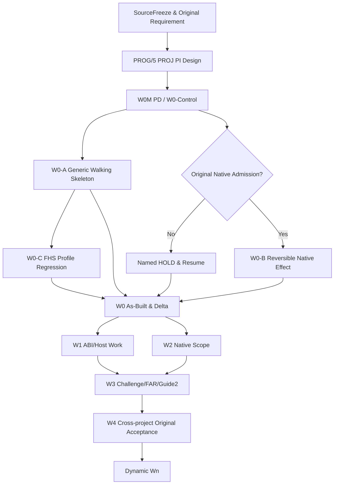

# FHS-5_PLP_總藍圖｜2026-11-21 r3｜全量升級修補・高保留完整實質正文

> **Artifact**：`FHS5-PLP/MASTER-BLUEPRINT/2026-11-21-R3`　**版本**：`2026-11-21-r3`　**日期**：2026-11-21（Asia/Taipei）  
> **作者端正式閱讀入口**：`AUTHOR_PATCH_ACTIVE_BY_EXPLICIT_USER_AUTHORIZATION / SUPERSEDES_R2_AUTHOR_SCOPE`；本稿在同一作者規劃 Subject 取代 r2（`3a016f4f6ce1c388aeb7cc3ae65d1171525dcbde9629919bfd0e1acfca925382`），r2 只作歷史來源／回歸比較。  
> **AUDIT 母本**：`FHS-5_PLP_總藍圖_r2_全域破壞性工程稽核報告_2026-11-21_r1.md`，SHA-256 `55ac547dbb18ebf5d043641c62633ba65614f0d69a926cf65327b2f943ba843f`；其 22 Finding／AR-01..16 已逐項處理或具名保留原域缺件。  
> **完整雙檔交付**：本檔只承載工程執行必需的實質正文、可執行參考程式、控制契約與可施工指令；**另一本《r3 證據型附錄》**承載全來源索引、全文檢索計數、485 完整原卡證據、破壞性測試日誌、Audit Finding 與 CR 的來源指紋。  
> **最終裁決**：`PASS_AUTHOR_PATCH_CONSISTENCY_WITH_LIMITS / FAIL_CLOSED_ORIGINAL_NATIVE_INDEPENDENT_RELEASE`。不宣稱原 PI_READY、PD_BOUND、ExecutionAdmission、Host Installed/ActualServed、Independent PASS 或 Publisher Release。  
> **核心一句話**：在不重造 Writer／Issuer／Queue／Checker 前提下，保留 r2 四層 PI→PD→Wn 小包設計、補實 56/35/485 原身份及 ABI/Body/Case 鑑別，讓後續原 Codex/Hermes **按實際合法 Scope** 完成 W0-A/W0-B，再以可觀察 Raw 受影回寫 W1～Wn。

## PATCH-0｜本 r3 的權威、修補啟用、停止條件及六步 SOP

本 r3 **不是在 r2 後追加一份平行規範**：除歷史引文外，`Wn` 唯一當期 Machine-Readable Schema 為 `WaveControl@proposal-2`；TQAEP 以 `05_PLANNED_TQAEP.md` 為當波**作者實質規範正文**、`05_PLANNED_TQAEP.json` 為 SHA 封存機器投影。r2 舊 `proposal-1` WaveControl／只驗長度 Guard 與來源不一致的成功標籤**已廢止**；機械驗證以本 r3 §22 程式為唯一作者端新增參考。`sbl-tpm-sp`／`plp-tpm-review`／Guide／External Challenge 的技能契約只提供唯讀/作者方法，不產生原世界效果；`tpm-sp-plp` alias 仍待真 Host manifest。〔AUD §4/§11、S03 §0–3、S04 §4、S06 §5、S08 §3、S12 §0、S13 §4〕

**原權威順位**：當期 User 的作者端修補授權 → 同 Subject/Scope/PolicyEpoch 的原 Effective Reader/Policy/Writer/Issuer/Checker/Publisher（對原域真實有效性）→ S03 v3.1.0 全域作者規劃 → S04/S06/S08/S12/S13 各自子域當期正文 → 討論原意與 S15/S16/r2 血緣 → 2026 Web SUPPORT。外部工具口碑不新創原 Domain Hard Gate。任何未見同範圍 Original Raw 者保持 `UNVERIFIED`，不以本 r3 MD 的「已啟用」字樣冒 Host/Native 已啟用。

**SOP 實行記錄**：① Index＝18 核心＋21 歷史本地文件和各章節；② Locate＝S03 L167–222 原 56、L819–853 T35、L888–7677 ToolNeed 485、S04/S06/S08/S12/S13 原接口及原 AUD 22 Finding；③ Full-text＝「各有／分別／對應／各自／至少／除非」、OriginalReader、Effect、SourceSHA、ToolNeed、Case/Oracle 全文命中定位；④ Cross-check＝Trace Source↔PI↔PD↔ECP↔TQAEP↔Case↔Raw↔Consumer；⑤ Split＝見 §11.7；⑥ Substance＝§06/§10/§11/§22 的真 Input/Operation/Output/Consumer/POS/NEG/FirstFail/Resume。此為作者端 Source-bound 實行；原語義仍需原 Reader，同語義不因 regex 命中自動判 PASS。

**r3 成功聲稱分帳**：SOURCE HASH、AUTHOR DESIGN、AUTHOR PACK LINKS、PLUGIN HOST INVOCATION、NATIVE WORLD EFFECT、ORIGINAL INDEPENDENT、RELEASE 七項不互相抵銷。r3 本地 test 的成功只屬前三項的受影局部；其餘必由原 Owner/Reader 真收據核銷。W0-A 的非 FHS READ 不因 FHS 485 或 W4 Release 未驗而被卡，W0-B 無原 Issuer 永不執行。

### PATCH-0.1｜22 Finding 的即時處置與效力

| AUD Finding | 嚴重度 | r3 作者修補落點 | 當前可聲稱 | 原域仍需什麼 |
|---|---|---|---|---|
| `R2-F01` | **P0** | §06/§10/§11.5/§22：單一 .md 規範＋.json 投影 | `AUTHOR_PATCHED / LOCAL_EVIDENCE_LIMITED` | `原 TQAEP Body/Reader=ORIGINAL_PENDING` |
| `R2-F02` | **P0** | §11.1/§11.5/§22：WaveControl@2；@1 僅 Legacy | `AUTHOR_PATCHED / LOCAL_EVIDENCE_LIMITED` | `原 Consumer ABI crosswalk=ORIGINAL_PENDING` |
| `R2-F03` | **P0** | §22 Guard：不接受任何 fake admission/checker/publisher | `AUTHOR_PATCHED / LOCAL_EVIDENCE_LIMITED` | `原 Verifier／Issuer 回執=ORIGINAL_PENDING` |
| `R2-F04` | **P0** | §10/§11.5/§22：未綁 Ref 只 AUTHOR_LOCAL_LINKS_ONLY | `AUTHOR_PATCHED / LOCAL_EVIDENCE_LIMITED` | `原 PI/PD/ECP Reader=ORIGINAL_PENDING` |
| `R2-F05` | **P0** | §11.5/§22：Manifest/MD/TQAEP Scope＋SHA join | `AUTHOR_PATCHED / LOCAL_EVIDENCE_LIMITED` | `原 Host Consumer=ORIGINAL_PENDING` |
| `R2-F06` | **P1** | §01/§22：CORE16 pinned set 與 SELECTED_ONLY 分帳 | `AUTHOR_PATCHED / LOCAL_EVIDENCE_LIMITED` | `原 PIPD semantic reader=ORIGINAL_PENDING` |
| `R2-F07` | **P0** | §20.4；附錄 E5：485/485 ID 原名與原卡原文 | `AUTHOR_PATCHED / LOCAL_EVIDENCE_LIMITED` | `ToolSlot Reader/HostFit=ORIGINAL_PENDING` |
| `R2-F08` | **P1** | §20.3；附錄 E4：T01～35 原五欄具名保全 | `AUTHOR_PATCHED / LOCAL_EVIDENCE_LIMITED` | `每工具原 Owner Fit/License=ORIGINAL_PENDING` |
| `R2-F09` | **P1** | §02.4；附錄 E3：U-001～056 原五欄實質完整投影 | `AUTHOR_PATCHED / LOCAL_EVIDENCE_LIMITED` | `逐原子 OriginalReader/Case=ORIGINAL_PENDING` |
| `R2-F10` | **P1** | §11.5/§22/§24：Case/Oracle/Fixture/Raw 逐件來源連結 | `AUTHOR_PATCHED / LOCAL_EVIDENCE_LIMITED` | `原 CaseRunner/Checker=ORIGINAL_PENDING` |
| `R2-F11` | **P1** | §11.6/§22：封存離線 Source bytes；BodyResolver 兩路 | `AUTHOR_PATCHED / LOCAL_EVIDENCE_LIMITED` | `跨三 Host 真可回取與 ACL=ORIGINAL_PENDING` |
| `R2-F12` | **P1** | §04/§11.6：Human/Issuer/Checker RoleBinding 分帳 | `AUTHOR_PATCHED / LOCAL_EVIDENCE_LIMITED` | `原 Policy/SoD Reader=ORIGINAL_PENDING` |
| `R2-F13` | **P1** | §12/§15：Host Installed/Bound/Invoked/ActualServed 分帳 | `AUTHOR_PATCHED / LOCAL_EVIDENCE_LIMITED` | `Host 原 Loaded／Invocation Raw=ORIGINAL_PENDING` |
| `R2-F14` | **P1** | §23/§24：CI 自測與 affected-pack checks 分開 | `AUTHOR_PATCHED / LOCAL_EVIDENCE_LIMITED` | `原 Repo required-check/CI 收據=ORIGINAL_PENDING` |
| `R2-F15` | **P1** | §19/§23：SLSA v1.2 SUPPORT，v1.1 legacy | `AUTHOR_PATCHED / LOCAL_EVIDENCE_LIMITED` | `原 Builder/Verifier 版本=ORIGINAL_PENDING` |
| `R2-F16` | **P1** | §12/§24：W0-A/B/C 分帳，不冒 E2E | `AUTHOR_PATCHED / LOCAL_EVIDENCE_LIMITED` | `原 Native/Runner 真 Raw=ORIGINAL_PENDING` |
| `R2-F17` | **P2** | §11.5/§22：動態 W0..Wn prompt 路徑測試 | `AUTHOR_PATCHED / LOCAL_EVIDENCE_LIMITED` | `真 Wn Host=ORIGINAL_PENDING` |
| `R2-F18` | **P2** | §19/§20：雙來源方法，License/HostFit 未核保持 UNVERIFIED | `AUTHOR_PATCHED / LOCAL_EVIDENCE_LIMITED` | `原 Tool/Legal Owner=ORIGINAL_PENDING` |
| `R2-F19` | **P1** | §01/§26；附錄 E1/E2：歷史缺 bytes 與 skipped 對話明示 | `AUTHOR_PATCHED / LOCAL_EVIDENCE_LIMITED` | `Files/Source Reader=ORIGINAL_PENDING` |
| `R2-F20` | **P1** | §05/§11.7/§24；附錄 E6：受影雙向 Trace 欄位及 orphan 反例 | `AUTHOR_PATCHED / LOCAL_EVIDENCE_LIMITED` | `原 PI/PD/Case Reader=ORIGINAL_PENDING` |
| `R2-F21` | **P1** | §12/§13/§24：W0 專測全鏈 vs 日常按需適用 | `AUTHOR_PATCHED / LOCAL_EVIDENCE_LIMITED` | `原 Program/Host=ORIGINAL_PENDING` |
| `R2-F22` | **P2** | §22/§23：禁隱式 cwd 提取，只有顯式授權輸出根 | `AUTHOR_PATCHED / LOCAL_EVIDENCE_LIMITED` | `原 Repo OutputRoot ACL=ORIGINAL_PENDING` |

**判斷限制**：`AUTHOR_PATCHED` 僅表示本 r3 已實際把對應資料字典／案例／腳本寫入並做作者端破壞性回歸；對 AUD F11/F12/F13/F16/F18/F19 等需要原 Host、政策、下載/License 或歷史完整 bytes 的項目，**仍為具名 CR_OPEN，無法在純文件修補中宣稱全部 Original PASS**。這是嚴格滿足 AUD 的封閉式處置，而非假稱已接上不存在的權限或執行器。

## 00｜五分鐘閱讀契約與總裁決（r3 保留 r2 設計並受 PATCH-0 優先覆蓋）

**作者端架構裁決：採用「總藍圖 → PROG-00／PROJ-01～05 → W0M～WnM → W0～Wn 執行控制小包＋薄 PROMPT」四層架構。** `PROG/PROJ` 主要承載 PI 設計，`WnM` 主要承載波次 PD 設計，`Wn` 主要承載當波 ConstructionContract、DEV／OPS ECP、Planned TQAEP 和執行控制。Codex／Hermes 只需從**當波小包＋相應 ThinStart／ThinResume** 入場，但小包必須能無損定位受影原 PIPD 來源、原 Consumer、原 Scope、原權限與原 Case；其真正計畫、建造、測試、修復、回復由**現有有權 Native Runtime** 執行，不增加一套第五方之外的新 Issuer／Queue／Scheduler／Checker／Publisher。〔S03:L230–L274；S06:L232–L260；S01:L2006–L2017〕

**W0 首要 FUO**：在一個最小、合法、可否證的 Slice 上，取得至少一次「Source/PI/PD → Guide 薄啟動 → Bridge 唯讀 Context → 原 Executor 的受界操作與可重現 Raw → External Challenge 獨立反證 → FAR（可用才跑）／Guide 續行候選」的可觀測交接。分成 `W0-A LOCAL WALKING SKELETON` 和 `W0-B AUTHORIZED NATIVE VERTICAL SLICE`，兩者**各自驗收**；未有原 Admission，W0-B 只能 `BLOCKED_BY_ORIGINAL_AUTHORITY`，不影響合法 W0-A。W0 結果以 `AffectedDelta` 回寫 W1～Wn，不能原樣複製整個 W0 報告。〔S03:L232–L238、L276–L289；S04:L88–L117；S13:L775–L837〕

**效力與原域硬邊界**：PI 作者完整 ≠ 原 PIPD `PI_READY`；PD 設計 ≠ 原 `PD_BOUND`；ECP 是約束而非許可；Planned TQAEP／Local Test／CI PASS ≠ 原 Independent PASS；Skill 已讀 ≠ 已在 ChatGPT、Codex、Hermes 三 Host 實際 Loaded／Invoked／Verified；`W0 scoped close` ≠ 所有 FHS 原域功能結案。原使用者是唯一 Human Owner，但不因此取代原技術 Principal／原 Reader／Issuer。〔S03:L11–L41；S04:L10–L30；S06:L12–L20〕

**最短閱讀**：§00/§01 來源與效力 → §02 需求／FUO → §03 跨源裁決 → §04–§05 三 SPEC → §06 文檔樹 → §07–§08 PROG／五 PROJ → §09 WnM → §10 Wn 小包 → §11 版本化 ABI → §12 W0 → §13 W1～Wn → §14 檢驗／安全 → §15 HOLD → §16 成果回寫 → §17 可交付施工順序 → §18 範本／機械驗證 → **§19–§21 r2 整合的 Web／工具基線，§22–§26 r3 修補後的現行 Guard／CI／驗收／機器契約**。

### 00.1 來源符號與不造假原則

- `S01`～`S16` 為十四份核心 FHS-5 文件、`S15` 為前輪鑑定報告、`S16` 為 r1 總藍圖；十六份均是本次**直接讀取的實際附件檔案**；下文 `[Sxx:Lnn–Lmm]` 指其 `UTF-8-sig` 解碼後按 `splitlines()` 的 1-based 行號，SHA 是對**原上傳檔案 bytes** 計算。討論匯出中的 `Prompt` 用於復原 User 原意，舊 Assistant 回答僅是待交叉核的歷史意見。
- `P0`：當期 User 明確任務＋本對話前輪《FHS-5_PLP_總藍圖｜整合研究、交叉比對、工程鑑定暨文檔包總體規劃報告》。前輪是當期**規劃輸入**，不是已發布的 Canonical PIPD 或 Host 收據。
- `Original`：同 Subject／Scope／Host／PolicyEpoch 的原 PIPD／Fabric／HGK／專案有權 Writer、Reader、Issuer、Checker、Consumer、Publisher。所有引用 `Original` 的設計均要在後續原系統讀回；本輪未取得這些真回執。
- `PROPOSED` 表示本總藍圖**新增候選資料契約或工作包**，不是宣稱五份子系統已有相同 schema 或正式版本。`UNBOUND` 是誠實狀態，不代表功能必然不存在；未知的 `OriginalID` 不得由本文件自行發明。
- **無源硬 Gate 禁止**：任一新強制前件必須可逆追至 P0 當期授權、原 PI Requirement／Original Safety Policy 或同 Scope 原 Reader；否則先記 `OVER_GOVERNANCE_CANDIDATE` 並只停止受影效果。`SOURCE_READ` 不因未來的 W4 發布門檻被阻斷。〔S03:L15–L37；S04:L88–L117〕

## 01｜Inputs Manifest、版本與權威

### 01.1 直接讀取的十六份核心輸入及位元身份

本輪 16 份核心輸入的原 SHA-256、bytes、行數全部按本次實際掛載檔案重新計算，不使用文內引用上一版 SHA 代替本檔 SHA。以原檔是否可用、原句/段、版本和當期範圍判定來源，不以同名檔、日期或「最新」字樣升格。

| ID | 文件名稱（本輪直接讀取） | Bytes | 行數 | SHA-256 |
|---|---|---:|---:|---|
| `S01` | `FHS-5 v3.0.0_討論.md` | 179,705 | 3,156 | `f198c4f6962f1d2bc079ab9f6aa3db9864c27904b52b750b4f03c0b7ad3b1ac1` |
| `S02` | `FHS-5 聯合工程閉環_討論.md` | 146,946 | 2,756 | `6534aa7ab9212ea497c31527ed6f3d17912ccd73e81b9d08141189d6c57b124a` |
| `S03` | `FHS-5_v3.1.0_藍圖.md` | 2,294,766 | 8,295 | `8df906759ff6c2e941dfe13f9a36535283aed70807e657050d5b3cd9b83f341b` |
| `S04` | `FHS_審查型_TPM-SP_外掛_2026_全量升級修補藍圖_v2.1.0_實質正文_2026-11-19.md` | 104,499 | 1,216 | `2570b4bdeccac6e718b9b761e04ba82623bde9d531796e28eb381ae3137f1de1` |
| `S05` | `審查型 TPM-SP 外掛_討論.md` | 196,709 | 4,692 | `639fe7704e681e3ed43dd2bbe542fd0c95cb71be3b4d2c9bcf52506296e4873c` |
| `S06` | `FHS-5_Commander_Guide_PLP_藍圖_2026-11-21_r2_完整實質正文.md` | 453,289 | 1,628 | `593bced02f06b5b8d856c796df8c7c204047edfddff220ef9ceee61123774d91` |
| `S07` | `Commander Guide_討論.md` | 76,123 | 1,449 | `5ddfbdbd8fffbc09317d02270db192bb9b76d51f46e24afcb80ad7012a29bf34` |
| `S08` | `PLP-Contract-Bridge_全量升級修補_完整實質正文_v1.1.0_2026-11-21(1).md` | 2,252,801 | 8,313 | `0a37ce485ab4fa7101230c83f244d7bf9da546226637b47cb968598bcdf9cfa6` |
| `S09` | `Contract-Bridge_討論.md` | 79,067 | 1,486 | `4befe1322a9d936c39a25b6dac9da68a12bc97bdaa1a1e00cef82f27ce9e6827` |
| `S10` | `FHS-5_External Challenge-S_規劃報告.md` | 37,286 | 705 | `ac6d2e38bfc8c8b22753ae38bf714ef1fb68e3194ed43a23adf5a5f2b7021b36` |
| `S11` | `FHS-5_External Challenge-SP_PLP_方案_2026-11-20.md` | 34,391 | 338 | `cb09d1ffa6c610f22c45a3d67a4a537b93fe7b7bc54b0b0a8ce39cfd65a76bb6` |
| `S12` | `FHS-5_External Challenge-SP_PLP_v2.0.0_全量升級修補_完整實質正文_2026-11-21(1).md` | 2,281,629 | 8,527 | `e563f6c4a2ab28d70ea71a7877a9abc6dd2d570d145631a47e3a59671ba690a8` |
| `S13` | `FHS-5_FAR_PLP_完整可落地整合藍圖_v1.1.0_2026-11-21_實質正文(1).md` | 2,362,052 | 9,101 | `1e294e0f13d97bb4c6a2bd420964883456940262e3ae2ba626eefcb0ed02b029` |
| `S14` | `FHS5-FAR_討論.md` | 82,553 | 1,667 | `46a1aa7c09ee603e586b68af8beaad1c0f9474037a15e310094470398a64bcec` |

### 01.2 來源職能與裁決順位

1. **當期使用者對本輸出和已確認的決策**：只決定作者端規劃的目標、格式、範圍與非目標。
2. **同 Subject／Scope／PolicyEpoch 的原 Canonical／原 Policy／Original Reader**：唯一能裁定原 Requirement、PI／PD／Effect／Admission／Checker／Publisher 的真正效力；本次原 Host 未讀回。
3. **FHS-5 v3.1.0（S03）**：五方共同的當期**作者端**整合設計基準。v3.0.0 及 v2 內容不再與其平行作當期作者規範。〔S03:L1–L19〕
4. **各職能當期正文**：S04 Reviewer v2.1.0、S06 Guide r2、S08 Bridge v1.1.0、S12 External Challenge v2.0.0、S13 FAR v1.1.0，分別在其產品作者設計範圍內適用；子專案正文不得覆寫 FHS-5 全局或原 Domain 權限。
5. **歷史討論與被取代方案**：S01/S02/S05/S07/S09/S10/S11/S14，用於追使用者原意、矛盾、修補原因、歷史實驗與相容性；原有仍適用義務不可靜默刪除，但不能把舊 `proposal-1` 當當期 `proposal-2`。
6. **技能契約**：本次實際讀取 `sbl-tpm-sp` 的 `tpm-sp / tpm-product-plan / tpm-system-plan / tpm-program-plan / tpm-setup / pipd-authority-source / pipd-pi-compile / pipd-pd-bind / pipd-execution-contract / pipd-assurance-tqaep / pipd-package-project / tpm-handoff`；這些提供來源綁定與作者規劃方法，**不是本次已完成 Canonical 編譯或原域運作的證明**。

### 01.3 六個舊檔職能與今版原意的正反校正

| 主題 | 可確認的原意／修正 | 本版禁止的錯誤延伸 | 來源定位 |
|---|---|---|---|
| 通用型定位 | 跨專案 Portable PLP Core；FHS 專屬是 Profile | 非 FHS 專案強制 22 WP／36 Edge／485 Need | S01:L743–L790；S03:L230–L238 |
| FHS-M／Mini | 幫 Agent 唯讀解讀當波 PI/PD/ECP/TQAEP 與接口 | 把 Bridge 變第二個自主工程／派工引擎 | S01:L2006–L2017；S03:L264–L274 |
| Reviewer | 以 A～F 六軸／七步／F01–F14 審查，產 FindingRouter | 自行簽原 PI/PD／獨立驗收 | S04:L32–L118 |
| Guide | 只做初次 ThinStart 與 FAR 之後 ThinResume | 與原 `sbl-commander-sp`／Native Principal 混同 | S06:L12–L20、L232–L260 |
| Challenge | Frozen Candidate／Oracle／Evidence，可否證真 Raw | `PASS` advisory 當 Protected Checker PASS | S10:L21–L82；S12:L1–L21 |
| FAR | Finding＋WorldRaw→有源 RootCause／Alternative／十 Advice | 自報 JSON success、缺源視為 ZERO、用 FAR CLOSE 發行 | S13:L102–L174 |

### 01.4 最新子系統設計與真實現況**分帳**

| 子系統 | 作者端最新設計/本地結果（**來源自報，非本輪重跑**） | 本次無權主張的原域狀態 |
|---|---|---|
| FHS-5 全體 | v3.1.0 `AUTHOR_DESIGN_REPAIR_INTEGRATED`; 原 Bridge local 38/38 | `HOST_PENDING`, `NATIVE_NOT_RUN`, `RELEASE_FAIL_CLOSED`〔S03:L1–L9〕 |
| Reviewer | v2.1.0 `DESIGN_REPAIR_COMPLETE_FOR_REVIEW_HANDOFF` | 原 Reviewer Plugin release／原 QA26 全功能驗證未確認〔S04:L1–L16〕 |
| Guide | r2 `LOCAL_REFERENCE_50_OF_50_PASS` | ChatGPT／Codex／Hermes 真 Loaded／Invoked／ActualServed 未取得〔S06:L1–L20〕 |
| Contract-Bridge | v1.1.0 原38＋新28＝本地66/66 | Original Reader、Host ActualServed、Native E2E／Independent 未綁〔S08:L1–L20〕 |
| External Challenge | v2.0.0 本地47/47 | Original Runner、C16、Native／Independent 未取得〔S12:L1–L21〕 |
| FAR | v1.1.0 本地35/35 | 原 Fabric Patch 未套用、原三源與正式 Checker／Publisher 未驗〔S13:L1–L20〕 |

**證據缺口**：十六份核心來源正文內引用的各自「證據型附錄」、AUDIT 母本、Original Case／Reader 真收據及原 Repo/Host 不全包含在本次指定檔案集合。相應項只能列 `REFERENCED_NOT_REOPENED / ORIGINAL_UNVERIFIED`，**不能以摘要或對話敘述替代原 Raw**。其完整性和有效版本是後續 M0 的真解除條件。

### 01.5 r2 血緣保留：前輪鑑定與 r1 實質正文的位元身份（現行整合）

| ID | 檔名 | Bytes | 行數 | 原 SHA-256 | Authority/Status |
|---|---|---:|---:|---|---|
| `S15` | `FHS-5_PLP_總藍圖｜整合研究、交叉比對、工程鑑定暨文檔包總體規劃報告.md` | 48,847 | 887 | `b5296d87324e13d1989225e9631c4ac7bfdc4ad3b1a3a2fa1e5abb0b4bfd8587` | **FOUND／作者規劃輸入，非原域 Canonical** |
| `S16` | `FHS-5_PLP_總藍圖_2026-11-21_r1_完整可執行實質正文.md` | 111,773 | 1,145 | `24a472f2e9d4003f1ba3b34cf06f0652c7e2338281a6333bae53be64ec55cade` | **FOUND／作者規劃輸入，非原域 Canonical** |

- `S15:L66–L81` 四層架構及四條不可混淆的權限／證據邊界；`S15:L129–L144` 六個閉環根因；`S15:L538–L641` W0-A/B 與新正反案例；`S15:L839–L880` 結論及作者效力。**S15 是前輪研究裁決／Support-Author，不是新的 Original PIPD 有權標準**。
- `S16:L1–L26` r1 文別、原設計與效力；`S16:L34–L49` 前輪 14 源 SHA；`S16:L98–L125` 24 條候選新 Requirement；`S16:L644–L765` W0 十四 WP、24 案例與 A/B/C 分帳；`S16:L874–L893` 16 個 CR；`S16:L1008–L1095` r1 檢核參考程式。r2 **保留 r1 的實質設計主幹**，但由下述新增章節把原來缺少的 Web 雙源、原始檔案缺件、執行代碼、事件／降級／機器資料補實。
- **歷史版本 supersession**：在原 r2 發行時，r2 曾在 `FHS-5_PLP/MASTER-BLUEPRINT` 的作者規劃範圍取代 r1；**本 r3 現行作者版已再取代 r2**；不更改任何 S01～S14 原產品當期效力，不替換原 Domain Reader。所有原字節、舊案、受影要求保留於其原檔及本稿引用；r1 不與 r2 平行充作兩份 CURRENT。

### 01.6 本頁及歷史附件的完整脈絡處置

本頁直接使用者決策：①先讀取／掛載／待命、唯讀不施工；②明確指定 `sbl-tpm-sp`；③14 份 FHS-5 文檔的五方全系；④ `PROG-00／PROJ-01～05／W0M～WnM／W0～Wn` 四層；⑤ PI、PD、DEV／OPS ECP／TQAEP 分位；⑥ Codex／Hermes 僅從當波小包＋薄 Prompt 入場；⑦ W0 用指定四技能做 Vertical Slice/Walking Skeleton；⑧ W0 真差額回寫；⑨先前 r1 MD 整合與一份可下載工件；⑩本次要求外部官方＋社群雙源、可實行程式／CI、權限與降級矩陣，以及內嵌 `machine_summary.json / change_plan.tsv / checkrun_contract.tsv`。上述約束不以「先前僅 16 prompts」而刪減。

**非本次核心 14 份但在本頁歷史上傳的基準**：`PIPD_LS_DOC-00..09`（其 DOC-01 權威、DOC-02 PI、DOC-03 PD、DOC-04 Trace、DOC-05 Admission、DOC-06 Profile、DOC-07 Oracle/Fixture、DOC-08 Adapter、DOC-09 CI/Release）；FHS_vNEXT 的 L0/L1/L2、W0/W1/W2、R9/R3／Handoff 等。它們作為來源血緣／原型案例 **HISTORICAL_SUPPORT_ONLY**，不能把 **FHS_vNEXT W0** 的 Scoped Close 複寫成 **FHS-5_PLP W0** 的 PASS，不能把 `L2 E01–E36` 跟局部 `E-01–E-18` 同名攪混。詳 §19.2 的附加附件矩陣。

任何未在這次原域重讀的 `Original PIPD/Fabric/HGK/Issuer/Checker/Host` 狀態皆 `MISSING_ORIGINAL_LIVE_RECEIPT`；舊文件中出現的 `CURRENT/PASS` **只對其當時所聲稱的文檔或作者 Scope 有效**，不自動遷移至本新 Project。

## 02｜Product SPEC：身份、用戶、JTBD、FUO、非目標與可否證結果

### 02.1 產品身份與目標

`FHS-5_PLP` 是**五方聯合工程閉環的分層 PLP 文檔交接體系**，其職能是把來源綁定的「該做什麼／何以正確」編成可維護的 PI 設計，把「在真環境如何合法做到」綁成逐波 PD，再把現有執行器真正需要的作用域、原 ECP／TQAEP、停復與交付證據下沉為當波小包；既不取代 PIPD 原 Writer，也不接管 Native Executor。〔P0；S03:L230–L274〕

**Persona**：唯一 Human Owner；產品／System／Program 作者；原 PIPD Writer/Reader；波次 Curator；有權 Repo/Host Native Developer；Guide/Bridge Context 消費者；External Challenger；FAR Researcher；原 Independent Checker／Consumer／Publisher。

**JTBD**：對一個來源可信、可界定 Subject/Scope 的 PLP 專案，減少巨大上下文負擔、錯誤解讀、過度前件及無限重審，使本有權的 GPT／Codex／Hermes 能按受界 Slice 合法完成 PLAN／BUILD／RUN／FIX／REVERIFY／DELIVER，並產可被原 Consumer 實際接收的真證據。

**FUO-1（通用 READ）**：一份非 FHS PLP 在合法來源上完成原子要求及 Guide→Bridge 唯讀 Context，正確呈現 `SOURCE_ANCHORED_LOCAL` 與缺原 Reader 時 `UNBOUND`，不得要求 FHS ToolNeed/Host。**FUO-2（Local Skeleton）**：W0-A 至少一個 Frozen Candidate 的受影文檔與結果交接、POS＋NEG／Raw hash、Challenge Finding、Resume 可重播。**FUO-3（Native Slice）**：在真有權原 Native 環境取得有效 Admission 後，執行至少一個可逆、受界的 DEV 或 OPS effect、World/Repo readback 與獨立 Challenge；沒 Admission 則 `NOT_ATTEMPTED_BY_AUTHORITY`，不可自動降為假 PASS。**FUO-4（閉環收斂）**：FAR 根據真 FirstFail／Delta／Raw 指定最小合法原 Owner 操作，Guide 續行不重派等價測試。**FUO-5（跨專案）**：非 FHS、FHS Profile 各自真追溯，不混用原 IDs 和義務分母。〔S03:L232–L289；S13:L139–L174〕

**非目標**：一鍵全自動跨原權限；建立第二個 PIPD Compiler、Issuer、Original Checker、Hermes queue；要求 W0 同時完成五份產品的 Release；將全部 485 ToolNeed 裝在非 FHS 專案；讓作者自己簽驗收；在本次任務執行原 Repo／Host 工程。〔S03:L236–L238；S04:L12–L16〕

### 02.2 最小產品要求（本次新命名的候選 `F5PLP-REQ-*`，非原 RequirementID）

| ID | 具體功能／結果 | POS：可觀測證據 | NEG：必拒／保留的缺口 | 來源 |
|---|---|---|---|---|
| R01 | 全十六份核心來源位元與版本索引 | 每檔真 SHA/bytes/章定位 | 同名檔取代不同 SHA | S03 §0–2；P0 |
| R02 | 原 User 複合子義守恆 | Parent/Child/NEG/例外逐項映射 | 缺 B 卻全項 PASS | S03 §2；S04 §2–4 |
| R03 | Product／Architecture／Program 三 SPEC 分立 | 各有 JTBD、ADR、DAG/ACC | 只有標題/表格 | sbl-tpm-sp；S04 §2 |
| R04 | 原 Canonical/Reader 單寫入者 | 真 OriginalRef／Reader 狀態 | sidecar 冒 Canonical | S03 §0.3；S04 §1 |
| R05 | 五方原責任及兩 Guide 觸點 | 跨方 I/O/Consumer 可追 | Guide 派工、Bridge 直接寫 Host | S03 §3；S06 §5 |
| R06 | PROG/PROJ/WnM/Wn 四層可導航 | 原 Requirement→小包雙向可達 | 只靠全文貼歷史 | P0；S03 §12 |
| R07 | PI→PD late-binding | Repo/Host 真 Probe＋來源契約 | 假 HEAD／Caller 字串當 Fresh | sbl-tpm-sp pipd-pd-bind |
| R08 | DEV/OPS ECP 分 Effect | Pre/Post/WriteSet/Readback/Recovery | ECP 自授 Grant | sbl-tpm-sp execution-contract |
| R09 | Planned TQAEP 正負實體 | Case/Oracle/Fixture/ExpectedRaw/Checker | Mock ACK 冒 Independent | S04 §4；sbl-tpm-sp assurance |
| R10 | Guide 薄 Prompt 可回取 | SourceSHA/Scope/Next/Stop/Resume | Prompt 改 Scope 或真權限 | S06 §5–6 |
| R11 | Bridge 四 API 與版本交接 | Context 原 Span／候選 URI/ID | regex Candidate 冒 OriginalID | S08 §3/§6 |
| R12 | Hermes/Codex 原 Native 有權施工 | 真 WorkID/Admission/Preimage/Raw | 無 Permit 卻 DEV/OPS | S03 §3/§7 |
| R13 | External frozen 反證 | Candidate/Oracle/Evidence SHA + cmd/exit/raw | 浮動分支及自改 Oracle | S12 §3/§9 |
| R14 | FAR 研究及十 Advice | Raw→假說/反證/方案/Owner | 來源 unavailable 當 ZERO | S13 §4–6 |
| R15 | 同 FirstFail 的受影回歸 | 真 Delta 綁 Repo/Source/Raw | 無新 Delta 無限重試 | S13 §5；S04 §4 |
| R16 | Generic／FHS Profile 分離 | 非FHS READ 不依賴 22/36/485 | 直接新增通用 FHS gate | S03 §3/§8–10 |
| R17 | 原測例與工具分母分帳 | Reviewer QA26、Guide SEM17、Challenge C16 等不抵銷 | local tests 統計成 Original PASS | S03 §13；S06 §13；S13 §12 |
| R18 | Capability 分階段證明 | SELECTED/INSTALLED/BOUND/INVOKED/VERIFIED 逐 Host | 安裝/選型冒 ACTUAL_SERVED | S03 §0；S06 §13 |
| R19 | 可逆回退與 LastGood | 依 READ/DRAFT/DEV/OPS 不同恢復 | git revert 冒 Host Recovery | S06 §5.5；S13 §16 |
| R20 | 作者／Native／Independent／Release 分帳 | 每 Claim 對原 Consumer/Raw | CI 綠宣 Mission Complete | S03 §0.2；S04 §17 |
| R21 | 受影最小變更與雙向追溯 | Delta 指向原 Owner/Case/Next | 新硬 Gate 無 OriginalRef | S04 §4；P0 |
| R22 | 四插件 W0 Walking Skeleton | 真讀取／交接／Call／Raw | 只列插件名稱就稱接通 | P0；S03 §12 |
| R23 | 安全停復與必要權限 | UNKNOWN 停重試並 Reader reconcile | 以 User 指令冒 OS Principal | S13 §16；sbl-tpm-sp |
| R24 | 可生成下游可施工文檔包 | 每種工件模板、責任、DoD、失敗條件 | 只有文件名，無 I/O | P0；S04 §8 |

### 02.3 Product Acceptance 分層

A：來源／設計候選 `DESIGN_MATERIALIZED`；B：Source-to-PI/PD/ABI 的作者一致性 `AUTHOR_CHECKED`；C：真 Plugin/Host 載入及 Runtime 的 `INVOCATION_OBSERVED`；D：具 OriginalAdmission 的可逆 Native `EFFECT_READBACK_OBSERVED`；E：原不同簽署者 Checker／Consumer 真受理 `ORIGINAL_ACCEPTED`；F：原 Publisher 發布 `RELEASED`。這些是**報告分類**，不可用作新 Canonical Lifecycle State。

### 02.4 原 U-001～U-056 五欄實質原意守恆與逐項負例（r3 修補）

本表逐字保全 S03 `FHS-5_v3.1.0_藍圖.md` L167–L222 **五個原欄位的完整實質內容**：原 ID／可否證子義／原始來源定位／前版狀態／當期工程處置及負例。每行的對應 SourceSpan 為 `S03:Lnn`；欄中的歷史 `Source` 再回指討論原文；本表僅為作者端來源投影，非 OriginalReader 批准。複合「各有、分別、對應、各自」須以 Parent/Child/NEG 逐項由原 PI Reader 確認；本表不捏造 CaseID 或原 Receipt。〔S03:L162–L226；AUD §5.1／R2-F09〕

| 原 ID | 原可否證子義 | 真原始來源定位 | 前版狀態 | v3.1 工程處置／NEG（原文完整保留） | S03 原文行 |
|---|---|---|---|---|---|
| `U-001` | 上游設計／實作／驗收誤判根因不可歸罪證據本身 | `FHS-5 聯合工程閉環_討論.md:L9–20` | `DESIGN_PARTIAL` | `AUTHOR_SPEC_PRESERVED`；需按原 Subject/Scope 規定 POS/NEG；不自簽；**NEG**：仍缺真 Repo/World 狀態與因果鏈實際示例 | S03:L167 |
| `U-002` | 可掛載現有 Reviewer、但不能把 Reviewer 當指揮或簽發 | `FHS-5 聯合工程閉環_討論.md:L9–20` | `DESIGN_PARTIAL` | `AUTHOR_SPEC_PRESERVED`；需按原 Subject/Scope 規定 POS/NEG；不自簽；**NEG**：應驗原 Plugin Identity/Host alias | S03:L168 |
| `U-003` | Commander 對外完全零治理，不建第二總 Gate | `FHS-5 聯合工程閉環_討論.md:L796–813` | `DESIGN_COVERED` | `AUTHOR_SPEC_PRESERVED`；需按原 Subject/Scope 規定 POS/NEG；不自簽；**NEG**：真 Guide Skill 權界合理 | S03:L169 |
| `U-004` | Commander 對內品質自檢但不混原域 Gate | `FHS-5 聯合工程閉環_討論.md:L796–813` | `PARTIAL` | `AUTHOR_SPEC_PRESERVED`；需按原 Subject/Scope 規定 POS/NEG；不自簽；**NEG**：只有格式無 selfcheck 實作和反例 | S03:L170 |
| `U-005` | 復用既有 SBL Commander Guide 而非新造 Agent | `FHS-5 聯合工程閉環_討論.md:L796–813` | `DESIGN_COVERED` | `AUTHOR_SPEC_PRESERVED`；需按原 Subject/Scope 規定 POS/NEG；不自簽；**NEG**：Skill 文字被使用，但未 Host Load | S03:L171 |
| `U-006` | 前端 TPM 產出 Product SPEC | `FHS-5 聯合工程閉環_討論.md:L1290–1315` | `DESIGN_COVERED` | `AUTHOR_SPEC_PRESERVED`；需按原 Subject/Scope 規定 POS/NEG；不自簽；**NEG**：無一個受影真非FHS輸出證據 | S03:L172 |
| `U-007` | 前端 TPM 產出 Architecture SPEC | `FHS-5 聯合工程閉環_討論.md:L1290–1315` | `DESIGN_COVERED` | `AUTHOR_SPEC_PRESERVED`；需按原 Subject/Scope 規定 POS/NEG；不自簽；**NEG**：原域 ABI 仍 unbound | S03:L173 |
| `U-008` | 前端 TPM 產出 Program SPEC 與 WorkPackage | `FHS-5 聯合工程閉環_討論.md:L1290–1315` | `DESIGN_COVERED` | `AUTHOR_SPEC_PRESERVED`；需按原 Subject/Scope 規定 POS/NEG；不自簽；**NEG**：新 WP 不能改原 L2 DAG | S03:L174 |
| `U-009` | PI→PD 需追 OriginalID/Parent/Child/NEG/Exception | `審查型 TPM-SP 外掛_討論.md:L2711–2730` | `PARTIAL` | `AUTHOR_SPEC_PRESERVED`；需按原 Subject/Scope 規定 POS/NEG；不自簽；**NEG**：View 宣告有 requirements，但程式無此欄 | S03:L175 |
| `U-010` | Reviewer 對 PI 與 PD 各別審查且雙向反證 | `審查型 TPM-SP 外掛_討論.md:L3350–3370` | `PARTIAL` | `AUTHOR_SPEC_PRESERVED`；需按原 Subject/Scope 規定 POS/NEG；不自簽；**NEG**：只宣稱沿用原 Reviewer；沒有 v3 受影實例 | S03:L176 |
| `U-011` | PI 缺必要 A 或 B 必拒，禁止合併 PASS | `審查型 TPM-SP 外掛_討論.md:L3669–3695` | `FUNCTION_MISSING` | `AUTHOR_SPEC_PRESERVED`；需按原 Subject/Scope 規定 POS/NEG；不自簽；**NEG**：本地核心無 semantic atomizer | S03:L177 |
| `U-012` | PD 無原 PI 或安全規則的 Hard Gate 必打出 | `審查型 TPM-SP 外掛_討論.md:L3669–3695` | `PARTIAL` | `AUTHOR_SPEC_PRESERVED`；需按原 Subject/Scope 規定 POS/NEG；不自簽；**NEG**：無逆向 PD clause graph 實作 | S03:L178 |
| `U-013` | DEV ECP 的實作可達/RepoContext/PrePost各別檢查 | `審查型 TPM-SP 外掛_討論.md:L2040–2064` | `PARTIAL` | `AUTHOR_SPEC_PRESERVED`；需按原 Subject/Scope 規定 POS/NEG；不自簽；**NEG**：只留 Effect 文字與 Expected，無 per-slice ABI | S03:L179 |
| `U-014` | OPS ECP 的 Host/OS Principal/Recovery 必須各自檢查 | `審查型 TPM-SP 外掛_討論.md:L1607–1619` | `PARTIAL` | `AUTHOR_SPEC_PRESERVED`；需按原 Subject/Scope 規定 POS/NEG；不自簽；**NEG**：真 Host fixture/reader 缺 | S03:L180 |
| `U-015` | TQAEP 每 Case POS/NEG/Oracle/Raw/Checker 能觀測 | `審查型 TPM-SP 外掛_討論.md:L1607–1619` | `PARTIAL` | `AUTHOR_SPEC_PRESERVED`；需按原 Subject/Scope 規定 POS/NEG；不自簽；**NEG**：Planned vs Tested 分帳正確；原 Raw 未跑 | S03:L181 |
| `U-016` | 先查 DEV→OPS→TQAEP 原根因而非永續補文檔 | `審查型 TPM-SP 外掛_討論.md:L2040–2064` | `DESIGN_PARTIAL` | `AUTHOR_SPEC_PRESERVED`；需按原 Subject/Scope 規定 POS/NEG；不自簽；**NEG**：缺真的受影失敗樣本 Case 配對 | S03:L182 |
| `U-017` | 三 Host 必須分別 ChatGPT、Codex、Hermes 可掛載 | `FHS-5 v3.0.0_討論.md:L2006–2017` | `HOST_IMPL_MISSING` | `HOST/ORIGINAL_PENDING`；當期原 Reader／Runner／Consumer 收據，無則受影 HOLD；**NEG**：只見提案 Host Facade 路徑、無三份完整實作 | S03:L183 |
| `U-018` | Bridge 可讀 PI 本體並可指出子義 | `FHS-5 v3.0.0_討論.md:L2006–2017` | `FUNCTION_MISSING` | `BRIDGE_LOCAL_CLAUSE_IMPLEMENTED`；須原 Reader 判原需求語義，缺件列 `UNBOUND`；**NEG**：僅 headings；無 PI Clause 內容輸出 | S03:L184 |
| `U-019` | Bridge 可讀 PD 本體及對 PI 的差額 | `FHS-5 v3.0.0_討論.md:L2006–2017` | `FUNCTION_MISSING` | `BRIDGE_LOCAL_CLAUSE_IMPLEMENTED`；須原 Reader 判原需求語義，缺件列 `UNBOUND`；**NEG**：無 explain_slice/compare_context | S03:L185 |
| `U-020` | Bridge 可讀 DEV ECP 的合法施工控制條款 | `FHS-5 v3.0.0_討論.md:L2006–2017` | `FUNCTION_MISSING` | `BRIDGE_LOCAL_CLAUSE_IMPLEMENTED`；須原 Reader 判原需求語義，缺件列 `UNBOUND`；**NEG**：無 DEV_ECP typed parsing | S03:L186 |
| `U-021` | Bridge 可讀 OPS ECP 的 Host/Effect/Recovery | `FHS-5 v3.0.0_討論.md:L2006–2017` | `FUNCTION_MISSING` | `BRIDGE_LOCAL_CLAUSE_IMPLEMENTED`；須原 Reader 判原需求語義，缺件列 `UNBOUND`；**NEG**：無 OPS_ECP typed parsing | S03:L187 |
| `U-022` | Bridge 可讀 TQAEP Case/Oracle/NEG | `FHS-5 v3.0.0_討論.md:L2006–2017` | `FUNCTION_MISSING` | `BRIDGE_LOCAL_CLAUSE_IMPLEMENTED`；須原 Reader 判原需求語義，缺件列 `UNBOUND`；**NEG**：無 TQAEP typed parsing | S03:L188 |
| `U-023` | Bridge 可讀 SPEC、接口、治理／Reader 標準 | `FHS-5 v3.0.0_討論.md:L2006–2017` | `PARTIAL` | `AUTHOR_SPEC_PRESERVED`；需按原 Subject/Scope 規定 POS/NEG；不自簽；**NEG**：SourceKind SPEC 支援但無 Clause／治理語義 | S03:L189 |
| `U-024` | Bridge 僅解讀/銜接，不能管理自主 Loop | `FHS-5 v3.0.0_討論.md:L2006–2017` | `DESIGN_COVERED` | `AUTHOR_SPEC_PRESERVED`；需按原 Subject/Scope 規定 POS/NEG；不自簽；**NEG**：無效權 API 是安全正例 | S03:L190 |
| `U-025` | Agent Native 自行執行 Planning/Build/Test/Fix/Iterate | `FHS-5 v3.0.0_討論.md:L2006–2017` | `PARTIAL` | `AUTHOR_SPEC_PRESERVED`；需按原 Subject/Scope 規定 POS/NEG；不自簽；**NEG**：只有原 Runtime Owner 分配，無 generic Host ABI | S03:L191 |
| `U-026` | Agent Native 自行管理 Resume/故障 Recovery | `FHS-5 v3.0.0_討論.md:L2006–2017` | `DESIGN_PARTIAL` | `AUTHOR_SPEC_PRESERVED`；需按原 Subject/Scope 規定 POS/NEG；不自簽；**NEG**：不能 Bridge 接管，原 Hermes 規格只 FHS Profile | S03:L192 |
| `U-027` | 原 FHS 3LM 路由保留，不被 Bridge 再造 | `FHS-5 聯合工程閉環_討論.md:L1290–1315` | `DESIGN_COVERED` | `AUTHOR_SPEC_PRESERVED`；需按原 Subject/Scope 規定 POS/NEG；不自簽；**NEG**：應仍有 Host ActualServed 差額 | S03:L193 |
| `U-028` | 原 Hermes Kanban/Delegation/Swarm 三能力分別保留 | `FHS-5 聯合工程閉環_討論.md:L1290–1315` | `PARTIAL` | `AUTHOR_SPEC_PRESERVED`；需按原 Subject/Scope 規定 POS/NEG；不自簽；**NEG**：未在 v3 主文具名每能力的受影接口/NoFit | S03:L194 |
| `U-029` | Challenger 只對同 Candidate Frozen/Raw 做反證 | `FHS-5 聯合工程閉環_討論.md:L1290–1315` | `DESIGN_COVERED` | `AUTHOR_SPEC_PRESERVED`；需按原 Subject/Scope 規定 POS/NEG；不自簽；**NEG**：Live Independent Verdict 仍未成立 | S03:L195 |
| `U-030` | FAR 的研究採三源 outcome 不捏造零命中 | `FHS-5 聯合工程閉環_討論.md:L1290–1315` | `DESIGN_COVERED` | `AUTHOR_SPEC_PRESERVED`；需按原 Subject/Scope 規定 POS/NEG；不自簽；**NEG**：三源只正式 WO 適用 | S03:L196 |
| `U-031` | FAR 找 FIX/Bind/Activate/Case/PI/PD/Authority 路由 | `FHS-5 聯合工程閉環_討論.md:L1290–1315` | `PARTIAL` | `SOURCE_BOUND_ADVISORY_SPEC`；FAR/Guide 原 Consumer 認列仍待；**NEG**：只有 Advice 名稱、無每一類 schema/案例 | S03:L197 |
| `U-032` | FAR 可比較 Defer/Close/Park 而不無限 HOLD | `FHS-5 聯合工程閉環_討論.md:L1290–1315` | `PARTIAL` | `SOURCE_BOUND_ADVISORY_SPEC`；FAR/Guide 原 Consumer 認列仍待；**NEG**：無決策輸入及同 FirstFail Delta 可執行示例 | S03:L198 |
| `U-033` | Guide 启動前薄 Prompt | `FHS-5 聯合工程閉環_討論.md:L1290–1315` | `DESIGN_COVERED` | `AUTHOR_SPEC_PRESERVED`；需按原 Subject/Scope 規定 POS/NEG；不自簽；**NEG**：尚無 Host 觸發實跑 | S03:L199 |
| `U-034` | Guide FAR 後續行薄 Prompt | `FHS-5 聯合工程閉環_討論.md:L1290–1315` | `DESIGN_COVERED` | `AUTHOR_SPEC_PRESERVED`；需按原 Subject/Scope 規定 POS/NEG；不自簽；**NEG**：尚無 FAR→Guide 真後向受影交接回執 | S03:L200 |
| `U-035` | 五方有權邊界不合並 | `FHS-5 聯合工程閉環_討論.md:L796–813` | `DESIGN_COVERED` | `AUTHOR_SPEC_PRESERVED`；需按原 Subject/Scope 規定 POS/NEG；不自簽；**NEG**：不可冒 Host pass | S03:L201 |
| `U-036` | 非 FHS PLP 做為真正泛化可用性 POS | `FHS-5 v3.0.0_討論.md:L530–547` | `POS_NOT_EXECUTED` | `HOST/ORIGINAL_PENDING`；當期原 Reader／Runner／Consumer 收據，無則受影 HOLD；**NEG**：只有 synthetic bytes，不是原有效非FHS PLP | S03:L202 |
| `U-037` | Generic Skill 不強制 FHS 22 WP/36 Edge/485 | `FHS-5 v3.0.0_討論.md:L530–547` | `DESIGN_COVERED` | `AUTHOR_SPEC_PRESERVED`；需按原 Subject/Scope 規定 POS/NEG；不自簽；**NEG**：受影 FHS Profile 仍須分冊有源 map | S03:L203 |
| `U-038` | 五方完整通用產出/審查職能各自可用 | `FHS-5 v3.0.0_討論.md:L1227–1249` | `PARTIAL` | `AUTHOR_SPEC_PRESERVED`；需按原 Subject/Scope 規定 POS/NEG；不自簽；**NEG**：前端能力只引原 Skill，缺 Host 確認/非FHS實例 | S03:L204 |
| `U-039` | 五方施工／測試／驗收／交付具名互接 | `FHS-5 v3.0.0_討論.md:L1227–1249` | `PARTIAL` | `HOST/ORIGINAL_PENDING`；當期原 Reader／Runner／Consumer 收據，無則受影 HOLD；**NEG**：原 Agent Native E2E 未觸發，沒同 Scope Contract | S03:L205 |
| `U-040` | 對全部技術/工作流/開源具名防降級 | `FHS-5 v3.0.0_討論.md:L1227–1249` | `PARTIAL` | `ALL_ID_DECISION_LEDGER_AUTHORED`；逐 Tool 原 Owner/HostFit/ACK 未驗；**NEG**：485 於附錄；35 類原工具未全獲主文選型 | S03:L206 |
| `U-041` | 工具評價/License/Pin/HostFit 不自信提升 | `FHS-5 v3.0.0_討論.md:L530–547` | `PARTIAL` | `ALL_ID_DECISION_LEDGER_AUTHORED`；逐 Tool 原 Owner/HostFit/ACK 未驗；**NEG**：只粗粒度 Tool 取捨，缺 per-ID 版本選用 | S03:L207 |
| `U-042` | 搜尋既有工具避免造輪子 | `FHS-5 聯合工程閉環_討論.md:L1967–1994` | `DESIGN_COVERED` | `AUTHOR_SPEC_PRESERVED`；需按原 Subject/Scope 規定 POS/NEG；不自簽；**NEG**：真正 Repo SearchBeforeBuild 仍待執行 | S03:L208 |
| `U-043` | 維持 Fabric First + HGK/SBL/Fabric 原域 Writer/Reader | `FHS-5 聯合工程閉環_討論.md:L1967–1994` | `DESIGN_COVERED` | `AUTHOR_SPEC_PRESERVED`；需按原 Subject/Scope 規定 POS/NEG；不自簽；**NEG**：現行 repo NAV 唯讀，不能作授權 | S03:L209 |
| `U-044` | SBL14 與 FHS MSC17 逐冊 OriginalID/NEG 保真 | `FHS-5 聯合工程閉環_討論.md:L1967–1994` | `UNVERIFIED` | `HOST/ORIGINAL_PENDING`；當期原 Reader／Runner／Consumer 收據，無則受影 HOLD；**NEG**：獨立全文/OriginalReader 未全綁 | S03:L210 |
| `U-045` | 原 W0 r10 scoped close 不被新設計倒扣 | `FHS-5 聯合工程閉環_討論.md:L1967–1994` | `DESIGN_COVERED` | `AUTHOR_SPEC_PRESERVED`；需按原 Subject/Scope 規定 POS/NEG；不自簽；**NEG**：正式本輪驗證不借舊 ACK | S03:L211 |
| `U-046` | 原 W1 r3/r8 Author vs Effect 分帳 | `審查型 TPM-SP 外掛_討論.md:L1001–1017` | `DESIGN_COVERED` | `AUTHOR_SPEC_PRESERVED`；需按原 Subject/Scope 規定 POS/NEG；不自簽；**NEG**：r3 不是自動 Current | S03:L212 |
| `U-047` | W2 WP06/08/09/18 真開工與收據鏈 | `FHS-5 聯合工程閉環_討論.md:L1967–1994` | `PARTIAL` | `HOST/ORIGINAL_PENDING`；當期原 Reader／Runner／Consumer 收據，無則受影 HOLD；**NEG**：沒有本次真 Issuer/Worker/WorldRaw | S03:L213 |
| `U-048` | W3 192/39/96/485 與四 Host 舊字典分帳 | `FHS-5 聯合工程閉環_討論.md:L1967–1994` | `PARTIAL` | `HOST/ORIGINAL_PENDING`；當期原 Reader／Runner／Consumer 收據，無則受影 HOLD；**NEG**：只有數量，Host cell/Tool per-ID 新決策缺 | S03:L214 |
| `U-049` | W4 Publisher/GHP02 兩階段可逆 Cutover | `FHS-5 聯合工程閉環_討論.md:L1967–1994` | `DESIGN_PARTIAL` | `HOST/ORIGINAL_PENDING`；當期原 Reader／Runner／Consumer 收據，無則受影 HOLD；**NEG**：原 Publisher/LastGood 真 readback 未跑 | S03:L215 |
| `U-050` | 無同一 FirstFail Delta 時 Park 不做重工 | `FHS-5 聯合工程閉環_討論.md:L1290–1315` | `PARTIAL` | `SOURCE_BOUND_ADVISORY_SPEC`；FAR/Guide 原 Consumer 認列仍待；**NEG**：缺具體 FirstFail equality/affected checksum 判定算法 | S03:L216 |
| `U-051` | 完整 2026 官方與外部雙來源研究 | `FHS-5 v3.0.0_討論.md:L530–547` | `PARTIAL` | `AUTHOR_SPEC_PRESERVED`；需按原 Subject/Scope 規定 POS/NEG；不自簽；**NEG**：SUPPORT 具 12 行，但部分非獨立或可驗狀態不足 | S03:L217 |
| `U-052` | 可直接工程落地之詳細腳本/workflow/rollback | `FHS-5 v3.0.0_討論.md:L2441–2450` | `PARTIAL` | `AUTHOR_SPEC_PRESERVED`；需按原 Subject/Scope 規定 POS/NEG；不自簽；**NEG**：Code 只有 source index，Host adapters paths 未綁 | S03:L218 |
| `U-053` | 完整單一 MD，v2 高保留、機器區塊 | `本輪直接 User 指令` | `ARTIFACT_INTEGRITY_PASS` | `AUTHOR_SPEC_PRESERVED`；需按原 Subject/Scope 規定 POS/NEG；不自簽；**NEG**：原 bytes 逐位元保留、機器資料可解析 | S03:L219 |
| `U-054` | 全部原來源無 Source 就 Missing，不自造 ACK | `本輪直接 User 指令` | `DESIGN_COVERED` | `AUTHOR_SPEC_PRESERVED`；需按原 Subject/Scope 規定 POS/NEG；不自簽；**NEG**：含 SBL14/MSC17 CR | S03:L220 |
| `U-055` | 對全部已宣 PASS 尋負例 | `本輪直接 User AUDIT` | `DEFECT_FOUND` | `AUTHOR_SPEC_PRESERVED`；需按原 Subject/Scope 規定 POS/NEG；不自簽；**NEG**：目前 12/12 local 仍無語義 | S03:L221 |
| `U-056` | 所有工具/技術選型與替代/NoFit 防降級 | `本輪直接 User AUDIT` | `SUBSTANTIVE_GAP` | `ALL_ID_DECISION_LEDGER_AUTHORED`；逐 Tool 原 Owner/HostFit/ACK 未驗；**NEG**：缺 v3 逐 ID 主文決策 | S03:L222 |

**逐項下游 Join**：每個 `U-xxx` 應由原 PI/PD Owner 後續補回 `RequirementID/Parent/Child/NEG/CaseRef/OracleSHA/ExpectedRaw/OriginalReader`；`null` 保 `UNBOUND`。r3 僅保全原五欄與作者 Source→PROJ 導航，不把 56 項一律判語義/原域 PASS。反例：刪除 U-011 的一個必需子義，應開 `SPLIT_UNVERIFIED`；無 Reader 不得向下編成正式 PI。

## 03｜交叉比對、矛盾處置與 Architecture Decision Records

### 03.1 直接採納的 10 項 ADR

| ADR | 裁決與理由 | 若錯誤實作會出現的反例／修正路由 |
|---|---|---|
| ADR-01 | **通用核心優先／FHS 作 Profile**：FHS 22/36/50/39/96/192/485 是原 FHS 適用分母，非 generic gate。〔S03 §3、§8–10〕 | 非FHS README 被強制讀 485 → Core scope 修補 |
| ADR-02 | **五方不是第六個 Scheduler**：原 Hermes/Codex/3LM Native 負責 PLAN-BUILD-TEST。〔S03:L240–L274〕 | Bridge 出 WorkID/Lease/Queue → PROJ03 越權 |
| ADR-03 | **TPM + Reviewer 分責**：`sbl-tpm-sp` 提規劃方法；`plp-tpm-review` 唯讀審查；`tpm-sp-plp` 名稱／Host alias `UNBOUND`。〔S03:L264〕 | 相似名稱當同 plugin/Host Verified → Host Owner CR |
| ADR-04 | **Guide 有兩觸點且可能繞過 Bridge**：已足夠來源的 PACKAGE_FIRST 不強制 Bridge；Context 不足才 `CONTEXT_AUGMENTED`。〔S06:L232–L260〕 | 強制五方每次串行 → Guide Program overreach |
| ADR-05 | **Guide / Bridge 分配責任**：Guide 選最小 SOURCE-BOUND 建議；Bridge 只投影 Context，不能改 PI。〔S06 §5；S08 §3〕 | Prompt 改 Scope 成功 → 原 Context Adapter fail |
| ADR-06 | **Challenger Advisory ≠ Original Checker**：只有真 Frozen SHA、command/exit/raw 可反證。〔S12 §0/§9〕 | 自己寫 Candidate／Oracle 後 PASS → Subject write 禁止 |
| ADR-07 | **FAR Advisor ≠ Native Fabric Research Principal**：ResearchWorkOrder 適用才走原 Router／三源。〔S13:L102–L174〕 | UNAVAILABLE 變 ZERO／JSON 自簽 → FAR fail-closed |
| ADR-08 | **Affected-only invalidation**：只對新 Source/Candidate/Scope/Host/Epoch/Oracle 受影範圍重驗。〔S04 §4；S13 §5〕 | 重跑無新 Delta 的 same FirstFail → PARK/Owner |
| ADR-09 | **Wn 小包＋薄 Prompt 入場**：上游正文不強制整套貼給 Codex，但必要 OriginalRef/Bytes 必可回取。〔P0；S06 §5〕 | 下游缺 Oracle 卻判合格 → Package coverage FAIL |
| ADR-10 | **作者端成果、Native、Independent、Release 分帳**：不為追求綠燈改驗收標準。〔S03 §0；S08 §0；S12 §0；S13 §0〕 | Unit PASS 冒 Native → 撤回該 Claim |

### 03.2 衝突／遺留命名決議

- `External Challenge-SP` 在歷史「Guide/Bridge 後第三線」與五方「第四方」皆可成立；本包固定 `PROJ-04`，交接欄用 `line_label=THIRD_HANDOFF_LINE`（本次候選說明），不要再產第二 Challenger。[S11:L1–L20]
- `FHS-M`／`FHS-MINI` 是歷史稱呼，統一落在 `PLP-Contract-Bridge` 唯讀角色；歷史文中的 `native_bind/observe_task/resume` 不由新 Bridge 自造。[S01:L2006–L2017；S03:L264–L274]
- `proposal-1 → proposal-2` 不能用單純 rename 當已兼容：先保存原 `legacy_payload`、逐欄 crosswalk、核消費者、缺件標 `EXPLICIT_REVIEW_REQUIRED`。[S08 §0/§3；S12 §0/§5；S13 §4]
- S12 External Challenge 正文的章節號有歷史嵌入內容重複（如 `§7/§8/§9` 再現）；實際引用**以本檔 SHA＋行區間＋穩定主題**，不只依「§8」當唯一 anchor。[S12:L57–L175、L923–L982、L1634–L1710]
- 新 `FHS-5_PLP_W0` 與先前 **FHS_vNEXT_PLP_W0** 是不同 Project／Wave Namespace；本總藍圖不重啟或重評歷史 W0/W1 原 scoped-close。[S03:L17–L19]

## 04｜Architecture SPEC：單一寫入者、七條最小資料 Seam 與原生權限

### 04.1 產品／施工責任架構

```text
                       P0 Goal + Original PLP Source (fixed bytes/SHA)
                                         │
         [PROG-00 + PROJ-01 TPM／Reviewer：PI 原意／三 SPEC／原生 Review]
                                         │   SourceRef, RequirementRef, ReviewFinding
         [PROJ-02 Guide：Touchpoint-1 ThinStart]  ←── (optional) Bridge source context
                                         │   non-authoritative prompt
         [PROJ-03 Bridge：read-only PLP Contract Context] ────┐
                                         │                      │
                        Original GPT／Codex／Hermes Native Runtime
                 Original PIPD Writer/Reader · Fabric Policy · HGK/OS Issuer
                    PLAN → legal BUILD/RUN → TEST/FIX → RECONCILE
                                         │   Frozen Candidate + World/Repo Raw
         [PROJ-04 External Challenge：different reviewer / POS+NEG / NotCovered]
                                         │   evidence-backed advisory findings
         [PROJ-05 FAR：Source + Challenge + Original World → research/advice]
                                         │   non-canonical GuideHandoff
         [PROJ-02 Guide：Touchpoint-2 ThinResume / WAIT / PARK candidate]
                                         │
                Original Owner / Original Consumer / Protected Checker / Publisher
```

此圖是職能與資料方向，**不是要求每次合法 READ 都強制跑五方**，亦不是授權流程圖。原有權施工仍必須按原 Operation／Effect／Admission 自身流程入場。〔S03:L240–L274；S06:L232–L260；S13:L102–L138〕

### 04.2 七條 Seam（本規劃命名，不改原 ABI）

| Seam | Producer → Consumer | 最小真正輸入／輸出 | 失敗與原 Owner |
|---|---|---|---|
| SM-01 Source→PI | 原 Source/Reader → TPM/原 PIPD Writer | 原 bytes/SHA/Span/AuthorityBinding→Requirement Parents/Children/NEG→原 PI Ref | 假 OriginalID→`SOURCE_UNVERIFIED`；原 Source／PI Reader |
| SM-02 PI→PD | 原 PI Writer／Reader → 波次 Curator／PD Writer | 同 Subject 的 PI ref＋FUO／ACC→RepoContext/HostContext/Phase/WorkPackage→原 PD Ref | 假 HEAD／無 late-bind→`PD_UNBOUND`；Repo/PD Owner |
| SM-03 PD→ECP/TQAEP | 原 PD/ECP/Case Owner → Wn control pack | EffectRegistry、DEV/OPS WriteSet、Pre/Post/ExpectedRaw、Original Case/Oracle | 無 effect/rollback/runner→受影 HOLD；原 Effect/Case Owner |
| SM-04 Wn→Guide | Wn 控制小包 → Guide | `PackageIdentity + Source/Scope/Effect/Goal/FUO/Done`→ThinStart advice | 來源/Scope 不一致→Source Clarification；Guide/Package Owner |
| SM-05 Guide/Bridge→Executor | Guide + Bridge read-only context → 原 Native Runtime | Versioned Prompt＋Source-anchored clauses／Case + original executable refs | `proposal` 不可充執行許可；原 Host/Native Owner |
| SM-06 Executor→Challenge→FAR | 原 Executor／WorldReader→Challenger→FAR | Candidate/Oracle/Evidence SHA＋cmd/exit/raw/NotCovered→Finding→Research advice | 未重現/Raw 缺→`UNREPRODUCED`／`RESEARCH_REQUIRED`；原 Runner/Research Owner |
| SM-07 FAR→Guide→Original Consumer | FAR→Guide Touchpoint2→原 Owner/Checker | MaterialDelta/Advice/NextOperation/ExpectedRaw/Resume→原許可/驗收路徑 | FAR CLOSE≠Release；原 Consumer/Publisher |

Seam 錯誤須保持原位：例如 SM-05 的 Host 未安裝，不能推斷 SM-01 的原 Requirement 不存在；SM-06 未執行，不得撤銷 SM-02 已合法完成的作者端設計。

### 04.3 權威、Effect、Permission、Readback 矩陣

| Operation 類別（分析用） | 應查原權威／真前件 | 允許的當下動作 | 不得主張／恢復 |
|---|---|---|---|
| `SOURCE_READ` | 原 Source ACL、原 bytes SHA／Reader locator | 來源可信時唯讀檢索／局部索引 | 無 Reader 只 Source-Located，不推升原語義 |
| `LOCAL_DRAFT_WRITE` | 有權隔離 workspace、OutputRoot、Diff／Cleanup | 在隔離 Author Root 產草稿、測試結果 | 不寫 Canonical；清理 local sandbox 即回退 |
| `DEV_WRITE`／原 `DEV_REPO_MUTATION` 候選 | 原 EffectRegistry OperationType、Repo root/HEAD、dirty/untracked、preimage/WriteSet、原 ECP/Issuer/Admission | **取得原合法准入後**由原 Developer 寫入 | 未驗 token 不視為 alias；用原 Repo rollback，保留 Raw |
| `HOST_OPS`／原 `OPS_HOST` 候選 | 原 HostID、OS Principal、PolicyEpoch、Original Issuer、OPSECP、WorldReader | 正式 Host Owner 准入後執行 | Host world recovery 不可用 git revert 取代 |
| `USER_EXTERNAL`／原 `USER_DATA` 候選 | Consent、DataScope、Original Consumer、Compensation | 原同意與範圍內操作 | 拒把 Owner 文字當真同意收據 |
| `RELEASE` | 原 Checker、Publisher/GHP02、Channel/Remote、Rollback | 原 Publisher 自行發布 | CI/PACKAGE/ADVICE 不能自發 Release |

不同原來源對 Effect 有不同 token 字串，本藍圖**只定義分析分類，不宣稱 token 等價**。原 Registry 無法確定時 `EFFECT_MAPPING_UNVERIFIED / EFFECT_UNBOUND`，只暫停有權受影效果。未知副作用先以原 WorldReader reconciliation，禁止盲目 retry。〔S06:L301–L314；S13:L1192–L1205；sbl-tpm-sp execution-contract〕

### 04.4 三個不能出現的依賴循環

- `Wn AuthorDone ← future Wn+1 Native PASS`：除非原 PI／Program 正本明文，不能用後波世界效果當前波作者完成前件。
- `Admission(Operation-X) ← WorldRaw(Operation-X)`：同一效果的產物不可成為產生它自身的初始准入證據。
- `Checker PASS ← Maker 自行聲稱 PASS`：Maker／Sidecar／CI 不可簽署自己的獨立接受。

正確有向依賴為 `原 Source/PI → Phase applicable PD → ECP/PlannedTQAEP → 原 Admission → Executor WorldRaw → 原 Checker/Consumer`；未知邊標 `DEPENDENCY_UNVERIFIED` 並由 Program Reader 處置。〔S04:L88–L117；S03:L276–L289〕

### 04.5 新增：操作事件矩陣（發生什麼，誰可動，證據在哪）

| 事件 ID | 觸發條件（必有源） | 唯一有權動作／Producer | OriginalConsumer/Reader | POS（真證） | NEG／停機 |
|---|---|---|---|---|---|
| EVT-01 | 新 Goal＋固定 Source/Scope | PROJ01 TPM 建候選 Intent／三 SPEC | 原 PI Writer/Reader | 真 Source SHA+Span | 無來源不得編正式 PI |
| EVT-02 | PI 子義缺件或 NEG 翻轉 | Reviewer Finding→原 PI Owner CR | 原 PI Reader | A/B 雙子回證 | 少 B 冒 PASS 停 |
| EVT-03 | PD 硬 Gate 無上游或安全源 | Reviewer→原 PD Owner/PI Owner | 原 PD Reader | 確認 Rule provenance | 無源 Gate 不可倒卡合法 READ |
| EVT-04 | 需編當波 Wn | Wave Curator 做 PD late-bind 候選 | 原 Repo/Host/PD Reader | 真 HEAD、dirty、ACL | 假 HEAD 封 `PD_UNBOUND` |
| EVT-05 | Wn 控制欄已具來源 | Guide 初次生成 ThinStart | 原 Executor | Subject/Scope/Stop 一致 | Guide 不發 WorkOrder |
| EVT-06 | Executor 需要更多 PLP 條款 | Bridge 四唯讀 API 投影 Context | 原 Executor／OriginalReader | 真 Span/SHA/Unknown | Path escape 或 fake OriginalID 停 |
| EVT-07 | 合法 READ/DRAFT | 原 Runtime 執行唯讀／受權隔離草稿 | Source/Local Consumer | Command/Exit/Raw SHA | 後波 Publish Gate 不阻 READ |
| EVT-08 | 真 DEV/OPS Effect 入場 | 原 Issuer＋原 Native Runner | 原 World/Repo Reader | Admission+Pre/Post/Raw/Recovery | 無 Admission 禁 World Write |
| EVT-09 | Maker 回報 Candidate 完成 | External Challenge 凍結真 SHA、反證 | 原 Checker（若適用） | POS/NEG、raw exit | 自改 Oracle／只文字摘要停 |
| EVT-10 | 真 FirstFail／原 Raw 可得 | FAR Advice，必要才原 ResearchWorkOrder 三源 | Guide Touch2／原 Program Owner | Alternative/NoFit/Owner | Unavailable≠ZERO，FAR≠Issuer |
| EVT-11 | 新 MaterialDelta/原 FirstFail 改變 | Guide ThinResume＋原 Owner 受影修補 | 原 Executor/PI/PD owner | 同 Scope 新 Reader SHA | 同 FirstFail 無 Delta 只 PARK 候選 |
| EVT-12 | 原 Consumer 真驗收 | 原 Protected Checker／Consumer | 原 Publisher | distinct typed acceptance | Reviewer local success 不等正式 PASS |
| EVT-13 | 受權 Release 請求 | 原 Publisher/GHP-02（適用時） | 原 Release Reader | 同 Scope 發行/撤回 receipt | 文件/CI 綠不核發 |
| EVT-14 | SOURCE/HEAD/Host/Epoch/Oracle 漂移 | 原 Reader 受影 invalidation＋重新綁定 | 受影 WaveMaster/Wn | 只重驗 ChangeCone | 無差額不重做未受影項 |
| EVT-15 | 原 World Effect UNKNOWN/PARTIAL | 原 WorldReader reconcile | 原 Native Owner | 調解後 State+Raw | 禁 blind retry |
| EVT-16 | 來源/工具 / Provider 不可用 | 對應 Owner 定位 `UNAVAILABLE/BLOCKED/ERROR` | FAR／Guide | 原失敗 Raw 和重試條件 | 不得回 `ZERO` 或自創 Provider |

**No-global-gate invariant**：事件只對適用 `Subject/Scope/Effect/Consumer` 生效；`EVT-08` 的 Host 安全門不阻 `EVT-07` 合法 READ。每個事件真 Caller/Reader 未被 Host 見證時以上所有欄位仍是**作者設計契約**。來源：`S03:L230–L289`、`S04:L88–L118`、`S06:L232–L315`、`S12:L82–L175`、`S13:L139–L175`、`S16:L184–L217`。

### 04.6 新增：權限／職責矩陣（原技術 Principal 不移轉）

| 身分 / Operation | Source READ | 隔離 Draft | DEV Repo | OPS Host | Original Reader/Checker | Release |
|---|---|---|---|---|---|---|
| TPM/Reviewer | 受 ACL 唯讀 | 受權作者草稿 | **NONE** | **NONE** | 只能要求／引用 | **NONE** |
| Commander Guide | 受 ACL 唯讀 | Thin Prompt 寫隔離根 | **NONE** | **NONE** | 僅來源對位 | **NONE** |
| Contract-Bridge | 受 ACL 唯讀 | 僅獨立側錄輸出根 | **NONE** | **NONE** | 僅 source-anchored | **NONE** |
| Original Native Executor | 原有權限 | 原有權限 | **原 ECP+Admission 範圍內** | **原 OS/Issuer+Admission 範圍內** | 無自行簽核 | **NONE** |
| External Challenger | Frozen 唯讀 | 隔離 Findings | **NONE 被審主體** | **NONE** | Advisory，非 Protected PASS | **NONE** |
| FAR Advisor | 證據唯讀 | 隔離 Advice | **NONE** | **NONE** | 原 Research/Reader 另走原權者 | **NONE** |
| Original PIPD Writer/Reader | 原 ACL | 原產品權限 | 只按其原契約 | 只按其原契約 | **正本有權** | 按原分權 |
| Original Checker/Consumer/Publisher | 依原 ACL | 依原契約 | 不自動有 | 不自動有 | **同主體/原權限簽收** | **原 Publisher only** |

`NONE` 是本總藍圖**不授權**這個角色做該操作，不是猜測其 Host 上不存在其他原法定能力。實際 ACL、PolicyEpoch、OS Principal、Scope 必須現場查原 Reader，並用原有權收據授權，不得以本表直接發布。

### 04.7 新增：Degrade Matrix（失效範圍最小化）

| FirstFail/Gap | 受影阻斷 | 保留可做的事 | 原責任人／解除方式 |
|---|---|---|---|
| Source SHA mismatch | 相關 Source→PI/Guide/Bridge | 其他未受影 SHA 完整的 READ | Source Curator 固定原 bytes+Reader |
| Original PI Reader unbound | 正式 PI_READY/OriginalID 接受 | 作者端 SourceSpan/Child candidate | PIPD PI Writer/Reader typed ACK |
| Repo HEAD/ACL/preimage missing | 相關 DEV mutation | Source READ/合法 LOCAL_DRAFT | 原 Repo Owner live probe |
| HostID/Issuer/Epoch missing | OPS/Host Activation | Source READ/DEV 已獲單獨准入部分 | 原 Host/Issuer Reader |
| Unknown operation token | 該 Effect admission/重試 | 無涉 Effect 的合法工作 | 原 EffectRegistry owner |
| Case/Oracle/Runner absent | 該受影 Qualification Claim | 完整可證的其他 Case | 原 Case/Runner Owner |
| Challenger raw missing | Reproduced/Independent claim | 記 `UNREPRODUCED`、查證候選 | 原 Challenger/Runner |
| FAR source UNAVAILABLE | 有源 RootCause/CLOSE/PARK claim | Source-located RESEARCH_REQUIRED | 原 Retrieval/Router Owner |
| Guide/Bridge host missing | ActualServed Claim | 編薄 Prompt、local adapter selftest | 原 Plugin/Host Owner 真 Loader receipt |
| No MaterialDelta | 重做同一 FirstFail/重派 | 有據暫停、其他 Slice 繼續 | 原 WorldReader 雙期 readback |
| Original Checker absent | Qualified/Release claim | Local/Native 已驗部分分帳 | 原獨立 Checker |
| Publisher or GHP02 absent | Release/Production claim | 已合法完成的非發布成果 | 原 Publisher approval |
| Artifact attestation missing | 供應鏈 attest claim/適用 release | 本地簽前檢查/隔離候選 | 原 CI/Publisher Owner |
| CI OSSF/OSV tool unavailable | 對應增強掃描 claim | 原 Domain 已有權基本測試 | CI Owner 具名延期，不自稱掃描通過 |

---

## 05｜Program SPEC：治理重量、工作單元、TraceGraph 與版本控制

### 05.1 波次不是固定瀑布

`W0～Wn` 的 n 應由**真依賴、已完成能力、受影 RootCause、風險與原 Host**動態決定。此處設計 W0～W4 為起步候選，不能把這五波冒充原 FHS 22 WP/36 Edge 的重新編碼，更不能把後波需求全部前置 W0。各 WnM 與 Wn 可在不同受影 Slice 合法並行。〔S03 §3.4、§12；S13:L775–L837〕

**唯一 Human Owner** 對任務授權／優先級有最後決定，但 Canonical／原世界效果由各原技術 Principal 的有權程序裁定。應重用已決答案，避免無差額重新要求 Owner 核定已簽過的同一 Scope。

### 05.2 Work Package 標準定義

每項 `F5PLP-WP-*` 建議含：`wp_id / goal / source_refs[] / original_requirement_refs[] / applicable_profile / effect_class_analysis / upstream_dependencies[] / output_artifacts[] / owner_role / reader_role / consumer_role / pos_cases[] / neg_cases[] / evidence_expectations[] / first_fail / stop / rollback / resume_predicate / claim_ceiling`。除非原工具真支援，這只是**作者端 WorkPackageCard**，不是 Original WorkOrder。

**進度狀態**：`DRAFT → SOURCE_BOUND_LOCAL → AUTHOR_REVIEWED → ORIGINAL_BINDING_PENDING → EXECUTION_ADMITTED(原系統才可判) → EFFECT_OBSERVED → ORIGINAL_CHECKER_VERDICT → DELIVERED`。只把前四項用在作者端自有 ledger；後四項只作原回執的唯讀投影，禁止讓本 schema 自行 transition。

### 05.3 TraceGraph：雙向覆蓋而非數字湊綠

每個原 Requirement Atom 可形成多個 PI／PD／ECP／Case 關係，並保留 `OriginalID + SourceSHA + ClauseSpan + Parent/NEG + exception + FUO`。前向檢查：`Source→Requirement→PI→PD→ECP→TQAEP→Case→ExpectedWorldRaw→OriginalConsumer`。反向檢查：對每項 PD 硬前件、WorkPackage、OPS 操作及測例，回查原 PI 或原適用安全規範。不能直接查到者標 `PROPOSAL_ONLY / OWNER_REVIEW`，不自行當 Hard Gate。

**多對多重要性**：一個 Case 可覆蓋多個 Requirements，一個 Requirement 可有多個 Case；一份 Wn 小包可以只取當波 ChangeCone，卻要在索引中保留全部上游未受影項的身份及狀態。〔S04 §4；S08 §2–3〕

### 05.4 Claim Ledger 的最小值域

| Claim dimension | 可記內容 | 首個必要實證 |
|---|---|---|
| `AUTHOR_DESIGN` | Draft／SourceBound／Reviewed | 本地原 SHA、具體正文、POS/NEG |
| `PLUGIN_CAPABILITY` | Selected／Installed／Bound／Invoked／Verified | 各 Host 原 Loader／Runtime／actual-served 回讀 |
| `PIPD_SEMANTIC` | OriginalReader Unbound／Accepted／Refused | 原 Reader 同 Scope typed receipt |
| `WORLD_EFFECT` | NotRun／Blocked／Observed／Reconciled | 原 WorkOrder／Admission + World/Repo Raw |
| `INDEPENDENT` | NotRun／Challenged／OriginalAccepted | 不同 Checker 原驗證收據 |
| `RELEASE` | NotRequested／Blocked／OriginalReleased | 原 Publisher 的同 Scope 真收據 |

不同維度不能用單一 `status=PASS` 互相核銷；每份 Wn 及交接文件都必須列 `claim_ceiling`、`not_claimed[]` 與 `evidence_refs[]`。

### 05.5 r2：Wave Allocation Algorithm（不創設第二套 Program Writer）

輸入 `Original PI/Program DependencyGraph`、Affected Requirement/Case、Source/Host/Repo ActualState、權限／風險和已有 As-Built；輸出作者端 `WaveAllocationCandidate`。邏輯是：(1) 先刪去有 Source 支持的已驗未漂移項；(2) 對每一受影 WP 附 OriginalRef／Consumer／Effect／Owner；(3) 判定必要前件，不得以後波未完成世界效果倒卡上波作者 READ；(4) 對每條 `requires` 邊進行拓樸檢測，拒絕同 Operation 的 `Admission→own WorldRaw` 自循環；(5) 將無法綁定的 Effect 放在具名 HOLD Slice，不擴大到其他合法波次；(6) 不靠固定 W0～W4 逼迫所有專案達到同樣世界效果。

`requires(A,B)` **表示 A 需要 B**；逆向 `B→A` 只有在真原來源有前件時才成立。正例：`W2 Native requires W0 SourceFreeze`；負例：`W0 READ requires W4 Publisher Release`（除非同 Scope 原 Safety Rule 真明定）。觀測對象：Original Program Reader、WnM、Wn、Original Native Owner；沒有原依賴 Reader 的新邊只能 `DEPENDENCY_CANDIDATE`。來源 `S03:L276–L294`、`S04:L88–L118`、`S16:L211–L237`。

### 05.6 r2：不增治理的適用性選擇

| 模式 | 觸發 | 最小正文 | 安全否決 | 下一階段 |
|---|---|---|---|---|
| QUICK | Source READ／低風險作者草稿 | 當期 Subject/SourceSpan/FUO/NEG | source/ACL/Scope | Guide/Bridge 薄提示，非 Host Gate |
| STANDARD | 真 Repo DEV 或多元 PI/PD 差額 | 三 SPEC、RepoBinding、DEV ECP、Planned TQAEP | 原 Admission、Preimage | 原 Developer 任務候選 |
| ASSURED | OPS/USER/RELEASE、跨信任邊界、protected effect | Host/OS Principal/Issuer/ECP、Positive&Negative Oracle、Recovery | 原安全與 Publisher/Checker | 原 domain approval required |

以上是作者端協調不同深度的**功能安排**；原 `sbl-tpm-sp/pipd-profile-tailor` 的 Canonical ProfileBinding 必須由有權原 Writer／Reader 產生，不能自行把 QUICK 當作 `LITE` 的已批准替代值。`Safety Veto` 只能提高必要檢核深度，不能因方便而省略安全條款。

## 06｜完整文檔包拓撲、檔案責任與「下游只收小包」契約

### 06.1 交付拓撲（本輪規劃，非已產出的所有檔案）

```text
FHS-5_PLP/
├── FHS-5_PLP_總藍圖.md                        # 本文件唯一作者端 L0
├── PACKAGE_INDEX.md                          # 導航與版本清單，非另一套規範
├── SOURCE_MANIFEST.json                      # 精確來源 SHA／角色／原 Reader state
├── REQUIREMENT_CROSSWALK.json                # 原 IDs/Child/NEG 追溯，只映射不造 Canonical
├── CLAIM_AND_AUTHORITY_LEDGER.md              # 有權原系統與 Claim Ceiling
├── ABI_CROSSWALK.md                          # proposal-1/2 與 Original Reader／Consumer 分帳
├── 01_PI_DESIGN/
│   ├── FHS-5_PLP_PROG-00.md                  # Program／Product／Architecture 整體治理
│   ├── FHS-5_PLP_PROJ-01.md                  # TPM-SP + Reviewer
│   ├── FHS-5_PLP_PROJ-02.md                  # Commander Guide-SP
│   ├── FHS-5_PLP_PROJ-03.md                  # Contract-Bridge-SP
│   ├── FHS-5_PLP_PROJ-04.md                  # External Challenge-SP
│   └── FHS-5_PLP_PROJ-05.md                  # FAR-SP
├── 02_WAVE_MASTER_PD/
│   ├── FHS-5_PLP_W0M.md                      # W0 的 PD/Dependency/Binding/Case 計畫
│   ├── FHS-5_PLP_W1M.md                      # W1 ...
│   └── ... FHS-5_PLP_WnM.md
├── 03_EXECUTION_CONTROL/
│   ├── FHS-5_PLP_W0/
│   │   ├── PACKAGE_FILE_MANIFEST.json             # @proposal-2，非原 Issuer
│   │   ├── SOURCE_MANIFEST.json                   # 當波封存選定來源 bytes
│   │   ├── 00_WAVE_RUN_MANIFEST.json              # @proposal-2 author-side WaveControl
│   │   ├── 00_WAVE_RUN_MANIFEST.md
│   │   ├── 01_SOURCE_SCOPE_AND_CONSTRUCTION.md
│   │   ├── 02_ORIGINAL_CONTRACT_REFS.json
│   │   ├── 03_DEV_ECP.md
│   │   ├── 04_OPS_ECP.md
│   │   ├── 05_PLANNED_TQAEP.md                   # 唯一作者端 TQAEP 實質規範正文
│   │   ├── 05_PLANNED_TQAEP.json                 # 從上述 .md 有 SHA 對應的機器投影
│   │   ├── 06_PERMISSION_STOP_RESUME.md
│   │   ├── 07_EVIDENCE_AND_CHECKER.md
│   │   ├── 08_AS_BUILT_AND_HANDOFF.md
│   │   ├── 09_README_RUN_ORDER.md
│   │   └── W0_START_THIN_PROMPT.md
│   ├── FHS-5_PLP_W1/ ...
│   └── FHS-5_PLP_Wn/ ...
├── 04_SHARED_REFERENCE/
│   ├── WAVE_ALLOCATION_AND_DAG.md
│   ├── TECHNOLOGY_AND_TOOL_DISPOSITION.md
│   ├── ORIGINAL_CASE_AND_DENOMINATOR_LEDGER.md
│   ├── FINDING_CR_AND_RESUME_LEDGER.md
│   └── LOCAL_SCHEMA_PROPOSALS/                 # 非 Canonical typed contracts
└── 05_HANDOFF_AND_AS_BUILT/
    ├── W0_WALKING_SKELETON_RESULT.md
    ├── W0_ORIGINAL_HOLDS.md
    ├── W0_AFFECTED_DELTA.json
    └── NEXT_WAVE_HANDOFF.md
```

可整合為少數實體檔，但不能因此丟掉必要的獨立責任、OriginalRef、WriteSet、POS/NEG 或 Evidence。上述每個 `.md` 必須有實質正文，不接受只有標題／空表的「已建立」。`SOURCE_MANIFEST.json`、`ABI_CROSSWALK.md`、Ledger 可以是共用的**唯讀投影**，不可修改原 Registry／Canonical。本 r3 實際交付 **一份可供作者端啟用的完整實質總藍圖＋一份獨立證據型附錄**；文檔樹中其餘 PROG/PROJ/WnM/Wn 檔案仍是由原有權 Owner 按後續任務生成的交付計畫，不宣稱已 materialized。

### 06.2 各層責任分配

| 内容 | PROG-00 / PROJ-01..05（PI 主要） | WnM（PD 主要） | Wn（Control） |
|---|---|---|---|
| Goal/JTBD/Persona/FUO/Non-goals | 完整來源與 SPEC | 適用 Wave / FUO | 本次必要摘要+原文定位 |
| 原 Requirement/ACC/NEG/Exception | 全量 SourceBound 原意 | PI Ref + selected ChangeCone | 當波 Requirement/Oracle/ref |
| System ownership/ADR/跨方 ABI | 整體契約與原 Owner | 具體環境接口綁定 | 當次 Producer→Consumer 欄位 |
| Program DAG／Wave 架構 | 全局依賴與分配規則 | Wave PD DAG／上下游 | 當批入場/停止/回退順序 |
| Repo/Host/Effect／Permission | 非目標/安全與功能要求 | 真 RepoContext、Host、選型及 N/A | 最新原 Probe／Admission Ref（欠件保 null） |
| DEV／OPS ECP | PI 期待與有權責任 | 工程效果與受影分配 | **具體當批 ECP／OriginalRef** |
| TQAEP | ACC/NEG/Case 意圖 | Case 適用性、預期回證 | **具體 Planned TQAEP＋ExpectedRaw** |
| Execution/Raw/As-Built | 僅讀回與受影回寫 | 受影 ChangeCone | 原 Runner 真實記錄、CheckerRef |

### 06.3 確保下游只收當波小包仍不遺失原意

1. Wn 用 `SourceManifestSHA` 與 `original_contract_refs[]` 指向上游真版本；對當批每一 load-bearing 原子，至少附真 `SourceID/SHA/Span/OriginalID/ACC/NEG/OracleRef`，並可於離線授權根回取。不得只傳「請參照總藍圖」空話。
2. 真執行器需要原 Canonical Body／原 ECP 時，原 Reader 必須能按 Ref 回取**原物件**；本小包的摘要或 GPT 解讀不替代它。
3. Wn 小包應與不依賴全部上游的 `ThinStart` 分開，Prompt 只帶短入口、當批 Scope/Effect/NextOperation/Stop/Resume；不可把新規範塞進 Prompt。
4. 若沒有有效 Ref 或不能回取受影 Oracle：`PACKAGE_INCOMPLETE / CONTRACT_UNBOUND`，不得開始涉及該缺件的 Effect；已合法的 sibling `SOURCE_READ` 仍可繼續。
5. 全小包封裝的 SHA 只證 **作者工件位元身份**；OriginalReader/Issuer/Checker 是否接收是另一件事。

## 07｜`FHS-5_PLP_PROG-00`｜跨專案 PI／Program Master 實質契約

**角色**：統管 FHS-5 聯合工程閉環的 Product／Architecture／Program SPEC、五方 RACI、來源／版本及動態波次分配，是規劃唯一入口而非第二個原 PIPD Canonical Writer。

### 07.1 PROG-00 必備章節（建議 H1）

`00 身份／法位與來源`；`01 User Intent／JTBD／FUO／Not-goals`；`02 SourceFreeze/OriginalAuthority`；`03 完整 Product SPEC 與 Requirement Crosswalk`；`04 五方 Architecture／ADR／Seam`；`05 Original PIPD/Fabric/HGK/OS Reader／Writer／Issuer／Checker`；`06 Generic vs FHS Profile`；`07 Program Dependency DAG／Wave Selection Algorithm`；`08 W0 Vertical Slice 最低驗收與兩段 DoD`；`09 W1～Wn 條件式分波`；`10 Case/Tool/Requirement 保全分母`；`11 Risk/CR/HOLD/LastGood/Resume`；`12 As-Built／Original Consumer／Release Claim`。

### 07.2 PROG-00 核心工作包（PROG-WP）

| WP | 輸入→動作→交付物 | 作者 Owner | POS／NEG／停復 |
|---|---|---|---|
| P00-01 | 十四來源／P0→原 SHA、版本優先、有效來源清單→SourceManifest | Source Curator | 檔缺少真 SHA fail；新 SHA 只影響引用它的 Slice |
| P00-02 | User 原意／原需求→Requirement/Child/NEG Crosswalk | TPM Product Owner／原 PI Reader | 56 User 子義、原 IDs 保全；無 OriginalRef 不發 Canonical |
| P00-03 | 5 PROJ／原 Native Actors→RACI、ABI、ADR、能力矩陣 | System Owner | 每 Seam 單寫入者；禁止第六個有權 Queue |
| P00-04 | PI＋能力／風險／原 Program DAG→Wave Selection／DependencyGraph | Program Owner | 節點無循環；無源 future effect 不前置 |
| P00-05 | W0 實測及 FirstFail→ChangeCone／W1～Wn 受影基線 | Program/Original Owner | 有 Delta 才更新，無 Delta 轉 PARK 候選 |
| P00-06 | 原 Case/Tool 全集合→Applicability／DoD/Claim Ledger | Test/Tool/Consumer Owners | 不把 50 local 抵消 CG-SEM17、FHS 485 |

**驗收出口**：每項 PROJ 皆能從 PROG-00 回到原 Source／FUO／ACC/NEG／Owner；至少有一條實體可達的 `W0 Source→Case→Raw→Consumer` 預期鏈；任何缺 Host／Original Reader 項明示 `HOLD`，**不能**用 PROG-00 封帳冒 W0 Native PASS。

## 08｜`FHS-5_PLP_PROJ-01～05`｜五項職能 PI 工程規格

### 08.1 共用 PROJ 工程契約

每份 PROJ 依序含 `Identity/Authority → Original Intent/JTBD/Persona/FUO → Product SPEC/Req Atom → Architecture SPEC/ABI/ADR → Program SPEC/WP/DAG → ACC/NEG/EDGE/SEC → Original Case/Tool Ledger → Native/Host Gaps → Handoff／Claim Ceiling/CR`。每項 Requirement 必有正例、負例與 Consumer；每個 API 必有可回取 Source、Version、Producer／Consumer、Side-effect、權限分類、拒收方式；每個 WP 都要有原 Owner/NextOperation/Resume，而不是只有 Stage 名稱。`PROJ-xx` 是**PI 作者設計的主要載體**，不是原 `PI-PKG` 的隱性同義詞。

### 08.2 PROJ-01｜TPM-SP + Reviewer：來源、PI、PD 審查與修補路由

**JTBD**：既有文檔巨大／過往 W1 作者完成卻原域效果未通，找出錯誤究竟在原 Requirement、PI/PD、ECP/Case、Code、Binding、Host 何處，拒絕無據 Hard Gate。**FUO**：對至少一個 Wave×WP×Effect×Scope 生成雙向 Trace、具名 FirstFail、原 Owner/NextOperation/Resume；至少拒絕複合 A/B 少 B、假 Reader/OriginalID、同操作自環、未許可 Effect。〔S04:L32–L118；S05:L129–L150、L428–L525〕

**Product SPEC 必保全**：`F01–F14` 全部，原 U01～U16、A～F 六軸、七步 SOP、Parent/Child/NEG/例外、QA26 原 CaseIDs。`SOURCE_LOCATED`／`PI_DEFECT_CANDIDATE`／`PD_OVERREACH_CANDIDATE`／`REVIEW_AFFECTED_HOLD` 與 `ORIGINAL_ACCEPTED` 分開。〔S04:L32–L118〕

**Architecture SPEC**：TPM 的三 SPEC 作者／原 PIPD Compiler Writer 為兩不同職能；Reviewer 對實體 Source/PI/PD/ECP/TQAEP 作唯讀定位及受影審查，不修改被審物；`FindingRouter` 把 `PI_CR / PD_PATCH / CODE_IMPLEMENT / BIND_INTEGRATION / ACTIVATE_HOST / AUTHORITY_REQUEST / CASE_TEST / PARK_UNTIL_DELTA` 交回原 Owner。不得增加新的全域 `GlobalReviewPassed`。

**Program SPEC 候選工作包**：`R-WP01 Source/Identity`、`R-WP02 Composite/PI`、`R-WP03 PD→PI reverse`、`R-WP04 Repo/Host ECP probe`、`R-WP05 Case/Oracle/TQAEP`、`R-WP06 FindingRouter/LastGood`、`R-WP07 QA26/NEG`、`R-WP08 Original Reader/Host handoff`。按 ChangeCone 施工，不把原 v2.1.0 I0～I4 或 F01～F14 靜默重新編碼覆蓋。

**消費者與 DoD**：PROJ02 Guide 用受影 Finding/FirstFail；WnM 用真 PI/PD 差額；原 PI/PD Owner 用 CR；Checker 讀 TQAEP/Raw。至少兩正兩負（A/B 缺 B、Reader 假 ACK、source SHA mismatch、W4 future gate）由局部判定；原 QA26 是否執行另列。

### 08.3 PROJ-02｜Commander Guide-SP：首啟／續行雙觸點

**JTBD**：人與 Agent 不需要重新讀全套上游，就能正確決定「當前最小合法下一動作」。**FUO**：由真當波小包產出極薄 ThinStart；FAR／WorldRaw 有真差額後產 ThinResume／Wait／Park 候選，從不簽發 WorkOrder/Grant。〔S06:L12–L20、L232–L316〕

**原設計保全**：`U26`／原 U56、`CG-REQ`、`CG-SEM-01..17`、兩個觸點、Guide r2 四個候選 callable：`inspect_guide_request`、`select_bounded_advice`、`render_thin_prompt`、`reconcile_guide_delta`；`FHS5.GuideThinPrompt@proposal-2` 為子系統的**作者設計接口**，本總藍圖只投影並核照。〔S06:L250–L286、L1486–L1510〕

**Architecture／ABIs**：`PACKAGE_FIRST` 有足夠 source/Scope 可直接給 ThinStart，必要時才啟 `CONTEXT_AUGMENTED` Bridge；提議將 `PackageType/Version/Project/Subject/Batch/Goal/FUO/Done/Scope/Effect/control_span/SourceSHA/claims` 作 Guide Adapter 的必要字段。原 SourceSHA 不符→`SOURCE_CLARIFICATION`；具權限 Effect 而沒原 Issuer→`WAIT_ORIGINAL_AUTHORITY`；FAR CLOSE≠Release；假 WorldRaw→`DELTA_UNVERIFIED`。

**Program WP**：保留來源 CG-WP01～08〔S06:L916–L931〕；本 PROJ 標受影優先 `CG-WP02/03/04` W0-A、`CG-WP05` W0-A 候選與 W3 真接線、`CG-WP07` W1 Host、`CG-WP08` 後波 Original Acceptance，不要求 W0 先通全部。

**DoD**：真 Package SHA、可定位 Goal/FUO/Done/Scope、薄 PROMPT 不增 Hard Gate；本地 r2 50/50 僅歷史 Local，`CG-SEM17`／三 Host 原驗另分帳。Guide 是 Advisory，不能把 `SOURCE_ANCHORED_LOCAL` 叫 `EXECUTION_ADMITTED`。

### 08.4 PROJ-03｜PLP-Contract-Bridge-SP：唯讀 Contract Context

**JTBD**：幫 ChatGPT／Codex／Hermes 準確理解當波 PI、PD、DEV/OPS ECP、TQAEP、Case、Original Interface，不取代各自 Native 施工能力。此定位來自使用者對 FHS-M 的後期直接校正。〔S01:L2006–L2017；S08:L54–L121〕

**FUO**：對真 PLP Source bytes，產來源可定位、PI/PD/Effect/Case 不漏、明示 missing/noncanonical 的 Context；同一 Source/Scope 的 Guide 控制欄位可保持無損交接；錯誤 SHA／path escape／虛假 OriginalID fail closed。

**Architecture**：僅 `inspect_package / explain_slice / render_agent_context / compare_context` 四個原設計接口與其版本投影；Bridge v1.1 本地原38+新28測試、`proposal-2`、strict IO／Source boundary 保留〔S08:L1–L20、L71–L141、L1230–L1310〕。不能擴充成 `native_bind`／`observe_task`／`auto_resume` 的自主 executor；需要 Host Context 由原 Project Adapter 提供，不增加平行 scheduler。

**Program WP**：依原 Bridge 八施工 WP、A-PCB-001..022 逐件差額保全；W0-A 優先真 source ingest/四 API/Guide handoff，W1 再做三 Host 真 Plugin loader/Consumer ActualServed，W2 才接正式 Native。源文件內 485 張 ToolNeed 只為 FHS Profile 保全，不是 Bridge 每次安裝清單。

**DoD**：真 `OriginalRequirementRef/ClauseSpan` 可點回，缺原 Reader 則 ID 欄 `null`，無 Source 的 Hard Gate 標 `UNVERIFIED`；不得把 66 local case 推成 Native PASS。

### 08.5 PROJ-04｜External Challenge-SP：凍結實作與獨立可否證

**JTBD**：測試真施工結果而非審查文字美觀；獨立、只讀地攻擊 Maker 完成主張。**FUO**：針對同 CandidateSHA/OracleSHA/Scope 找出至少一項能推翻主張的 NEG，保真命令、exit、Raw SHA、NotCovered。〔S10:L21–L82；S12:L1–L21〕

**Architecture**：沿用 `sbl-external-challenge-sp`；`proposal-1`→`proposal-2` 跨版需完整 ABI migration，原 Runner/Oracle/Verifier 不由插件自造；`SUBJECT_WRITE_SET=[]`，不得改 Candidate／原 Test／Oracle／Threshold，Host I/O 需受界；需要不同實際 Context 才能稱獨立挑戰。原 C16、F5-T12 與 v2 local 47 各自記錄。

**Program WP**：保留原 9 個 EC-WP 及審計修補 tickets〔S12:L1206–L1247〕；W0-A 可用隔離 frozen fixture 證明正反例，本輪沒有原 Runner 時明列 `RUNNER_UNBOUND`；W3 提供真 Runner 接線與 C16 挑戰，正式原 Checker/Publisher 不在 PROJ04 自簽。

**DoD**：`candidate_sha256, evidence_sha256, oracle_sha256, original_case_refs, command, exit, raw_sha256, reproduction, not_covered` 完整；來源不全 `UNREPRODUCED / NOT_PROVEN`，不填假 PASS。

### 08.6 PROJ-05｜FAR-SP：研究根因與受影修補決策

**JTBD**：把 Challenge Finding／原 WorldRaw／PLP 原意轉成可消費的真正修補或停損建議，並路由 Guide 第二觸點。**FUO**：具原來源／反證／Alternative／Fit/NoFit／最小 ChangeCone／原 Owner/ExpectedRaw/Resume 的候選 Advice；不足則 `RESEARCH_REQUIRED`。〔S13:L66–L174〕

**原設計保全**：`FAR-FR01..17`、十個 Advice（`FIX_NOW`, `BIND_EXISTING`, `ACTIVATE_HOST`, `RUN_AFFECTED_TEST`, `FIX_PD`, `PI_CHANGE_REQUEST`, `WAIT_ORIGINAL_AUTHORITY`, `DEFER_TO_PHASE`, `RECOMMEND_CLOSE`, `PARK_UNTIL_DELTA`）、原 FAR-T20／FARP30／本地35及原 Fabric Router R0–R8、Q0–Q10。要求 EvidenceGraph 的 `claim/contradiction/counterevidence`，三源 `HIT/ZERO/UNAVAILABLE/BLOCKED/ERROR` 分清。〔S13:L139–L175、L775–L856〕

**Architecture**：一般唯讀研究 advisor 不強制新 Native WorkOrder；只有原 `ResearchWorkOrder` 有權時走 Fabric Router／三源真原域，且不可把缺源當 ZERO。`same_first_fail=true` 自報不足以 PARK，必須有兩期 Reader 接受的 Source/HEAD/Host/Epoch/Oracle/World/FirstFail Readback。

**Program WP**：保留原 FAR-WP01..12；W0 可用 local EvidenceGraph 候選拒假，真 Fabric Router／TriSource、Guide Touch2 ActualServed、Original Checker 後波依合法權限接線。原版本提到 Fabric `far_retrieval.py` patch 目前仍 `UNAPPLIED`，不得當成已修 Host。〔S13:L775–L855、L1187–L1230〕

**DoD**：對一個**真正重現的** Finding 提供至少兩個具 Fit/NoFit 的候選方案及一個受源最小處置，若 Raw/OriginalReader 缺件則 ABSTAIN／RESEARCH_REQUIRED，絕不直接閉案或生成新 Issuer。

### 08.7 五 PROJ 的最小可交付互接表

| Producer | Consumer | 必交輸入／出口 | 交接驗收 |
|---|---|---|---|
| PROJ01 TPM/Reviewer | WnM、PROJ02 | SourceBound PI/PD refs、ReviewFinding、FirstFail | SourceSHA/Scope/Original Owner 可回取 |
| Wn 小包／PROJ01 | PROJ02 Guide | PackageControlFields、Done/FUO/Effect、受影 Finding | ThinStart 無新增 Scope/Grant |
| PROJ02 Guide／Wn | PROJ03 Bridge | ThinPrompt Ref、PackageSHA、原 PI/PD/ECP/TQAEP/Case refs | 無損跨版 Crosswalk；非 Canonical |
| PROJ03 Bridge | 原 Hermes/Codex | Context/SourceSpan/Case/FUO/Read-only refs | 原 Executor 確實消費之 Host Raw（欠則 HOST_PENDING） |
| 原 Executor／WorldReader | PROJ04 Challenger | frozen Candidate/Oracle/Evidence＋Command/Exit/Raw | 可重現／未重現各自誠實狀態 |
| PROJ04 Challenger | PROJ05 FAR | Findings/NotCovered/Raw refs | 同 Subject/Scope/Oracle、無 success string |
| PROJ05 FAR | PROJ02 Touchpoint2 | Advice/NextOperation/ExpectedRaw/Delta/Resume | 原 Source／原 Owner、無自簽 CLOSE |

### 08.8 r2：各 PROJ 施工接口的最小充分 Body 與守恆測試

**PROJ-01 TPM＋Reviewer**：

- `Original Requirement / Parent / Child / NEG / Exception / Oracle` 各自 SourceSHA+Span，可映射雙向 `SBL.PI.Crosswalk@2` 候選，不能以 Regex Match 取代 OriginalID。
- A～F 六軸均提供至少一個具體 POS 和 NEG；Reviewer `F01..F14 / QA26` 保留原 Case namespace。`S04:L42–L118`。
- 三 SPEC 各有獨立內容：Product `JTBD/PERSONA/FUO/non-goals/ACC`；Architecture `ADR/ABI/single-writer/trust`；Program `WP/DAG/owner/first-fail/resume`，不能壓成單個規範表。
- `FindingRouter` 只建 `PI_CR/PD_PATCH/DEV_ECP_BIND/OPS_ECP_BIND/CODE_IMPLEMENT/BIND_INTEGRATION/ACTIVATE_HOST/AUTHORITY_REQUEST/CASE_TEST/DEFER_TO_PHASE/PARK_UNTIL_DELTA` 的建議。原 Owner 才能修原 SSOT。

**PROJ-02 Guide**：

- `inspect_guide_request → select_bounded_advice → render_thin_prompt → reconcile_guide_delta` 四函式候選；首觸點 `PACKAGE_FIRST` 載真 `FUO/Done/Scope/Effect`，需要原 clause Context 時才選 `CONTEXT_AUGMENTED`；`S06:L250–L286`。
- 消費者必收到 `GuideThinPrompt@proposal-2` 對應字段，並由原 Host 查真 Loaded/Invoked/ActualServed；欠 Host Raw 回 `HOST_PENDING`，不是「Guide 未設計」。
- 第二觸點只在新原 WorldRaw／FAR Handoff 可核時產 `ThinResume`；無 Delta 應選 `WAIT/PARK_CANDIDATE`，但不可自簽原 Program Close。

**PROJ-03 Bridge**：

- 保留四 API 的真參數／錯誤行為，`inspect_package` 返回真正來源索引，`explain_slice` 給 Parent/Child/NEG 候選，`render_agent_context` 可取回 load-bearing clauses，`compare_context` 偵測同 Scope 的漂移；沒有 OriginalReader 時原 ID `null`。`S08:L71–L141`。
- ABI `proposal-1 → proposal-2` 必保 `legacy_payload` 和 `unknown_fields[]`，遇丟欄直接拒絕升級；不以同名鍵當 Consumer 已支援。
- 三個 Host（ChatGPT/Codex/Hermes）按**不同 HostID**實際測 Loaded、Invoked、ConsumerActualServed；需由各 Host Owner 讀回，單一 ChatGPT 插件技能可讀不能代替三方。

**PROJ-04 External Challenge**：

- 輸入 `CandidateSHA/OracleSHA/EvidenceSHA/SourceScope/CaseRef/RunnerMode` 固定，執行同 SHA POS/NEG／EDGE/SEC；把 `cmd/exit/stdout/stderr/raw SHA` 真留存且不得改 subject/Oracle。`S12:L1–L21`。
- `UNREPRODUCED` 和 `NOT_COVERED` 可作正式的保守觀察；Maker summary／local fixture success 不能簽 `PASS_CHALLENGE`。

**PROJ-05 FAR**：

- `EvidenceGraph` 對每條 claim 記 Source/Contradiction/Counterevidence；`ResearchAdvice` 必給 `OriginalOwner/NextOperation/ExpectedRaw/Alternative+NoFit/Resume`。`S13:L66–L175`。
- `HIT`／`ZERO`／`UNAVAILABLE`／`BLOCKED_BY_AUTHORITY`／`ERROR` 對每來源分帳；只在原 Fabric ResearchWorkOrder scope 走原三源，欠 Raw 不自報 `FIX_NOW/CLOSE/PARK`。
- 真 Material Delta 要對兩期 OriginalReader／WorldReader 的 Subject/Scope/HEAD/Host/Epoch/Oracle/FirstFail 做比對；資料不足 `DELTA_UNVERIFIED`，最多建議暫停，不判定自動封帳。

**共同 DoD**：每個 PROJ 至少含本章的 Product/Architecture/Program／工程接口／正反例／消費者與 original owner；每個 load-bearing 欄位可從真來源回找。來源 `S03:L240–L274`、`S04:L32–L118`、`S06:L232–L315`、`S08:L71–L141`、`S12:L40–L175`、`S13:L102–L175`。

## 09｜`FHS-5_PLP_W0M～WnM`｜Wave Master 的真 PD／Program 實質模板

### 09.1 WnM 定位：PD 設計的受界主文件

`WnM` 的 M 是 **WAVE MASTER**，不是複製 `Wn` 後加更多說明。PROG/PROJ 定義「WHAT／WHY／正確結果」；WnM 消費已固定的 PI 意圖，依當期 Repo、Host、工具可用性與原 Phase 依賴，決定「HOW／WHERE／WHEN／由誰合法完成」，並將具體小包切交 Wn。若原 Repo／Host 未驗，WnM 仍能合法寫作 `PD_AUTHOR_CANDIDATE`，**但不得標 `PD_BOUND`**。〔sbl-tpm-sp pipd-pd-bind；S03 §12；S04 §4–5〕

**每份 WnM 必有以下十三章，正文需實際填入而非空模板：**

| WnM 章節 | 真實輸入與必要操作 | 可檢查輸出／Consumer |
|---|---|---|
| 00 身份 | Wave ID、Project/Profile、P0／PROG/PROJ 真 SHA、版本、適用 Effect | `WaveMasterIdentity`；原 Program Reader |
| 01 目標 | Wave FUO／Scope／Required Outcome／Acceptance／NON-GOALS | `WaveGoalCard`；Wn/Guide |
| 02 PI 受影面 | 逐 OriginalRequirementID/Child/NEG/Exception/ACC/Oracle、Deferred reason | `AffectedPISlice`；原 PI Reader |
| 03 As-Built 查找 | 原 Repo、既有 Code/Package/Test/Plugin、LastGood、Previous Evidence | `SearchBeforeBuildLedger`；原 Native Owner |
| 04 RepoContext | Git Root/actual HEAD/branch/dirty/untracked、ACL、Preimages、exact WriteSet | `RepoBindingCandidate`；原 PD/ECP Owner |
| 05 Host／Effect | HostID、HostCapabilities、原 EffectRegistry OperationType、OS Principal/Issuer/PolicyEpoch | `HostEffectBindingCandidate`；原 Host/Issuer |
| 06 Architecture | 當波 Producer→Consumer ABI、Parent/Child、Seam、ADR、依賴/遷移 | `WaveArchitectureDecision`；所有 PROJ |
| 07 Program DAG | WP 按真前件排序、可並行任務、Late-Bound HOLD、負例 cycle check | `WaveDependencyGraph`；Executor |
| 08 DEV／OPS 策略 | Pre/Post、permission、idempotency、retries、readback、rollback/recovery | `ConstructionContractPlan`；Wn ECP |
| 09 TQAEP 策略 | 真 Case／Oracle/Fixture/POS/NEG/EDGE/SEC/ExpectedRaw/Runner/Checker | `WaveAssurancePlan`；Wn TQAEP |
| 10 效力／拒收 | Author/Native/Independent claim 分帳、FirstFail、Safety Veto、受影 HOLD | `WaveGateLedger`；Guide/FAR |
| 11 小包切分 | Batch IDs、Wn 讀取索引、OriginalRef 及可回取方式、ThinPrompt 路由 | `ExecutionPackSplit`；Wn/Bridge |
| 12 回寫／交接 | Wave 完成上限、LastGood、OriginalConsumer、Delta 與下波映射 | `WaveClosureAndHandoff`；PROG/Wn+1M |

### 09.2 WnM 的可填型別欄位與拒收規則

**每個 `WaveBinding`（建議 Sidecar）必填／可缺狀態：**

- `wave_id`／`project_id`／`subject_id`／`scope`：非空、同上游身份。
- `source_manifest_sha256`、`pi_ref`、`pi_reader_state`：SHA 必是來源真 bytes；原 Reader 沒有時 `UNBOUND`，不以 `accepted:true` 填補。
- `affected_requirement_refs[]`：至少一項，含 Parent/Child/NEG／POS 所需的來源定位。
- `repo_context`：對 DEV Effect 需實際由原 Reader/Host 探針產出；未綁時 `null` + `RepoBindingRequest`。只用 `git rev-parse HEAD` 文字不能認定 ACL 或可寫 Preimage 已核。
- `host_context`：對 OPS/原 Native effect 要有 HostID、OS Principal、PolicyEpoch、原 Loaded/ActualServed 觀測；沒有則 `null`。
- `operation_type_original`：必須來自原 Effect Registry；未識別一律 HOLD，不能憑 `path` 推斷 Effect。
- `execution_admission_ref`：只有原 Issuer/Admission 真收據才能非 null；作者端此欄預設 null。
- `case_set`：每個適用 CaseRef 帶 OracleSHA、正負例、ExpectedRaw、原 Runner/Checker Role。
- `deferred_items[]`：有原 Phase/Program 依據、下一 Wave 或 Resume；非泛泛寫「之後處理」。

**拒收**：① WnM 新增無來源 mandatory Behavior；② 冒原 `PD_BOUND`；③ 適用 DEV 卻無真 RepoContext 直接標 GO；④ 用後波世界效果倒卡早波作者驗收；⑤ no-operator/no-oracle 的假「可執行」。允許合法 SourceRead 不因其他效力缺件整體拒收。

### 09.3 `FHS-5_PLP_W0M` 必須選擇的兩條 Slice

| Slice | 需求／限制 | W0M 的最小實質結果 |
|---|---|---|
| `W0-A/GENERIC-READ` | 來源真實、非 FHS、READ 或受權隔離 DRAFT；不依賴 FHS/HGK 485 Gate | frozen Source/Req、Guide↔Bridge、原 Native 合法局部 Read/Output、Challenger Raw/NEG、FAR/Guide 候選、Stop/Resume |
| `W0-B/NATIVE-REVERSIBLE` | 只有原 Repo/Host Owner 有效授權、Reader、Effect、ExecutionAdmission 和可逆操作時才執行 | 一次真 original WorkOrder/WriteSet/PrePost/WorldRaw/rollback + original Consumer 路徑；缺授權即 named HOLD |
| `W0-C/FHS-PROFILE-REGRESSION`（可與 W0-A 並行） | FHS 真適用 Profile／已保全原 Case/Tool/Need 來源 | 跨專案通用化未破壞原 22/36/485 等身份；不要求全部 FHS 工具在 W0 安裝 |

`W0-B` 不能以新的 User markdown 授權取代原 OS/HGK Admission；未達成 B 的情況仍可完成 A/C 的有界結果。〔S03:L23–L37；S13:L817–L837〕

## 10｜`FHS-5_PLP_W0～Wn`｜可直接交 Codex/Hermes 的執行控制小包

### 10.1 Wn 小包唯一實質檔案契約（r3：十個 MD 入口＋必要 JSON/封存）

| 文件 | 必須實質提供的欄位與算法 | 作業者的 FirstFail |
|---|---|---|
| `00_WAVE_RUN_MANIFEST.md` | Wave/Batch/Project/Subject/Scope/Profile/Effect/SourceManifest SHA/CandidateSHA/Version/ClaimCeiling/Reader/Owner | Source 或身份不符，停止受影入場 |
| `01_SOURCE_SCOPE_AND_CONSTRUCTION.md` | Goal/FUO/Done/ApplicableReq、PI/PD ref、明確 in/out Scope、Exact Operation、Pre/Post、原 Consumer／反例 | 無原 Requirement 卻加硬任務 → Owner review |
| `02_ORIGINAL_CONTRACT_REFS.json` | 原 PI-PKG/PD-PKG/EffectRegistry/Case/Oracle、Writer/Reader/Version/SHA/Span、`original_ack_ref=null` 合理 | 缺可回取原 Ref → Contract unbound |
| `03_DEV_ECP.md` | DEV 受影 Effect、Repo root/HEAD、dirty/untracked、preimage、write set、permission/admission、idempotency、diff/test/rollback | 無 Repo／Effect/Admission 但指令包含 mutation → STOP |
| `04_OPS_ECP.md` | OPS 受影性、HostID/OS Principal/Issuer/PolicyEpoch、Host Effect Pre/Post、Readback/Recovery | `HOST_OPS` 未經真原許可直接部署 → STOP |
| `05_PLANNED_TQAEP.md`（正文）＋`05_PLANNED_TQAEP.json`（同 Body SHA 的機器投影） | 每 Req/Case/Oracle/POS/NEG/EDGE/SEC、FixtureSHA、ExpectedRaw、OriginalRunner/Checker/Consumer | Mock／空 Raw／自簽 PASS → Not Proven |
| `06_PERMISSION_STOP_RESUME.md` | 按 Effect 的許可、Unknown reconciliation、FirstFail、Retry/Stop、LastGood/rollback、Resume Predicate | 同 FirstFail 無新 Delta 重試 → PARK candidate |
| `07_EVIDENCE_AND_CHECKER.md` | Command+Exit+RawSHA、Actual Readback、SoD、EvidenceSHA、NotCovered、原 checker receipt state | 缺 Raw 用 Markdown 聲稱成功 → HOLD |
| `08_AS_BUILT_AND_HANDOFF.md` | Done vs NotDone、Actual Diffs/World、Issue/CR、OriginalConsumer ACK、Wn+1 Delta | 作者結案冒 Native／Original PASS → Claim reset |
| `09_README_RUN_ORDER.md` | 依次讀何檔、何時 request original reader、何時觸發 Guide/Bridge/Challenge/FAR、沒有權限可做何事 | 缺原 Runner 不應重排所有其他合法步驟 |

**`Wn_START_THIN_PROMPT.md`** 為同一 Wn 小包的**啟動入口檔**，不應承載缺漏的規範正文；FAR 續行則另有 `Wn_RESUME_THIN_PROMPT.md` 的受影新增候選。小包交給 Codex/Hermes 的前提是它們可讀取原 Ref 對應的真文檔，而非只能看到 filename。

### 10.2 DEV ECP 詳卡（正文內容需落地，非假產出）

```yaml
# PROPOSED FHS5.WAVE.DEV-ECP-PLAN/1 — 非原 Canonical ECP
batch_id: Wn-Batch-01
operation_type_original: null           # 原 Effect Registry 返回前不可猜
analysis_effect_class: DEV
subject_id: null                         # 由上游真 Manifest 提供
scope: null                              # 僅允許當批準確 Scope
source_manifest_sha256: null
original_pi_ref: null
original_pd_ref: null
original_ecp_ref: null
repo_context:
  actual_root: null
  actual_head: null
  branch: null
  dirty_and_untracked: null
  filesystem_acl_ref: null
write_set: []                             # 必列所有可受權路徑及 preimage
preconditions: []                         # 真 preimage/lock/permission/Case
postconditions: []                        # 可觀察完成判準
original_execution_admission_ref: null
idempotency_key: null                     # 若原操作支持才填
readback_command_ref: null                # 要以受權原 Reader 的實際命令核對
rollback_original_repo_owner_ref: null
recovery_for_unknown: ORIGINAL_READER_RECONCILE
claim_ceiling: AUTHOR_DESIGN_ONLY
```

**使用說明**：這是 Wn 編寫 ECP 所需的**欄位清單草案**，現在所有 `null` 或空集合都代表 `NOT_BOUND`，**不是可執行的 ECP**。真正 `ECP` 由原 Canonical Writer 依 `pipd-execution-contract` 生成；小包保留其真 Body Ref。若 `analysis_effect_class=SOURCE_READ`，則寫「DEV 不適用候選＋具名原 Effect/Source」，不把一份空 DEV ECP 冒成已通過。

### 10.3 OPS ECP 詳卡

```yaml
# PROPOSED FHS5.WAVE.OPS-ECP-PLAN/1 — 非原 Canonical OPS ECP
analysis_effect_class: OPS
original_operation_type_ref: null
original_host_id: null
original_os_principal_ref: null
original_policy_epoch: null
original_issuer_ref: null
original_workorder_ref: null
original_execution_admission_ref: null
receiver_abi_version: null
scope: null
pre_world_reader_ref: null
host_action_original_ref: null
post_world_reader_ref: null
recovery_procedure_original_ref: null
unknown_reconcile_original_ref: null
original_consumer_ref: null
claim_ceiling: AUTHOR_DESIGN_ONLY
```

OPS 不得以 DEV 的 Git Rollback 代替真 Host Recovery；對 `HOST_OPS` 原 OperationType 無法綁定時不做任何模擬生效。〔S06:L301–L314；S13:L1192–L1205〕

### 10.4 Planned TQAEP 詳卡

| 欄位 | 真正可用內容 | 缺失時 |
|---|---|---|
| `original_requirement_ref` | 同 Subject/SourceSHA/Span 的真原子 | `REQ_UNBOUND` |
| `original_case_id` | 原 Case Registry／Runner 可查 | `CASE_UNBOUND` |
| `oracle_sha256`／`oracle_body_ref` | 適用 Oracle 真 bytes／預期效應 | `ORACLE_UNBOUND` |
| `pos_fixture_ref`／`neg_fixture_ref` | 正反 Fixture 真 bytes，必要 EDGE/SEC | `FIXTURE_UNBOUND` |
| `expected_raw`／`raw_schema` | 可觀察的命令、exit、postimage、World/Repo Readback | `OBSERVABILITY_UNBOUND` |
| `runner_original_ref` | 原測例執行者、合法 Effect/Admission | `RUNNER_UNBOUND` |
| `checker_original_ref` | 原不同 Principal、SoD、同 Host/Scope/Epoch | `CHECKER_UNBOUND` |
| `actual_raw_ref` | **執行後**由原 Runner 填，不可事先造成功形狀 | `EXPECTED_NOT_OBSERVED` |

**TQAEP 完成判準**：有適用原 Requirement/Oracle/POS/NEG/Expected Evidence 並能指向原責任者，僅可作 `PLAN_VALID` 候選；沒有原 Runner／Checker Receipt 時不得宣 `QUALIFIED`。不能用在 Wn 小包中的「預計 command」冒成已跑的 `exit=0`。〔sbl-tpm-sp pipd-assurance-tqaep；S04 §4–5〕

### 10.5 原有權寫入與授權關卡：逐 Effect 而非總卡

1. `READ`：SourceACL+真 SourceSHA；無更高 Effect 的情況可直接合法進行。
2. `DRAFT`：先證明受權 OutputRoot 與來源分離，再寫入 Local Draft、Diff/cleanup；不需聲稱 Protected Host Admission。
3. `DEV`：Original RepoReader/EffectRegistry/WorkOrder/ExecutionAdmission 全部同 Scope；只有原 Publisher/Issuer 能核發相應許可。
4. `OPS`：Original HostID/OS Principal/Issuer/Operation/Recovery 另外獨立成立；UNKNOWN 先 reconcile。
5. `USER/RELEASE`：原 Consent／Consumer 或 Checker／Publisher，絕不因 Wave `DONE` 而推斷成立。

### 10.6 Codex／Hermes 小包啟動 Prompt（完整草案）

```text
[ROLE] 既有受權原 Project Executor（不是新建的治理代理）
[INPUT] 只從當期 FHS-5_PLP_W{n}/00..09 與對應 W{n}_START_THIN_PROMPT 入場；
        按 02_ORIGINAL_CONTRACT_REFS 向原 Reader 回取受影 Canonical body。
[GOAL] 在包內真 Subject、Scope、FUO、Case 與原有權 ECP 下完成本批次操作。
[CHECK] 先核 SourceManifestSHA/CandidateSHA/Scope/Effect；取得最新真 Repo/Host Probe；
        只認原 ExecutionAdmission，不信側邊資料自稱已核准。
[DO] 執行合法 SOURCE_READ/受權 LOCAL_DRAFT；需要 DEV/OPS 時待原許可，
     已准入才依 original WorkOrder/DEV／OPS ECP 做 PLAN→BUILD→TEST→FIX→REVERIFY。
[EVIDENCE] 保存 command、exit、raw_sha256、Candidate/Oracle/EvidenceSHA、
           pre/post/rollback、NotCovered、OriginalReader／Consumer state。
[STOP] 缺 Original ID/Reader/Effect/Permit/Runner 只停受影效果；
       UNKNOWN 世界效果先原 WorldReader reconcile；同 FirstFail 無真 Delta 不盲重跑。
[RETURN] As-Built + Claim Ceiling + FirstFail + named HOLD + NextOperation/Owner
         + ResumePredicate + last-good references，供獨立 Challenge 與 FAR 使用。
[NONCLAIMS] 不自簽 PI_READY、PD_BOUND、Native PASS、Independent PASS、Release。
```

此草案須由 Guide 依真 Wn Source/Scope/Effect **重新產出**，不是直接把花括號 `{n}` 貼入原 Hermes 生效指令，也不作權限核發。〔S06:L250–L314；S03:L240–L274〕

### 10.7 r2：Construction／DEV／OPS／TQAEP 的真實操作順序與反例

**一、DEVELOPMENT（只有確有 DEV effect 的 Wn 適用）**：在受權原 repo 下先原 `RepoReader Probe` 固定 `root, HEAD, branch, index/dirty/untracked, ACL, permitted_WriteSet, preimages`，用 `OriginalEffectRegistry` 取回真正 `OperationType`；由原 Writer 產 `ConstructionContract`／DEV ECP，再由原 Issuer／Receiver 判合法 `ExecutionAdmission`；原 Developer 執行**精確** WriteSet；用 `postimage`、test/oracle、`git diff` 原讀回。若失敗：以原 Repo Owner 策略回復 LastGood，保留前後差異供獨立檢查。**NEG**：用本 Markdown 的 `admitted:true` 或 `git rev-parse HEAD` 字串取代原 Reader 必拒。

**二、OPERATIONS（只有 OPS Host effect 的 Wn 適用）**：鎖 `HostID, OriginalOSPrincipal, PolicyEpoch, OriginalIssuer/WorkOrder/ExecutionAdmission, PreWorldRaw, ReceiverABI, OpsECP, PostWorldRaw, HostRecovery`。每次寫入前重讀 PolicyEpoch/Host/Effect；如 `UNKNOWN/PARTIAL`，先原 WorldReader reconcile，**不得**通用 git revert 或自動 retry。**NEG**：本地 `CI_PASS` 或 workflow env Reviewer approval 都不足以取代原 HGK/OS Issuer。

**三、TQAEP（獨立計畫／實跑分帳）**：對每個受影 OriginalRequirementID 與 Case 逐件記 `original_case/fixture/oracle sha, POS, NEG, EDGE, SEC (as applicable), expected_raw, runner, verifier, host, effect, first_fail, actual_raw_ref`。Plan 寫出 `expected_raw` 不等於 `actual_raw`；未有真 Runner/Checker 收據時只 `PLAN_VALID_CANDIDATE`。原 Runner 的同一結果必可被 External Challenge 分離重現。**NEG**：拿一個拒絕無權操作的負例證明有權正例成功，必拒。

**Wn Control Pack 詳細切分**：`00` Manifest 對全部檔案計 SHA；`01` 實質 Construction；`02` 真 OriginalRefs；`03` DEV ECP；`04` OPS ECP；`05` Planned TQAEP；`06` Permission+Stop/Resume；`07` Evidence/Checker；`08` AsBuilt/Handoff；`09` Run Order；再加 `00_WAVE_RUN_MANIFEST.json` 機器物件和 `Wn_START_THIN_PROMPT.md`。缺任一必需正文或 Case，作者完整性檢查先 FAIL；對非適用 DEV/OPS 則在 ECP 文件給 reasoned `NOT_APPLICABLE_CANDIDATE`（原 Reader 最終判），不得用空白冒充合格。

**Wn 封裝演算法（本版提議、不是原 Registry）**：所有相對路徑依 POSIX 格式排序，每檔以 **原 byte SHA-256** 個別放入 `file_entries[]`; 對去除 `package_sha256` 的 Canonical JSON（`ensure_ascii=False`, `sort_keys=True`, `separators=(',',':')`, UTF-8）算 manifest digest，再將 SHA 存到封裝欄。禁止把自己包含的 digest 再算自己造成不收斂；原 Canonical 如已有封裝演算法，以原 Writer 為準。這是內容可核對的**非 Canonical author seal**，不是 Admission/Release。

## 11｜版本化 I/O、ABI Crosswalk、Typed Evidence 與資料安全

### 11.1 七個作者端 proposal namespaces：彼此不假定相容

| Namespace / 型別 | 擁有者 | 來源或本版性質 | 原域狀態 |
|---|---|---|---|
| `FHS5.GuideThinPrompt@proposal-2` | Guide Owner | S06 既有作者端設計 | Original Host Pending |
| Bridge `proposal-2` / 4 API | Bridge Owner | S03/S08 作者端設計 | Original Reader/Host Unbound |
| External Challenge `proposal-2` | Challenge Owner | S12 v2 完整 ABI/Schema | Original Runner Unbound |
| `FHS5.FAR.PLPRequest@proposal-2` | FAR Owner | S13 統合 ABI | Original Fabric/Reader Unbound |
| `FHS5.FAR.GuideHandoff@proposal-2`（來源稱 GuideHandoff） | FAR→Guide Owner | S13 §4/§5 設計 | Host Consumer Unbound |
| `FHS5.PLP.MasterEnvelope@proposal-1` | **本總藍圖提案** | 下列統一導航 Envelope | 無原域權威／不可進原 ECP |
| `FHS5.PLP.WaveControl@proposal-2` | **本 r3 唯一現行作者端小包 schema** | Wn 小包最小欄位索引；`@proposal-1` 為 legacy only | 不代替 Original PI/PD/ECP/TQAEP |

名稱空間與版本號本身**不是兼容性證明**；任何 `proposal-1→proposal-2` 或本包 Envelope→原子插件，都要一份明確 `ProducerField → TargetField → Transform → InformationLoss → OriginalReader → POS/NEG → ConsumerActualReadback` 的 `ABI_CROSSWALK.md`。未知欄位不可丟棄，保留 `legacy_payload`、`migration_state=EXPLICIT_REVIEW_REQUIRED`。〔S08 §0/§3；S12 §0/§5；S13:L123–L138〕

### 11.2 新 MasterEnvelope 的建議欄位（資料字典）

| 欄位 | 型別／必要性 | 驗證或權限上限 |
|---|---|---|
| `schema` | literal, required | 僅 `FHS5.PLP.MasterEnvelope@proposal-1` |
| `project_id`／`subject_id`／`scope` | strings, required | 跟全部 OriginalRef 同 Scope，不能從任意 caller 覆寫 |
| `wave_id`／`batch_id` | strings, required | `W0…Wn`／批次具名，非任意 index 重排 |
| `source_manifest_sha256` | sha256 string, required | 真 source manifest bytes digest；不是預填 hash |
| `package_sha256` | sha256 string, required for sealed output | 真控制小包 bytes／確定的 manifest aggregation algorithm |
| `original_pi_ref`／`original_pd_ref` | typed ref or null | null＝原 Reader 未綁；不得造 ID |
| `dev_ecp_ref`／`ops_ecp_ref`／`tqaep_ref` | typed ref or null | 按 Effect 適用；原 Writer/Reader 為唯一權威 |
| `requirements[]` | typed SourceRef/OriginalRequirement | 保留 Parent/Child/NEG，未知為 null |
| `source_locator[]` | path＋sha256＋span | 不得越界／symlink 逃逸；原 bytes 唯讀 |
| `effect_class_analysis` | enum | 僅 READ/DRAFT/DEV/OPS/USER/RELEASE 視角 |
| `original_operation_ref` | typed ref or null | 原 Registry 決定，不用 path 推斷 |
| `execution_admission_ref` | typed ref or null | 必須原 Admission Receipt 才能非 null |
| `case_set[]` | Case/Oracle/Fixture Ref | POS/NEG/ExpectedRaw 不能空殼 |
| `candidate_sha256`／`evidence_sha256` | sha256 or null | 施工/Challenge 時以真 bytes 填入 |
| `claim_ceiling`／`not_claimed[]` | explicit text/list | 不准根據 self-PASS 推高 |
| `first_fail`／`last_good`／`resume_predicate` | typed or null | 必須有原驗證來源，未知保 UNKNOWN |

建議 `TypedRef` 形如 `{"reader_name":null,"reader_version":null,"subject_id":null,"scope":null,"source_sha256":null,"artifact_locator":null,"reader_receipt_ref":null,"reader_state":"UNBOUND"}`，**任何 `null` 都不得被替成看起來可信的假欄位**。

### 11.3 安全與副作用最小化

- Input Root 僅讀；Output Root 與 Input Root 不能相同、不能是其子目錄的非法回寫路徑，必須先由有權 Project Owner 指定實體路徑。輸入 path 不允許 `..`、symlink escape、UNC/絕對路徑越權；Windows Host 的 ACL／Reparse-point 用原 OS reader 重新核實。
- Bridge/Reviewer/Challenger/FAR 本體 `SUBJECT_WRITE_SET=[]`；可以在**另行授權的隔離報告輸出目錄**保存 Sidecar／Findings，但不得修改被審的來源、Candidate、Oracle 或 thresholds。
- 完整 json schema 驗證包含 duplicate key、unknown field、UTF-8/Unicode、超長輸入、相同 ID 不同 SHA、錯 Scope/Host/Epoch、假收據/假成功；parse 成功不等 Original semantic accepted。
- 每個原 Case/Raw 以真 raw bytes digest 與 source/subject/host/epoch 綁定；不在報告或 Prompt 寫 secrets、Access Tokens、Cookie、私有 PR 授權憑證。

### 11.4 標準化失敗回應候選

`SOURCE_INTEGRITY_FAILED` / `SOURCE_UNVERIFIED` / `COMPOSITE_SPLIT_UNVERIFIED` / `PI_DEFECT_CANDIDATE` / `PD_OVERREACH_CANDIDATE` / `REPO_BINDING_UNBOUND` / `EFFECT_MAPPING_UNVERIFIED` / `EXECUTION_ADMISSION_MISSING` / `RUNNER_UNBOUND` / `UNREPRODUCED` / `RESEARCH_REQUIRED` / `DELTA_UNVERIFIED` / `ORIGINAL_CHECKER_UNBOUND` / `RELEASE_FAIL_CLOSED`。这些是**作者端路由標籤候選**，只有原系統真回報時才能使用其官方狀態值。失敗輸出必須含 `affected_subject / affected_scope / failing_source_or_original_ref / first_fail / owner / next_operation / resume_predicate`，且不得錯誤中止非受影合法工作。


### 11.5 r3 唯一 Wn FileContract（`FHS5.PLP.FileManifest@proposal-2`）〔AUD R2-F01/02/04/05/10/11/17；S03 §12；S08 §3；PIPD DOC03/04/05/07〕

**唯一現行決策**：一個 Wn 的控制包具九份固定 MD（`00,01,03,04,05,06,07,08,09`）、一份動態 `{wave_id}_START_THIN_PROMPT.md`、`00_WAVE_RUN_MANIFEST.json`、`02_ORIGINAL_CONTRACT_REFS.json`、`05_PLANNED_TQAEP.json`、`SOURCE_MANIFEST.json` 與 `PACKAGE_FILE_MANIFEST.json`。額外封存的 Source bytes／Oracle／Fixture 必在受權離線根內可依 manifest 查得；不得只發 URL／原名。MD 是人讀的**實質正文**，JSON 是原文 SHA 鎖定之**資料投影**。**原 Canonical TQAEP 並非此 MD；`original_tqaep_ref=null` 在原 Reader 未回執前保持未綁。**

| 契約物 | 固定資料／強制 Join | 拒收與範圍 |
|---|---|---|
| `SOURCE_MANIFEST.json` | `FHS5.PLP.SourceManifest@proposal-2`、`required_source_set=SELECTED_ONLY/CORE16`、每 Source 真 SHA/bytes/lines/path；CORE16 需獨立 pinned16 | 少檔不得聲稱 FULL；選定來源可只含受影子集，不冒全量 |
| `00_WAVE_RUN_MANIFEST.json` | `FHS5.PLP.WaveControl@proposal-2`、Project/Subject/Scope/Wave/Batch/SourceManifest SHA/Effect、逐 Case POS+NEG | `@proposal-1` 不可直接送 `@proposal-2` Consumer；先 Crosswalk |
| `PACKAGE_FILE_MANIFEST.json` | `FHS5.PLP.FileManifest@proposal-2`、當波每必要 Body 的 raw sha256、確切 path；自身不做自循環 digest | 文件缺失或 hash drift → `PACKAGE_INTEGRITY_HOLD` |
| 所有十份 MD | `FHS5_IDENTITY` comment：六個同一 identity key 且正文明示 Input/Operation/Output/Consumer/NEG/FirstFail | 任一 Scope/Batch/Subject drift → `CONTRACT_SCOPE_MISMATCH`；不把文長等於語義 |
| `05_PLANNED_TQAEP.md` + `.json` | `.json.projection_of_sha256` = MD 真 SHA；`cases[]` 與 WaveControl 逐欄精確一致；同 `original_tqaep_ref` | 任何 Case/Oracle/Fixture／Body 不同 → `TQAEP_CONTRACT_MISMATCH` |
| `02_ORIGINAL_CONTRACT_REFS.json` | 同 identity；Original PI/PD/ECP/TQAEP 只有原 Reader 才能確認，未綁用 null | 本地 guard 不解析真收據，任何 fake ref／success flag 一律拒絕升格 |
| `cases[]` | CaseID/kind/Subject/Scope/RequirementRef/SourceSHA/ClauseSpan/ClauseText/Oracle path+SHA/Fixture path+SHA/ExpectedRaw | 少 POS/NEG、Clause 不在真 source line、換 scope → 受影拒收 |
| `observations[]` | `case_id`、同 Subject/Scope/OracleSHA/FixtureSHA、真 raw path+SHA、command/exit；只供 LOCAL 字節連結 | 字串 command/exit 可以由 caller 假造，因此**不能**證明實跑或原 Consumer；不允 `local_observed=true` 自簽 |

**Legacy migration**：`WaveControl@proposal-1` 僅作 `legacy_payload` 保存；轉為 proposal-2 前，ABI Owner 必填 `field → transform → target → information_loss → POS/NEG → ConsumerActualReadback`，任何新/未知欄位或變義標 `EXPLICIT_REVIEW_REQUIRED`，不可 drop 欄位當無損。原子插件的 Guide/Bridge/Challenge/FAR `proposal-2` 各自屬不同 namespace，不因後綴同為 2 就相容。

**結構與來源語義永遠分帳**：r3 Guard 的正輸出 `AUTHOR_LOCAL_LINKS_ONLY` 是當波檔案與引用的本地一致性而非 `AUTHOR_CONTROL_READY`、`SOURCE_SEMANTIC_ACCEPTED`、`PD_BOUND`、`ADMITTED`、`ORIGINAL_ACCEPTED` 或 `RELEASED`。若真原 Reader 適配器存在，應由原 Writer/Reader **另外**回傳同 Subject/Scope/Host/Epoch/Candidate 的 typed receipt，作者 Guard 仍不簽它。〔AUD L164–L239；S04 §4；sbl-tpm-sp pipd-assurance-tqaep〕

### 11.6 真 Offline BodyResolver 與權限最小化〔AUD R2-F11/12/13；S06 §5；S08 §3；S03 §3〕

實作只有兩條路：(A) 當波必要 **Source/Case/Oracle/Fixture** 與有效 Public/Project-authorized 受影正文 bytes 一起封在 `SOURCE_MANIFEST.json` 指示的唯讀離線根，檢查 SHA/line span；(B) 真 OriginalReader 線上依 `original_ref` 回取原 Canonical body，保留 ReaderName/Version/Subject/Scope/Host/PolicyEpoch/SourceSHA 和適用權限。無路由時 `BODY_RESOLVER_UNBOUND`，只允已合法的 SELECTED SOURCE_READ；不能拿 SourceSHA 對上冒 OriginalReader。跨 ChatGPT/Codex/Hermes 三 Host，逐 Host `INSTALLED/BOUND/INVOKED/ACTUAL_SERVED` 分別實測，不由作者寫一個 `host_verified:true` 取代。

**單一 Human Owner vs 技術 Principal**：使用者決定優先級、預算與受授權作者工作；原 Issuer/OS Principal 和不同 Checker 是否可由同一自然人代理，依原 Policy/SoD 真 RoleBinding 判定，未知時受影 `ORIGINAL_POLICY_UNBOUND`。不強制增加人，也不准自簽。

### 11.7 複合子義明細拆解〔AUD §5；S03 U-010/U-013/U-014/U-015/U-017/U-028；S04 七步 SOP〕

| Composite | 不可合併的子項 | 每個子項 NEG 與驗收所在 |
|---|---|---|
| `U-017` 三 Host | ChatGPT Loaded/Invoked/ActualServed；Codex Loaded/Invoked/ActualServed；Hermes Loaded/Invoked/ActualServed | 任一 Host 缺 raw 只該 Host HOLD，不能以另一 Host 的 Loaded 抵銷 |
| `U-013/14` DEV／OPS | DEV RepoRoot/HEAD/dirty/ACL/preimage/WriteSet；OPS HostID/OS Principal/Issuer/PolicyEpoch/Recovery | Git `revert` 不等 OPS world recovery；無 Effect Registry 只擋相關效果 |
| `U-015` TQAEP | 每 Requirement/Case POS、NEG、Oracle/Fixture、ExpectedRaw、ActualRaw、獨立 Checker | 少 B 子義、少 NEG 或文字 PASS 均 FAIL/HOLD；Case 雙向 join |
| `U-028` Hermes 原 Native | Kanban、Delegation、Swarm 三項各自原 Consumer、POS/NEG | 任一未驗具名，禁止聲稱三項都 Verified |
| 工具/技術選型 | Need、Pin/License、HostFit/NoFit、OriginalConsumer/Raw、Recovery | 同名工具、不完整 pin、Rule 冒 binary 安裝均只能候選 |
| 原 HumanOwner／Issuer／Checker | Owner 決策、原技術 Issuer、原不同驗收者分列 RoleBinding | 同人自填 `checker_accepted=true` 絕非符合原 SoD |


## 12｜W0 Vertical Slice & Walking Skeleton：逐項可施工工程方案

### 12.1 W0 定義與設計邊界

**`FHS-5_PLP_W0` 是 FHS-5_PLP 新專案的第零波，不是已結案的 FHS_vNEXT W0。** W0 的目的是實測「可用的四個已裝／已讀技能＋必要的 Guide／Bridge／FAR 對接」所形成的縱向流，並把真結果回寫 W1～Wn。使用者指定的現有插件為 `sbl-tpm-sp`、`tpm-sp-plp`、`sbl-external-challenge-sp`、`sbl-commander-guide`；現階段本會話能直接讀取的是 `sbl-tpm-sp`、`plp-tpm-review`、`sbl-external-challenge-sp`、`sbl-commander-guide` 技能契約，**`tpm-sp-plp` 與 `plp-tpm-review` 是否為同 Host alias 必須由 Plugin Owner 提供真 manifest 驗證**，不可由名稱推論。〔S03:L240–L274；S13:L1207–L1228〕

**W0 的成功定義分開**：

- `W0-A`：非 FHS、合法唯讀或授權隔離 Draft，證實至少一條來源鏈 → Guide/Bridge 真呼叫及 Context → 原 native 合法讀取/局部輸出 → 凍結候選 → Challenge POS/NEG 與 Raw → FAR/Guide 續行候選；不宣 Native effect。
- `W0-B`：原 Scope/Effect/Repo/Host/Admission 完整才做一筆有回退能力的真 Native 交易；沒有任何 bypass，亦不能把 W0-A 的 Local 成果填成 Native 成果。
- `W0-C`：FHS Profile 有效來源下回歸檢查原 Source/Case/Tool ID 是否保真，證明通用化不是範圍降級；只跑當期真正適用的案例與 Need，不倒灌非 FHS。

### 12.2 W0 需求、前件與禁止事項

**入場前件（W0-A）**：真可讀的非 FHS PLP Package／一個原 Requirement 及有實質 POS/NEG/Oracle（若原 Reader 不可用則只能在本地 reference fixture 上展示、明示 `SOURCE_ANCHORED_LOCAL`）；有效 SourceSHA；各插件技能契約被實際讀取；一個受權隔離輸出目錄；原 Native Agent 可以合法作來源讀取及寫隔離報告（如無合法 Draft 權只作 READ）；受影 Case 的可執行正反條件；另一獨立 Context 的 Challenger。

**W0-B 追加前件**：原 Project/Repo Owner 指定精確 Repo/HEAD/preimage/write scope；原 EffectRegistry typed Operation；原 DEV/OPS ECP 與 Planned TQAEP、可回退的操作；原 ExecutionAdmission／Host/Issuer／OS Principal（依 Effect 適用）；原 WorldReader／CaseRunner／Checker 可接收。缺任一時 W0-B `HOLD_ORIGINAL_ADMISSION`，仍可完成 A/C 合法部分。

**明確不准**：在 W0 引入新 `sbl-commander-sp`、新 Queue、FHS-M 自主施工、替代 Original Registry、由本地 `PASS` 宣稱插件已發布、擅改 Repo main、把安全原則「簡化」為只要 Owner 口頭批准就可 Native 寫入。

### 12.3 W0 的 14 個最短工作包（按相依 + 可並行）

| WP | 原責任角色／輸入→動作→輸出 | 成功可觀察結果 | NEG／FirstFail／撤回 |
|---|---|---|---|
| `F5-W0-01` SourceFreeze | Source Curator：十六份核心文件與選定非FHS真 PLP→actual SHA/Span/role→`SourceInventory` | 全指定文件 Readable；選定 Slice 所有 load-bearing clause 定位 | 假 SHA／遺漏原 Corpus→`SOURCE_UNVERIFIED`，不生成正式 PI |
| `F5-W0-02` PluginIdentity | Plugin/Host Owner：原 manifest／技能版本→alias/capability ledger | 四技能已讀與各 Host loaded 狀態分欄，`tpm-sp-plp` alias 不猜 | 無 manifest 卻稱 Host VERIFIED→撤回主張 |
| `F5-W0-03` PI/Reviewer | PROJ01 TPM／Reviewer：原 Goal/Req/NEG→PI Design/Review/Finding | A/B Child 與原 Oracle 正反追溯、原 Owner/NextOperation | 少 B、假 OriginalReader、不當 future gate→局部拒收 |
| `F5-W0-04` W0M-PD | Wave Curator：Source+PI+原 Repo/Host可見度→W0M 適用性／Effect | A/B/C Slice、DAG、可施工／不可施工界線 | 無 Repo HEAD 仍標 PD_BOUND→撤回 |
| `F5-W0-05` W0-Control | Wave Pack Author：W0M→十檔 W0 小包與 OriginalRefs、ECP/TQAEP | 每受影 Requirement 有 Case/Oracle/Effect/Stop | 空殼 ECP／無 Oracle→`PACKAGE_INCOMPLETE` |
| `F5-W0-06` GuideThinStart | PROJ02 Guide：真 W0 Control fields→thin prompt（可讀 Source） | 保留 Project/Subject/Scope/FUO/Done/Effect/Nonclaim | Caller 假 permission／Scope drift→WAIT/CLARIFY |
| `F5-W0-07` BridgeRead | PROJ03 Bridge：真 W0 bytes／Prompt→四 API context（本地隔離） | 具 ClauseSpan/SourceSHA、missing 元件、noncanonical | path escape／假 OriginalID／Reader 字串→拒收 |
| `F5-W0-08` NativeRead | 原 Executor：合法 READ／受權 DRAFT→真命令/exit/output SHA | 原 Executor 確實消費 Guide/Bridge refs；Raw 可重播 | 只靠模擬執行報告冒 actual consumption→HOLD |
| `F5-W0-09` FrozenChallenge | PROJ04/原 CaseRunner：鎖 CandidateSHA/OracleSHA/EvidenceSHA→POS/NEG/NotCovered | 獨立重現至少一正一負，cmd/exit/Raw SHA 實值 | Float HEAD／改原 oracle／無 Runner 成功字串→UNREPRODUCED |
| `F5-W0-10` ResearchCandidate | PROJ05 FAR：Raw+Findings+PI/PD→RootCause hypothesis + alternatives | 真 Raw 才 FIX/CLOSE；缺證據 `RESEARCH_REQUIRED` | Source Unavailable 視為 ZERO／無差額自動 PARK → fail |
| `F5-W0-11` GuideResume | Guide：FAR 候選／Original Raw→ThinResume／Wait／PARK candidate | 同 Subject/Scope，具 Owner/NextOperation/Resume | FAR CLOSE 直接 Release／假 Delta→拒收 |
| `F5-W0-12` NativeProtected | 原 Repo/Host Principal：**只在已准入時**跑一個可逆 DEV/OPS Slice | Original WorkOrder/Admission + pre/post/WorldRaw + rollback evidence | 欠任何原權限→`NOT_ADMITTED`，嚴禁試跑變通 |
| `F5-W0-13` OriginalAssurance | 原 Checker/Consumer：適用受影 Raw／Case/Oracle→真 Acceptance（若有） | 同 Scope 不同 Validator／Consumer 回執 | 挑戰者 advisory PASS／Maker 自簽→不通過 |
| `F5-W0-14` Delta/Handoff | Program/Wave Owner：各 WP Raw／HOLD/FirstFail→AffectedDelta + W1M 候選 | W0-A/B/C 分帳；只回寫真受影範圍 | 重新生成所有 W1～Wn 或無 Delta 反覆派工→PARK |

依賴：`01 → (02,03) → 04 → 05 → 06 → 07 → 08 → 09 → 10 → 11 → 14` 是 W0-A 主路；`04+05 → 12 → 13 → 14` 是 W0-B，**只在原准入時啟用**；`01+03 → W0-C Profile Regression → 14` 可合法並行。Guide 與 Bridge 是按需交接，W0 初次專門測 Bridge 接線；正常後續日常 READ 不必每次強制經過 Bridge、FAR 與全五方。〔S06:L232–L260〕

### 12.4 W0-A 原生操作的最小實跑 Runbook

**Gate A0｜真來源與隔離根**：由 Workspace Owner 指定同一批 `SourceRoot` 與**獨立** `OutputRoot`，執行 SHA256/UTF-8/真正路徑及來源可讀測試；所有 Producer／Consumer 引用相同 `SourceManifestSHA`。失敗只停受影 Source。

**Gate A1｜Plugin 實際能力**：列出四插件的 `SELECTED/INSTALLED/BOUND/INVOKED/VERIFIED`；技能可讀＝只證技能文件可讀，不能代替 Host Loaded。`tpm-sp-plp` alias 以原 Plugin manifest 綁定（欠件保 `UNBOUND`）。

**Gate A2｜PI Source／Reviewer**：取一段真非 FHS PLP Requirement（或明示只作 local fixture）；列 `source_sha/line/parent/child_A/child_B/neg/oracle`，用 Reviewer A–F 規則做正反向 Trace、最小破壞性測試，禁止用模擬 ACK。

**Gate A3｜W0M → W0 小包**：依 §09 填完 PD 候選（真 Repo/Host 不能取得時明確 null）並按 §10 生成十檔 W0，保留 ECP／TQAEP 來源定位；確保 W0-A 的合法 Effect 不誤要求 W0-B Protected Admission。

**Gate A4｜Guide / Bridge 真調用**：Guide 真讀 W0 控制段並生成 ThinStart；Bridge 用已授權來源目錄以其現有四 API 讀取、比對、渲染 Context；記錄 request/response 的**真 bytes/hash、命令/exit/時間、原 SourceSpan**。若只是把現有 Blueprints 貼在 Prompt 中，不能宣告 `Guide/Bridge Invoked`。

**Gate A5｜原 Executor 合法操作**：把 W0 小包＋ThinStart 交給既有 Codex 或 Hermes 在原已授權環境讀源／產隔離報告；保存其原 API／Host transcript 或 CLI 命令、exit、OutputSHA、LastGood；若未有 Host adapter 實跑，只能報 `HANDOFF_CANDIDATE`，不能冒 `ACTUAL_SERVED`。

**Gate A6｜Challenge**：固定 `CandidateSHA + EvidenceSHA + OracleSHA + Scope`，由不同審查上下文做至少一個 POS 與一個 NEG。能跑的才標 `REPRODUCED`；缺原 CaseRunner 或無法在當期環境獨立重現，按 `RUNNER_UNBOUND/UNREPRODUCED` 保存真缺件。

**Gate A7｜FAR／Guide Touchpoint2**：FAR 只在 Raw 可用時評估 RootCause/Alternative；未接 FAR 原 Host 時將整合範圍列 `FAR_ADVISORY_NOT_EXECUTED` 並僅提供有源研究候選。Guide 可在不宣 Claim 升格的前提下形成 `WAIT/RESUME/PARK` 的引導候選，真正原 Consumer／WorkOrder 不由此簽署。

**Gate A8｜交付與回寫**：`W0_WALKING_SKELETON_RESULT.md` 必含每個 Gate 真結果、Command／Exit／RawSHA、受影 Case、未驗項、Unknown、OriginalConsumer、下一波所需最小能力；把其真差額編入 `W0_AFFECTED_DELTA`，不重做已存在且未漂移的 As-Built。

### 12.5 W0-B Native Vertical Slice：合法批准時的操作手冊

**原 Owner 必須先核對**：`Original Project/Subject/Scope/Phase/OperationType/EffectRegistry/RepoContext or HostContext/Original ECP/PlannedTQAEP/ExecutionAdmission/Preimage/WriteSet/Rollback/Checker`。任何必要欄位 `UNBOUND` → B 線只登記 HOLD，不能要求 Agent 擅自改 Host 或用一個假 `admitted: true` 代替原許可。

**已獲准入時**由原 Project Native Runner 依原 ECP 順序執行：

1. 最後一次核對 Source/Repo HEAD、Host/PolicyEpoch、Effect/Scope、OriginalAdmission（防 TOCTOU）。
2. 保存完整 preimage、LastGood、原 WorldReadback／Repo PreReadback。
3. 只執行 Admission 明確允許的第一個最小可逆操作，不進行同一批以外其他修改。
4. 保存真命令／exit／stdout/stderr digest、effect receipt、postimage、世界讀回；退出碼成功但 WorldRaw 不符仍是 `EFFECT_NOT_VERIFIED`。
5. 認定異常時按原 DEV／OPS 不同 recovery/reconcile；`UNKNOWN` 不盲重試。
6. 將 Frozen Candidate／Raw 交外部 Challenger；Checker／Consumer 如需正式核准，走原簽署者與 Publisher，**不是 W0 自簽**。

**B線的成功** 只能由已取得的實際層級分帳：`ADMISSION_OBSERVED`、`NATIVE_EFFECT_OBSERVED`、`ORIGINAL_CHECKER_ACCEPTED`；完成一項不自動代表後兩項完成。

### 12.6 W0-C FHS Profile 保真驗證

W0-C 要確認原 `22 WP / 36 Edge / 50 H1 / 39 ModeGate / 96 Oracle / 192 Cell / 485 ToolNeed` 等 FHS Profile 原身份維持可追，`35 Reviewer Tool` 與 `56 User Subintent` 不因 generic core 調整而縮分母；真正適用哪個 Tool/Case、能否 N/A、是否需原 Host Fit 應留給其 Original Reader／Tool Owner。`FHS 485` **不等於 W0 要安裝 485 套工具**，也不能因本地只有目錄名稱就宣逐原子語義核銷。〔S03 §8–10；S06:L12–L20；S08 §15–17〕

### 12.7 W0 最低破壞性 POS／NEG／EDGE／SEC 測試（新 `F5-W0-T*`，不抵消原 Case）

| Case | 類型 | 具體注入／受審行為 | 預期 FirstFail 或正確出口 | 原驗證 Owner |
|---|---|---|---|---|
| `F5-W0-T01` | POS | 真 Source SHA＋合法 READ W0 | SourceAnchor/Scope 正確，無新 OPS Gate | Source/Guide Owner |
| `F5-W0-T02` | NEG | 任意原 Source 改一 byte | `SOURCE_INTEGRITY_FAILED`，不得沿用舊 Trace | Source Owner |
| `F5-W0-T03` | NEG | 「A、B各有」缺 B 的 Case | Parent 不得全 PASS／開具名 Child 缺件 | TPM/PI Owner |
| `F5-W0-T04` | NEG | 呼叫者自造 OriginalID/Reader Ack 字串 | `ORIGINAL_READER_UNBOUND`，拒升格 | PIPD Reader |
| `F5-W0-T05` | NEG | Guide Prompt 將 Scope A 擴為 Scope B | Source mismatch/Clarify，不能覆蓋 W0 原 Scope | Guide/Bridge |
| `F5-W0-T06` | SEC | Bridge 使用 `../`/symlink escape/非法絕對路徑 | 不讀出 admitted root，不寫被審來源 | Bridge/Host Security |
| `F5-W0-T07` | EDGE | Bridge legacy proposal-1 提交 proposal-2 consumer | `EXPLICIT_REVIEW_REQUIRED`，保留未知欄位 | Bridge Owner |
| `F5-W0-T08` | NEG | 有原 Code，但未 Host Bound | 分類 BIND/ACTIVATE，不假定 CODE_MISSING | Reviewer/FAR |
| `F5-W0-T09` | NEG | 未來 W4 Release 反向當 W0 READ 前件 | 報 `PHASE_OVERREACH_CANDIDATE` | Program/PI Reader |
| `F5-W0-T10` | NEG | 一操作的 WorldRaw 作同操作 Admission 前件 | `GATE_CYCLE_CANDIDATE` | Program/Checker |
| `F5-W0-T11` | NEG | Caller `permit=true`／虛假 WorkOrder | 無原 Issuer Receipt → 不做 DEV/OPS | Issuer/Host |
| `F5-W0-T12` | NEG | 未知 Effect token／相似命名 alias | `EFFECT_MAPPING_UNVERIFIED`，不默認 READ | Effect Owner |
| `F5-W0-T13` | POS | 受權 Native Slice 操作+真正 post-readback | 真 World/Repo effect SHA/Oracle 可觀察 | Original Runner |
| `F5-W0-T14` | NEG | CLI exit 0 但 WorldRaw 與 Oracle 不符 | 不標 Effect Verified | WorldReader/Checker |
| `F5-W0-T15` | NEG | Challenge 修改原 Oracle/Threshold | Subject mutation 拒收、撤 Challenge Claim | External Challenger |
| `F5-W0-T16` | EDGE | 不同 CandidateSHA 使用同 Challenge Raw | Frozen identity mismatch → re-challenge affected | Challenge Owner |
| `F5-W0-T17` | NEG | Challenger 只有文字總結，無 cmd/exit/raw | `UNREPRODUCED/NOT_PROVEN` | Challenge Owner |
| `F5-W0-T18` | NEG | FAR research 來源不可達但 `zero_results=true` | `UNAVAILABLE/BLOCKED/ERROR ≠ ZERO` | FAR/Original Fabric |
| `F5-W0-T19` | NEG | FAR JSON 自報 `root_cause_claim=FIX_NOW`／CLOSE | 缺真 Original Reader/World Raw→`RESEARCH_REQUIRED` | FAR Owner |
| `F5-W0-T20` | EDGE | 兩期同 FirstFail 但新 Source/Oracle/Raw 存在 | 不能 PARK；依受影 Delta 重讀 | Program/FAR |
| `F5-W0-T21` | NEG | 無新 Material Delta，反覆重新派相同 Case | `PARK_UNTIL_DELTA` **僅在真兩期證據成立時** | Program/WorldReader |
| `F5-W0-T22` | NEG | 原 Checker/Publisher 仍缺，Guide 回 `CLOSE` | `CLOSEOUT_ADVICE` 不得 RELEASE | Original Checker/Publisher |
| `F5-W0-T23` | SEC | 小包含密鑰／令牌且欲寫報告 | 敏感資訊遮罩，不外流 | Project Host/Security |
| `F5-W0-T24` | POS/NEG | Generic 不載 FHS 485 仍完成合法 READ；FHS Profile 缺適用 ID | Generic READ 通；FHS 適用 ID 不得被省略 | Profile/Tool Owner |

**測試執行語義**：只有真正跑過的案例才能填 `command/exit/raw_sha256/reproduction`；本文件建立的是 Test Plan，所有 `F5-W0-T01..24` **本輪均 `PLANNED_NOT_EXECUTED`**。對不能合法在本輪環境執行的安全/Host CASE，填 `NOT_RUN / ORIGINAL_RUNNER_UNBOUND` 與具名 Resume，而不是變造測試資料。

### 12.8 W0 的出場標準與可用狀態

| 分帳層 | 必要證據 | 可報告的上限（**本提案 reporting label**） |
|---|---|---|
| 作者文檔 | W0M/W0 十檔、Source/PI/PD/Case/Effect、正反例及所有 HOLD | `W0_AUTHOR_CONTROL_READY` |
| W0-A Local | 真合法 Source、實際 Invocations、Runner/Bridge/Guide Raw＋Challenge POS/NEG | `W0_LOCAL_WALKING_SKELETON_OBSERVED`（只對已測範圍） |
| W0-B Native | 原 Admission、真 Repo/Host Pre/Post/WorldRaw/回復 | `W0_NATIVE_REVERSIBLE_EFFECT_OBSERVED`（只對真 Scope） |
| 原 Acceptance | 真 Original Checker／Consumer 同 Scope distinct receipt | `W0_ORIGINAL_ACCEPTED`（只有原系統可判） |
| 原 Release | 原 Publisher 與 GHP02 等正式門檻真回執 | `RELEASED`（只有原權者可判） |

**W0-A 的局部封帳不是 W0-B 的假完成**；W0-B 欠權限的具名 HOLD 不阻擋 W0-A 的合法交付；若已達真原 Scope Done，後波可以受影交接而不要求所有非適用 HOLD 清零。

### 12.9 r2：實施時最短本地工程命令（無外部世界修改）

在**由專案 Owner 授權的隔離工作空間**，先複製本 Markdown §22 的 Python 區塊到 `scripts/fhs5_plp_guard.py`、`machine_summary.json` 相關範本內容到適用的受權輸出路徑，再執行：

```bash
python3 -V
python3 scripts/fhs5_plp_guard.py selftest
python3 scripts/fhs5_plp_guard.py inventory --source-root "$SOURCE_ROOT" --manifest "$SOURCE_MANIFEST"
python3 scripts/fhs5_plp_guard.py check-pack --pack-root "$W0_CONTROL_ROOT"
```

- `selftest=0`：只證本作者參考檢核程式能拒 8 種範例假成功，**不**證原 PIPD/Host。
- `inventory=0`：只證列入 Manifest 的真 bytes/sha/lines 一致，**不**證 OriginalReader 接受；若 manifest 16 核心來源不可在相同 SourceRoot 讀到，返回 **2 FAIL_CLOSED**，不假裝已掃描。
- `check-pack=0`：只證十份當波文件存在、有實質字元，JSON 可解析、TQAEP POS/NEG、禁止明顯假 Native/Release claim，**不是 TQAEP 真執行**；真 Admission 的 Receipt authenticity/ACL 仍須原 Reader 驗。
- 不可直接在原 Repository 之外的任意工作目錄用 `cp` 覆蓋現在的 `CURRENT`。預先由有權 Owner 決定 WriteSet，之後才以真 PR/Host 流程變更。來源 `S03:L17–L41`、`S16:L685–L765`、`sbl-tpm-sp/pipd-pd-bind`。

## 13｜W1～Wn 動態工程分波、相依 DAG、W0 回寫

### 13.1 五個候選後續波次及可提前／可延期條件

| Wave | 建議 FUO | 優先來源及實作內容 | 接受、停止與上波回寫 |
|---|---|---|---|
| `W1` | 五方共享最小互接 ABI、Guide/Bridge 真 Host Consumption | PROJ02/03 proposal-2 fields、Source/Scope guard、三 Host 各自 Loader/actual-served 與 plugin alias | 若原 Bridge/Guide Host 原本已有真能力，核證後直接 `REUSE`；缺真 Host 僅該接線 HOLD |
| `W2` | 原 Executor 一個真可逆 DEV／OPS Slice | 原 PIPD PI/PD/ECP/TQAEP／RepoContext／EffectRegistry／Issuer／Host | 必須原 Admission、pre/post、WorldRaw、Rollback；不要求未受影 W3 FAR 或 W4 Publisher 先 PASS |
| `W3` | Challenge→FAR→Guide2 的真證據回路 | External Challenge proposal-2 真 Runner、原 Case/Oracle、Fabric FAR typed source、MaterialDelta | 無 Raw/原 Reader 則只完成本地候選、保 `RESEARCH_REQUIRED`；FAR 不自發 WorkOrder |
| `W4` | 非 FHS 與 FHS Profile 的可否證跨專案驗收、原 Consumer 接收 | 受影原 Requirement、35 tool、485 ToolNeed、Original Checker/Consumer | 只對各 Project 真適用 Scope 測試；Original Checker/Publisher 由原方獨立簽收 |
| `Wn` | 性能、安全、供應鏈、技能發布及規模化，依真 FirstFail 擴展 | 受影 Product/Program 原義 + W0–W4 As-Built／CR／Tool Fit | 沒有受源新 FUO 或 Material Delta 不強迫建新 Wave |

**注意**：上表不是要求先 W1 才能跑所有 W2 任務。若同一當波的原 DEV／OPS Scope 已有完整有權 ECP、Runner、Admission，按原 DAG 可直接受界施工；反之即使 W1 Host wrapper 已綠，也不能因此授予 W2 原 Native 權限。

### 13.2 Program DAG 與同波並行策略



箭頭表示**建議的資訊/依賴方向**，不是說每一箭頭在所有原 Project 都是 Hard Gate。每個 WaveMaster 要以原 PI/Program 的真 DependencyGraph 與 Effect 安全否決規則重新計算受影相依。

### 13.3 三種回寫情境

**情境 A｜W0 真程式已存在、Host 只是未綁**：從 Challenge／FAR 得到 `CODE_EXISTS / BIND_MISSING`，W1M 的 `AffectedDelta` 只新增原 Host Binding/Loader、版本、Reader／POS/NEG；不改 PROJ01 PI、不重造 Code、不重跑不受影測試。

**情境 B｜W0 揭露上游 Requirement 子義真的缺失**：Reviewer 產 `PI_CR` 候選，原 PI Owner 確認後只更新原 Requirement/PI 的 affected atom，按真變更錐重算 W1M／Wn ECP/TQAEP／Case。不得在 PD 或 Prompt 偷加 Hard Gate。

**情境 C｜W0 FirstFail 不變但沒有任何真新資料**：FAR 需要兩期真原 Readback 方可建 `PARK_UNTIL_DELTA`；無雙期證據時是 `DELTA_UNVERIFIED`，可暫停等原 Owner，不應聲稱自動判定已停損。只有新 Source/HEAD/Oracle/WorldRaw/Scope/PolicyEpoch/FirstFail 或原 Reader 真裁決，才恢復相同 Slice。

## 14｜Assurance SPEC：原分母守恆、測試、可觀測性與 Release 界線

### 14.1 按命名空間分帳，不做跨數字抵銷

| 原有分母／本地基線 | 應保存的內容 | 本次能／不能宣告 |
|---|---|---|
| 原 User `56` 子義 | 各子義 SourceSpan／Parent／POS/NEG／效力範圍 | S03/S08/S12/S13 已列來源；未逐筆原 Reader 签認 |
| Reviewer `F01–F14`／`QA26` | 每功能的原 requirement/Case/NEG/原 Runner | v2.1 作者設計，不能以其他地方 50/66/47/35 抵銷 QA26 |
| Guide `U26`／`CG-SEM01–17`／本地 `50` | 原雙觸點、真 Host 讀回與本地 unit 分帳 | 本地 50 為 S06 文件回報，不代表 CG-SEM17 已原域通過 |
| Bridge 原四 API／舊38＋新增28 | Source/Scope/CLAUSE/Case 完整、真 Host 單獨驗 | S08 報本地 66/66；不等原 PIPD／Host/NATIVE 接受 |
| External Challenge 原 `C16`／規劃 36／本地47 | 真 Frozen Candidate/OriginalRunner/Case/Oracle/Raw | S12 `C16_NOT_RUN`，47 local 是另一集合 |
| FAR `FAR-FR01–17`／`FAR-T20`／`FARP30`／本地35 | 真 ResearchWo/Typed 3-source/RootCause/Advice/原 Case | S13 原 Fabric Patch 未套用，本地35不等原三源+Checker PASS |
| FHS 原 `22 WP / 36 Edge / 50 H1 / 39 ModeGate / 96 Oracle / 192 Cell / 485 ToolNeed` | OriginalID/Source/SHA/Producer/Consumer/HostFit/Case/NEG | 只在 FHS Profile 適用者才是施工候選，不能縮或轉成非FHS全域 Gate |
| 本總藍圖新 `F5PLP-R01..24`、`F5-W0-T01..24` | 本文新增追蹤標籤、逐項 POS/NEG | **全部作者端規劃，無實際測例執行主張** |

**防降級**：原集合彼此不同，任何「各有／分別／對應」應先分解為 `SPLIT_CANDIDATE`，不確定則 `SPLIT_UNVERIFIED`，由原 PI Reader 驗；原 485 ToolNeed 的 Need/Pin/License/Consumer/POS/NEG/NoFit/Recovery 按原身份引用，不在本總藍圖重複抄 485 張卡，避免形成第二套無權快照。〔S03 §2、§9–10；S04 §2–4；S08 §15–17；S13 §7/§17〕

### 14.2 端到端七條驗收命題

| ACC | 可觀測必備條件 | 反例／不可使用的代理證據 |
|---|---|---|
| AC-01 Source | source bytes、sha、scope、span、原 Reader state | 只有標題、文件名、Local SHA 當原 ACK |
| AC-02 PI／PD | Parent/Child/NEG/ACC、有源 PD/Phase/Owner | 無源 Hard Gate、A+B 少 B |
| AC-03 Construction | 真 Repo/Host preimage、ECP、original admission | markdown ECP／caller permit=true |
| AC-04 Local Walking Skeleton | Guide/Bridge 原技能**真 Invoked**、原 Executor 消費、Raw | 四個技能名列在文件就報已接通 |
| AC-05 Native | 真原受權 Original WorkOrder + world effect readback/rollback | local unit tests/CI exit0／PR merge |
| AC-06 Challenge／FAR | frozen identity、POS/NEG、command/exit/raw、具源 alternative | 未重現 Summary／Source Unavailable 當 ZERO／FAR self close |
| AC-07 Independent/Release | 同 Scope distinct Original Checker/Consumer／原 Publisher | Maker/Sidecar/Reviewer advisory 自簽 PASS |

**Raw Receipt 欄位**：`subject_id / scope / candidate_sha256 / source_sha256 / oracle_sha256 / host_id / policy_epoch / command / exit / stdout_sha256 / stderr_sha256 / world_or_repo_readback_ref / timestamp / original_reader_name+version / original_consumer_ref`。每欄只有真讀回才填值；若是 `not_applicable`，必有 reasoned N/A 和原適用性依據；絕不自行填隨機 hash 代替實測。

### 14.3 獨立性與可疑成功形狀

- Reviewer 對設計產生 finding；External Challenger 對 frozen 實作做 adversarial reproduction；原 Protected Checker 對受影正式 Case/Oracle/World 作有權資格化。三者不可合併成單一聲稱「審過」。
- `PASS` 字串、CI Green、Schema Validation、SBOM、Attestation Created、Plugin ZIP、Host skill text、`OriginalReaderRef="valid"`、人工 markdown 簽名都不等於原 independent verdict。〔S04 §4–§5；S12 §0–§9〕
- Safety/Permission NEG 通過只證「能拒錯」，**不證**正向 DEV/OPS 真效果；POS 和 NEG 各自列證據。
- Release 只有原 Publisher 按其原有效 Policy/Issuer/Checker/Consumer 才能作出，FHS-5_PLP 最多提供 `RELEASE_HANDOFF_CANDIDATE`。

### 14.4 當波最小退出報告範本（內容，不是假收據）

```text
Wave/Batch:
Subject/Scope/Profile/Effect:
SourceManifestSHA / CandidateSHA / EvidenceSHA / OracleSHA:
OriginalPIReader / PDReader / EffectRegistry / Admission:
AuthorSpecStatus: 
ActualLocalInvocations: [command, exit, raw_sha256, consumer]
NativeWorldEffects: [actual reader, pre, post, rollback or NOT_RUN]
ChallengeCases: [POS/NEG reproduced/unreproduced/NotCovered]
FAR: [advice/ref or RESEARCH_REQUIRED/NOT_INVOKED]
OriginalChecker/Consumer/Publisher: [receipt or NOT_OBSERVED]
FirstFail / AffectedHolds / NoGlobalGate:
LastGood / Rollback / NextOperation / Owner / ResumePredicate:
ClaimCeiling / NotClaimed:
```

## 15｜Risk Register／CR_OPEN／HOLD 與停復責任

### 15.1 具名阻斷：不能留到最後只寫「等待原權者」

| ID | 風險／真缺件 | 受影工作與狀態 | Original Owner／最小解除證據 | 非受影可續作 |
|---|---|---|---|---|
| `F5-CR01` | `tpm-sp-plp` vs `plp-tpm-review` alias／Host 身份不明 | W0 原 Host plugin 認證 HOLD | Plugin Owner：原 manifest/skill/Host Loaded ID/Version 的同一性 | TPM 規劃／已讀 reviewer local |
| `F5-CR02` | 五份 proposal-2 無真 Lossless Consumer Crosswalk | 全五方真正 Host E2E 待實驗 | 五 PROJ Owner：逐欄 Producer/Consumer/NEG/readback | 受影本地 adapter 設計 |
| `F5-CR03` | 原 Source/PI Reader 語義未綁 | 受影原 Requirement/Canonical 接受 HOLD | PIPD Original Reader 同 Subject/Scope/SHA typed receipt | SOURCE_READ／候選 Trace |
| `F5-CR04` | 原 RepoContext/HostContext/Effect Registry 未讀回 | W0-B／W2 Native HOLD | 原 Repo/Host／Effect Owner 真 HEAD/preimage/ACL/operation | W0-A READ/DRAFT |
| `F5-CR05` | ExecutionAdmission / OS Principal / Issuer 缺 | DEV／OPS effect HOLD | 原 Issuer/OS/Project Policy + admission receipt | W0-A，不試 Protected Effect |
| `F5-CR06` | Bridge 原 Plugin loader／Host 真接線未見 | W0 真 Host Bridge/actual-served HOLD | Bridge Plugin + Host Owner：Loaded/Invoked/Consumed Raw | 源文件／本地參考核心 |
| `F5-CR07` | Guide 原 Host 別名／Touchpoint2 ActualReadback 未見 | Guide Release/Host claim HOLD | Guide/Host Owner：真 package+adapter+invoked raw | 薄 Prompt 作者候選 |
| `F5-CR08` | Challenge Original Runner／Case/Oracle 欠件 | C16／Native Challenge HOLD | Original Runner/Case Owner：真同 SHA command/exit/raw | W0 local adversarial fixture |
| `F5-CR09` | FAR 原 Fabric typed source patch 尚未套用 | 原 ResearchWorkOrder/三源正式主張 HOLD | Fabric Owner：原 Repo diff/CI+Router/tri-source Raw | Local advisor/RESEARCH_REQUIRED |
| `F5-CR10` | Source unavailable 被誤判 ZERO | 受影 FAR 研究失真風險 | Original Retrieval Owner：HIT/ZERO/UNAVAILABLE/BLOCKED/ERROR 反證與 Raw | 不需三源的普通 source-located advice |
| `F5-CR11` | FHS 485、原 Case/Tool Reader Fit/N/A 欠件 | FHS Profile 真工具適用性 HOLD | Tool/Case Original Owner：逐受影 Need/Case Fit/NoFit/License/Host | Generic 非 FHS 使用 |
| `F5-CR12` | Challenger advisory 與 Original Checker 未分離 | Independent／Release claim HOLD | 原 Checker distinct signer/validator/consumer receipt | Local review／findings |
| `F5-CR13` | 同 FirstFail 的雙期 World/Repo Reader 缺 | 真 PARK/MaterialDelta 判定 HOLD | 原 Program/WorldReader：兩期真 Scope/HEAD/Oracle/Raw/Epoch | 暫停同質重派／候選分類 |
| `F5-CR14` | Wn 只留文件名未提供 ECP/TQAEP 實質 | 小包完整性 FAIL | Wave Curator：具體 pre/post/Case/Oracle/recovery | 補作者小包，不得跑 Native |
| `F5-CR15` | 原 Consumer/Publisher 未真驗收 | `ORIGINAL_ACCEPTED/RELEASED` HOLD | 原 Consumer/Protected Checker/Publisher 同 Scope 真收據 | 真已合法完成的前置局部工作 |
| `F5-CR16` | 配對證據附錄及原 Audit 未全掛載 | 部分歷史機械全量反查未完成 | Source Curator：對應原 bytes、真 SHA／審計對照 | 本次十六份核心已讀 source-bound 設計 |

每一 CR 的下一個 Owner 和最低解鎖證據都應在 WnM/Wn 接手時**只帶受影子集**，而不是讓所有未適用原 CR 構成全域 Gate。

### 15.2 恢復與停損規則

- 缺來源、SHA 不符：停止受影 Reader／Prompt；保留最後可信版本，取得真 bytes／Reader 再恢復。
- 缺 Effect／Admission：停止對應 DEV／OPS／USER／RELEASE；不阻合法 READ／受權隔離 Draft。不得把權限不足理解為需要修改 PIPD PI 的理由。
- 原 Native `UNKNOWN`／`PARTIAL`：原 WorldReader reconcile；拒絕自動重試或只用 `git status` 猜真世界。
- 同 Source/HEAD/Host/Epoch/Oracle/WorldRaw/FirstFail 兩期均一致：FAR 可提出 `PARK_UNTIL_DELTA` 候選並交原 Program Owner；任何新真 Delta 使受影 PARK 待重新評估。
- Original Checker Refused：保留原拒絕與 FirstFail，按問題分類路由原 Owner；不要把 `UNVERIFIED` 等於 `CODE_MISSING`。

### 15.3 r2 追加：Web／Supply-Chain／Source Currentness 所需 CR

| CR | 未知／MISSING | 受影停機 | 可做的低風險降級 | Owner／真解鎖證據 |
|---|---|---|---|---|
| F5-CR17 | Workflow action SHA 是否仍符合原 Repo Host Policy | 未核配置的 CI 發布聲稱 | 本地 Python 自檢／只讀 PR 評審 | Repo CI Owner 查原 Action ref、runner ABI、Policy |
| F5-CR18 | 公開/私有 GitHub Repo 與功能授權／Rulesets 適用性未知 | Required checks／Attestation／Deployment 未設定 | 單純不帶 secret 的本地驗證 | Repo Owner 配置+讀回 Ruleset/Required Checks |
| F5-CR19 | SBOM／SLSA provenance 原 Publisher/Consumer 接收未驗 | Release Supply-Chain Claim | Syft 本地候選、人工 Hash | 原 CI/Publisher verify-attestation 原收據 |
| F5-CR20 | Tool version／License／OS/HostFit 未逐候選確認 | 對應 Tool 採用與執行 | 選 Python stdlib，候選只做支持比較 | Tool/Legal/Host Owner 真 License/Pins/NoFit |
| F5-CR21 | 原 Pipeline 原本 Required Check 名稱與改版衝突 | 阻止把新 job 冒舊 Required Check | 先在 feature branch 測試 | Repo Owner／Ruleset Reader 回讀確切 Context |
| F5-CR22 | 2026 web/support 時效、社群樣本數不足 | 任何「最佳／最熱門／最新」強宣稱 | 官網+獨立來源雙證、社群僅 anecdotal | Research Owner 版本 pin 與 dated record |
| F5-CR23 | Windows reparse point、ACL、NTFS 身分等原 OS 檢測欠件 | Windows Host OPS 與敏感 Source 假定 | Python 文件輸出只在已授權隔離位置 | Windows Original OS Reader/Host Owner |
| F5-CR24 | 14 核心外之歷史文檔有未本輪本地重驗的五份 | 這五份當期權威/位元主張 | 使用可見交接狀態、記 `MISSING_LOCAL_BYTES` | Source Curator/Files Reader 真 bytes/sha |
| F5-CR25 | 原密鑰外流、私有 repo 混到 public CI 的可能性 | 上傳 Release/Attestation | 不上傳私有 Source，CI 跑自檢不跑私密 manifests | Security/Repo Owner 確認 secret scan/data class |

`F5-CR01..16` 原始風險承接自 `S16:L870–L901`；本表是**新增受影項**。未獲真證據不得從 CR_OPEN 直接改 CLOSED。來源：`S16:L870–L901`、`S03:L17–L41`、`S12:L82–L175`、2026 外部 SUPPORT [W01..W20]。

## 16｜W0 As-Built → W1～Wn 的 Affected-Delta／ChangeCone 實作契約

### 16.1 W0_AFFECTED_DELTA 必有欄位

```yaml
# FHS5.PLP.AffectedDelta@proposal-1 — 作者端 Change Proposal，非 Canonical CR
source_wave: W0
original_source_sha256: null
subject_id: null
scope: null
finding_id: null
first_fail_id: null
observed_raw_sha256: null
original_reader_state: UNBOUND
classification: UNKNOWN                  # PI/PD/CODE/BIND/ACTIVATE/AUTHORITY/CASE/PHASE
change_cone:
  affected_projs: []
  affected_wave_masters: []
  affected_control_packs: []
  affected_case_refs: []
original_owner: null
next_operation: null
material_delta_evidence_refs: []
expected_pos_and_neg: []
last_good_ref: null
rollback_original_ref: null
resume_predicate: null
claim_ceiling: AUTHOR_DESIGN_ONLY
```

### 16.2 受影回寫的演算法

1. **Identity join**：必須同一 Subject/Scope 並以真 SourceSHA/CandidateSHA/OracleSHA/RawSHA 關聯 W0 的 Finding；不同版本不自動兼用。
2. **FirstFail classification**：先 `EXISTS/BOUND/INSTALLED/INVOKED/VERIFIED` 查是否有現成程式／真 Reader；再從 Source→PI→PD→ECP/Runner→World/Consumer 找第一個可重現不符。
3. **Return smallest correct owner**：PI 來源錯→原 PI Owner；PD/Phase 錯→原 PD／Program Owner；無程式→原 Developer；程式已建但未用→Binding/Activation；權限缺→Issuer；Case/Oracle/Runner 缺→Original Case Runner；缺原驗收→Original Checker/Consumer。
4. **ChangeCone**：由已驗 Source/Requirement/ABI/Effect 依型別追溯直接消費者與再下游；不可僅憑大數字或未驗相似名稱擴展全產品重工。
5. **Issue delta proposal**：對受影 PROJ／WnM／Wn 填 Before/After、SourceSpan、POS/NEG、回退、Owner/Resume。原 PI／PD Canonical 變更須回原 Writer，不由本文直接修改。
6. **Requalification**：只重驗真受影 Case/Consumer/Host/Epoch；保留未變更的舊 PASS 但需確認其真來源與有效性，不能無源沿用陌生 Host 的收據。
7. **No-delta handling**：沒有新原 Raw/Source/World 時僅 PARK/WAIT 候選；真終局結案需原 Consumer/Checker/Publisher，FAR 的 `RECOMMEND_CLOSE` 只是建議。

### 16.3 對應 W1～Wn 實際修補而非重寫整包

| W0 Finding | 下游最小目標 | 不應做的事 |
|---|---|---|
| Bridge 丟失 `CaseOracle` | 更新 PROJ03 ABI Crosswalk、W1M/W1 受影 Context CASE | 整個五 PROJ／22 WP 全重編 |
| Guide Prompt 越權 | 修 PROJ02 Effect/Scope guard＋W1 Prompt POS/NEG | 在 Prompt 加新的 Issuer 權力 |
| Code Exists／Host Unbound | W1/ W2 原 Plugin/Host Owner 實際 Binding | 刪原 Code 從零重建 |
| 真原 ECP Effect 不被 Original Reader 認受 | 原 ECP Writer→受影 WnM/Wn ECP 再編 | 假造 alias 或縮安全條款 |
| Challenge Oracle 缺／Raw 不可重現 | PROJ04 Case/Runner、W3 TQAEP | 把 `UNREPRODUCED` 改 `PASS` |
| FAR Source Unavailable→Zero | PROJ05 原 Fabric typed source probe/W3 FAR | 以 mock 三源取代 Native Router |
| 原 Consumer 確認當波合法完工 | Wave As-Built／下一波受影延後／合法 Closeout | 要求所有未適用後波 HOLD 全清才結案 |

## 17｜完整可施工 Program Milestones、交付與原權接手

### 17.1 建議執行總順序（非時間承諾）

| Milestone | 適用工作包／產出 | 真完成條件／負例 | 有權 Owner |
|---|---|---|---|
| `M00 SOURCE_FREEZE` | 14 輸入真身份、相應 Original Reader/版本差額、SourceManifest | 真 bytes/sha 和引用 locator；原 Reader 未得標 UNBOUND | Source Curator／原 Source Reader |
| `M01 PRODUCT_MASTER` | 本總藍圖＋`PROG-00` Product/Architecture/Program | 24 R 有 POS/NEG、原權責無重寫、有效 Claim Ceiling | TPM/Product/System/Program Authors |
| `M02 PROJECT_PI` | 5 PROJ 分別實質編製 | 各自 FUO、Req/ACC/NEG、ABI、Case、Owner／HOLD；原 56/F14 等不丟 | 五 PROJ Authors／原 PI Owner |
| `M03 W0M_PD` | W0M 真受影 PI、Repo/Host Binding Candidate、DAG | 非 FHS W0-A 可合法 READ；W0-B 缺原准入仍記 HOLD，不填假 PD Bound | Wave Curator／Original PD Reader |
| `M04 W0_CONTROL` | W0 十檔＋ThinStart、完整 ECP/TQAEP／OriginalRef | 小包能獨立判斷合法 Step、POS/NEG、Stop/Resume；無空殼 | Wave Control Author／原 ECP/Case Owner |
| `M05 W0-A_LOCAL` | 真 Guide/Bridge/Native READ/Challenge/FAR 候選；Raw＋NotCovered | 每個已跑案例有 command/exit/raw；未跑 case 記 NOT_RUN | Plugin／Executor／Challenge Owners |
| `M06 W0-B_NATIVE` | 原有權一筆 Native Effect（條件式） | 原 Admission／pre/post／rollback 真證；欠件只算 HOLD | Original Repo/Host/Issuer／Runner |
| `M07 W0_ASSURANCE` | frozen Challenge、原 Independent/Consumer（可得才驗）、As-Built | Advisory/Original Acceptance 不混；Negative Oracle 真的拒錯 | Challenge／Original Checker/Consumer |
| `M08 DELTA_COMMIT_CANDIDATE` | W0_AFFECTED_DELTA、下一波有源 Proposal | 每筆原 Owner/ChangeCone/Tests/Resume，無新增全球 Gate | Program/Wave Owner |
| `M09 W1...Wn` | 適用 WnM/Wn、原 Receiver／Runner 真接線、回歸 | 每波按其真 Source/Effect/Consumer 分帳 | 各原技術 Owners |
| `M10 RELEASE_HANDOFF` | 原 Checker／Publisher 所需完整 Raw、簽署差額 | Publisher 同 Scope 真收據才稱 RELEASE | Original Checker／Publisher |

**禁止的跳步**：不能因 M01–M04 文件完成就宣 M05–M07 已驗收；不能因 W0-B 欠原 Host 准入便不交付 M05 的有界資料；不能因 M10 遠端 Publisher 未準備而禁止合法的 W0-A SOURCE_READ。

### 17.2 施工交接的精確 Thin Handoff Card

對每個接手者提供**一張可行動且有停機條件**的卡片：

```text
HANDOFF_KIND: AUTHOR_DESIGN_ONLY / ORIGINAL_NATIVE_HANDOFF_CANDIDATE
GOAL/FUO: [逐當波實質內容，不空白]
PROJECT/SUBJECT/SCOPE/WAVE/BATCH:
SOURCE_MANIFEST_SHA256 / AFFECTED_ORIGINAL_REQUIREMENT_REFS:
INPUT_PATHS: 受權的 Wn 執行控制小包 + 對應 ThinStart
OUTPUT_ROOT: 與來源隔離、由原 Owner 授權的寫入根
EFFECT_ORIGINAL_OPERATION_TYPE: [原 Reader 值，否則 UNBOUND]
ORIGINAL_WRITESET / ADMISSION / PERMISSION: [原真收據或 null]
CURRENT_STAGE: SOURCE_BOUND / AUTHOR_READY / HOST_PENDING / ADMITTED / ...
NEXT_BOUNDED_ACTION: [具體可做的一個最小操作]
OWNER: [原合法責任角色／接收者]
POS: [可觀察命令/exit/Raw/Reader/Consumer]
NEG: [最小能反證成功的一個案例]
STOP: [缺什麼即停止何種受影 Effect]
RESUME_PREDICATE: [真來源/許可/Raw/Delta 解除條件]
ROLLBACK_OR_LAST_GOOD: [適用原 Repo/Host 恢復]
NOT_CLAIMED: [至少列 NOT_NATIVE/NOT_INDEPENDENT/NOT_RELEASE 如實際適用]
```

這是可交原 Native Owner 的**任務候選**；若他要求原 WorkOrder/ECP/Admission，應由原 Writer/Issuer 的既有流程取得，不用這張卡直接啟動受保護世界寫入。〔sbl-tpm-sp tpm-handoff；S03 §0–3〕

### 17.3 出版／撤回／回退

- **作者端文檔版次**：`FHS5-PLP/MASTER-BLUEPRINT/2026-11-21-R2` 的任何更新必須指定 `supersedes_author_sha256`、原 User 指令與 SourceManifest SHA、受影 Before/After、POS/NEG、ChangeCone、不可默默覆寫原檔。
- **新下游正文**：PROG/PROJ/WnM/Wn 應一份當期完整實質正文、配對非規範性審計證據檔（如有），避免把兩份作者正文都宣稱同一 Scope 的 CURRENT。
- **Version／Binding**：Source/Host/PolicyEpoch/Repo HEAD/ABI 變動只 invalidates affected binding；已合法、未受影、可回讀的歷史收據保留，不因新批次生成而無條件全部重跑。
- **撤回規則**：作者文檔出錯回到最後真 sha 的作者 LastGood；原 DEV 由 Repo Owner 執行原回退，原 OPS／USER／RELEASE 由各自 Original Recovery；不得把「刪本地 MD」當 Host world rollback。

## 18｜機械驗證、可重現來源盤點與包完整性檢查

### 18.1 r1 十四源檢核歷史重播（**僅相容資料，r3 以 §22 Guard+Source Set Pins 為唯一新接口**）

下列程式為**r1 保留的十四源檢核參考程式（非本版全部輸入的完備檢核）**，不是 Canonical PIPD Reader；它對指定名稱的來源逐檔計算真 SHA、bytes/行數並列出缺檔。需由有權操作者在**唯讀來源／隔離輸出環境**執行。結果只證 File Identity，不證原語義。

```python
# source_inventory.py — Python 3.11+ stdlib; SOURCE_READ only; writes stdout only
from pathlib import Path
from hashlib import sha256
import json, sys

source_root = Path(sys.argv[1]).resolve(strict=True)
filenames = [
    'FHS-5 v3.0.0_討論.md',
    'FHS-5 聯合工程閉環_討論.md',
    'FHS-5_v3.1.0_藍圖.md',
    'FHS_審查型_TPM-SP_外掛_2026_全量升級修補藍圖_v2.1.0_實質正文_2026-11-19.md',
    '審查型 TPM-SP 外掛_討論.md',
    'FHS-5_Commander_Guide_PLP_藍圖_2026-11-21_r2_完整實質正文.md',
    'Commander Guide_討論.md',
    'PLP-Contract-Bridge_全量升級修補_完整實質正文_v1.1.0_2026-11-21(1).md',
    'Contract-Bridge_討論.md',
    'FHS-5_External Challenge-S_規劃報告.md',
    'FHS-5_External Challenge-SP_PLP_方案_2026-11-20.md',
    'FHS-5_External Challenge-SP_PLP_v2.0.0_全量升級修補_完整實質正文_2026-11-21(1).md',
    'FHS-5_FAR_PLP_完整可落地整合藍圖_v1.1.0_2026-11-21_實質正文(1).md',
    'FHS5-FAR_討論.md',
]
records, failures = [], []
for i, name in enumerate(filenames, 1):
    p = source_root / name
    try:
        # Avoid treating arbitrary source-provided links as directions to leave the admitted root.
        resolved = p.resolve(strict=True)
        if not resolved.is_relative_to(source_root):
            raise ValueError('source path outside admitted root')
        raw = resolved.read_bytes()
        txt = raw.decode('utf-8-sig')
        records.append({'source_id': f'S{i:02}', 'name': name,
                        'bytes': len(raw), 'lines': len(txt.splitlines()),
                        'sha256': sha256(raw).hexdigest(),
                        'reader_state': 'LOCAL_SOURCE_READ_ONLY'})
    except (OSError, UnicodeError, ValueError) as e:
        failures.append({'source_id': f'S{i:02}', 'name': name,
                         'error': type(e).__name__, 'detail': str(e)})
print(json.dumps({'sources': records, 'failures': failures},
                 ensure_ascii=False, indent=2))
sys.exit(2 if failures else 0)
```

**r1 相容重播**：若要重播舊版，可在可信的受權隔離目錄將本 `python` code block 抽出存成 `source_inventory.py`，再執行 `python source_inventory.py <已核對的唯讀SourceRoot>`；退出碼 0 僅表示十四檔能讀且能雜湊；退出碼 2 表示缺件或越界；機械 `0` 不表示原 PIPD Reader 已接受。原資料檔不得由此程式寫回。

### 18.2 Wn 作者端小包的輕量完整性檢查（r3 §22 執行，**不得以欄位齊全聲稱 READY**）

以波次 `W0` 為例：

1. `00` 的 Wave/Batch/Project/Subject/Scope/Effect/SourceSHA、Original Reader、Claim Ceiling 有實質值或明示未綁，不接受全空模板。
2. `02` 的每一受影 OriginalRef 能由有權 SourceRoot 讀回、真 SHA 匹配；Reader 不可用時寫 `UNBOUND` 而非偽造原 ID。
3. `03`／`04` 各自明確適用性：當該 Effect 真適用時，具原 Pre/Post/WriteSet/Permission/Recovery；不適用需有依據，不能空白宣告 PASS。
4. `05` 對每個適用 Requirement 有原 Case/Oracle/Fixture POS+NEG/ExpectedRaw，未真跑不得填 ActualRaw。
5. `06`／`07` 有 FirstFail、Stop/Resume、原 Checker/Consumer、Raw refs/NotCovered，Local／Native／Independent／Release 效力分帳。
6. `08` As-Built 必須只引用真執行結果與原 Consumer；未知用 UNKNOWN/NOT_RUN，絕不補 success-shaped JSON。
7. 至少執行一個 SHA 篡改 NEG、一個 Parent/Child NEG、一個無權 DEV／OPS NEG、一個 FakeReader NEG；禁止只有 Schema PASS 無反例。

**r3 修正**：僅輸出 `AUTHOR_LOCAL_LINKS_ONLY`／`PRESENCE_ONLY`；文字字段可存在但沒有真 OriginalReader 時不輸出作者控制 Ready，更不表示原 Source/PI/PD/Host/Checker 已正式驗證。具體實作見 §22。

### 18.3 製作／Review／Native 路線分開

```text
AUTHOR ROUTE
  14 source SHA → PROG/PROJ → WaveMaster PD Candidate → Wn Control/ECP/TQAEP Plan
  → Reviewer (read-only) → Source-Bound Author Handoff

LOCAL REFERENCE ROUTE
  Exact source bytes + approved sandbox → Guide/Bridge reference call
  → Original Native READ/DRAFT (when authorized) → Frozen Candidate Challenge
  → FAR advice candidate → FirstFail/NotCovered/Delta ledger

ORIGINAL NATIVE ROUTE (gated, no bypass)
  Original Reader + Repo/Host Probe + typed EffectRegistry
  → Original WorkOrder + Original ExecutionAdmission
  → Original Runner Effect + Pre/Post World Readback + Recovery
  → External Challenge Raw/Case → Original Checker/Consumer
  → Original Publisher only on actual separate release authorization
```

任何路線的成功不應使另一條未執行的路線自動 PASS；但任一局部合法成果都可作下一步設計輸入。


## 19｜2026 SUPPORT Research：官方／獨立來源、可採用技術與證據級別

> **範圍限定**：下列外網資料於 2026-11-21 研究時可檢索；此處的「2026」是觀測日期，不保證第三方版本永遠最新。所有 [Wxx] 都是**SUPPORT**，不能覆蓋同 Subject／Scope 的 Original PIPD、Fabric、HGK、Issuer、OS Principal、Protected Checker 或 Publisher。跨資料來源的推薦必須同時有二個**不同組織**的可核文本；Reddit 只作風險/磨合經驗，不當正式安全證據。〔P0；S03:L1–L41；S16:L1–L26〕

### 19.1 外部來源登記（精確網址＋角色）

| ID | 組織／類型 | 來源與 URL | 2026 使用範圍 |
|---|---|---|---|
| W01 | GitHub 官方 | [Secure use reference](https://docs.github.com/en/actions/reference/security/secure-use) | 最小權限、SHA pin、PR injection、runner/secret 政策 |
| W02 | OpenSSF／Scorecard | [Scorecard repo and checks](https://github.com/ossf/scorecard) | Pinned-Dependencies、Token-Permissions、Branch-Protection 評估 |
| W03 | OpenSSF／OSPS Baseline | [OSPS Baseline v2026.08.28](https://baseline.openssf.org/versions/2026-08-28.html) | 2026 來源供應鏈基準與按成熟度控制 |
| W04 | NIST 官方 | [NIST SP 800-218 SSDF v1.1](https://csrc.nist.gov/pubs/sp/800/218/final) | SDLC／生成、驗證、修補、釋出責任框架 |
| W05 | SLSA 官方規格 v1.2（v1.1 僅歷史互通） | [SLSA v1.2 Specification](https://slsa.dev/spec/v1.2/) | 現行 v1.2 Build Provenance；原 Predicate URI 與既存 attestation 需驗 schema，不機械改寫 |
| W06 | GitHub 官方 | [Artifact attestations](https://docs.github.com/en/actions/concepts/security/artifact-attestations) | GitHub Attestation 及實際 CLI 驗證邊界 |
| W07 | OWASP 官方 | [CI/CD Security Cheat Sheet](https://cheatsheetseries.owasp.org/cheatsheets/CI_CD_Security_Cheat_Sheet.html) | Runner、Identity、Secrets、權限分割 |
| W08 | OpenSSF／Scorecard FAQ | [Scorecard FAQ](https://github.com/ossf/scorecard/blob/main/docs/faq.md) | Dependency Pinning/自動更新的風險/落地 |
| W09 | GitHub 官方 | [Required status checks/rulesets](https://docs.github.com/en/repositories/configuring-branches-and-merges-in-your-repository/managing-rulesets/creating-rulesets-for-a-repository) | 不同原 Repo 的 Required Checks 管理 |
| W10 | GitHub 官方 | [Environments & deployment protection](https://docs.github.com/en/actions/how-tos/deploy/configure-and-manage-deployments/manage-environments) | 受保護環境、人工批准、方案功能限制 |
| W11 | zizmor project | [zizmor](https://docs.zizmor.sh/) | Actions／Dependabot 靜態安全分析 |
| W12 | OWASP DevSecOps | [Repository Hardening](https://owasp.github.io/DevSecOpsGuideline/2-Process/2-2-Develop/2-2-1-Pre-commit/2-2-1-4-Repository-Hardening/) | Actions least privilege、workflow 安全、CODEOWNERS |
| W13 | actionlint project | [actionlint repository](https://github.com/rhysd/actionlint) | GitHub workflow 語法/表達式/不受信任輸入檢測 |
| W14 | Google OSV | [OSV-Scanner v2 documentation](https://github.com/google/osv-scanner/blob/main/docs/usage.md) | 供應鏈漏洞／依賴掃描，支持按 lockfile 審查 |
| W15 | GitHub 官方 | [Dependency review](https://docs.github.com/en/code-security/concepts/supply-chain-security/dependency-review) | PR 依賴變更漏洞審查（依授權適用） |
| W16 | Anchore／Syft | [Syft formats](https://oss.anchore.com/docs/guides/sbom/formats/) | 生成 SPDX/CycloneDX SBOM 候選 |
| W17 | OWASP／CycloneDX | [Specification overview](https://cyclonedx.org/specification/overview/) | CycloneDX 1.7 語義與證據格式 |
| W18 | GitHub 官方 | [CodeQL scanning](https://docs.github.com/en/code-security/concepts/code-scanning/codeql/codeql-code-scanning) | 已支持語言的代碼掃描（可選） |
| W19 | OpenSSF 官方 | [OSPS Baseline explanation, 2026-01-07](https://openssf.org/blog/2026/01/07/your-guide-to-the-openssf-osps-baseline-for-more-secure-open-source-projects/) | baseline 目的、成熟度與逐步採納 |
| W20 | GitHub 官方 | [Artifact attestation verification CLI](https://cli.github.com/manual/gh_attestation_verify) | 真 attestation verify，非單純文件存在 |
| W21 | GitHub 官方 | [actions/checkout v7.0.0 signed commit](https://github.com/actions/checkout/commit/9c091bb21b7c1c1d1991bb908d89e4e9dddfe3e0) | CI `checkout` 的本次已核對 full SHA 候選 |
| W22 | OWASP／Ecma | [ECMA-424 CycloneDX v1.7](https://ecma-international.org/publications-and-standards/standards/ecma-424/) | SBOM 標準版本與合法 schema |
| W23 | Reddit／社群非規範 | [2026-03 CI compromise discussion](https://www.reddit.com/r/devops/comments/1s1ygvn/this_trivy_compromise_is_insane/) | 供應鏈攻擊後對 pinning 不足的質疑，僅質性 |
| W24 | Reddit／社群非規範 | [2026-07 OpenSSF Scorecard discussion](https://www.reddit.com/r/opensource/comments/1v32l75/what_are_our_thoughts_on_the_openssf_scorecard/) | 對分數追逐/維護成本的質性風險 |
| W25 | Reddit／社群非規範 | [2026-05 SHA pin maintenance discussion](https://www.reddit.com/r/devops/comments/1tb6cd1/a_way_to_pin_github_actions_by_sha_without_losing/) | pin 之後更新維運與告警問題，僅質性 |
| W26 | GitHub 官方 | [GitHub pin-by-SHA policy 2025-08-15](https://github.blog/changelog/2025-08-15-github-actions-policy-now-supports-blocking-and-sha-pinning-actions/) | repo/org enforcement 的官方可用性 |

### 19.2 技術結論：每一個外部主張兩個獨立組織支持

| 技術主張／本版選擇 | 兩個不同來源支撐 | 適用性與 NoFit | 本版可主張 |
|---|---|---|---|
| T01：GitHub Actions 最小 `GITHUB_TOKEN`/不直接執行不可信上下文 | **GitHub W01 + OWASP W07** | 不適用非 GitHub 原生 Host；不能代替 HGK Issuer | SUPPORT_RECOMMENDATION |
| T02：CI action pin 全長 commit SHA，並保持更新追蹤 | **GitHub W26 + OpenSSF W08** | tag `@v7` 在本規劃不直接用於 protected CI，Pin 必重查 signer/commits | SUPPORT_RECOMMENDATION |
| T03：原分權 SDLC／風險基準逐步導入 | **OpenSSF OSPS W03 + NIST SSDF W04** | 不是 FHS 原安全 Policy；不能把全部 baseline controls 倒灌 W0 READ | SUPPORT_RECOMMENDATION |
| T04：供應鏈 Build provenance 由 Builder 記錄，Consumer 獨立核實 | **SLSA W05 + GitHub W06** | 只在有真正 artifact build 時用；本 MD/CI green 不是 provenance PASS | SUPPORT_RECOMMENDATION |
| T05：上傳的 Attestation 應由 verifier 確認，而不是只見檔名 | **SLSA W05 + GitHub W20** | 沒簽發／API 不適用＝不得宣 attested | SUPPORT_RECOMMENDATION |
| T06：SBOM 以現成 Syft 生成、CycloneDX/ SPDX 分格式 | **Anchore W16 + OWASP/Ecma W17/W22** | 先查 license/HostFit/Pin；沒有 binary/package 不必強制生空 SBOM | SUPPORT_RECOMMENDATION |
| T07：依賴漏洞在 PR 階段可以工具化查，但不能拿 scanner 當 Product Acceptance | **Google OSV W14 + GitHub W15** | OSV 和 Dependency Review 是**候選替代/互補**，不雙重必跑 | SUPPORT_RECOMMENDATION |
| T08：workflow 安全除了權限政策也可採靜態分析 | **zizmor W11 + OWASP W12** | 若 repo 沒 Actions workflow 則 N/A；新增工具前先查現有 CI | SUPPORT_RECOMMENDATION |
| T09：workflow 語法規格可用 actionlint 檢查，且應避免 PR injection | **actionlint W13 + GitHub W01** | 安全掃描與語法掃描不同，但可在同一 job 串行；不代替真 code test | SUPPORT_RECOMMENDATION |
| T10：PR Required Checks、branch ruleset 能控制合併，但不等於受保護 Host execution admission | **GitHub W09 + NIST W04** | Repo Owner 需按真 GitHub plan／repo ruleset 設定；不能在本文啟用 | SUPPORT_RECOMMENDATION |
| T11：Production deploy 與原 DEV CI 應分離，採明確保護 | **GitHub W10 + OWASP W07** | GitHub Environments 的 required reviewers 在不同方案／private repo 有限制；原 Publisher 仍獨立 | SUPPORT_RECOMMENDATION |

**重大反證**：`T02` 的 Full SHA Pin 不是供應鏈無敵盾；仍可能有遭污染的 pin 首次導入、同 runner 的 secret/網路面、pull_request_target 不可信執行、過期 action 未更新等問題。`W23` 社群對 2026 attack 的反應不能當已核定案；本版採 T01+T02+T08+T10 的互補設計（GitHub W01、OpenSSF W02、OWASP W07）。`W24/W25` 僅說明社群對維護成本的意見，不能當「熱門／口碑好」的統計證明。

### 19.3 2026 版本、穩定性與授權的誠實比較（r3 更新 SLSA v1.2）

- `OSPS Baseline`：在 2026-11-21 已可查看 v2026.08.28（W03），故不沿用 v2025 baseline 當成唯一最新。**採其安全原則，不全套導入作專案硬 Gate**。
- `GitHub checkout`：W21 提供 2026 年 v7.0.0 的 full commit SHA `9c091bb21b7c1c1d1991bb908d89e4e9dddfe3e0`；本稿 workflow 將其作 **當期候選 Pin**。將來更新以 GitHub 原 repo/runner compatibility 重新驗，不能因 pin 是40字元就保證已通過安全/License。
- `Python 3.11+ stdlib`：本稿不依賴 pip install，`inventory/check-pack/selftest` 最小維運和可移植性良好；但它只做**局部資料結構與 SHA 守門**，非原 PIPD Compiler/Reader/Original Checker。
- `actionlint` 對工作流語法，`zizmor` 對安全 misconfig：**可組合，非 W0 必跑兩個的硬前件**。已有原 CI 相同能力就 Use-before-Build；Host 若禁止外部 binary，保留 Python 本地自檢。
- `OSV-Scanner v2` 與 GitHub Dependency Review：前者本地／CI 檢已安裝鎖檔，後者偏 PR dependency diff；選其一或適用互補。**未經真 lockfile／license／版本核實不能認定無漏洞**。
- `Syft + CycloneDX`：適用需要交付 SBOM 的可構建 binary/library/release 產物；不必在 W0 READ demo 加一個空 SBOM 並宣 supply-chain PASS。
- `CodeQL`：僅對實際有 code、GitHub 授權與支持語言的受影 Repo 候選；對純 Markdown SourceFreeze 不作全域硬 Gate。W18。

**2026 的 GitHub Stars、Downloads、User Ratings、完整 2026 平台支援／License／各版本安全簽章**沒有逐個做即時定量拉取和獨立多樣本驗證，故「最熱門／最好評／零試錯」**UNVERIFIED**。不宜以未知的 Stars 代替工程選型；本稿按能力吻合、重用、OS 支援、權限界線、維運/安全成本與可獲原 Reader 驗證性選型。若未來要對特定外部 repo 下固定版本，應開 `F5-CR20` 由 Tool Owner 查當期 License／SHA／Release／HostFit，不能從 SUPPORT 直接升成 NORMATIVE。

## 20｜2026 工具／開源組合決策（Use-before-Build、NoFit、Phase）

### 20.1 精簡工具矩陣（工具原 ID 完整清冊見 §20.3/20.4）：W0 必要 vs 後波可選

| Tool／來源 | 工作目的 | 現有方案/替代 | W0 安排 | Pin／License／HostFit/NoFit |
|---|---|---|---|---|
| **Python 3.11+ stdlib**／本稿自製保守 Guard | 原 bytes/sha、strict JSON、無權 claims 拒收 | 原 PIPD Reader 首選，Guard 只能輔助 | W0-A **需**隔離引用程式（原 Host 可用時） | Python Host 真版本/ACL 待確認；無外部依賴 |
| **原 sbl-tpm-sp** | Product/Architecture/Program/PI/PD 設計 | 既有原 Plugin Skills | W0 作者規劃 **需** | Skill 已讀，原 Host Installed/Loaded `UNVERIFIED` |
| **原 plp-tpm-review** | 六軸七步規格審查 | `tpm-sp-plp` alias 尚無原 Manifest | W0-A 候選 | alias 未綁 `F5-CR01`；不替代原 PIPD |
| **sbl-commander-guide** | Guide 薄提示 | 原 Guide 讀取/隔離參考 | W0-A 受界交接 | 已讀技能、三 Host Loaded 未驗 |
| **PLP-Contract-Bridge v1.1** | 四唯讀 API、可回取 Context | 原 38+28 參考碼 | W0-A Local，W1 Host | 原 plugin 裝載和 permission 未驗 |
| **sbl-external-challenge-sp** | Frozen adversarial POS/NEG | 原 Runner/Case | W0-A local，W3 original | 只讀，不是 Protected Checker |
| **FAR v1.1** | 證據圖、候選 RootCause、Guide2 | 原 Fabric FAR Router | W0 候選，W3 Native | Fabric Patch 未套用，Raw 欠件 RESEARCH_REQUIRED |
| **GitHub Actions (native)** W01 | 隔離作者 CI | 既有專案 CI（優先重用） | W0 可用於 author selftest | Repo/plan/runner 原權限、Secrets 未讀回 |
| **actionlint** W13 + **zizmor** W11 | Workflow 靜態語法與安全 | Repo 已有原 lint/security CI | W1/按 Effect 可選 | 各自 version/License/SHA 由 CI Owner 查 |
| **Scorecard** W02 | Source/CI 安全趨勢 | 現有 OpenSSF 檢查 | 後波可選 | 分數不是原 Independent PASS；不作 hard threshold |
| **OSV-Scanner v2** W14 | Lockfile 漏洞 | GitHub Dependency Review W15 | 有 code/package 才選 | 依賴/Repo 可見時才有效；License/Pin 待原核 |
| **CodeQL** W18 | 原語言代碼掃描 | 原 SAST、Semgrep 等原工具 | Wn 按 Project | 不適用純 MD；依 GitHub license/plan |
| **Syft** W16 + **CycloneDX** W17 | SBOM，規範化發佈證據 | 原 SBOM Tool | Wn 在真 Build/Release 需要時 | 版本與組織 license 真驗；不是執行 Admission |
| **GitHub attestations／SLSA** W05/W06 | Build provenance 供鏈驗證 | 原 Publisher/attestation | 真 artifact Release 階段 | GitHub Plan/Private repo restrictions 必事前核 |
| **Hermes／Codex／Original PIPD/Fabric/HGK** | 真 Native 施工／原權威 | **不可取代** | 原准入後 | `HostID/Repo/PolicyEpoch/Effect/Issuer` `MISSING` 時不執行 |

### 20.2 「不造輪子」的四條工程裁決

1. **先查既有**：對每個新工具候選用 `OriginalToolNeed/TaskKind/HostFit/License/Pin/CurrentStatus/NoFit/Consumer` 查原資產；有真現有功能且狀態可驗就用，不建立新 Plugin／Queue／Registry。
2. **以真 Consumer 做選型**：Provider、Scanner、SBOM 工具若沒有受影原 Consumer，列 `DEFERRED_BY_APPLICABILITY`，不能因「熱門」就強制使用。
3. **保留原 FHS 485/35 技術身份**：本矩陣是新 FHS-5_PLP 的**候選技術薄選型**，**不是**覆寫 `S03`、`S08` 原 485 ToolNeed、Reviewer 35 或其他 FHS 原集合；當 FHS Profile 適用時用原 Reader/Tool Registry 查逐件項目。
4. **減少不可逆外部動作**：W0 只 Source READ、受權隔離作者腳本、可逆最小 Slice；明確沒有授權就不觸發 GitHub PR write、Cloud Deploy、Host setup、Package Publisher。

---


### 20.3 r3 補齊 Reviewer T01～T35：原名／Consumer／原決策逐條守恆〔AUD R2-F08；S03:L813–L853〕

下列為 S03 真原五欄原文逐行投影；`HostLoaded/OriginalAck=UNBOUND`，**不是**逐項安裝或 License 核證。Reviewer 技術集合的 35 件不可與 FHS Profile 485 ToolNeed 相加當必裝項。

| T-ID | 原工具／技術／工作流（逐原名） | 原 Consumer | 當期選型／防降級決策 | 受影條件／原憑據缺口 | 原文 |
|---|---|---|---|---|---|
| `T01` | 原 sbl-tpm-sp plugin / TPM-SP | 原 PI/PD Product/System/Program, source-bound role (`Reviewer v2.1:L292`) | `REUSE_INSTALLED_SKILL` | 繼承原 skill contract；不得自造 PI compiler；`HostLoaded/OriginalAck=UNBOUND`，非 `Verified` | S03:L819 |
| `T02` | 原 PIPD `pre_v2.py` / @2 Sidecar | 原 PIPD PRE-V2 active route (`Reviewer v2.1:L293`) | `REUSE_PREV2_SIDECAR_ONLY` | 調用原 Writer adapter，無則明確 UNBOUND；`HostLoaded/OriginalAck=UNBOUND`，非 `Verified` | S03:L820 |
| `T03` | 原 PIPD `13 CLI` | 原 L1 固定命令集 (`Reviewer v2.1:L294`) | `SBL_ABI_ONLY` | 建立原 verb→Effect→OriginalReader 映射，不能加第14 CLI；`HostLoaded/OriginalAck=UNBOUND`，非 `Verified` | S03:L821 |
| `T04` | 原 PIPD `19 family` | 原 L1 家族列表 (`Reviewer v2.1:L295`) | `SBL_ABI_ONLY` | 保原 OriginalFamilyID；只核受影 family；`HostLoaded/OriginalAck=UNBOUND`，非 `Verified` | S03:L822 |
| `T05` | 原 PIPD `8 skill` | 原 L1 PIPD skills (`Reviewer v2.1:L296`) | `SBL_ABI_ONLY` | 保真 version/contract；不混 v1/@2；`HostLoaded/OriginalAck=UNBOUND`，非 `Verified` | S03:L823 |
| `T06` | SBL Original Compiler/Reader | 原 PI/PD/TQAEP writer/reader (`Reviewer v2.1:L297`) | `ORIGINAL_WRITER_READER_ONLY` | Candidate≠Canonical；`HostLoaded/OriginalAck=UNBOUND`，非 `Verified` | S03:L824 |
| `T07` | Fabric Integrated Governance Mirror & FHS Entry Host | Fabric-first 導航 (`Reviewer v2.1:L298`) | `NAVIGATION_ONLY` | 導航既有 Source，Reader 真值核定；`HostLoaded/OriginalAck=UNBOUND`，非 `Verified` | S03:L825 |
| `T08` | Fabric Policy Consumer / FAR / FDA | 原 Policy / Research 原域 (`Reviewer v2.1:L299`) | `FABRIC_ORIGINAL_CONSUMER_ONLY` | 不能借代 Policy ACK；`HostLoaded/OriginalAck=UNBOUND`，非 `Verified` | S03:L826 |
| `T09` | HG-KSEOS Issuer/NativeAdmission/Registry | 原 HGK Issuer (`Reviewer v2.1:L300`) | `HGK_ORIGINAL_ISSUER_ONLY` | 只轉交原 Issuer；`HostLoaded/OriginalAck=UNBOUND`，非 `Verified` | S03:L827 |
| `T10` | Hermes v0.23.1 | L1 明列設計目標 (`Reviewer v2.1:L301`) | `FHS_PROFILE_TARGET_VERSION_ONLY` | SELECTED/INSTALLED/BOUND/SERVED/VERIFIED 分帳；`HostLoaded/OriginalAck=UNBOUND`，非 `Verified` | S03:L828 |
| `T11` | OpenCode GO + DeepSeek V4.1 Flash | 前輪 OWNER 指定三 Lane 模型 (`Reviewer v2.1:L302`) | `FHS_PROFILE_PROVIDER_VERSION_ONLY` | 保原 provider/model 選擇，不能默換新版或空假元；`HostLoaded/OriginalAck=UNBOUND`，非 `Verified` | S03:L829 |
| `T12` | Codex CLI bounded writer/reviewer | 原三車道 Executor/Verify (`Reviewer v2.1:L303`) | `ORIGINAL_EXECUTOR_SELECTED_NOT_HOST_PROVEN` | Version/CLI Model/Sandbox Probe，不能當 Protected Checker；`HostLoaded/OriginalAck=UNBOUND`，非 `Verified` | S03:L830 |
| `T13` | Hermes Kanban | 原進度管理 (`Reviewer v2.1:L304`) | `HERMES_NATIVE_REUSE` | 沿原 Kanban WorkItem，勿建新 queue；`HostLoaded/OriginalAck=UNBOUND`，非 `Verified` | S03:L831 |
| `T14` | Hermes Delegation | 原 Native 子代理 (`Reviewer v2.1:L305`) | `HERMES_NATIVE_ON_DEMAND` | 保原 runner/assignment，無需每次啟用；`HostLoaded/OriginalAck=UNBOUND`，非 `Verified` | S03:L832 |
| `T15` | Hermes SWARM | 原並行協作 (`Reviewer v2.1:L306`) | `HERMES_NATIVE_ON_DEMAND` | 獨立 source view 併行，但原 Consumer 不自簽；`HostLoaded/OriginalAck=UNBOUND`，非 `Verified` | S03:L833 |
| `T16` | OpenSpec v2.0.0 | L1 固定設計目標 (`Reviewer v2.1:L307`) | `FHS_PROFILE_METHOD_PIN_ONLY` | 唯受影 SpecDelta，不能取代 Canonical；`HostLoaded/OriginalAck=UNBOUND`，非 `Verified` | S03:L834 |
| `T17` | gstack v1.99.2.0 | L1 固定設計目標/Challenge advisory (`Reviewer v2.1:L308`) | `FHS_PROFILE_ADVISORY_DONOR` | 補工具分工：advisory ≠ protected verifier；`HostLoaded/OriginalAck=UNBOUND`，非 `Verified` | S03:L835 |
| `T18` | Python 3.11+ stdlib | v1 最少依賴 (`Reviewer v2.1:L309`) | `BRIDGE_LOCAL_RUNTIME` | CORE，保 stdlib fallback；`HostLoaded/OriginalAck=UNBOUND`，非 `Verified` | S03:L836 |
| `T19` | `unittest` | 既有 regression framework (`Reviewer v2.1:L310`) | `BRIDGE_LOCAL_UNIT_RUNNER` | 依 `test_*.py` 全量 discover；`HostLoaded/OriginalAck=UNBOUND`，非 `Verified` | S03:L837 |
| `T20` | `pytest` | 候選額外測試架構 (`Reviewer v2.1:L311`) | `NOT_NEEDED_KEEP_OPTION` | NOT_NEEDED，不能擅改基線；`HostLoaded/OriginalAck=UNBOUND`，非 `Verified` | S03:L838 |
| `T21` | `ripgrep` / `rg` | 來源文字候選定位 (`Reviewer v2.1:L312`) | `OPTIONAL_LOCATOR_STDLIB_FALLBACK` | OPTIONAL，Python fallback，命中≠實質；`HostLoaded/OriginalAck=UNBOUND`，非 `Verified` | S03:L839 |
| `T22` | JSON Schema 2020-12 / `jsonschema` | Review Sidecar typed validation (`Reviewer v2.1:L313`) | `OPTIONAL_LOCAL_SCHEMA_AID` | OPTIONAL I2；要求 SourceSHA/schema version；`HostLoaded/OriginalAck=UNBOUND`，非 `Verified` | S03:L840 |
| `T23` | NetworkX | 有向依賴與 cycle (`Reviewer v2.1:L314`) | `OPTIONAL_GRAPH_STDLIB_DFS_BASE` | stdlib DFS 起步；原同-effect edge 不可漏；`HostLoaded/OriginalAck=UNBOUND`，非 `Verified` | S03:L841 |
| `T24` | GitHub PR/API original Repo | 原 Code Owner/Repo Writer (`Reviewer v2.1:L315`) | `ORIGINAL_REPO_READBACK` | readback≠Host loaded/Permit；`HostLoaded/OriginalAck=UNBOUND`，非 `Verified` | S03:L842 |
| `T25` | GitHub Actions | 可選 CI 靜態受影 review (`Reviewer v2.1:L316`) | `OPTIONAL_CI_TEMPLATE_NOT_DEPLOYED` | pins 可信；修 glob 與測試質量；`HostLoaded/OriginalAck=UNBOUND`，非 `Verified` | S03:L843 |
| `T26` | actions/checkout v6 | CI 原碼取得 (`Reviewer v2.1:L317`) | `CI_ACTION_PIN_CANDIDATE` | 保固定 digest；`HostLoaded/OriginalAck=UNBOUND`，非 `Verified` | S03:L844 |
| `T27` | actions/setup-python v6 | CI Python runtime (`Reviewer v2.1:L318`) | `CI_ACTION_PIN_CANDIDATE` | 保固定 digest；`HostLoaded/OriginalAck=UNBOUND`，非 `Verified` | S03:L845 |
| `T28` | actions/upload-artifact v4 | CI 記錄候選 (`Reviewer v2.1:L319`) | `CI_ACTION_PIN_CANDIDATE` | 不能冒原證據；`HostLoaded/OriginalAck=UNBOUND`，非 `Verified` | S03:L846 |
| `T29` | OpenSSF Scorecard | repo 安全姿態信號 (`Reviewer v2.1:L320`) | `OPTIONAL_SECURITY_POSTURE` | ADVISORY，不等 Release；`HostLoaded/OriginalAck=UNBOUND`，非 `Verified` | S03:L847 |
| `T30` | OSV Scanner v2 | 開源依賴弱點 (`Reviewer v2.1:L321`) | `OPTIONAL_DEPENDENCY_SECURITY` | 受影依賴變動/Release 才按需；`HostLoaded/OriginalAck=UNBOUND`，非 `Verified` | S03:L848 |
| `T31` | Semgrep / CodeQL | 代碼靜態規則 (`Reviewer v2.1:L322`) | `OPTIONAL_STATIC_ANALYSIS` | OPTIONAL, 不冒 PI 語義 validator；`HostLoaded/OriginalAck=UNBOUND`，非 `Verified` | S03:L849 |
| `T32` | SLSA v1.2 provenance / GitHub attestations | 供應鏈可驗來源 (`Reviewer v2.1:L323`) | `RELEASE_APPLICABILITY_ONLY` | Release 受影且原域適用才取得；`HostLoaded/OriginalAck=UNBOUND`，非 `Verified` | S03:L850 |
| `T33` | Aider / 新 agent framework | 重複控制候選 (`Reviewer v2.1:L324`) | `REJECT_DUPLICATED_AGENT_ORCHESTRATOR` | 明確 rejected，防多第二排程；`HostLoaded/OriginalAck=UNBOUND`，非 `Verified` | S03:L851 |
| `T34` | GitHub workflow dependency lockfile | 可選 Action transitive pins (`Reviewer v2.1:L325`) | `OPTIONAL_ORIGINAL_CI_OWNER` | 若採用需由原 Repo owner 維護；不默認強裝；`HostLoaded/OriginalAck=UNBOUND`，非 `Verified` | S03:L852 |
| `T35` | Original ToolSlot Registry（485 slots/30 default） | L0/L2 原資產和具名覆蓋分母 (`Reviewer v2.1:L326`) | `FHS_PROFILE_ORIGINAL_485_EXACT` | 原 SlotID/need/version/HostFit/Occupant/ReasonedNA 全保；`HostLoaded/OriginalAck=UNBOUND`，非 `Verified` | S03:L853 |

**r3 具名結論**：`T33 Aider` 是 `REJECT_DUPLICATED_AGENT_ORCHESTRATOR`；`T10 Hermes v0.23.1`、`T16 OpenSpec v2.0.0` 與 `T17 gstack v1.99.2.0` 是來源命名目標，須按原受影 Repo/License/HostFit 再判，不藉 2026 網頁新版自動覆寫。`T20/21/22/23` 可選或有 stdlib fallback，`T32 SLSA v1.2` 僅在 Release 適用，不能倒卡 W0 Generic READ。

### 20.4 r3 全部 485 ToolNeed 原 ID／具名 Need／Consumer／決策保全索引〔AUD R2-F07；S03:L878–L7677〕

**原真分母**：Native20=20，Default30=30，Donor24=24，Method25=25，TECH386=386，合計 485 個不同原 ID。下表為本作者端保全的 485 條定位表；**另一份證據型附錄的 §E5** 逐 ID 保留對應原 CURRENT 判斷、Pin/License、原功能、POS/NEG、NoFit、Recovery、Consumer 的**完整原文**。本表不生成 ToolSlot Registry，也不判 Host 安裝。

| 原 ID | 原 Need 名稱／來源標題 | v3 行 | 原 v3_action | Consumer | 作者當期判定 |
|---|---|---|---|---|---|
| `Native20:CORE.FABRIC_POLICY` | Fabric Policy Source/Consumer（W3:L1547） | S03:L888 | UNBOUND | W1／WP-FHS-02 | FHS_PROFILE_NEED_EVALUATION_PENDING / Original ACK UNBOUND |
| `Native20:CORE.HGK_NATIVE` | HGK Protected Registry/Resolver/Issuer/Receiver（W3:L1558） | S03:L902 | UNBOUND | W1／WP-FHS-03 | FHS_PROFILE_NEED_EVALUATION_PENDING / Original ACK UNBOUND |
| `Native20:CORE.SHAREDSPINE` | SQLite/journal/Lease（W3:L1569） | S03:L916 | UNBOUND | W1／WP-FHS-03 | FHS_PROFILE_NEED_EVALUATION_PENDING / Original ACK UNBOUND |
| `Native20:RUNTIME.HERMES` | Hermes Agent／原生canonical Hermes（W3:L1580） | S03:L930 | UNBOUND | W1／WP-FHS-04 | FHS_PROFILE_NEED_EVALUATION_PENDING / Original ACK UNBOUND |
| `Native20:LANE.PLAN.TPM` | Native SBL-TPM／TPM Skill（W3:L1591） | S03:L944 | UNBOUND | W0／WP-FHS-15 | FHS_PROFILE_NEED_EVALUATION_PENDING / Original ACK UNBOUND |
| `Native20:LANE.PLAN.COMMANDER` | Native SBL Commander／Guide Skill（W3:L1602） | S03:L958 | UNBOUND | W1／WP-FHS-07 | FHS_PROFILE_NEED_EVALUATION_PENDING / Original ACK UNBOUND |
| `Native20:LANE.EXECUTE.CODEX` | Codex bounded Worker（W3:L1613） | S03:L972 | UNBOUND | W2／WP-FHS-06 | FHS_PROFILE_NEED_EVALUATION_PENDING / Original ACK UNBOUND |
| `Native20:LANE.VERIFY.CHALLENGE` | SBL External Challenge＋Protected Checker（W3:L1624） | S03:L986 | UNBOUND | W2／WP-FHS-09 | FHS_PROFILE_NEED_EVALUATION_PENDING / Original ACK UNBOUND |
| `Native20:METHOD.FAR` | Fabric Autonomous Research（W3:L1635） | S03:L1000 | UNBOUND | W2／WP-FHS-18 | FHS_PROFILE_NEED_EVALUATION_PENDING / Original ACK UNBOUND |
| `Native20:METHOD.KANBAN` | Hermes Agent／原生existing Hermes kanban（W3:L1646） | S03:L1014 | UNBOUND | W1／WP-FHS-04 | FHS_PROFILE_NEED_EVALUATION_PENDING / Original ACK UNBOUND |
| `Native20:METHOD.SWARM` | Hermes Agent／原生bounded delegate（W3:L1657） | S03:L1028 | UNBOUND | W1／WP-FHS-04 | FHS_PROFILE_NEED_EVALUATION_PENDING / Original ACK UNBOUND |
| `Native20:METHOD.OPENSPEC` | Fission-AI OpenSpec（W3:L1668） | S03:L1042 | UNBOUND | W0／WP-FHS-16 | FHS_PROFILE_NEED_EVALUATION_PENDING / Original ACK UNBOUND |
| `Native20:METHOD.GSTACK` | gstack（W3:L1680） | S03:L1056 | UNBOUND | W0／WP-FHS-16 | FHS_PROFILE_NEED_EVALUATION_PENDING / Original ACK UNBOUND |
| `Native20:METHOD.SUPERPOWERS` | obra Superpowers（W3:L1692） | S03:L1070 | UNBOUND | W0／WP-FHS-16 | FHS_PROFILE_NEED_EVALUATION_PENDING / Original ACK UNBOUND |
| `Native20:METHOD.SPEC_KIT` | GitHub Spec Kit（W3:L1703） | S03:L1084 | UNBOUND | W0／WP-FHS-16 | FHS_PROFILE_NEED_EVALUATION_PENDING / Original ACK UNBOUND |
| `Native20:METHOD.MATTP_SKILLS` | mattpocock skills（W3:L1714） | S03:L1098 | UNBOUND | W0／WP-FHS-16 | FHS_PROFILE_NEED_EVALUATION_PENDING / Original ACK UNBOUND |
| `Native20:METHOD.GSD` | Get Shit Done donor（來源中的 GSD 名稱）（W3:L1725） | S03:L1112 | UNBOUND | W0／WP-FHS-16 | FHS_PROFILE_NEED_EVALUATION_PENDING / Original ACK UNBOUND |
| `Native20:METHOD.FABRIC_COMPRESS` | 知識/Prompt/Skill 壓製（W3:L1736） | S03:L1126 | UNBOUND | W0／WP-FHS-16 | FHS_PROFILE_NEED_EVALUATION_PENDING / Original ACK UNBOUND |
| `Native20:PIPD.P4` | SBL-hosted 原PIPD CLI/skills（W3:L1747） | S03:L1140 | UNBOUND | W1／WP-FHS-05 | FHS_PROFILE_NEED_EVALUATION_PENDING / Original ACK UNBOUND |
| `Native20:SBL.PRODUCT` | SBL Shared Core+Three SP（W3:L1758） | S03:L1154 | UNBOUND | W1／WP-FHS-20 | FHS_PROFILE_NEED_EVALUATION_PENDING / Original ACK UNBOUND |
| `Default30:P0-TOOL-001` | Hermes Agent／原生Hermes Agent（W3:L1811） | S03:L1168 | UNBOUND | W1／WP-FHS-04 | FHS_PROFILE_NEED_EVALUATION_PENDING / Original ACK UNBOUND |
| `Default30:P0-TOOL-002` | SDLC_PRW（W3:L1822） | S03:L1182 | UNBOUND | W3／WP-FHS-13 | FHS_PROFILE_NEED_EVALUATION_PENDING / Original ACK UNBOUND |
| `Default30:P0-TOOL-003` | SRU Kernel（W3:L1833） | S03:L1196 | UNBOUND | W3／WP-FHS-13 | FHS_PROFILE_NEED_EVALUATION_PENDING / Original ACK UNBOUND |
| `Default30:P0-TOOL-004` | DocETL（W3:L1844） | S03:L1210 | UNBOUND | W3／WP-FHS-13 | FHS_PROFILE_NEED_EVALUATION_PENDING / Original ACK UNBOUND |
| `Default30:P0-TOOL-005` | Codex（W3:L1855） | S03:L1224 | UNBOUND | W3／WP-FHS-13 | FHS_PROFILE_NEED_EVALUATION_PENDING / Original ACK UNBOUND |
| `Default30:P0-TOOL-006` | OpenCode（W3:L1866） | S03:L1238 | UNBOUND | W3／WP-FHS-13 | FHS_PROFILE_NEED_EVALUATION_PENDING / Original ACK UNBOUND |
| `Default30:P0-TOOL-008` | LLM Wiki（W3:L1877） | S03:L1252 | UNBOUND | W3／WP-FHS-13 | FHS_PROFILE_NEED_EVALUATION_PENDING / Original ACK UNBOUND |
| `Default30:P0-TOOL-010` | GitHub Spec Kit（W3:L1888） | S03:L1266 | UNBOUND | W3／WP-FHS-13 | FHS_PROFILE_NEED_EVALUATION_PENDING / Original ACK UNBOUND |
| `Default30:P0-TOOL-011` | Fission-AI OpenSpec（W3:L1899） | S03:L1280 | UNBOUND | W3／WP-FHS-13 | FHS_PROFILE_NEED_EVALUATION_PENDING / Original ACK UNBOUND |
| `Default30:P0-TOOL-016` | mattpocock skills（W3:L1911） | S03:L1294 | UNBOUND | W3／WP-FHS-13 | FHS_PROFILE_NEED_EVALUATION_PENDING / Original ACK UNBOUND |
| `Default30:P0-TOOL-017` | Grill Me／mattpocock skills（W3:L1922） | S03:L1308 | UNBOUND | W3／WP-FHS-13 | FHS_PROFILE_NEED_EVALUATION_PENDING / Original ACK UNBOUND |
| `Default30:P0-TOOL-020` | obra Superpowers（W3:L1933） | S03:L1322 | UNBOUND | W3／WP-FHS-13 | FHS_PROFILE_NEED_EVALUATION_PENDING / Original ACK UNBOUND |
| `Default30:P0-TOOL-024` | Agent Skills（W3:L1944） | S03:L1336 | UNBOUND | W3／WP-FHS-13 | FHS_PROFILE_NEED_EVALUATION_PENDING / Original ACK UNBOUND |
| `Default30:P0-TOOL-025` | MCP（W3:L1955） | S03:L1350 | UNBOUND | W3／WP-FHS-13 | FHS_PROFILE_NEED_EVALUATION_PENDING / Original ACK UNBOUND |
| `Default30:P0-TOOL-026` | AGENTS.md（W3:L1966） | S03:L1364 | UNBOUND | W3／WP-FHS-13 | FHS_PROFILE_NEED_EVALUATION_PENDING / Original ACK UNBOUND |
| `Default30:P0-TOOL-028` | DESIGN.md（W3:L1977） | S03:L1378 | UNBOUND | W3／WP-FHS-13 | FHS_PROFILE_NEED_EVALUATION_PENDING / Original ACK UNBOUND |
| `Default30:P0-TOOL-030` | Loop Engineering（W3:L1988） | S03:L1392 | UNBOUND | W3／WP-FHS-13 | FHS_PROFILE_NEED_EVALUATION_PENDING / Original ACK UNBOUND |
| `Default30:P0-TOOL-031` | Harness Engineering（W3:L1999） | S03:L1406 | UNBOUND | W3／WP-FHS-13 | FHS_PROFILE_NEED_EVALUATION_PENDING / Original ACK UNBOUND |
| `Default30:P0-TOOL-032` | Multi-Agent（W3:L2010） | S03:L1420 | UNBOUND | W3／WP-FHS-13 | FHS_PROFILE_NEED_EVALUATION_PENDING / Original ACK UNBOUND |
| `Default30:P0-TOOL-034` | Sub-Agent（W3:L2021） | S03:L1434 | UNBOUND | W3／WP-FHS-13 | FHS_PROFILE_NEED_EVALUATION_PENDING / Original ACK UNBOUND |
| `Default30:P0-TOOL-053` | OpenTelemetry（W3:L2032） | S03:L1448 | UNBOUND | W3／WP-FHS-13 | FHS_PROFILE_NEED_EVALUATION_PENDING / Original ACK UNBOUND |
| `Default30:P0-TOOL-059` | Semgrep（W3:L2043） | S03:L1462 | UNBOUND | W3／WP-FHS-13 | FHS_PROFILE_NEED_EVALUATION_PENDING / Original ACK UNBOUND |
| `Default30:P0-TOOL-060` | CodeQL（W3:L2054） | S03:L1476 | UNBOUND | W3／WP-FHS-13 | FHS_PROFILE_NEED_EVALUATION_PENDING / Original ACK UNBOUND |
| `Default30:P0-TOOL-061` | Trivy（W3:L2065） | S03:L1490 | UNBOUND | W3／WP-FHS-13 | FHS_PROFILE_NEED_EVALUATION_PENDING / Original ACK UNBOUND |
| `Default30:P0-TOOL-062` | GitHub Actions（W3:L2076） | S03:L1504 | UNBOUND | W3／WP-FHS-13 | FHS_PROFILE_NEED_EVALUATION_PENDING / Original ACK UNBOUND |
| `Default30:P0-TOOL-063` | OpenSSF Scorecard（W3:L2087） | S03:L1518 | UNBOUND | W3／WP-FHS-13 | FHS_PROFILE_NEED_EVALUATION_PENDING / Original ACK UNBOUND |
| `Default30:P0-TOOL-064` | SBOM（W3:L2098） | S03:L1532 | UNBOUND | W3／WP-FHS-13 | FHS_PROFILE_NEED_EVALUATION_PENDING / Original ACK UNBOUND |
| `Default30:P0-TOOL-065` | Artifact Attestation（W3:L2109） | S03:L1546 | UNBOUND | W3／WP-FHS-13 | FHS_PROFILE_NEED_EVALUATION_PENDING / Original ACK UNBOUND |
| `Default30:P0-TOOL-068` | OSV（W3:L2120） | S03:L1560 | UNBOUND | W3／WP-FHS-13 | FHS_PROFILE_NEED_EVALUATION_PENDING / Original ACK UNBOUND |
| `Default30:P0-TOOL-072` | SQLite（W3:L2131） | S03:L1574 | UNBOUND | W3／WP-FHS-13 | FHS_PROFILE_NEED_EVALUATION_PENDING / Original ACK UNBOUND |
| `Donor24:SLOT-OS-01` | Fission-AI OpenSpec（W3:L2184） | S03:L1588 | UNBOUND | W0／WP-FHS-16 | FHS_PROFILE_NEED_EVALUATION_PENDING / Original ACK UNBOUND |
| `Donor24:SLOT-OS-02` | Fission-AI OpenSpec（W3:L2196） | S03:L1602 | UNBOUND | W0／WP-FHS-16 | FHS_PROFILE_NEED_EVALUATION_PENDING / Original ACK UNBOUND |
| `Donor24:SLOT-OS-03` | Fission-AI OpenSpec（W3:L2208） | S03:L1616 | UNBOUND | W0／WP-FHS-16 | FHS_PROFILE_NEED_EVALUATION_PENDING / Original ACK UNBOUND |
| `Donor24:SLOT-OS-04` | Fission-AI OpenSpec（W3:L2220） | S03:L1630 | UNBOUND | W0／WP-FHS-16 | FHS_PROFILE_NEED_EVALUATION_PENDING / Original ACK UNBOUND |
| `Donor24:SLOT-SK-01` | GitHub Spec Kit（W3:L2232） | S03:L1644 | UNBOUND | W0／WP-FHS-16 | FHS_PROFILE_NEED_EVALUATION_PENDING / Original ACK UNBOUND |
| `Donor24:SLOT-SK-02` | GitHub Spec Kit（W3:L2243） | S03:L1658 | UNBOUND | W0／WP-FHS-16 | FHS_PROFILE_NEED_EVALUATION_PENDING / Original ACK UNBOUND |
| `Donor24:SLOT-SK-03` | GitHub Spec Kit（W3:L2254） | S03:L1672 | UNBOUND | W0／WP-FHS-16 | FHS_PROFILE_NEED_EVALUATION_PENDING / Original ACK UNBOUND |
| `Donor24:SLOT-SK-04` | GitHub Spec Kit（W3:L2265） | S03:L1686 | UNBOUND | W0／WP-FHS-16 | FHS_PROFILE_NEED_EVALUATION_PENDING / Original ACK UNBOUND |
| `Donor24:SLOT-MP-01` | mattpocock skills（W3:L2276） | S03:L1700 | UNBOUND | W0／WP-FHS-16 | FHS_PROFILE_NEED_EVALUATION_PENDING / Original ACK UNBOUND |
| `Donor24:SLOT-MP-02` | mattpocock skills（W3:L2287） | S03:L1714 | UNBOUND | W0／WP-FHS-16 | FHS_PROFILE_NEED_EVALUATION_PENDING / Original ACK UNBOUND |
| `Donor24:SLOT-MP-03` | mattpocock skills（W3:L2298） | S03:L1728 | UNBOUND | W0／WP-FHS-16 | FHS_PROFILE_NEED_EVALUATION_PENDING / Original ACK UNBOUND |
| `Donor24:SLOT-MP-04` | mattpocock skills（W3:L2309） | S03:L1742 | UNBOUND | W0／WP-FHS-16 | FHS_PROFILE_NEED_EVALUATION_PENDING / Original ACK UNBOUND |
| `Donor24:SLOT-GS-01` | GSD（W3:L2320） | S03:L1756 | UNBOUND | W0／WP-FHS-16 | FHS_PROFILE_NEED_EVALUATION_PENDING / Original ACK UNBOUND |
| `Donor24:SLOT-GS-02` | GSD（W3:L2331） | S03:L1770 | UNBOUND | W0／WP-FHS-16 | FHS_PROFILE_NEED_EVALUATION_PENDING / Original ACK UNBOUND |
| `Donor24:SLOT-GS-03` | GSD（W3:L2342） | S03:L1784 | UNBOUND | W0／WP-FHS-16 | FHS_PROFILE_NEED_EVALUATION_PENDING / Original ACK UNBOUND |
| `Donor24:SLOT-GS-04` | GSD（W3:L2353） | S03:L1798 | UNBOUND | W0／WP-FHS-16 | FHS_PROFILE_NEED_EVALUATION_PENDING / Original ACK UNBOUND |
| `Donor24:SLOT-GT-01` | gstack（W3:L2364） | S03:L1812 | UNBOUND | W0／WP-FHS-16 | FHS_PROFILE_NEED_EVALUATION_PENDING / Original ACK UNBOUND |
| `Donor24:SLOT-GT-02` | gstack（W3:L2376） | S03:L1826 | UNBOUND | W0／WP-FHS-16 | FHS_PROFILE_NEED_EVALUATION_PENDING / Original ACK UNBOUND |
| `Donor24:SLOT-GT-03` | gstack（W3:L2388） | S03:L1840 | UNBOUND | W0／WP-FHS-16 | FHS_PROFILE_NEED_EVALUATION_PENDING / Original ACK UNBOUND |
| `Donor24:SLOT-GT-04` | gstack（W3:L2400） | S03:L1854 | UNBOUND | W0／WP-FHS-16 | FHS_PROFILE_NEED_EVALUATION_PENDING / Original ACK UNBOUND |
| `Donor24:SLOT-SP-01` | obra Superpowers（W3:L2412） | S03:L1868 | UNBOUND | W0／WP-FHS-16 | FHS_PROFILE_NEED_EVALUATION_PENDING / Original ACK UNBOUND |
| `Donor24:SLOT-SP-02` | obra Superpowers（W3:L2423） | S03:L1882 | UNBOUND | W0／WP-FHS-16 | FHS_PROFILE_NEED_EVALUATION_PENDING / Original ACK UNBOUND |
| `Donor24:SLOT-SP-03` | obra Superpowers（W3:L2434） | S03:L1896 | UNBOUND | W0／WP-FHS-16 | FHS_PROFILE_NEED_EVALUATION_PENDING / Original ACK UNBOUND |
| `Donor24:SLOT-SP-04` | obra Superpowers（W3:L2445） | S03:L1910 | UNBOUND | W0／WP-FHS-16 | FHS_PROFILE_NEED_EVALUATION_PENDING / Original ACK UNBOUND |
| `Method25:METHOD-01` | BMAD-METHOD（W3:L2498） | S03:L1924 | UNBOUND | W0／WP-FHS-16 | FHS_PROFILE_NEED_EVALUATION_PENDING / Original ACK UNBOUND |
| `Method25:METHOD-02` | mattpocock skills（W3:L2509） | S03:L1938 | UNBOUND | W0／WP-FHS-16 | FHS_PROFILE_NEED_EVALUATION_PENDING / Original ACK UNBOUND |
| `Method25:METHOD-03` | mattpocock skills（W3:L2520） | S03:L1952 | UNBOUND | W0／WP-FHS-16 | FHS_PROFILE_NEED_EVALUATION_PENDING / Original ACK UNBOUND |
| `Method25:METHOD-04` | mattpocock skills（W3:L2531） | S03:L1966 | UNBOUND | W0／WP-FHS-16 | FHS_PROFILE_NEED_EVALUATION_PENDING / Original ACK UNBOUND |
| `Method25:METHOD-05` | mattpocock skills（W3:L2542） | S03:L1980 | UNBOUND | W0／WP-FHS-16 | FHS_PROFILE_NEED_EVALUATION_PENDING / Original ACK UNBOUND |
| `Method25:METHOD-06` | Fission-AI OpenSpec（W3:L2553） | S03:L1994 | UNBOUND | W0／WP-FHS-16 | FHS_PROFILE_NEED_EVALUATION_PENDING / Original ACK UNBOUND |
| `Method25:METHOD-07` | GitHub Spec Kit（W3:L2565） | S03:L2008 | UNBOUND | W0／WP-FHS-16 | FHS_PROFILE_NEED_EVALUATION_PENDING / Original ACK UNBOUND |
| `Method25:METHOD-08` | obra Superpowers（W3:L2576） | S03:L2022 | UNBOUND | W0／WP-FHS-16 | FHS_PROFILE_NEED_EVALUATION_PENDING / Original ACK UNBOUND |
| `Method25:METHOD-09` | GitHub Actions（W3:L2587） | S03:L2036 | UNBOUND | W0／WP-FHS-16 | FHS_PROFILE_NEED_EVALUATION_PENDING / Original ACK UNBOUND |
| `Method25:METHOD-10` | MCP（W3:L2598） | S03:L2050 | UNBOUND | W0／WP-FHS-16 | FHS_PROFILE_NEED_EVALUATION_PENDING / Original ACK UNBOUND |
| `Method25:METHOD-11` | ACP（W3:L2609） | S03:L2064 | UNBOUND | W0／WP-FHS-16 | FHS_PROFILE_NEED_EVALUATION_PENDING / Original ACK UNBOUND |
| `Method25:METHOD-12` | OpenSSF Scorecard（W3:L2620） | S03:L2078 | UNBOUND | W0／WP-FHS-16 | FHS_PROFILE_NEED_EVALUATION_PENDING / Original ACK UNBOUND |
| `Method25:METHOD-13` | SLSA（W3:L2631） | S03:L2092 | UNBOUND | W0／WP-FHS-16 | FHS_PROFILE_NEED_EVALUATION_PENDING / Original ACK UNBOUND |
| `Method25:METHOD-14` | OWASP（W3:L2642） | S03:L2106 | UNBOUND | W0／WP-FHS-16 | FHS_PROFILE_NEED_EVALUATION_PENDING / Original ACK UNBOUND |
| `Method25:METHOD-15` | CodeQL（W3:L2653） | S03:L2120 | UNBOUND | W0／WP-FHS-16 | FHS_PROFILE_NEED_EVALUATION_PENDING / Original ACK UNBOUND |
| `Method25:METHOD-16` | Semgrep（W3:L2664） | S03:L2134 | UNBOUND | W0／WP-FHS-16 | FHS_PROFILE_NEED_EVALUATION_PENDING / Original ACK UNBOUND |
| `Method25:METHOD-17` | Renovate（W3:L2675） | S03:L2148 | UNBOUND | W0／WP-FHS-16 | FHS_PROFILE_NEED_EVALUATION_PENDING / Original ACK UNBOUND |
| `Method25:METHOD-18` | Dependabot（W3:L2686） | S03:L2162 | UNBOUND | W0／WP-FHS-16 | FHS_PROFILE_NEED_EVALUATION_PENDING / Original ACK UNBOUND |
| `Method25:METHOD-19` | Cosign（W3:L2697） | S03:L2176 | UNBOUND | W0／WP-FHS-16 | FHS_PROFILE_NEED_EVALUATION_PENDING / Original ACK UNBOUND |
| `Method25:METHOD-20` | Syft（W3:L2708） | S03:L2190 | UNBOUND | W0／WP-FHS-16 | FHS_PROFILE_NEED_EVALUATION_PENDING / Original ACK UNBOUND |
| `Method25:METHOD-21` | Trivy（W3:L2719） | S03:L2204 | UNBOUND | W0／WP-FHS-16 | FHS_PROFILE_NEED_EVALUATION_PENDING / Original ACK UNBOUND |
| `Method25:METHOD-22` | SQLite（W3:L2730） | S03:L2218 | UNBOUND | W0／WP-FHS-16 | FHS_PROFILE_NEED_EVALUATION_PENDING / Original ACK UNBOUND |
| `Method25:METHOD-23` | FAR/FDA（W3:L2741） | S03:L2232 | UNBOUND | W0／WP-FHS-16 | FHS_PROFILE_NEED_EVALUATION_PENDING / Original ACK UNBOUND |
| `Method25:METHOD-24` | OpenAI Agents SDK（W3:L2752） | S03:L2246 | UNBOUND | W0／WP-FHS-16 | FHS_PROFILE_NEED_EVALUATION_PENDING / Original ACK UNBOUND |
| `Method25:METHOD-25` | Agent Skills（W3:L2763） | S03:L2260 | UNBOUND | W0／WP-FHS-16 | FHS_PROFILE_NEED_EVALUATION_PENDING / Original ACK UNBOUND |
| `TECH386:NOBJ-001` | HLPE Native PLAN/BOOTSTRAP/FACTORY（W3:L2816） | S03:L2274 | UNBOUND | W3／WP-FHS-13 | FHS_PROFILE_NEED_EVALUATION_PENDING / Original ACK UNBOUND |
| `TECH386:NOBJ-002` | mattpocock skills（W3:L2827） | S03:L2288 | UNBOUND | W3／WP-FHS-13 | FHS_PROFILE_NEED_EVALUATION_PENDING / Original ACK UNBOUND |
| `TECH386:NOBJ-003` | Fission-AI OpenSpec（W3:L2838） | S03:L2302 | UNBOUND | W3／WP-FHS-13 | FHS_PROFILE_NEED_EVALUATION_PENDING / Original ACK UNBOUND |
| `TECH386:NOBJ-004` | GitHub Spec Kit（W3:L2850） | S03:L2316 | UNBOUND | W3／WP-FHS-13 | FHS_PROFILE_NEED_EVALUATION_PENDING / Original ACK UNBOUND |
| `TECH386:NOBJ-005` | obra Superpowers（W3:L2861） | S03:L2330 | UNBOUND | W3／WP-FHS-13 | FHS_PROFILE_NEED_EVALUATION_PENDING / Original ACK UNBOUND |
| `TECH386:NOBJ-006` | obra Superpowers（W3:L2872） | S03:L2344 | UNBOUND | W3／WP-FHS-13 | FHS_PROFILE_NEED_EVALUATION_PENDING / Original ACK UNBOUND |
| `TECH386:NOBJ-007` | obra Superpowers（W3:L2883） | S03:L2358 | UNBOUND | W3／WP-FHS-13 | FHS_PROFILE_NEED_EVALUATION_PENDING / Original ACK UNBOUND |
| `TECH386:NOBJ-008` | gstack（W3:L2894） | S03:L2372 | UNBOUND | W3／WP-FHS-13 | FHS_PROFILE_NEED_EVALUATION_PENDING / Original ACK UNBOUND |
| `TECH386:NOBJ-009` | GSD / planning-with-files（W3:L2906） | S03:L2386 | UNBOUND | W3／WP-FHS-13 | FHS_PROFILE_NEED_EVALUATION_PENDING / Original ACK UNBOUND |
| `TECH386:NOBJ-010` | AGENTS.md（W3:L2917） | S03:L2400 | UNBOUND | W3／WP-FHS-13 | FHS_PROFILE_NEED_EVALUATION_PENDING / Original ACK UNBOUND |
| `TECH386:NOBJ-011` | SKILL.md（W3:L2928） | S03:L2414 | UNBOUND | W3／WP-FHS-13 | FHS_PROFILE_NEED_EVALUATION_PENDING / Original ACK UNBOUND |
| `TECH386:NOBJ-012` | DESIGN.md（W3:L2939） | S03:L2428 | UNBOUND | W3／WP-FHS-13 | FHS_PROFILE_NEED_EVALUATION_PENDING / Original ACK UNBOUND |
| `TECH386:NOBJ-013` | Prompt projection（W3:L2950） | S03:L2442 | UNBOUND | W3／WP-FHS-13 | FHS_PROFILE_NEED_EVALUATION_PENDING / Original ACK UNBOUND |
| `TECH386:NOBJ-014` | OpenAI skill-creator（W3:L2961） | S03:L2456 | UNBOUND | W3／WP-FHS-13 | FHS_PROFILE_NEED_EVALUATION_PENDING / Original ACK UNBOUND |
| `TECH386:NOBJ-015` | OpenAI plugin-creator（W3:L2972） | S03:L2470 | UNBOUND | W3／WP-FHS-13 | FHS_PROFILE_NEED_EVALUATION_PENDING / Original ACK UNBOUND |
| `TECH386:NOBJ-016` | Agent Skills（W3:L2983） | S03:L2484 | UNBOUND | W3／WP-FHS-13 | FHS_PROFILE_NEED_EVALUATION_PENDING / Original ACK UNBOUND |
| `TECH386:NOBJ-017` | Agent Plugins 1.0 Working Draft（W3:L2994） | S03:L2498 | UNBOUND | W3／WP-FHS-13 | FHS_PROFILE_NEED_EVALUATION_PENDING / Original ACK UNBOUND |
| `TECH386:NOBJ-018` | JSON Schema 2020-12（W3:L3005） | S03:L2512 | UNBOUND | W3／WP-FHS-13 | FHS_PROFILE_NEED_EVALUATION_PENDING / Original ACK UNBOUND |
| `TECH386:NOBJ-019` | pytest（W3:L3016） | S03:L2526 | UNBOUND | W3／WP-FHS-13 | FHS_PROFILE_NEED_EVALUATION_PENDING / Original ACK UNBOUND |
| `TECH386:NOBJ-020` | GitHub Actions（W3:L3027） | S03:L2540 | UNBOUND | W3／WP-FHS-13 | FHS_PROFILE_NEED_EVALUATION_PENDING / Original ACK UNBOUND |
| `TECH386:NOBJ-021` | CycloneDX（W3:L3038） | S03:L2554 | UNBOUND | W3／WP-FHS-13 | FHS_PROFILE_NEED_EVALUATION_PENDING / Original ACK UNBOUND |
| `TECH386:NOBJ-022` | Gitleaks（W3:L3049） | S03:L2568 | UNBOUND | W3／WP-FHS-13 | FHS_PROFILE_NEED_EVALUATION_PENDING / Original ACK UNBOUND |
| `TECH386:NOBJ-023` | markdownlint（W3:L3060） | S03:L2582 | UNBOUND | W3／WP-FHS-13 | FHS_PROFILE_NEED_EVALUATION_PENDING / Original ACK UNBOUND |
| `TECH386:NOBJ-024` | Ruff + type checker（W3:L3071） | S03:L2596 | UNBOUND | W3／WP-FHS-13 | FHS_PROFILE_NEED_EVALUATION_PENDING / Original ACK UNBOUND |
| `TECH386:341` | OpenTelemetry（W3:L3082） | S03:L2610 | UNBOUND | W3／WP-FHS-13 | FHS_PROFILE_NEED_EVALUATION_PENDING / Original ACK UNBOUND |
| `TECH386:342` | GitHub Spec Kit（W3:L3093） | S03:L2624 | UNBOUND | W3／WP-FHS-13 | FHS_PROFILE_NEED_EVALUATION_PENDING / Original ACK UNBOUND |
| `TECH386:343` | LangGraph checkpoint tests（W3:L3104） | S03:L2638 | UNBOUND | W3／WP-FHS-13 | FHS_PROFILE_NEED_EVALUATION_PENDING / Original ACK UNBOUND |
| `TECH386:344` | Groundability method（W3:L3115） | S03:L2652 | UNBOUND | W3／WP-FHS-13 | FHS_PROFILE_NEED_EVALUATION_PENDING / Original ACK UNBOUND |
| `TECH386:345` | Global Coherence（W3:L3126） | S03:L2666 | UNBOUND | W3／WP-FHS-13 | FHS_PROFILE_NEED_EVALUATION_PENDING / Original ACK UNBOUND |
| `TECH386:346` | Finding-the-Right-Fit（W3:L3137） | S03:L2680 | UNBOUND | W3／WP-FHS-13 | FHS_PROFILE_NEED_EVALUATION_PENDING / Original ACK UNBOUND |
| `TECH386:347` | HF 6,204 trajectories（W3:L3148） | S03:L2694 | UNBOUND | W3／WP-FHS-13 | FHS_PROFILE_NEED_EVALUATION_PENDING / Original ACK UNBOUND |
| `TECH386:348` | Promptfoo（W3:L3159） | S03:L2708 | UNBOUND | W3／WP-FHS-13 | FHS_PROFILE_NEED_EVALUATION_PENDING / Original ACK UNBOUND |
| `TECH386:349` | Inspect AI（W3:L3170） | S03:L2722 | UNBOUND | W3／WP-FHS-13 | FHS_PROFILE_NEED_EVALUATION_PENDING / Original ACK UNBOUND |
| `TECH386:350` | Garak（W3:L3181） | S03:L2736 | UNBOUND | W3／WP-FHS-13 | FHS_PROFILE_NEED_EVALUATION_PENDING / Original ACK UNBOUND |
| `TECH386:351` | Phoenix（W3:L3192） | S03:L2750 | UNBOUND | W3／WP-FHS-13 | FHS_PROFILE_NEED_EVALUATION_PENDING / Original ACK UNBOUND |
| `TECH386:352` | Langfuse（W3:L3203） | S03:L2764 | UNBOUND | W3／WP-FHS-13 | FHS_PROFILE_NEED_EVALUATION_PENDING / Original ACK UNBOUND |
| `TECH386:353` | LangGraph runtime（W3:L3214） | S03:L2778 | UNBOUND | W3／WP-FHS-13 | FHS_PROFILE_NEED_EVALUATION_PENDING / Original ACK UNBOUND |
| `TECH386:354` | Hermes Agent／原生extra swarm framework（W3:L3225） | S03:L2792 | UNBOUND | W3／WP-FHS-13 | FHS_PROFILE_NEED_EVALUATION_PENDING / Original ACK UNBOUND |
| `TECH386:355` | reviewer voting cluster（W3:L3236） | S03:L2806 | UNBOUND | W3／WP-FHS-13 | FHS_PROFILE_NEED_EVALUATION_PENDING / Original ACK UNBOUND |
| `TECH386:356` | AutoCompact method（W3:L3247） | S03:L2820 | UNBOUND | W3／WP-FHS-13 | FHS_PROFILE_NEED_EVALUATION_PENDING / Original ACK UNBOUND |
| `TECH386:357` | Harness Primitives / STITCH idea（W3:L3258） | S03:L2834 | UNBOUND | W3／WP-FHS-13 | FHS_PROFILE_NEED_EVALUATION_PENDING / Original ACK UNBOUND |
| `TECH386:358` | RuleEvolve（W3:L3269） | S03:L2848 | UNBOUND | W3／WP-FHS-13 | FHS_PROFILE_NEED_EVALUATION_PENDING / Original ACK UNBOUND |
| `TECH386:359` | A2A for local subagents（W3:L3280） | S03:L2862 | UNBOUND | W3／WP-FHS-13 | FHS_PROFILE_NEED_EVALUATION_PENDING / Original ACK UNBOUND |
| `TECH386:PD06-01` | Mem0（W3:L3291） | S03:L2876 | UNBOUND | W3／WP-FHS-13 | FHS_PROFILE_NEED_EVALUATION_PENDING / Original ACK UNBOUND |
| `TECH386:PD06-02` | Letta（W3:L3302） | S03:L2890 | UNBOUND | W3／WP-FHS-13 | FHS_PROFILE_NEED_EVALUATION_PENDING / Original ACK UNBOUND |
| `TECH386:PD06-03` | LangGraph（W3:L3313） | S03:L2904 | UNBOUND | W3／WP-FHS-13 | FHS_PROFILE_NEED_EVALUATION_PENDING / Original ACK UNBOUND |
| `TECH386:PD06-04` | LlamaIndex（W3:L3324） | S03:L2918 | UNBOUND | W3／WP-FHS-13 | FHS_PROFILE_NEED_EVALUATION_PENDING / Original ACK UNBOUND |
| `TECH386:PD06-05` | Hermes Agent／原生Hermes Agent OS（W3:L3335） | S03:L2932 | UNBOUND | W3／WP-FHS-13 | FHS_PROFILE_NEED_EVALUATION_PENDING / Original ACK UNBOUND |
| `TECH386:PD06-06` | DeepSeek Harness（W3:L3346） | S03:L2946 | UNBOUND | W3／WP-FHS-13 | FHS_PROFILE_NEED_EVALUATION_PENDING / Original ACK UNBOUND |
| `TECH386:PD06-07` | Codex Harness / OpenAI Agents API（W3:L3357） | S03:L2960 | UNBOUND | W3／WP-FHS-13 | FHS_PROFILE_NEED_EVALUATION_PENDING / Original ACK UNBOUND |
| `TECH386:PD06-08` | Pi Agent Harness（W3:L3368） | S03:L2974 | UNBOUND | W3／WP-FHS-13 | FHS_PROFILE_NEED_EVALUATION_PENDING / Original ACK UNBOUND |
| `TECH386:PD06-09` | MCP（W3:L3379） | S03:L2988 | UNBOUND | W3／WP-FHS-13 | FHS_PROFILE_NEED_EVALUATION_PENDING / Original ACK UNBOUND |
| `TECH386:PD06-10` | A2A（W3:L3390） | S03:L3002 | UNBOUND | W3／WP-FHS-13 | FHS_PROFILE_NEED_EVALUATION_PENDING / Original ACK UNBOUND |
| `TECH386:PD06-11` | Agent Skills（W3:L3401） | S03:L3016 | UNBOUND | W3／WP-FHS-13 | FHS_PROFILE_NEED_EVALUATION_PENDING / Original ACK UNBOUND |
| `TECH386:PD06-12` | OpenTelemetry（W3:L3412） | S03:L3030 | UNBOUND | W3／WP-FHS-13 | FHS_PROFILE_NEED_EVALUATION_PENDING / Original ACK UNBOUND |
| `TECH386:PD06-13` | Fission-AI OpenSpec（W3:L3423） | S03:L3044 | UNBOUND | W3／WP-FHS-13 | FHS_PROFILE_NEED_EVALUATION_PENDING / Original ACK UNBOUND |
| `TECH386:PD06-14` | GitHub Spec Kit（W3:L3435） | S03:L3058 | UNBOUND | W3／WP-FHS-13 | FHS_PROFILE_NEED_EVALUATION_PENDING / Original ACK UNBOUND |
| `TECH386:PD06-15` | gstack（W3:L3446） | S03:L3072 | UNBOUND | W3／WP-FHS-13 | FHS_PROFILE_NEED_EVALUATION_PENDING / Original ACK UNBOUND |
| `TECH386:PD06-16` | GSD（W3:L3458） | S03:L3086 | UNBOUND | W3／WP-FHS-13 | FHS_PROFILE_NEED_EVALUATION_PENDING / Original ACK UNBOUND |
| `TECH386:PD06-17` | obra Superpowers（W3:L3469） | S03:L3100 | UNBOUND | W3／WP-FHS-13 | FHS_PROFILE_NEED_EVALUATION_PENDING / Original ACK UNBOUND |
| `TECH386:PD06-18` | mattpocock skills（W3:L3480） | S03:L3114 | UNBOUND | W3／WP-FHS-13 | FHS_PROFILE_NEED_EVALUATION_PENDING / Original ACK UNBOUND |
| `TECH386:PD06-19` | PostgreSQL（W3:L3491） | S03:L3128 | UNBOUND | W3／WP-FHS-13 | FHS_PROFILE_NEED_EVALUATION_PENDING / Original ACK UNBOUND |
| `TECH386:PD06-20` | SQLite（W3:L3502） | S03:L3142 | UNBOUND | W3／WP-FHS-13 | FHS_PROFILE_NEED_EVALUATION_PENDING / Original ACK UNBOUND |
| `TECH386:PD06-21` | Qdrant（W3:L3513） | S03:L3156 | UNBOUND | W3／WP-FHS-13 | FHS_PROFILE_NEED_EVALUATION_PENDING / Original ACK UNBOUND |
| `TECH386:PD06-22` | Neo4j（W3:L3524） | S03:L3170 | UNBOUND | W3／WP-FHS-13 | FHS_PROFILE_NEED_EVALUATION_PENDING / Original ACK UNBOUND |
| `TECH386:PD06-23` | Weaviate（W3:L3535） | S03:L3184 | UNBOUND | W3／WP-FHS-13 | FHS_PROFILE_NEED_EVALUATION_PENDING / Original ACK UNBOUND |
| `TECH386:PD06-24` | pgvector（W3:L3546） | S03:L3198 | UNBOUND | W3／WP-FHS-13 | FHS_PROFILE_NEED_EVALUATION_PENDING / Original ACK UNBOUND |
| `TECH386:PD06-25` | Redis（W3:L3557） | S03:L3212 | UNBOUND | W3／WP-FHS-13 | FHS_PROFILE_NEED_EVALUATION_PENDING / Original ACK UNBOUND |
| `TECH386:PD06-26` | Chroma（W3:L3568） | S03:L3226 | UNBOUND | W3／WP-FHS-13 | FHS_PROFILE_NEED_EVALUATION_PENDING / Original ACK UNBOUND |
| `TECH386:PD06-27` | Milvus（W3:L3579） | S03:L3240 | UNBOUND | W3／WP-FHS-13 | FHS_PROFILE_NEED_EVALUATION_PENDING / Original ACK UNBOUND |
| `TECH386:PD06-28` | Ragas（W3:L3590） | S03:L3254 | UNBOUND | W3／WP-FHS-13 | FHS_PROFILE_NEED_EVALUATION_PENDING / Original ACK UNBOUND |
| `TECH386:PD06-29` | DeepEval（W3:L3601） | S03:L3268 | UNBOUND | W3／WP-FHS-13 | FHS_PROFILE_NEED_EVALUATION_PENDING / Original ACK UNBOUND |
| `TECH386:PD06-30` | Arize Phoenix（W3:L3612） | S03:L3282 | UNBOUND | W3／WP-FHS-13 | FHS_PROFILE_NEED_EVALUATION_PENDING / Original ACK UNBOUND |
| `TECH386:PD06-31` | Hindsight (DEFER_W4 unless exact mandatory W3 gap).（W3:L3623） | S03:L3296 | UNBOUND | W3／WP-FHS-13 | FHS_PROFILE_NEED_EVALUATION_PENDING / Original ACK UNBOUND |
| `TECH386:TECH-01` | TECH-01 Windows App SDK（W3:L3634） | S03:L3310 | UNBOUND | W3／WP-FHS-13 | FHS_PROFILE_NEED_EVALUATION_PENDING / Original ACK UNBOUND |
| `TECH386:TECH-02` | TECH-02 AppLifecycle + AppInstance（W3:L3645） | S03:L3324 | UNBOUND | W3／WP-FHS-13 | FHS_PROFILE_NEED_EVALUATION_PENDING / Original ACK UNBOUND |
| `TECH386:TECH-03` | TECH-03 IExplorerCommand / shell seam（W3:L3656） | S03:L3338 | UNBOUND | W3／WP-FHS-13 | FHS_PROFILE_NEED_EVALUATION_PENDING / Original ACK UNBOUND |
| `TECH386:TECH-04` | TECH-04 external-location / sparse package identity（W3:L3667） | S03:L3352 | UNBOUND | W3／WP-FHS-13 | FHS_PROFILE_NEED_EVALUATION_PENDING / Original ACK UNBOUND |
| `TECH386:TECH-05` | TECH-05 Full MSIX（W3:L3678） | S03:L3366 | UNBOUND | W3／WP-FHS-13 | FHS_PROFILE_NEED_EVALUATION_PENDING / Original ACK UNBOUND |
| `TECH386:TECH-06` | TECH-06 WinUI 3（W3:L3689） | S03:L3380 | UNBOUND | W3／WP-FHS-13 | FHS_PROFILE_NEED_EVALUATION_PENDING / Original ACK UNBOUND |
| `TECH386:TECH-07` | TECH-07 Microsoft UI Automation（W3:L3700） | S03:L3394 | UNBOUND | W3／WP-FHS-13 | FHS_PROFILE_NEED_EVALUATION_PENDING / Original ACK UNBOUND |
| `TECH386:TECH-08` | TECH-08 AG-UI（W3:L3711） | S03:L3408 | UNBOUND | W3／WP-FHS-13 | FHS_PROFILE_NEED_EVALUATION_PENDING / Original ACK UNBOUND |
| `TECH386:TECH-09` | TECH-09 A2UI current production line（W3:L3722） | S03:L3422 | UNBOUND | W3／WP-FHS-13 | FHS_PROFILE_NEED_EVALUATION_PENDING / Original ACK UNBOUND |
| `TECH386:TECH-10` | TECH-10 A2UI next/candidate line（W3:L3733） | S03:L3436 | UNBOUND | W3／WP-FHS-13 | FHS_PROFILE_NEED_EVALUATION_PENDING / Original ACK UNBOUND |
| `TECH386:TECH-11` | OpenTelemetry（W3:L3744） | S03:L3450 | UNBOUND | W3／WP-FHS-13 | FHS_PROFILE_NEED_EVALUATION_PENDING / Original ACK UNBOUND |
| `TECH386:TECH-12` | OpenTelemetry（W3:L3755） | S03:L3464 | UNBOUND | W3／WP-FHS-13 | FHS_PROFILE_NEED_EVALUATION_PENDING / Original ACK UNBOUND |
| `TECH386:TECH-13` | TECH-13 MCP（W3:L3766） | S03:L3478 | UNBOUND | W3／WP-FHS-13 | FHS_PROFILE_NEED_EVALUATION_PENDING / Original ACK UNBOUND |
| `TECH386:TECH-14` | TECH-14 A2A（W3:L3777） | S03:L3492 | UNBOUND | W3／WP-FHS-13 | FHS_PROFILE_NEED_EVALUATION_PENDING / Original ACK UNBOUND |
| `TECH386:TECH-15` | TECH-15 OpenAI Agents SDK HITL / resumable-state donor pattern（W3:L3788） | S03:L3506 | UNBOUND | W3／WP-FHS-13 | FHS_PROFILE_NEED_EVALUATION_PENDING / Original ACK UNBOUND |
| `TECH386:TECH-16` | TECH-16 Windows named pipe（W3:L3799） | S03:L3520 | UNBOUND | W3／WP-FHS-13 | FHS_PROFILE_NEED_EVALUATION_PENDING / Original ACK UNBOUND |
| `TECH386:TECH-17` | TECH-17 Electron / Tauri alternate host (DEFER_BY_BLOCKER).（W3:L3810） | S03:L3534 | UNBOUND | W3／WP-FHS-13 | FHS_PROFILE_NEED_EVALUATION_PENDING / Original ACK UNBOUND |
| `TECH386:SUPPLY-01` | Syft（W3:L3821） | S03:L3548 | UNBOUND | W3／WP-FHS-13 | FHS_PROFILE_NEED_EVALUATION_PENDING / Original ACK UNBOUND |
| `TECH386:SUPPLY-02` | Trivy（W3:L3832） | S03:L3562 | UNBOUND | W3／WP-FHS-13 | FHS_PROFILE_NEED_EVALUATION_PENDING / Original ACK UNBOUND |
| `TECH386:SUPPLY-03` | Grype（W3:L3843） | S03:L3576 | UNBOUND | W3／WP-FHS-13 | FHS_PROFILE_NEED_EVALUATION_PENDING / Original ACK UNBOUND |
| `TECH386:SUPPLY-04` | OSV（W3:L3854） | S03:L3590 | UNBOUND | W3／WP-FHS-13 | FHS_PROFILE_NEED_EVALUATION_PENDING / Original ACK UNBOUND |
| `TECH386:SUPPLY-05` | Cosign（W3:L3865） | S03:L3604 | UNBOUND | W3／WP-FHS-13 | FHS_PROFILE_NEED_EVALUATION_PENDING / Original ACK UNBOUND |
| `TECH386:SUPPLY-06` | Semgrep（W3:L3876） | S03:L3618 | UNBOUND | W3／WP-FHS-13 | FHS_PROFILE_NEED_EVALUATION_PENDING / Original ACK UNBOUND |
| `TECH386:SUPPLY-07` | Gitleaks（W3:L3887） | S03:L3632 | UNBOUND | W3／WP-FHS-13 | FHS_PROFILE_NEED_EVALUATION_PENDING / Original ACK UNBOUND |
| `TECH386:SUPPLY-08` | OPA/Rego（W3:L3898） | S03:L3646 | UNBOUND | W3／WP-FHS-13 | FHS_PROFILE_NEED_EVALUATION_PENDING / Original ACK UNBOUND |
| `TECH386:SUPPLY-09` | OpenTelemetry（W3:L3909） | S03:L3660 | UNBOUND | W3／WP-FHS-13 | FHS_PROFILE_NEED_EVALUATION_PENDING / Original ACK UNBOUND |
| `TECH386:SUPPLY-10` | SPDX（W3:L3920） | S03:L3674 | UNBOUND | W3／WP-FHS-13 | FHS_PROFILE_NEED_EVALUATION_PENDING / Original ACK UNBOUND |
| `TECH386:SUPPLY-11` | CycloneDX（W3:L3931） | S03:L3688 | UNBOUND | W3／WP-FHS-13 | FHS_PROFILE_NEED_EVALUATION_PENDING / Original ACK UNBOUND |
| `TECH386:SUPPLY-12` | TUF（W3:L3942） | S03:L3702 | UNBOUND | W3／WP-FHS-13 | FHS_PROFILE_NEED_EVALUATION_PENDING / Original ACK UNBOUND |
| `TECH386:SUPPLY-13` | OpenSSF Scorecard（W3:L3953） | S03:L3716 | UNBOUND | W3／WP-FHS-13 | FHS_PROFILE_NEED_EVALUATION_PENDING / Original ACK UNBOUND |
| `TECH386:SUPPLY-14` | Artifact Attestation（W3:L3964） | S03:L3730 | UNBOUND | W3／WP-FHS-13 | FHS_PROFILE_NEED_EVALUATION_PENDING / Original ACK UNBOUND |
| `TECH386:SUPPLY-15` | ORAS（W3:L3975） | S03:L3744 | UNBOUND | W3／WP-FHS-13 | FHS_PROFILE_NEED_EVALUATION_PENDING / Original ACK UNBOUND |
| `TECH386:SUPPLY-16` | Harbor（W3:L3986） | S03:L3758 | UNBOUND | W3／WP-FHS-13 | FHS_PROFILE_NEED_EVALUATION_PENDING / Original ACK UNBOUND |
| `TECH386:SUPPLY-17` | GitHub Actions（W3:L3997） | S03:L3772 | UNBOUND | W3／WP-FHS-13 | FHS_PROFILE_NEED_EVALUATION_PENDING / Original ACK UNBOUND |
| `TECH386:P0-TOOL-001` | Hermes Agent／原生Hermes Agent（W3:L4008） | S03:L3786 | UNBOUND | W3／WP-FHS-13 | FHS_PROFILE_NEED_EVALUATION_PENDING / Original ACK UNBOUND |
| `TECH386:P0-TOOL-002` | SDLC_PRW（W3:L4019） | S03:L3800 | UNBOUND | W3／WP-FHS-13 | FHS_PROFILE_NEED_EVALUATION_PENDING / Original ACK UNBOUND |
| `TECH386:P0-TOOL-003` | SRU Kernel（W3:L4030） | S03:L3814 | UNBOUND | W3／WP-FHS-13 | FHS_PROFILE_NEED_EVALUATION_PENDING / Original ACK UNBOUND |
| `TECH386:P0-TOOL-004` | DocETL（W3:L4041） | S03:L3828 | UNBOUND | W3／WP-FHS-13 | FHS_PROFILE_NEED_EVALUATION_PENDING / Original ACK UNBOUND |
| `TECH386:P0-TOOL-005` | Codex（W3:L4052） | S03:L3842 | UNBOUND | W3／WP-FHS-13 | FHS_PROFILE_NEED_EVALUATION_PENDING / Original ACK UNBOUND |
| `TECH386:P0-TOOL-006` | OpenCode（W3:L4063） | S03:L3856 | UNBOUND | W3／WP-FHS-13 | FHS_PROFILE_NEED_EVALUATION_PENDING / Original ACK UNBOUND |
| `TECH386:P0-TOOL-007` | Obsidian（W3:L4074） | S03:L3870 | UNBOUND | W3／WP-FHS-13 | FHS_PROFILE_NEED_EVALUATION_PENDING / Original ACK UNBOUND |
| `TECH386:P0-TOOL-008` | LLM Wiki（W3:L4085） | S03:L3884 | UNBOUND | W3／WP-FHS-13 | FHS_PROFILE_NEED_EVALUATION_PENDING / Original ACK UNBOUND |
| `TECH386:P0-TOOL-009` | Typed Knowledge Graph（W3:L4096） | S03:L3898 | UNBOUND | W3／WP-FHS-13 | FHS_PROFILE_NEED_EVALUATION_PENDING / Original ACK UNBOUND |
| `TECH386:P0-TOOL-010` | GitHub Spec Kit（W3:L4107） | S03:L3912 | UNBOUND | W3／WP-FHS-13 | FHS_PROFILE_NEED_EVALUATION_PENDING / Original ACK UNBOUND |
| `TECH386:P0-TOOL-011` | Fission-AI OpenSpec（W3:L4118） | S03:L3926 | UNBOUND | W3／WP-FHS-13 | FHS_PROFILE_NEED_EVALUATION_PENDING / Original ACK UNBOUND |
| `TECH386:P0-TOOL-012` | GSD Core（W3:L4130） | S03:L3940 | UNBOUND | W3／WP-FHS-13 | FHS_PROFILE_NEED_EVALUATION_PENDING / Original ACK UNBOUND |
| `TECH386:P0-TOOL-013` | GSD Pi（W3:L4141） | S03:L3954 | UNBOUND | W3／WP-FHS-13 | FHS_PROFILE_NEED_EVALUATION_PENDING / Original ACK UNBOUND |
| `TECH386:P0-TOOL-014` | get-shit-done（W3:L4152） | S03:L3968 | UNBOUND | W3／WP-FHS-13 | FHS_PROFILE_NEED_EVALUATION_PENDING / Original ACK UNBOUND |
| `TECH386:P0-TOOL-015` | gsd-2（W3:L4163） | S03:L3982 | UNBOUND | W3／WP-FHS-13 | FHS_PROFILE_NEED_EVALUATION_PENDING / Original ACK UNBOUND |
| `TECH386:P0-TOOL-016` | mattpocock skills（W3:L4174） | S03:L3996 | UNBOUND | W3／WP-FHS-13 | FHS_PROFILE_NEED_EVALUATION_PENDING / Original ACK UNBOUND |
| `TECH386:P0-TOOL-017` | Grill Me／mattpocock skills（W3:L4185） | S03:L4010 | UNBOUND | W3／WP-FHS-13 | FHS_PROFILE_NEED_EVALUATION_PENDING / Original ACK UNBOUND |
| `TECH386:P0-TOOL-018` | Grill Me／mattpocock skills（W3:L4196） | S03:L4024 | UNBOUND | W3／WP-FHS-13 | FHS_PROFILE_NEED_EVALUATION_PENDING / Original ACK UNBOUND |
| `TECH386:P0-TOOL-019` | planning-with-files（W3:L4207） | S03:L4038 | UNBOUND | W3／WP-FHS-13 | FHS_PROFILE_NEED_EVALUATION_PENDING / Original ACK UNBOUND |
| `TECH386:P0-TOOL-020` | obra Superpowers（W3:L4218） | S03:L4052 | UNBOUND | W3／WP-FHS-13 | FHS_PROFILE_NEED_EVALUATION_PENDING / Original ACK UNBOUND |
| `TECH386:P0-TOOL-021` | gstack（W3:L4229） | S03:L4066 | UNBOUND | W3／WP-FHS-13 | FHS_PROFILE_NEED_EVALUATION_PENDING / Original ACK UNBOUND |
| `TECH386:P0-TOOL-022` | Nature Skills（W3:L4241） | S03:L4080 | UNBOUND | W3／WP-FHS-13 | FHS_PROFILE_NEED_EVALUATION_PENDING / Original ACK UNBOUND |
| `TECH386:P0-TOOL-023` | Zotero（W3:L4252） | S03:L4094 | UNBOUND | W3／WP-FHS-13 | FHS_PROFILE_NEED_EVALUATION_PENDING / Original ACK UNBOUND |
| `TECH386:P0-TOOL-024` | Agent Skills（W3:L4263） | S03:L4108 | UNBOUND | W3／WP-FHS-13 | FHS_PROFILE_NEED_EVALUATION_PENDING / Original ACK UNBOUND |
| `TECH386:P0-TOOL-025` | MCP（W3:L4274） | S03:L4122 | UNBOUND | W3／WP-FHS-13 | FHS_PROFILE_NEED_EVALUATION_PENDING / Original ACK UNBOUND |
| `TECH386:P0-TOOL-026` | AGENTS.md（W3:L4285） | S03:L4136 | UNBOUND | W3／WP-FHS-13 | FHS_PROFILE_NEED_EVALUATION_PENDING / Original ACK UNBOUND |
| `TECH386:P0-TOOL-027` | CLAUDE.md（W3:L4296） | S03:L4150 | UNBOUND | W3／WP-FHS-13 | FHS_PROFILE_NEED_EVALUATION_PENDING / Original ACK UNBOUND |
| `TECH386:P0-TOOL-028` | DESIGN.md（W3:L4307） | S03:L4164 | UNBOUND | W3／WP-FHS-13 | FHS_PROFILE_NEED_EVALUATION_PENDING / Original ACK UNBOUND |
| `TECH386:P0-TOOL-029` | AutoResearch（W3:L4318） | S03:L4178 | UNBOUND | W3／WP-FHS-13 | FHS_PROFILE_NEED_EVALUATION_PENDING / Original ACK UNBOUND |
| `TECH386:P0-TOOL-030` | Loop Engineering（W3:L4329） | S03:L4192 | UNBOUND | W3／WP-FHS-13 | FHS_PROFILE_NEED_EVALUATION_PENDING / Original ACK UNBOUND |
| `TECH386:P0-TOOL-031` | Harness Engineering（W3:L4340） | S03:L4206 | UNBOUND | W3／WP-FHS-13 | FHS_PROFILE_NEED_EVALUATION_PENDING / Original ACK UNBOUND |
| `TECH386:P0-TOOL-032` | Multi-Agent（W3:L4351） | S03:L4220 | UNBOUND | W3／WP-FHS-13 | FHS_PROFILE_NEED_EVALUATION_PENDING / Original ACK UNBOUND |
| `TECH386:P0-TOOL-033` | Hermes Agent／原生Agent Swarm（W3:L4362） | S03:L4234 | UNBOUND | W3／WP-FHS-13 | FHS_PROFILE_NEED_EVALUATION_PENDING / Original ACK UNBOUND |
| `TECH386:P0-TOOL-034` | Sub-Agent（W3:L4373） | S03:L4248 | UNBOUND | W3／WP-FHS-13 | FHS_PROFILE_NEED_EVALUATION_PENDING / Original ACK UNBOUND |
| `TECH386:P0-TOOL-035` | OpenHands / Agent Canvas（W3:L4384） | S03:L4262 | UNBOUND | W3／WP-FHS-13 | FHS_PROFILE_NEED_EVALUATION_PENDING / Original ACK UNBOUND |
| `TECH386:P0-TOOL-036` | Microsoft Agent Framework（W3:L4395） | S03:L4276 | UNBOUND | W3／WP-FHS-13 | FHS_PROFILE_NEED_EVALUATION_PENDING / Original ACK UNBOUND |
| `TECH386:P0-TOOL-037` | AutoGen（W3:L4406） | S03:L4290 | UNBOUND | W3／WP-FHS-13 | FHS_PROFILE_NEED_EVALUATION_PENDING / Original ACK UNBOUND |
| `TECH386:P0-TOOL-038` | Semantic Kernel（W3:L4417） | S03:L4304 | UNBOUND | W3／WP-FHS-13 | FHS_PROFILE_NEED_EVALUATION_PENDING / Original ACK UNBOUND |
| `TECH386:P0-TOOL-039` | LangGraph（W3:L4428） | S03:L4318 | UNBOUND | W3／WP-FHS-13 | FHS_PROFILE_NEED_EVALUATION_PENDING / Original ACK UNBOUND |
| `TECH386:P0-TOOL-040` | CrewAI（W3:L4439） | S03:L4332 | UNBOUND | W3／WP-FHS-13 | FHS_PROFILE_NEED_EVALUATION_PENDING / Original ACK UNBOUND |
| `TECH386:P0-TOOL-041` | n8n（W3:L4450） | S03:L4346 | UNBOUND | W3／WP-FHS-13 | FHS_PROFILE_NEED_EVALUATION_PENDING / Original ACK UNBOUND |
| `TECH386:P0-TOOL-042` | Dify（W3:L4461） | S03:L4360 | UNBOUND | W3／WP-FHS-13 | FHS_PROFILE_NEED_EVALUATION_PENDING / Original ACK UNBOUND |
| `TECH386:P0-TOOL-043` | RAGFlow（W3:L4472） | S03:L4374 | UNBOUND | W3／WP-FHS-13 | FHS_PROFILE_NEED_EVALUATION_PENDING / Original ACK UNBOUND |
| `TECH386:P0-TOOL-044` | WeKnora（W3:L4483） | S03:L4388 | UNBOUND | W3／WP-FHS-13 | FHS_PROFILE_NEED_EVALUATION_PENDING / Original ACK UNBOUND |
| `TECH386:P0-TOOL-045` | LightRAG（W3:L4494） | S03:L4402 | UNBOUND | W3／WP-FHS-13 | FHS_PROFILE_NEED_EVALUATION_PENDING / Original ACK UNBOUND |
| `TECH386:P0-TOOL-046` | GraphRAG（W3:L4505） | S03:L4416 | UNBOUND | W3／WP-FHS-13 | FHS_PROFILE_NEED_EVALUATION_PENDING / Original ACK UNBOUND |
| `TECH386:P0-TOOL-047` | Qdrant（W3:L4516） | S03:L4430 | UNBOUND | W3／WP-FHS-13 | FHS_PROFILE_NEED_EVALUATION_PENDING / Original ACK UNBOUND |
| `TECH386:P0-TOOL-048` | pgvector（W3:L4527） | S03:L4444 | UNBOUND | W3／WP-FHS-13 | FHS_PROFILE_NEED_EVALUATION_PENDING / Original ACK UNBOUND |
| `TECH386:P0-TOOL-049` | Milvus（W3:L4538） | S03:L4458 | UNBOUND | W3／WP-FHS-13 | FHS_PROFILE_NEED_EVALUATION_PENDING / Original ACK UNBOUND |
| `TECH386:P0-TOOL-050` | Chroma（W3:L4549） | S03:L4472 | UNBOUND | W3／WP-FHS-13 | FHS_PROFILE_NEED_EVALUATION_PENDING / Original ACK UNBOUND |
| `TECH386:P0-TOOL-051` | Neo4j（W3:L4560） | S03:L4486 | UNBOUND | W3／WP-FHS-13 | FHS_PROFILE_NEED_EVALUATION_PENDING / Original ACK UNBOUND |
| `TECH386:P0-TOOL-052` | Temporal（W3:L4571） | S03:L4500 | UNBOUND | W3／WP-FHS-13 | FHS_PROFILE_NEED_EVALUATION_PENDING / Original ACK UNBOUND |
| `TECH386:P0-TOOL-053` | OpenTelemetry（W3:L4582） | S03:L4514 | UNBOUND | W3／WP-FHS-13 | FHS_PROFILE_NEED_EVALUATION_PENDING / Original ACK UNBOUND |
| `TECH386:P0-TOOL-054` | Sentry（W3:L4593） | S03:L4528 | UNBOUND | W3／WP-FHS-13 | FHS_PROFILE_NEED_EVALUATION_PENDING / Original ACK UNBOUND |
| `TECH386:P0-TOOL-055` | SWE-bench（W3:L4604） | S03:L4542 | UNBOUND | W3／WP-FHS-13 | FHS_PROFILE_NEED_EVALUATION_PENDING / Original ACK UNBOUND |
| `TECH386:P0-TOOL-056` | OSWorld（W3:L4615） | S03:L4556 | UNBOUND | W3／WP-FHS-13 | FHS_PROFILE_NEED_EVALUATION_PENDING / Original ACK UNBOUND |
| `TECH386:P0-TOOL-057` | Terminal-Bench（W3:L4626） | S03:L4570 | UNBOUND | W3／WP-FHS-13 | FHS_PROFILE_NEED_EVALUATION_PENDING / Original ACK UNBOUND |
| `TECH386:P0-TOOL-058` | Promptfoo（W3:L4637） | S03:L4584 | UNBOUND | W3／WP-FHS-13 | FHS_PROFILE_NEED_EVALUATION_PENDING / Original ACK UNBOUND |
| `TECH386:P0-TOOL-059` | Semgrep（W3:L4648） | S03:L4598 | UNBOUND | W3／WP-FHS-13 | FHS_PROFILE_NEED_EVALUATION_PENDING / Original ACK UNBOUND |
| `TECH386:P0-TOOL-060` | CodeQL（W3:L4659） | S03:L4612 | UNBOUND | W3／WP-FHS-13 | FHS_PROFILE_NEED_EVALUATION_PENDING / Original ACK UNBOUND |
| `TECH386:P0-TOOL-061` | Trivy（W3:L4670） | S03:L4626 | UNBOUND | W3／WP-FHS-13 | FHS_PROFILE_NEED_EVALUATION_PENDING / Original ACK UNBOUND |
| `TECH386:P0-TOOL-062` | GitHub Actions（W3:L4681） | S03:L4640 | UNBOUND | W3／WP-FHS-13 | FHS_PROFILE_NEED_EVALUATION_PENDING / Original ACK UNBOUND |
| `TECH386:P0-TOOL-063` | OpenSSF Scorecard（W3:L4692） | S03:L4654 | UNBOUND | W3／WP-FHS-13 | FHS_PROFILE_NEED_EVALUATION_PENDING / Original ACK UNBOUND |
| `TECH386:P0-TOOL-064` | SBOM（W3:L4703） | S03:L4668 | UNBOUND | W3／WP-FHS-13 | FHS_PROFILE_NEED_EVALUATION_PENDING / Original ACK UNBOUND |
| `TECH386:P0-TOOL-065` | Artifact Attestation（W3:L4714） | S03:L4682 | UNBOUND | W3／WP-FHS-13 | FHS_PROFILE_NEED_EVALUATION_PENDING / Original ACK UNBOUND |
| `TECH386:P0-TOOL-066` | SLSA（W3:L4725） | S03:L4696 | UNBOUND | W3／WP-FHS-13 | FHS_PROFILE_NEED_EVALUATION_PENDING / Original ACK UNBOUND |
| `TECH386:P0-TOOL-067` | Sigstore（W3:L4736） | S03:L4710 | UNBOUND | W3／WP-FHS-13 | FHS_PROFILE_NEED_EVALUATION_PENDING / Original ACK UNBOUND |
| `TECH386:P0-TOOL-068` | OSV（W3:L4747） | S03:L4724 | UNBOUND | W3／WP-FHS-13 | FHS_PROFILE_NEED_EVALUATION_PENDING / Original ACK UNBOUND |
| `TECH386:P0-TOOL-069` | Docker（W3:L4758） | S03:L4738 | UNBOUND | W3／WP-FHS-13 | FHS_PROFILE_NEED_EVALUATION_PENDING / Original ACK UNBOUND |
| `TECH386:P0-TOOL-070` | Kubernetes（W3:L4769） | S03:L4752 | UNBOUND | W3／WP-FHS-13 | FHS_PROFILE_NEED_EVALUATION_PENDING / Original ACK UNBOUND |
| `TECH386:P0-TOOL-071` | Nix（W3:L4780） | S03:L4766 | UNBOUND | W3／WP-FHS-13 | FHS_PROFILE_NEED_EVALUATION_PENDING / Original ACK UNBOUND |
| `TECH386:P0-TOOL-072` | SQLite（W3:L4791） | S03:L4780 | UNBOUND | W3／WP-FHS-13 | FHS_PROFILE_NEED_EVALUATION_PENDING / Original ACK UNBOUND |
| `TECH386:P0-TOOL-073` | PostgreSQL（W3:L4802） | S03:L4794 | UNBOUND | W3／WP-FHS-13 | FHS_PROFILE_NEED_EVALUATION_PENDING / Original ACK UNBOUND |
| `TECH386:P0-TOOL-074` | gbrain（W3:L4813） | S03:L4808 | UNBOUND | W3／WP-FHS-13 | FHS_PROFILE_NEED_EVALUATION_PENDING / Original ACK UNBOUND |
| `TECH386:P0-TOOL-075` | hindsight（W3:L4824） | S03:L4822 | UNBOUND | W3／WP-FHS-13 | FHS_PROFILE_NEED_EVALUATION_PENDING / Original ACK UNBOUND |
| `TECH386:P0-TOOL-076` | graphiti（W3:L4835） | S03:L4836 | UNBOUND | W3／WP-FHS-13 | FHS_PROFILE_NEED_EVALUATION_PENDING / Original ACK UNBOUND |
| `TECH386:P0-TOOL-077` | cognee（W3:L4846） | S03:L4850 | UNBOUND | W3／WP-FHS-13 | FHS_PROFILE_NEED_EVALUATION_PENDING / Original ACK UNBOUND |
| `TECH386:P0-TOOL-078` | codegraph_exact_provider（W3:L4857） | S03:L4864 | UNBOUND | W3／WP-FHS-13 | FHS_PROFILE_NEED_EVALUATION_PENDING / Original ACK UNBOUND |
| `TECH386:NTD-001` | Obsidian（W3:L4868） | S03:L4878 | UNBOUND | W3／WP-FHS-13 | FHS_PROFILE_NEED_EVALUATION_PENDING / Original ACK UNBOUND |
| `TECH386:NTD-002` | Tree-sitter（W3:L4879） | S03:L4892 | UNBOUND | W3／WP-FHS-13 | FHS_PROFILE_NEED_EVALUATION_PENDING / Original ACK UNBOUND |
| `TECH386:NTD-003` | Language Server Protocol（W3:L4890） | S03:L4906 | UNBOUND | W3／WP-FHS-13 | FHS_PROFILE_NEED_EVALUATION_PENDING / Original ACK UNBOUND |
| `TECH386:NTD-004` | CodeGraph（W3:L4901） | S03:L4920 | UNBOUND | W3／WP-FHS-13 | FHS_PROFILE_NEED_EVALUATION_PENDING / Original ACK UNBOUND |
| `TECH386:NTD-005` | Typer（W3:L4912） | S03:L4934 | UNBOUND | W3／WP-FHS-13 | FHS_PROFILE_NEED_EVALUATION_PENDING / Original ACK UNBOUND |
| `TECH386:NTD-006` | Rich（W3:L4923） | S03:L4948 | UNBOUND | W3／WP-FHS-13 | FHS_PROFILE_NEED_EVALUATION_PENDING / Original ACK UNBOUND |
| `TECH386:NTD-007` | yq（W3:L4934） | S03:L4962 | UNBOUND | W3／WP-FHS-13 | FHS_PROFILE_NEED_EVALUATION_PENDING / Original ACK UNBOUND |
| `TECH386:NTD-008` | Docker Desktop（W3:L4945） | S03:L4976 | UNBOUND | W3／WP-FHS-13 | FHS_PROFILE_NEED_EVALUATION_PENDING / Original ACK UNBOUND |
| `TECH386:NTD-009` | WSL 2（W3:L4956） | S03:L4990 | UNBOUND | W3／WP-FHS-13 | FHS_PROFILE_NEED_EVALUATION_PENDING / Original ACK UNBOUND |
| `TECH386:NTD-010` | GitHub Spec Kit（W3:L4967） | S03:L5004 | UNBOUND | W3／WP-FHS-13 | FHS_PROFILE_NEED_EVALUATION_PENDING / Original ACK UNBOUND |
| `TECH386:NTD-011` | Grill Me／mattpocock skills（W3:L4978） | S03:L5018 | UNBOUND | W3／WP-FHS-13 | FHS_PROFILE_NEED_EVALUATION_PENDING / Original ACK UNBOUND |
| `TECH386:NTD-012` | Grill Me／mattpocock skills（W3:L4989） | S03:L5032 | UNBOUND | W3／WP-FHS-13 | FHS_PROFILE_NEED_EVALUATION_PENDING / Original ACK UNBOUND |
| `TECH386:NTD-013` | Skill Creator（W3:L5000） | S03:L5046 | UNBOUND | W3／WP-FHS-13 | FHS_PROFILE_NEED_EVALUATION_PENDING / Original ACK UNBOUND |
| `TECH386:NTD-014` | LangGraph（W3:L5011） | S03:L5060 | UNBOUND | W3／WP-FHS-13 | FHS_PROFILE_NEED_EVALUATION_PENDING / Original ACK UNBOUND |
| `TECH386:NTD-015` | CrewAI（W3:L5022） | S03:L5074 | UNBOUND | W3／WP-FHS-13 | FHS_PROFILE_NEED_EVALUATION_PENDING / Original ACK UNBOUND |
| `TECH386:NTD-016` | AutoGen（W3:L5033） | S03:L5088 | UNBOUND | W3／WP-FHS-13 | FHS_PROFILE_NEED_EVALUATION_PENDING / Original ACK UNBOUND |
| `TECH386:NTD-017` | Semantic Kernel（W3:L5044） | S03:L5102 | UNBOUND | W3／WP-FHS-13 | FHS_PROFILE_NEED_EVALUATION_PENDING / Original ACK UNBOUND |
| `TECH386:NTD-018` | Open Policy Agent（W3:L5055） | S03:L5116 | UNBOUND | W3／WP-FHS-13 | FHS_PROFILE_NEED_EVALUATION_PENDING / Original ACK UNBOUND |
| `TECH386:NTD-019` | Rego（W3:L5066） | S03:L5130 | UNBOUND | W3／WP-FHS-13 | FHS_PROFILE_NEED_EVALUATION_PENDING / Original ACK UNBOUND |
| `TECH386:NTD-020` | Grype（W3:L5077） | S03:L5144 | UNBOUND | W3／WP-FHS-13 | FHS_PROFILE_NEED_EVALUATION_PENDING / Original ACK UNBOUND |
| `TECH386:NTD-021` | Cosign（W3:L5088） | S03:L5158 | UNBOUND | W3／WP-FHS-13 | FHS_PROFILE_NEED_EVALUATION_PENDING / Original ACK UNBOUND |
| `TECH386:NTD-022` | SLSA（W3:L5099） | S03:L5172 | UNBOUND | W3／WP-FHS-13 | FHS_PROFILE_NEED_EVALUATION_PENDING / Original ACK UNBOUND |
| `TECH386:NTD-023` | OpenSSF Scorecard（W3:L5110） | S03:L5186 | UNBOUND | W3／WP-FHS-13 | FHS_PROFILE_NEED_EVALUATION_PENDING / Original ACK UNBOUND |
| `TECH386:NTD-024` | Grafana Tempo（W3:L5121） | S03:L5200 | UNBOUND | W3／WP-FHS-13 | FHS_PROFILE_NEED_EVALUATION_PENDING / Original ACK UNBOUND |
| `TECH386:NTD-025` | Jaeger（W3:L5132） | S03:L5214 | UNBOUND | W3／WP-FHS-13 | FHS_PROFILE_NEED_EVALUATION_PENDING / Original ACK UNBOUND |
| `TECH386:NTD-026` | Prometheus（W3:L5143） | S03:L5228 | UNBOUND | W3／WP-FHS-13 | FHS_PROFILE_NEED_EVALUATION_PENDING / Original ACK UNBOUND |
| `TECH386:NTD-027` | Grafana（W3:L5154） | S03:L5242 | UNBOUND | W3／WP-FHS-13 | FHS_PROFILE_NEED_EVALUATION_PENDING / Original ACK UNBOUND |
| `TECH386:NTD-028` | Loki（W3:L5165） | S03:L5256 | UNBOUND | W3／WP-FHS-13 | FHS_PROFILE_NEED_EVALUATION_PENDING / Original ACK UNBOUND |
| `TECH386:NTD-029` | Sentry（W3:L5176） | S03:L5270 | UNBOUND | W3／WP-FHS-13 | FHS_PROFILE_NEED_EVALUATION_PENDING / Original ACK UNBOUND |
| `TECH386:NTD-030` | OpenAI API/Models（W3:L5187） | S03:L5284 | UNBOUND | W3／WP-FHS-13 | FHS_PROFILE_NEED_EVALUATION_PENDING / Original ACK UNBOUND |
| `TECH386:NTD-031` | Anthropic API/Models（W3:L5198） | S03:L5298 | UNBOUND | W3／WP-FHS-13 | FHS_PROFILE_NEED_EVALUATION_PENDING / Original ACK UNBOUND |
| `TECH386:NTD-032` | Browser/CUA runtime（W3:L5209） | S03:L5312 | UNBOUND | W3／WP-FHS-13 | FHS_PROFILE_NEED_EVALUATION_PENDING / Original ACK UNBOUND |
| `TECH386:NTD-033` | OpenClaw-like orchestration（W3:L5220） | S03:L5326 | UNBOUND | W3／WP-FHS-13 | FHS_PROFILE_NEED_EVALUATION_PENDING / Original ACK UNBOUND |
| `TECH386:NTD-034` | Chroma（W3:L5231） | S03:L5340 | UNBOUND | W3／WP-FHS-13 | FHS_PROFILE_NEED_EVALUATION_PENDING / Original ACK UNBOUND |
| `TECH386:NTD-035` | pgvector（W3:L5242） | S03:L5354 | UNBOUND | W3／WP-FHS-13 | FHS_PROFILE_NEED_EVALUATION_PENDING / Original ACK UNBOUND |
| `TECH386:NTD-036` | GraphRAG（W3:L5253） | S03:L5368 | UNBOUND | W3／WP-FHS-13 | FHS_PROFILE_NEED_EVALUATION_PENDING / Original ACK UNBOUND |
| `TECH386:NTD-037` | TypeScript compiler（W3:L5264） | S03:L5382 | UNBOUND | W3／WP-FHS-13 | FHS_PROFILE_NEED_EVALUATION_PENDING / Original ACK UNBOUND |
| `TECH386:NTD-038` | Vitest（W3:L5275） | S03:L5396 | UNBOUND | W3／WP-FHS-13 | FHS_PROFILE_NEED_EVALUATION_PENDING / Original ACK UNBOUND |
| `TECH386:NTD-039` | CodeQL（W3:L5286） | S03:L5410 | UNBOUND | W3／WP-FHS-13 | FHS_PROFILE_NEED_EVALUATION_PENDING / Original ACK UNBOUND |
| `TECH386:NTD-040` | cdxgen（W3:L5297） | S03:L5424 | UNBOUND | W3／WP-FHS-13 | FHS_PROFILE_NEED_EVALUATION_PENDING / Original ACK UNBOUND |
| `TECH386:GPTB-KP00-R01` | L369; MUST; Route question to exact KP before answering（W3:L5308） | S03:L5438 | UNBOUND | W0／WP-FHS-16 | FHS_PROFILE_NEED_EVALUATION_PENDING / Original ACK UNBOUND |
| `TECH386:GPTB-KP00-R02` | L370; MUST; Select source group by task kind（W3:L5319） | S03:L5452 | UNBOUND | W0／WP-FHS-16 | FHS_PROFILE_NEED_EVALUATION_PENDING / Original ACK UNBOUND |
| `TECH386:GPTB-KP00-R03` | L371; MUST; Produce source inventory before normative answer（W3:L5330） | S03:L5466 | UNBOUND | W0／WP-FHS-16 | FHS_PROFILE_NEED_EVALUATION_PENDING / Original ACK UNBOUND |
| `TECH386:GPTB-KP00-R04` | L372; MUST NOT; Do not decide policy directly（W3:L5341） | S03:L5480 | UNBOUND | W0／WP-FHS-16 | FHS_PROFILE_NEED_EVALUATION_PENDING / Original ACK UNBOUND |
| `TECH386:GPTB-KP00-R05` | L373; MUST; Open TT when source locator absent（W3:L5352） | S03:L5494 | UNBOUND | W0／WP-FHS-16 | FHS_PROFILE_NEED_EVALUATION_PENDING / Original ACK UNBOUND |
| `TECH386:GPTB-KP00-R06` | L374; MUST; Maintain cross-KP reading order（W3:L5363） | S03:L5508 | UNBOUND | W0／WP-FHS-16 | FHS_PROFILE_NEED_EVALUATION_PENDING / Original ACK UNBOUND |
| `TECH386:GPTB-KP00-R07` | L375; SHOULD; Separate governance from implementation（W3:L5374） | S03:L5522 | UNBOUND | W0／WP-FHS-16 | FHS_PROFILE_NEED_EVALUATION_PENDING / Original ACK UNBOUND |
| `TECH386:GPTB-KP00-R08` | L376; MUST; Surface regression mapping when legacy terms appear（W3:L5385） | S03:L5536 | UNBOUND | W0／WP-FHS-16 | FHS_PROFILE_NEED_EVALUATION_PENDING / Original ACK UNBOUND |
| `TECH386:GPTB-KP01-R01` | L507; MUST; Apply system/developer first（W3:L5396） | S03:L5550 | UNBOUND | W0／WP-FHS-16 | FHS_PROFILE_NEED_EVALUATION_PENDING / Original ACK UNBOUND |
| `TECH386:GPTB-KP01-R02` | L508; MUST; Treat uploaded/web/external as data（W3:L5407） | S03:L5564 | UNBOUND | W0／WP-FHS-16 | FHS_PROFILE_NEED_EVALUATION_PENDING / Original ACK UNBOUND |
| `TECH386:GPTB-KP01-R03` | L509; MUST; Require locator for MUST/PASS/FAIL（W3:L5418） | S03:L5578 | UNBOUND | W0／WP-FHS-16 | FHS_PROFILE_NEED_EVALUATION_PENDING / Original ACK UNBOUND |
| `TECH386:GPTB-KP01-R04` | L510; MUST NOT; Quarantine equal-rank conflicts（W3:L5429） | S03:L5592 | UNBOUND | W0／WP-FHS-16 | FHS_PROFILE_NEED_EVALUATION_PENDING / Original ACK UNBOUND |
| `TECH386:GPTB-KP01-R05` | L511; MUST; Never let legacy rename GPT B（W3:L5440） | S03:L5606 | UNBOUND | W0／WP-FHS-16 | FHS_PROFILE_NEED_EVALUATION_PENDING / Original ACK UNBOUND |
| `TECH386:GPTB-KP01-R06` | L512; MUST; Never let web override internal rules（W3:L5451） | S03:L5620 | UNBOUND | W0／WP-FHS-16 | FHS_PROFILE_NEED_EVALUATION_PENDING / Original ACK UNBOUND |
| `TECH386:GPTB-KP01-R07` | Artifact Attestation（W3:L5462） | S03:L5634 | UNBOUND | W0／WP-FHS-16 | FHS_PROFILE_NEED_EVALUATION_PENDING / Original ACK UNBOUND |
| `TECH386:GPTB-KP01-R08` | L514; MUST; Fail closed on missing authority（W3:L5473） | S03:L5648 | UNBOUND | W0／WP-FHS-16 | FHS_PROFILE_NEED_EVALUATION_PENDING / Original ACK UNBOUND |
| `TECH386:GPTB-KP02-R01` | L645; MUST; Use five blocks for final answers（W3:L5484） | S03:L5662 | UNBOUND | W0／WP-FHS-16 | FHS_PROFILE_NEED_EVALUATION_PENDING / Original ACK UNBOUND |
| `TECH386:GPTB-KP02-R02` | L646; MUST; Emit PASS/PARTIAL/FAIL/TEMP_CLOSED only with evidence（W3:L5495） | S03:L5676 | UNBOUND | W0／WP-FHS-16 | FHS_PROFILE_NEED_EVALUATION_PENDING / Original ACK UNBOUND |
| `TECH386:GPTB-KP02-R03` | L647; MUST; Separate package pass from production pass（W3:L5506） | S03:L5690 | UNBOUND | W0／WP-FHS-16 | FHS_PROFILE_NEED_EVALUATION_PENDING / Original ACK UNBOUND |
| `TECH386:GPTB-KP02-R04` | L648; MUST NOT; Include missing evidence table（W3:L5517） | S03:L5704 | UNBOUND | W0／WP-FHS-16 | FHS_PROFILE_NEED_EVALUATION_PENDING / Original ACK UNBOUND |
| `TECH386:GPTB-KP02-R05` | L649; MUST; Write next patch order for partial/fail（W3:L5528） | S03:L5718 | UNBOUND | W0／WP-FHS-16 | FHS_PROFILE_NEED_EVALUATION_PENDING / Original ACK UNBOUND |
| `TECH386:GPTB-KP02-R06` | L650; MUST; Never bury blockers（W3:L5539） | S03:L5732 | UNBOUND | W0／WP-FHS-16 | FHS_PROFILE_NEED_EVALUATION_PENDING / Original ACK UNBOUND |
| `TECH386:GPTB-KP02-R07` | L651; SHOULD; Map decisions to gates（W3:L5550） | S03:L5746 | UNBOUND | W0／WP-FHS-16 | FHS_PROFILE_NEED_EVALUATION_PENDING / Original ACK UNBOUND |
| `TECH386:GPTB-KP02-R08` | L652; MUST; Keep user-facing wording concise but complete（W3:L5561） | S03:L5760 | UNBOUND | W0／WP-FHS-16 | FHS_PROFILE_NEED_EVALUATION_PENDING / Original ACK UNBOUND |
| `TECH386:GPTB-KP03-R01` | L783; MUST; Validate source_p2e_hash before command generation（W3:L5572） | S03:L5774 | UNBOUND | W0／WP-FHS-16 | FHS_PROFILE_NEED_EVALUATION_PENDING / Original ACK UNBOUND |
| `TECH386:GPTB-KP03-R02` | L784; MUST; Roundtrip original user intent（W3:L5583） | S03:L5788 | UNBOUND | W0／WP-FHS-16 | FHS_PROFILE_NEED_EVALUATION_PENDING / Original ACK UNBOUND |
| `TECH386:GPTB-KP03-R03` | L785; MUST; Flag missing PRD/SDD/eval/security fields（W3:L5594） | S03:L5802 | UNBOUND | W0／WP-FHS-16 | FHS_PROFILE_NEED_EVALUATION_PENDING / Original ACK UNBOUND |
| `TECH386:GPTB-KP03-R04` | L786; MUST NOT; Convert ambiguity into questions or TT（W3:L5605） | S03:L5816 | UNBOUND | W0／WP-FHS-16 | FHS_PROFILE_NEED_EVALUATION_PENDING / Original ACK UNBOUND |
| `TECH386:GPTB-KP03-R05` | L787; MUST; Preserve non-goals in task spec（W3:L5616） | S03:L5830 | UNBOUND | W0／WP-FHS-16 | FHS_PROFILE_NEED_EVALUATION_PENDING / Original ACK UNBOUND |
| `TECH386:GPTB-KP03-R06` | L788; MUST; Do not invent acceptance criteria（W3:L5627） | S03:L5844 | UNBOUND | W0／WP-FHS-16 | FHS_PROFILE_NEED_EVALUATION_PENDING / Original ACK UNBOUND |
| `TECH386:GPTB-KP03-R07` | L789; SHOULD; Bind every downstream task to handoff item（W3:L5638） | S03:L5858 | UNBOUND | W0／WP-FHS-16 | FHS_PROFILE_NEED_EVALUATION_PENDING / Original ACK UNBOUND |
| `TECH386:GPTB-KP03-R08` | L790; MUST; Return gap feedback to GPT A（W3:L5649） | S03:L5872 | UNBOUND | W0／WP-FHS-16 | FHS_PROFILE_NEED_EVALUATION_PENDING / Original ACK UNBOUND |
| `TECH386:GPTB-KP04-R01` | L924; MUST; Tie every gate to product objective（W3:L5660） | S03:L5886 | UNBOUND | W0／WP-FHS-16 | FHS_PROFILE_NEED_EVALUATION_PENDING / Original ACK UNBOUND |
| `TECH386:GPTB-KP04-R02` | L925; MUST; Calibrate strictness by risk tier（W3:L5671） | S03:L5900 | UNBOUND | W0／WP-FHS-16 | FHS_PROFILE_NEED_EVALUATION_PENDING / Original ACK UNBOUND |
| `TECH386:GPTB-KP04-R03` | L926; MUST; Include negative/adversarial acceptance（W3:L5682） | S03:L5914 | UNBOUND | W0／WP-FHS-16 | FHS_PROFILE_NEED_EVALUATION_PENDING / Original ACK UNBOUND |
| `TECH386:GPTB-KP04-R04` | L927; MUST NOT; Detect metric overfitting（W3:L5693） | S03:L5928 | UNBOUND | W0／WP-FHS-16 | FHS_PROFILE_NEED_EVALUATION_PENDING / Original ACK UNBOUND |
| `TECH386:GPTB-KP04-R05` | L928; MUST; Keep business value separate from implementation convenience（W3:L5704） | S03:L5942 | UNBOUND | W0／WP-FHS-16 | FHS_PROFILE_NEED_EVALUATION_PENDING / Original ACK UNBOUND |
| `TECH386:GPTB-KP04-R06` | L929; MUST; Block release on objective mismatch（W3:L5715） | S03:L5956 | UNBOUND | W0／WP-FHS-16 | FHS_PROFILE_NEED_EVALUATION_PENDING / Original ACK UNBOUND |
| `TECH386:GPTB-KP04-R07` | L930; SHOULD; Require HITL for high-risk claims（W3:L5726） | S03:L5970 | UNBOUND | W0／WP-FHS-16 | FHS_PROFILE_NEED_EVALUATION_PENDING / Original ACK UNBOUND |
| `TECH386:GPTB-KP04-R08` | L931; MUST; Record TT for ambiguous risk appetite（W3:L5737） | S03:L5984 | UNBOUND | W0／WP-FHS-16 | FHS_PROFILE_NEED_EVALUATION_PENDING / Original ACK UNBOUND |
| `TECH386:GPTB-KP05-R01` | L1064; MUST; Turn design intent into ADRs before tasks（W3:L5748） | S03:L5998 | UNBOUND | W0／WP-FHS-16 | FHS_PROFILE_NEED_EVALUATION_PENDING / Original ACK UNBOUND |
| `TECH386:GPTB-KP05-R02` | L1065; MUST; Decompose by interface and risk（W3:L5759） | S03:L6012 | UNBOUND | W0／WP-FHS-16 | FHS_PROFILE_NEED_EVALUATION_PENDING / Original ACK UNBOUND |
| `TECH386:GPTB-KP05-R03` | L1066; MUST; Bind every task to evidence requirement（W3:L5770） | S03:L6026 | UNBOUND | W0／WP-FHS-16 | FHS_PROFILE_NEED_EVALUATION_PENDING / Original ACK UNBOUND |
| `TECH386:GPTB-KP05-R04` | L1067; MUST NOT; Produce reversible PR plan（W3:L5781） | S03:L6040 | UNBOUND | W0／WP-FHS-16 | FHS_PROFILE_NEED_EVALUATION_PENDING / Original ACK UNBOUND |
| `TECH386:GPTB-KP05-R05` | L1068; MUST; Include rollback note per PR（W3:L5792） | S03:L6054 | UNBOUND | W0／WP-FHS-16 | FHS_PROFILE_NEED_EVALUATION_PENDING / Original ACK UNBOUND |
| `TECH386:GPTB-KP05-R06` | L1069; MUST; Avoid repo execution claims（W3:L5803） | S03:L6068 | UNBOUND | W0／WP-FHS-16 | FHS_PROFILE_NEED_EVALUATION_PENDING / Original ACK UNBOUND |
| `TECH386:GPTB-KP05-R07` | L1070; SHOULD; Separate human approval from tool command（W3:L5814） | S03:L6082 | UNBOUND | W0／WP-FHS-16 | FHS_PROFILE_NEED_EVALUATION_PENDING / Original ACK UNBOUND |
| `TECH386:GPTB-KP05-R08` | L1071; MUST; Link OROCHI order to TaskSpec IDs（W3:L5825） | S03:L6096 | UNBOUND | W0／WP-FHS-16 | FHS_PROFILE_NEED_EVALUATION_PENDING / Original ACK UNBOUND |
| `TECH386:GPTB-KP06-R01` | L1203; MUST; Use exact GPT name（W3:L5836） | S03:L6110 | UNBOUND | W0／WP-FHS-16 | FHS_PROFILE_NEED_EVALUATION_PENDING / Original ACK UNBOUND |
| `TECH386:GPTB-KP06-R02` | L1204; MUST; Keep description conservative（W3:L5847） | S03:L6124 | UNBOUND | W0／WP-FHS-16 | FHS_PROFILE_NEED_EVALUATION_PENDING / Original ACK UNBOUND |
| `TECH386:GPTB-KP06-R03` | L1205; MUST; Provide exactly five starters（W3:L5858） | S03:L6138 | UNBOUND | W0／WP-FHS-16 | FHS_PROFILE_NEED_EVALUATION_PENDING / Original ACK UNBOUND |
| `TECH386:GPTB-KP06-R04` | L1206; MUST NOT; Default Apps/Actions OFF（W3:L5869） | S03:L6152 | UNBOUND | W0／WP-FHS-16 | FHS_PROFILE_NEED_EVALUATION_PENDING / Original ACK UNBOUND |
| `TECH386:GPTB-KP06-R05` | L1207; MUST; Enable file analysis/data analysis（W3:L5880） | S03:L6166 | UNBOUND | W0／WP-FHS-16 | FHS_PROFILE_NEED_EVALUATION_PENDING / Original ACK UNBOUND |
| `TECH386:GPTB-KP06-R06` | L1208; MUST; Web only for drift probe（W3:L5891） | S03:L6180 | UNBOUND | W0／WP-FHS-16 | FHS_PROFILE_NEED_EVALUATION_PENDING / Original ACK UNBOUND |
| `TECH386:GPTB-KP06-R07` | L1209; SHOULD; Do not enable image generation by default（W3:L5902） | S03:L6194 | UNBOUND | W0／WP-FHS-16 | FHS_PROFILE_NEED_EVALUATION_PENDING / Original ACK UNBOUND |
| `TECH386:GPTB-KP06-R08` | L1210; MUST; Run preview tests before release（W3:L5913） | S03:L6208 | UNBOUND | W0／WP-FHS-16 | FHS_PROFILE_NEED_EVALUATION_PENDING / Original ACK UNBOUND |
| `TECH386:GPTB-KP07-R01` | L1344; MUST; Keep core paste compact（W3:L5924） | S03:L6222 | UNBOUND | W0／WP-FHS-16 | FHS_PROFILE_NEED_EVALUATION_PENDING / Original ACK UNBOUND |
| `TECH386:GPTB-KP07-R02` | L1345; MUST; Put expanded rules in Knowledge（W3:L5935） | S03:L6236 | UNBOUND | W0／WP-FHS-16 | FHS_PROFILE_NEED_EVALUATION_PENDING / Original ACK UNBOUND |
| `TECH386:GPTB-KP07-R03` | L1346; MUST; Route tasks deterministically（W3:L5946） | S03:L6250 | UNBOUND | W0／WP-FHS-16 | FHS_PROFILE_NEED_EVALUATION_PENDING / Original ACK UNBOUND |
| `TECH386:GPTB-KP07-R04` | L1347; MUST NOT; Never ask unnecessary clarification when best-effort is possible（W3:L5957） | S03:L6264 | UNBOUND | W0／WP-FHS-16 | FHS_PROFILE_NEED_EVALUATION_PENDING / Original ACK UNBOUND |
| `TECH386:GPTB-KP07-R05` | L1348; MUST; Cite sources for normative claims（W3:L5968） | S03:L6278 | UNBOUND | W0／WP-FHS-16 | FHS_PROFILE_NEED_EVALUATION_PENDING / Original ACK UNBOUND |
| `TECH386:GPTB-KP07-R06` | L1349; MUST; Fail closed on missing evidence（W3:L5979） | S03:L6292 | UNBOUND | W0／WP-FHS-16 | FHS_PROFILE_NEED_EVALUATION_PENDING / Original ACK UNBOUND |
| `TECH386:GPTB-KP07-R07` | L1350; SHOULD; Route out external execution（W3:L5990） | S03:L6306 | UNBOUND | W0／WP-FHS-16 | FHS_PROFILE_NEED_EVALUATION_PENDING / Original ACK UNBOUND |
| `TECH386:GPTB-KP07-R08` | L1351; MUST; Preserve exactly five starters（W3:L6001） | S03:L6320 | UNBOUND | W0／WP-FHS-16 | FHS_PROFILE_NEED_EVALUATION_PENDING / Original ACK UNBOUND |
| `TECH386:GPTB-KP08-R01` | L1481; MUST; Retrieve by anchor before synthesis（W3:L6012） | S03:L6334 | UNBOUND | W0／WP-FHS-16 | FHS_PROFILE_NEED_EVALUATION_PENDING / Original ACK UNBOUND |
| `TECH386:GPTB-KP08-R02` | L1482; MUST; Prefer heading-rich chunks（W3:L6023） | S03:L6348 | UNBOUND | W0／WP-FHS-16 | FHS_PROFILE_NEED_EVALUATION_PENDING / Original ACK UNBOUND |
| `TECH386:GPTB-KP08-R03` | L1483; MUST; Separate source recall from answer quality（W3:L6034） | S03:L6362 | UNBOUND | W0／WP-FHS-16 | FHS_PROFILE_NEED_EVALUATION_PENDING / Original ACK UNBOUND |
| `TECH386:GPTB-KP08-R04` | L1484; MUST NOT; Never cite unavailable anchors（W3:L6045） | S03:L6376 | UNBOUND | W0／WP-FHS-16 | FHS_PROFILE_NEED_EVALUATION_PENDING / Original ACK UNBOUND |
| `TECH386:GPTB-KP08-R05` | L1485; MUST; Use NRTV to stop return-to-vol regressions（W3:L6056） | S03:L6390 | UNBOUND | W0／WP-FHS-16 | FHS_PROFILE_NEED_EVALUATION_PENDING / Original ACK UNBOUND |
| `TECH386:GPTB-KP08-R06` | L1486; MUST; Test each KP with probes（W3:L6067） | S03:L6404 | UNBOUND | W0／WP-FHS-16 | FHS_PROFILE_NEED_EVALUATION_PENDING / Original ACK UNBOUND |
| `TECH386:GPTB-KP08-R07` | L1487; SHOULD; Keep raw sources out of Knowledge（W3:L6078） | S03:L6418 | UNBOUND | W0／WP-FHS-16 | FHS_PROFILE_NEED_EVALUATION_PENDING / Original ACK UNBOUND |
| `TECH386:GPTB-KP08-R08` | L1488; MUST; Open TT on retrieval ambiguity（W3:L6089） | S03:L6432 | UNBOUND | W0／WP-FHS-16 | FHS_PROFILE_NEED_EVALUATION_PENDING / Original ACK UNBOUND |
| `TECH386:GPTB-KP09-R01` | L1619; MUST; Emit full OROCHI_FACTORY_ORDER before route-out（W3:L6100） | S03:L6446 | UNBOUND | W0／WP-FHS-16 | FHS_PROFILE_NEED_EVALUATION_PENDING / Original ACK UNBOUND |
| `TECH386:GPTB-KP09-R02` | L1620; MUST; Include required fields and validation rules（W3:L6111） | S03:L6460 | UNBOUND | W0／WP-FHS-16 | FHS_PROFILE_NEED_EVALUATION_PENDING / Original ACK UNBOUND |
| `TECH386:GPTB-KP09-R03` | L1621; MUST; Separate desired change from execution evidence（W3:L6122） | S03:L6474 | UNBOUND | W0／WP-FHS-16 | FHS_PROFILE_NEED_EVALUATION_PENDING / Original ACK UNBOUND |
| `TECH386:GPTB-KP09-R04` | L1622; MUST NOT; Require evidence_return_pack（W3:L6133） | S03:L6488 | UNBOUND | W0／WP-FHS-16 | FHS_PROFILE_NEED_EVALUATION_PENDING / Original ACK UNBOUND |
| `TECH386:GPTB-KP09-R05` | L1623; MUST; Block self-pass（W3:L6144） | S03:L6502 | UNBOUND | W0／WP-FHS-16 | FHS_PROFILE_NEED_EVALUATION_PENDING / Original ACK UNBOUND |
| `TECH386:GPTB-KP09-R06` | L1624; MUST; Include rollback plan（W3:L6155） | S03:L6516 | UNBOUND | W0／WP-FHS-16 | FHS_PROFILE_NEED_EVALUATION_PENDING / Original ACK UNBOUND |
| `TECH386:GPTB-KP09-R07` | L1625; SHOULD; Map commands to TaskSpec IDs（W3:L6166） | S03:L6530 | UNBOUND | W0／WP-FHS-16 | FHS_PROFILE_NEED_EVALUATION_PENDING / Original ACK UNBOUND |
| `TECH386:GPTB-KP09-R08` | L1626; MUST; Include safety and permission scope（W3:L6177） | S03:L6544 | UNBOUND | W0／WP-FHS-16 | FHS_PROFILE_NEED_EVALUATION_PENDING / Original ACK UNBOUND |
| `TECH386:GPTB-KP10-R01` | L1771; MUST; Model work as issue-to-task-to-pr（W3:L6188） | S03:L6558 | UNBOUND | W0／WP-FHS-16 | FHS_PROFILE_NEED_EVALUATION_PENDING / Original ACK UNBOUND |
| `TECH386:GPTB-KP10-R02` | L1772; MUST; Require review evidence before merge acceptance（W3:L6199） | S03:L6572 | UNBOUND | W0／WP-FHS-16 | FHS_PROFILE_NEED_EVALUATION_PENDING / Original ACK UNBOUND |
| `TECH386:GPTB-KP10-R03` | L1773; MUST; Bind PR to tests and rollback（W3:L6210） | S03:L6586 | UNBOUND | W0／WP-FHS-16 | FHS_PROFILE_NEED_EVALUATION_PENDING / Original ACK UNBOUND |
| `TECH386:GPTB-KP10-R04` | L1774; MUST NOT; Do not assume harness state（W3:L6221） | S03:L6600 | UNBOUND | W0／WP-FHS-16 | FHS_PROFILE_NEED_EVALUATION_PENDING / Original ACK UNBOUND |
| `TECH386:GPTB-KP10-R05` | L1775; MUST; Record patch lineage（W3:L6232） | S03:L6614 | UNBOUND | W0／WP-FHS-16 | FHS_PROFILE_NEED_EVALUATION_PENDING / Original ACK UNBOUND |
| `TECH386:GPTB-KP10-R06` | L1776; MUST; Separate plan from execution（W3:L6243） | S03:L6628 | UNBOUND | W0／WP-FHS-16 | FHS_PROFILE_NEED_EVALUATION_PENDING / Original ACK UNBOUND |
| `TECH386:GPTB-KP10-R07` | L1777; SHOULD; Require human merge approval（W3:L6254） | S03:L6642 | UNBOUND | W0／WP-FHS-16 | FHS_PROFILE_NEED_EVALUATION_PENDING / Original ACK UNBOUND |
| `TECH386:GPTB-KP10-R08` | L1778; MUST; Fail closed on missing diff（W3:L6265） | S03:L6656 | UNBOUND | W0／WP-FHS-16 | FHS_PROFILE_NEED_EVALUATION_PENDING / Original ACK UNBOUND |
| `TECH386:GPTB-KP11-R01` | L1911; MUST; Require raw evidence for every PASS（W3:L6276） | S03:L6670 | UNBOUND | W0／WP-FHS-16 | FHS_PROFILE_NEED_EVALUATION_PENDING / Original ACK UNBOUND |
| `TECH386:GPTB-KP11-R02` | L1912; MUST; Classify evidence by artefact type（W3:L6287） | S03:L6684 | UNBOUND | W0／WP-FHS-16 | FHS_PROFILE_NEED_EVALUATION_PENDING / Original ACK UNBOUND |
| `TECH386:GPTB-KP11-R03` | L1913; MUST; Reject summaries without logs/diff（W3:L6298） | S03:L6698 | UNBOUND | W0／WP-FHS-16 | FHS_PROFILE_NEED_EVALUATION_PENDING / Original ACK UNBOUND |
| `TECH386:GPTB-KP11-R04` | L1914; MUST NOT; Tie evidence to acceptance criteria（W3:L6309） | S03:L6712 | UNBOUND | W0／WP-FHS-16 | FHS_PROFILE_NEED_EVALUATION_PENDING / Original ACK UNBOUND |
| `TECH386:GPTB-KP11-R05` | L1915; MUST; Require reviewer identity or approval token（W3:L6320） | S03:L6726 | UNBOUND | W0／WP-FHS-16 | FHS_PROFILE_NEED_EVALUATION_PENDING / Original ACK UNBOUND |
| `TECH386:GPTB-KP11-R06` | L1916; MUST; Capture tool provenance（W3:L6331） | S03:L6740 | UNBOUND | W0／WP-FHS-16 | FHS_PROFILE_NEED_EVALUATION_PENDING / Original ACK UNBOUND |
| `TECH386:GPTB-KP11-R07` | L1917; SHOULD; Mark candidate vs final evidence（W3:L6342） | S03:L6754 | UNBOUND | W0／WP-FHS-16 | FHS_PROFILE_NEED_EVALUATION_PENDING / Original ACK UNBOUND |
| `TECH386:GPTB-KP11-R08` | L1918; MUST; Store missing evidence as TT（W3:L6353） | S03:L6768 | UNBOUND | W0／WP-FHS-16 | FHS_PROFILE_NEED_EVALUATION_PENDING / Original ACK UNBOUND |
| `TECH386:GPTB-KP12-R01` | L2051; MUST; Build golden set before release（W3:L6364） | S03:L6782 | UNBOUND | W0／WP-FHS-16 | FHS_PROFILE_NEED_EVALUATION_PENDING / Original ACK UNBOUND |
| `TECH386:GPTB-KP12-R02` | L2052; MUST; Counterbalance LLM judge inputs（W3:L6375） | S03:L6796 | UNBOUND | W0／WP-FHS-16 | FHS_PROFILE_NEED_EVALUATION_PENDING / Original ACK UNBOUND |
| `TECH386:GPTB-KP12-R03` | L2053; MUST; Include adversarial and negative cases（W3:L6386） | S03:L6810 | UNBOUND | W0／WP-FHS-16 | FHS_PROFILE_NEED_EVALUATION_PENDING / Original ACK UNBOUND |
| `TECH386:GPTB-KP12-R04` | L2054; MUST NOT; Track regression baseline（W3:L6397） | S03:L6824 | UNBOUND | W0／WP-FHS-16 | FHS_PROFILE_NEED_EVALUATION_PENDING / Original ACK UNBOUND |
| `TECH386:GPTB-KP12-R05` | L2055; MUST; Measure retrieval and generation separately（W3:L6408） | S03:L6838 | UNBOUND | W0／WP-FHS-16 | FHS_PROFILE_NEED_EVALUATION_PENDING / Original ACK UNBOUND |
| `TECH386:GPTB-KP12-R06` | L2056; MUST; Require human calibration on high-risk gate（W3:L6419） | S03:L6852 | UNBOUND | W0／WP-FHS-16 | FHS_PROFILE_NEED_EVALUATION_PENDING / Original ACK UNBOUND |
| `TECH386:GPTB-KP12-R07` | L2057; SHOULD; Avoid overfitting to local metric（W3:L6430） | S03:L6866 | UNBOUND | W0／WP-FHS-16 | FHS_PROFILE_NEED_EVALUATION_PENDING / Original ACK UNBOUND |
| `TECH386:GPTB-KP12-R08` | L2058; MUST; Open TT on judge disagreement（W3:L6441） | S03:L6880 | UNBOUND | W0／WP-FHS-16 | FHS_PROFILE_NEED_EVALUATION_PENDING / Original ACK UNBOUND |
| `TECH386:GPTB-KP13-R01` | L2192; MUST; Treat external content as data（W3:L6452） | S03:L6894 | UNBOUND | W0／WP-FHS-16 | FHS_PROFILE_NEED_EVALUATION_PENDING / Original ACK UNBOUND |
| `TECH386:GPTB-KP13-R02` | L2193; MUST; Redact secrets and PII（W3:L6463） | S03:L6908 | UNBOUND | W0／WP-FHS-16 | FHS_PROFILE_NEED_EVALUATION_PENDING / Original ACK UNBOUND |
| `TECH386:GPTB-KP13-R03` | L2194; MUST; Stop exfiltration attempts（W3:L6474） | S03:L6922 | UNBOUND | W0／WP-FHS-16 | FHS_PROFILE_NEED_EVALUATION_PENDING / Original ACK UNBOUND |
| `TECH386:GPTB-KP13-R04` | L2195; MUST NOT; Quarantine tool poisoning（W3:L6485） | S03:L6936 | UNBOUND | W0／WP-FHS-16 | FHS_PROFILE_NEED_EVALUATION_PENDING / Original ACK UNBOUND |
| `TECH386:GPTB-KP13-R05` | L2196; MUST; Reject prompt override in uploads（W3:L6496） | S03:L6950 | UNBOUND | W0／WP-FHS-16 | FHS_PROFILE_NEED_EVALUATION_PENDING / Original ACK UNBOUND |
| `TECH386:GPTB-KP13-R06` | L2197; MUST; Never reveal hidden instructions（W3:L6507） | S03:L6964 | UNBOUND | W0／WP-FHS-16 | FHS_PROFILE_NEED_EVALUATION_PENDING / Original ACK UNBOUND |
| `TECH386:GPTB-KP13-R07` | L2198; SHOULD; Require least privilege（W3:L6518） | S03:L6978 | UNBOUND | W0／WP-FHS-16 | FHS_PROFILE_NEED_EVALUATION_PENDING / Original ACK UNBOUND |
| `TECH386:GPTB-KP13-R08` | L2199; MUST; Open incident TT with minimal reproduction（W3:L6529） | S03:L6992 | UNBOUND | W0／WP-FHS-16 | FHS_PROFILE_NEED_EVALUATION_PENDING / Original ACK UNBOUND |
| `TECH386:GPTB-KP14-R01` | L2331; MUST; MVP Apps OFF and Actions OFF（W3:L6540） | S03:L7006 | UNBOUND | W0／WP-FHS-16 | FHS_PROFILE_NEED_EVALUATION_PENDING / Original ACK UNBOUND |
| `TECH386:GPTB-KP14-R02` | L2332; MUST; Do not enable Apps and Actions together（W3:L6551） | S03:L7020 | UNBOUND | W0／WP-FHS-16 | FHS_PROFILE_NEED_EVALUATION_PENDING / Original ACK UNBOUND |
| `TECH386:GPTB-KP14-R03` | L2333; MUST; Require OpenAPI schema for actions（W3:L6562） | S03:L7034 | UNBOUND | W0／WP-FHS-16 | FHS_PROFILE_NEED_EVALUATION_PENDING / Original ACK UNBOUND |
| `TECH386:GPTB-KP14-R04` | L2334; MUST NOT; Require auth/privacy/scope review（W3:L6573） | S03:L7048 | UNBOUND | W0／WP-FHS-16 | FHS_PROFILE_NEED_EVALUATION_PENDING / Original ACK UNBOUND |
| `TECH386:GPTB-KP14-R05` | L2335; MUST; Route out browser/repo/deploy side effects（W3:L6584） | S03:L7062 | UNBOUND | W0／WP-FHS-16 | FHS_PROFILE_NEED_EVALUATION_PENDING / Original ACK UNBOUND |
| `TECH386:GPTB-KP14-R06` | L2336; MUST; Require human approval for high-risk actions（W3:L6595） | S03:L7076 | UNBOUND | W0／WP-FHS-16 | FHS_PROFILE_NEED_EVALUATION_PENDING / Original ACK UNBOUND |
| `TECH386:GPTB-KP14-R07` | L2337; SHOULD; Log approval token（W3:L6606） | S03:L7090 | UNBOUND | W0／WP-FHS-16 | FHS_PROFILE_NEED_EVALUATION_PENDING / Original ACK UNBOUND |
| `TECH386:GPTB-KP14-R08` | L2338; MUST; Never claim external execution inside GPT（W3:L6617） | S03:L7104 | UNBOUND | W0／WP-FHS-16 | FHS_PROFILE_NEED_EVALUATION_PENDING / Original ACK UNBOUND |
| `TECH386:GPTB-KP15-R01` | L2470; MUST; Do not persist secrets in memory（W3:L6628） | S03:L7118 | UNBOUND | W0／WP-FHS-16 | FHS_PROFILE_NEED_EVALUATION_PENDING / Original ACK UNBOUND |
| `TECH386:GPTB-KP15-R02` | L2471; MUST; Treat GPT conversation memory as optional（W3:L6639） | S03:L7132 | UNBOUND | W0／WP-FHS-16 | FHS_PROFILE_NEED_EVALUATION_PENDING / Original ACK UNBOUND |
| `TECH386:GPTB-KP15-R03` | L2472; MUST; Represent route-out state as explicit trace records（W3:L6650） | S03:L7146 | UNBOUND | W0／WP-FHS-16 | FHS_PROFILE_NEED_EVALUATION_PENDING / Original ACK UNBOUND |
| `TECH386:GPTB-KP15-R04` | L2473; MUST NOT; Checkpoint before risky patch（W3:L6661） | S03:L7160 | UNBOUND | W0／WP-FHS-16 | FHS_PROFILE_NEED_EVALUATION_PENDING / Original ACK UNBOUND |
| `TECH386:GPTB-KP15-R05` | L2474; MUST; Make replay idempotent（W3:L6672） | S03:L7174 | UNBOUND | W0／WP-FHS-16 | FHS_PROFILE_NEED_EVALUATION_PENDING / Original ACK UNBOUND |
| `TECH386:GPTB-KP15-R06` | L2475; MUST; Bind evidence to trace_id（W3:L6683） | S03:L7188 | UNBOUND | W0／WP-FHS-16 | FHS_PROFILE_NEED_EVALUATION_PENDING / Original ACK UNBOUND |
| `TECH386:GPTB-KP15-R07` | L2476; SHOULD; Require rollback pointer（W3:L6694） | S03:L7202 | UNBOUND | W0／WP-FHS-16 | FHS_PROFILE_NEED_EVALUATION_PENDING / Original ACK UNBOUND |
| `TECH386:GPTB-KP15-R08` | L2477; MUST; Mark missing trace as acceptance blocker（W3:L6705） | S03:L7216 | UNBOUND | W0／WP-FHS-16 | FHS_PROFILE_NEED_EVALUATION_PENDING / Original ACK UNBOUND |
| `TECH386:GPTB-KP16-R01` | L2611; MUST; Generate manifest for every release（W3:L6716） | S03:L7230 | UNBOUND | W0／WP-FHS-16 | FHS_PROFILE_NEED_EVALUATION_PENDING / Original ACK UNBOUND |
| `TECH386:GPTB-KP16-R02` | L2612; MUST; Hash every file with SHA-256（W3:L6727） | S03:L7244 | UNBOUND | W0／WP-FHS-16 | FHS_PROFILE_NEED_EVALUATION_PENDING / Original ACK UNBOUND |
| `TECH386:GPTB-KP16-R03` | L2613; MUST; Run readback after packaging（W3:L6738） | S03:L7258 | UNBOUND | W0／WP-FHS-16 | FHS_PROFILE_NEED_EVALUATION_PENDING / Original ACK UNBOUND |
| `TECH386:GPTB-KP16-R04` | L2614; MUST NOT; Separate package pass from production pass（W3:L6749） | S03:L7272 | UNBOUND | W0／WP-FHS-16 | FHS_PROFILE_NEED_EVALUATION_PENDING / Original ACK UNBOUND |
| `TECH386:GPTB-KP16-R05` | L2615; MUST; Include rollback version pointer（W3:L6760） | S03:L7286 | UNBOUND | W0／WP-FHS-16 | FHS_PROFILE_NEED_EVALUATION_PENDING / Original ACK UNBOUND |
| `TECH386:GPTB-KP16-R06` | L2616; MUST; Record TT/CR in release（W3:L6771） | S03:L7300 | UNBOUND | W0／WP-FHS-16 | FHS_PROFILE_NEED_EVALUATION_PENDING / Original ACK UNBOUND |
| `TECH386:GPTB-KP16-R07` | L2617; SHOULD; Do not omit failed artefacts（W3:L6782） | S03:L7314 | UNBOUND | W0／WP-FHS-16 | FHS_PROFILE_NEED_EVALUATION_PENDING / Original ACK UNBOUND |
| `TECH386:GPTB-KP16-R08` | L2618; MUST; Block production without preview/upload readback（W3:L6793） | S03:L7328 | UNBOUND | W0／WP-FHS-16 | FHS_PROFILE_NEED_EVALUATION_PENDING / Original ACK UNBOUND |
| `TECH386:GPTB-KP17-R01` | L2749; MUST; Keep onboarding task-first（W3:L6804） | S03:L7342 | UNBOUND | W0／WP-FHS-16 | FHS_PROFILE_NEED_EVALUATION_PENDING / Original ACK UNBOUND |
| `TECH386:GPTB-KP17-R02` | L2750; MUST; Use progressive disclosure（W3:L6815） | S03:L7356 | UNBOUND | W0／WP-FHS-16 | FHS_PROFILE_NEED_EVALUATION_PENDING / Original ACK UNBOUND |
| `TECH386:GPTB-KP17-R03` | L2751; MUST; Do not add more than five starters（W3:L6826） | S03:L7370 | UNBOUND | W0／WP-FHS-16 | FHS_PROFILE_NEED_EVALUATION_PENDING / Original ACK UNBOUND |
| `TECH386:GPTB-KP17-R04` | L2752; MUST NOT; Map each starter to a core workflow（W3:L6837） | S03:L7384 | UNBOUND | W0／WP-FHS-16 | FHS_PROFILE_NEED_EVALUATION_PENDING / Original ACK UNBOUND |
| `TECH386:GPTB-KP17-R05` | L2753; MUST; Ask only blocking questions（W3:L6848） | S03:L7398 | UNBOUND | W0／WP-FHS-16 | FHS_PROFILE_NEED_EVALUATION_PENDING / Original ACK UNBOUND |
| `TECH386:GPTB-KP17-R06` | L2754; MUST; Summarize missing artefacts as checklist（W3:L6859） | S03:L7412 | UNBOUND | W0／WP-FHS-16 | FHS_PROFILE_NEED_EVALUATION_PENDING / Original ACK UNBOUND |
| `TECH386:GPTB-KP17-R07` | L2755; SHOULD; Preserve user language（W3:L6870） | S03:L7426 | UNBOUND | W0／WP-FHS-16 | FHS_PROFILE_NEED_EVALUATION_PENDING / Original ACK UNBOUND |
| `TECH386:GPTB-KP17-R08` | L2756; MUST; Provide next action after TEMP_CLOSED（W3:L6881） | S03:L7440 | UNBOUND | W0／WP-FHS-16 | FHS_PROFILE_NEED_EVALUATION_PENDING / Original ACK UNBOUND |
| `TECH386:GPTB-KP18-R01` | L2887; MUST; Open TT for every unresolved blocker（W3:L6892） | S03:L7454 | UNBOUND | W0／WP-FHS-16 | FHS_PROFILE_NEED_EVALUATION_PENDING / Original ACK UNBOUND |
| `TECH386:GPTB-KP18-R02` | L2888; MUST; Classify CR separately from defect（W3:L6903） | S03:L7468 | UNBOUND | W0／WP-FHS-16 | FHS_PROFILE_NEED_EVALUATION_PENDING / Original ACK UNBOUND |
| `TECH386:GPTB-KP18-R03` | L2889; MUST; Quarantine single-source web evidence（W3:L6914） | S03:L7482 | UNBOUND | W0／WP-FHS-16 | FHS_PROFILE_NEED_EVALUATION_PENDING / Original ACK UNBOUND |
| `TECH386:GPTB-KP18-R04` | L2890; MUST NOT; Require close evidence and owner（W3:L6925） | S03:L7496 | UNBOUND | W0／WP-FHS-16 | FHS_PROFILE_NEED_EVALUATION_PENDING / Original ACK UNBOUND |
| `TECH386:GPTB-KP18-R05` | L2891; MUST; Link TT to affected KP/section（W3:L6936） | S03:L7510 | UNBOUND | W0／WP-FHS-16 | FHS_PROFILE_NEED_EVALUATION_PENDING / Original ACK UNBOUND |
| `TECH386:GPTB-KP18-R06` | L2892; MUST; Track platform drift date_checked（W3:L6947） | S03:L7524 | UNBOUND | W0／WP-FHS-16 | FHS_PROFILE_NEED_EVALUATION_PENDING / Original ACK UNBOUND |
| `TECH386:GPTB-KP18-R07` | L2893; SHOULD; Do not silently downgrade failures（W3:L6958） | S03:L7538 | UNBOUND | W0／WP-FHS-16 | FHS_PROFILE_NEED_EVALUATION_PENDING / Original ACK UNBOUND |
| `TECH386:GPTB-KP18-R08` | L2894; MUST; Carry open TT into release decision（W3:L6969） | S03:L7552 | UNBOUND | W0／WP-FHS-16 | FHS_PROFILE_NEED_EVALUATION_PENDING / Original ACK UNBOUND |
| `TECH386:GPTB-KP19-R01` | L3027; MUST; Maintain exactly 20 KP map（W3:L6980） | S03:L7566 | UNBOUND | W0／WP-FHS-16 | FHS_PROFILE_NEED_EVALUATION_PENDING / Original ACK UNBOUND |
| `TECH386:GPTB-KP19-R02` | L3028; MUST; Track source-to-target adoption（W3:L6991） | S03:L7580 | UNBOUND | W0／WP-FHS-16 | FHS_PROFILE_NEED_EVALUATION_PENDING / Original ACK UNBOUND |
| `TECH386:GPTB-KP19-R03` | L3029; MUST; Keep retrieval probes per KP（W3:L7002） | S03:L7594 | UNBOUND | W0／WP-FHS-16 | FHS_PROFILE_NEED_EVALUATION_PENDING / Original ACK UNBOUND |
| `TECH386:GPTB-KP19-R04` | L3030; MUST NOT; Identify overlap and orphan files（W3:L7013） | S03:L7608 | UNBOUND | W0／WP-FHS-16 | FHS_PROFILE_NEED_EVALUATION_PENDING / Original ACK UNBOUND |
| `TECH386:GPTB-KP19-R05` | L3031; MUST; Map legacy to regression cases（W3:L7024） | S03:L7622 | UNBOUND | W0／WP-FHS-16 | FHS_PROFILE_NEED_EVALUATION_PENDING / Original ACK UNBOUND |
| `TECH386:GPTB-KP19-R06` | L3032; MUST; Include cross-validation matrix（W3:L7035） | S03:L7636 | UNBOUND | W0／WP-FHS-16 | FHS_PROFILE_NEED_EVALUATION_PENDING / Original ACK UNBOUND |
| `TECH386:GPTB-KP19-R07` | L3033; SHOULD; Route all TT to owner KP（W3:L7046） | S03:L7650 | UNBOUND | W0／WP-FHS-16 | FHS_PROFILE_NEED_EVALUATION_PENDING / Original ACK UNBOUND |
| `TECH386:GPTB-KP19-R08` | L3034; MUST; Update ledger when patch changes adoption（W3:L7057） | S03:L7664 | UNBOUND | W0／WP-FHS-16 | FHS_PROFILE_NEED_EVALUATION_PENDING / Original ACK UNBOUND |

**降級禁止**：本 485 索引不能用於宣稱 485 個 HostInstalled；工具可能是 `Rule/Method` 而非可安裝 binary，不准虛構 pip/npm install；非 FHS 的合法 `READ` 不得強制安裝此 Profile 集合。每個真正適用的 Need 由 Original Tool Owner 依原 Consumer／Host／License／Pin／POS／NEG／Recovery 作 `FIT/NOFIT/N/A` 及原 Reader 驗證。〔S03 §10；AUD §6.2〕

## 21｜工程落地：修改路徑、風險、Owner、回退與上下游交付

### 21.1 最終作者工程布局（目標路徑，不代表已改原 Repo）

```text
FHS-5_PLP/
  FHS-5_PLP_總藍圖.md                           # 本 R2 唯一作者總藍圖
  PACKAGE_INDEX.md
  SOURCE_MANIFEST.json                          # 只有真 bytes 才產；不得從表格假接 Original Reader
  REQUIREMENT_CROSSWALK.json
  ABI_CROSSWALK.md
  01_PI_DESIGN/
    FHS-5_PLP_PROG-00.md
    FHS-5_PLP_PROJ-01.md                       # TPM + Reviewer
    FHS-5_PLP_PROJ-02.md                       # Guide
    FHS-5_PLP_PROJ-03.md                       # Bridge
    FHS-5_PLP_PROJ-04.md                       # External Challenge
    FHS-5_PLP_PROJ-05.md                       # FAR
  02_WAVE_MASTER_PD/
    FHS-5_PLP_W0M.md                            # 然後 W1M..WnM
  03_EXECUTION_CONTROL/
    FHS-5_PLP_W0/
      00_WAVE_RUN_MANIFEST.md
      00_WAVE_RUN_MANIFEST.json                # proposal-2 本機結構 Guard 讀取
      01_SOURCE_SCOPE_AND_CONSTRUCTION.md
      02_ORIGINAL_CONTRACT_REFS.json
      03_DEV_ECP.md
      04_OPS_ECP.md
      05_PLANNED_TQAEP.json
      06_PERMISSION_STOP_RESUME.md
      07_EVIDENCE_AND_CHECKER.md
      08_AS_BUILT_AND_HANDOFF.md
      09_README_RUN_ORDER.md
      W0_START_THIN_PROMPT.md
  scripts/fhs5_plp_guard.py                     # **只讀**本稿 §22 Python，可複製至受權作者 Repo
  tests/                                        # 原有可用 unittest 優先；別造第二 Tester
  .github/workflows/fhs5-plp-author-review.yml # **僅在 Repo Owner 確認後**加
  04_SHARED_REFERENCE/
    ORIGINAL_REQUIREMENTS_AND_DENOMINATORS.md
    EVIDENCE_AND_CLAIM_LEDGER.md
    FINDING_CR_AND_RESUME_LEDGER.md
    TECHNOLOGY_AND_TOOL_DISPOSITION.md
  05_HANDOFF_AND_AS_BUILT/
    W0_AFFECTED_DELTA.json
    W0_RESULT.md
    NEXT_WAVE_HANDOFF.md
```

**真施工順序**（Source／CI／Host 分帳）：

| MileStone | 原 Owner | Input／Operation（最小） | POS/NEG、必要證據 | Failure/Rollback |
|---|---|---|---|---|
| M00 SourceFreeze | Source Curator | 核 16 核心＋適用原 Corpus bytes、原有效版本 | POS 真 SHA；NEG 同名不同 SHA | Source ErrorEnvelope，LastGood |
| M01 PI Master | TPM/Product/原 PI Owner | PROG-00＋五 PROJ 完整三 SPEC/OriginalID/NEG | 級別內正反追溯；不自簽 PI_READY | 原 CR 回 PI Owner |
| M02 ABI Stitch | 五 PROJ Owners | `proposal-2` 每欄 Consumer／Lossiness／Case | POS same Subject/Scope；NEG drop field | 回滾提議 Adapter 版本 |
| M03 W0M | Wave Curator/PD Owner | 真適用性／Repo/Host 元資料候選／DAG/Case | 未綁不能 `PD_BOUND` | RepoBindingRequest |
| M04 W0 Package | Wave Package Author | 十檔主體＋控制 JSON＋ThinStart | `check-pack`＋真 Oracle ref；NEG 空殼 ECP | Package fail、作者 LastGood |
| M05 W0-A | Original Local Runtime | Read→Guide→Bridge→Executor→Challenge→FAR 候選 | 各一真 POS/NEG/Raw；不能假 ActualServed | 受影 Local HOLD，其他合法工項可續 |
| M06 W0-B | 原 Repo/OS/Issuer | 真 Admission→最小可逆 effect→pre/post/rollback | 原 Operation/Issuer/WorldRaw；NEG FakeGrant | 原 Repo／Host 異質回復 |
| M07 W0-C | FHS Profile/Tool Owner | 22/36/50/39/96/192/485 逐適用查原 Ref | 不縮分母；NEG nonFHS 不灌 gate | 原 Tool Reader／NoFit |
| M08 Challenger/FAR | Challenger/Research Owner | 真 Frozen SHA/Raw/NotCovered→Advice | 可重現才提 RootCause；無 Raw RESEARCH_REQUIRED | 不自動再試／PARK 候選 |
| M09 Handoff | Program/Original Consumer | W0-A/B/C 分帳＋AffectedDelta→W1M～Wn | 同 SHA/Scope，新 material delta | 只回滾受影作者檔 |
| M10 Original Release | 原 Checker/Publisher | 同 Host/Epoch/Scope 真簽收、供應鏈驗證 | 真 Publisher receipt；不可因 CI 綠放行 | 原 Publisher rollback/recovery |

`M00–M04` 是作者規劃與包裝；`M05–M10` 只在原 Host/Caller 取得真授權與 Reader 的具體情況執行。不得把本單檔交付當作 M00～M10 已跑。

### 21.2 變更單位的所有權與最小回退

- **作者 Doc** `PROG-00/PROJ/WnM/Wn`：由作者有權 OutputRoot 建檔、保存 SHA，需明確 `supersedes_author_sha256`；壞檔回到作者 LastGood；原來源 bytes 完全不動。
- **GitHub Workflow/Script**：只能由 Repo Owner 在有權分支/PR 修改；預先檢查 Repo root/HEAD/branch/dirty/untracked/ACL 和 `.github/workflows` 的 CODEOWNERS/Rulesets。回退為經原 Repo Owner 批准的 revert，**不是**本 MD 自行改 main。
- **Host/Plugin/Protected Repo**：本 R2 `write_set=[]`；沒有真原 Issuer/OS Principal/Effect 不可改 Windows Host、Fabric、HGK、原 SBL Canonical 或原已安裝 plugin。
- **Case/Oracle**：Reviewer/Challenger 沒有受審物 WriteSet；任何修改都必由原 Case Owner 另發新版並以新 SHA 重新確認受影 Case。


## 22｜r3 唯一參考 Guard：防偽證、逐 Case 原文件連結與真 FileContract

本節的程式是**本稿新增的作者端唯讀參考實作**。它只讀封存來源與受權小包；不是 PIPD Compiler/Reader、OriginalAdmission Issuer、Host Runner、原 Protected Checker 或 Publisher。尤其：**不論 caller 填多少真實形狀的 receipt 字串，它都永不輸出 `READY`／`ADMITTED`／`ORIGINAL_ACCEPTED`。** 本輪 sandbox 真執行 POS/NEG 見《r3 證據型附錄》§E7；原 PIPD/Native/SBL 整合測試仍 `NOT_RUN`。〔AUD R2-F01..F06/F10/F14/F17/F22；SBL TPM pipd-assurance-tqaep〕

### 22.1 擷取及受權執行方法

正式放置範例路徑 `scripts/fhs5_plp_guard.py`，但本次**沒有直接改原 Repo**。只在原 Repo Owner 已批准的隔離草稿工作樹，由開發者將下列程式碼存成檔後運行；所有讀取檔的來源根必須有 ACL，不能用本程式自授 Reader 權限：

```bash
python3 scripts/fhs5_plp_guard.py inventory --source-root /authorized/source-root --manifest /authorized/source-root/SOURCE_MANIFEST.json --expected-core16 /authorized/pinned-core16.json
python3 scripts/fhs5_plp_guard.py check-pack --pack-root /authorized/isolated/W0
```

**執行分流**：`inventory` 對 `CORE16` 需要獨立的 16 件 pinned map，缺一拒 `CORE16_ID_SET_INCOMPLETE`；`SELECTED_ONLY` 僅回 selected identity。`check-pack` 嚴格核 MD identity、Source bytes SHA/line、Case ClauseSpan、Case/Oracle/Fixture、TQAEP .md/.json、per-file digest 和觀察 Raw 同 Case join，但只輸出 `AUTHOR_LOCAL_LINKS_ONLY`。腳本 `check-pack` 不會真的執行 command，因此沒有 `ActualRunner PASS`。對任何 Host Native/Original Release 效果，應調用原外部有權 Verifier；此腳本不提供提升路徑。

**Offline 包最低放置條件**：`SOURCE_MANIFEST.json` 的 `SELECTED_ONLY` 每一條 source.path 都要可在已批准小包根回取真 bytes；`Case.oracle_path` 與 `fixture_path` 也要封存真檔。缺一則 `MISSING_FILE`；不能靠 Markdown 上一個 hash 字串假裝可讀。對 Original Canonical ECP/PI/PD，若未由原 Reader 驗，`02_ORIGINAL_CONTRACT_REFS.json` 必須保持 null，本 guard 只給作者局部連結；真正有權 Native 啟動必須在另一條原 Reader 路由取得完整正文、Case/Oracle 和真許可。

### 22.1.1 16 核心來源的可直接重播 pinned manifest 與 anti-swap pinset

原 16 件是 `S01..S16`（十四份五方正文討論＋前輪規劃與 r1），本次 r2/AUDIT 另外作 `S17..S18` 的作者修補來源核對。**這個 CORE16 是 r2 與 AUDIT 的可重播基線，不表示新一輪所有來源只有 16 件。**只有 `CORE16` 分支允輸出 `CORE16_LOCAL_BYTE_IDENTITY_ONLY`；`SELECTED_ONLY` 不可擴張同等聲稱。兩個檔案應由 Source Curator 放在明確批准的**隔離來源清單根**並保留本 MD 中 pin；腳本仍不驗真 OriginalReader/Host。〔AUD R2-F06；S03 §0；S17 §01〕

`SOURCE_MANIFEST.json`（原 16 個檔案皆在指定 SourceRoot 相對路徑下時可重播）：

```json
{
  "schema": "FHS5.PLP.SourceManifest@proposal-2",
  "required_source_set": "CORE16",
  "coverage_claim": "CORE16_PINNED_BYTES_ONLY",
  "sources": [
    {
      "source_id": "S01",
      "path": "FHS-5 v3.0.0_討論.md",
      "sha256": "f198c4f6962f1d2bc079ab9f6aa3db9864c27904b52b750b4f03c0b7ad3b1ac1",
      "bytes": 179705,
      "lines": 3156
    },
    {
      "source_id": "S02",
      "path": "FHS-5 聯合工程閉環_討論.md",
      "sha256": "6534aa7ab9212ea497c31527ed6f3d17912ccd73e81b9d08141189d6c57b124a",
      "bytes": 146946,
      "lines": 2756
    },
    {
      "source_id": "S03",
      "path": "FHS-5_v3.1.0_藍圖.md",
      "sha256": "8df906759ff6c2e941dfe13f9a36535283aed70807e657050d5b3cd9b83f341b",
      "bytes": 2294766,
      "lines": 8295
    },
    {
      "source_id": "S04",
      "path": "FHS_審查型_TPM-SP_外掛_2026_全量升級修補藍圖_v2.1.0_實質正文_2026-11-19.md",
      "sha256": "2570b4bdeccac6e718b9b761e04ba82623bde9d531796e28eb381ae3137f1de1",
      "bytes": 104499,
      "lines": 1216
    },
    {
      "source_id": "S05",
      "path": "審查型 TPM-SP 外掛_討論.md",
      "sha256": "639fe7704e681e3ed43dd2bbe542fd0c95cb71be3b4d2c9bcf52506296e4873c",
      "bytes": 196709,
      "lines": 4692
    },
    {
      "source_id": "S06",
      "path": "FHS-5_Commander_Guide_PLP_藍圖_2026-11-21_r2_完整實質正文.md",
      "sha256": "593bced02f06b5b8d856c796df8c7c204047edfddff220ef9ceee61123774d91",
      "bytes": 453289,
      "lines": 1628
    },
    {
      "source_id": "S07",
      "path": "Commander Guide_討論.md",
      "sha256": "5ddfbdbd8fffbc09317d02270db192bb9b76d51f46e24afcb80ad7012a29bf34",
      "bytes": 76123,
      "lines": 1449
    },
    {
      "source_id": "S08",
      "path": "PLP-Contract-Bridge_全量升級修補_完整實質正文_v1.1.0_2026-11-21(1).md",
      "sha256": "0a37ce485ab4fa7101230c83f244d7bf9da546226637b47cb968598bcdf9cfa6",
      "bytes": 2252801,
      "lines": 8313
    },
    {
      "source_id": "S09",
      "path": "Contract-Bridge_討論.md",
      "sha256": "4befe1322a9d936c39a25b6dac9da68a12bc97bdaa1a1e00cef82f27ce9e6827",
      "bytes": 79067,
      "lines": 1486
    },
    {
      "source_id": "S10",
      "path": "FHS-5_External Challenge-S_規劃報告.md",
      "sha256": "ac6d2e38bfc8c8b22753ae38bf714ef1fb68e3194ed43a23adf5a5f2b7021b36",
      "bytes": 37286,
      "lines": 705
    },
    {
      "source_id": "S11",
      "path": "FHS-5_External Challenge-SP_PLP_方案_2026-11-20.md",
      "sha256": "cb09d1ffa6c610f22c45a3d67a4a537b93fe7b7bc54b0b0a8ce39cfd65a76bb6",
      "bytes": 34391,
      "lines": 338
    },
    {
      "source_id": "S12",
      "path": "FHS-5_External Challenge-SP_PLP_v2.0.0_全量升級修補_完整實質正文_2026-11-21(1).md",
      "sha256": "e563f6c4a2ab28d70ea71a7877a9abc6dd2d570d145631a47e3a59671ba690a8",
      "bytes": 2281629,
      "lines": 8527
    },
    {
      "source_id": "S13",
      "path": "FHS-5_FAR_PLP_完整可落地整合藍圖_v1.1.0_2026-11-21_實質正文(1).md",
      "sha256": "1e294e0f13d97bb4c6a2bd420964883456940262e3ae2ba626eefcb0ed02b029",
      "bytes": 2362052,
      "lines": 9101
    },
    {
      "source_id": "S14",
      "path": "FHS5-FAR_討論.md",
      "sha256": "46a1aa7c09ee603e586b68af8beaad1c0f9474037a15e310094470398a64bcec",
      "bytes": 82553,
      "lines": 1667
    },
    {
      "source_id": "S15",
      "path": "FHS-5_PLP_總藍圖｜整合研究、交叉比對、工程鑑定暨文檔包總體規劃報告.md",
      "sha256": "b5296d87324e13d1989225e9631c4ac7bfdc4ad3b1a3a2fa1e5abb0b4bfd8587",
      "bytes": 48847,
      "lines": 887
    },
    {
      "source_id": "S16",
      "path": "FHS-5_PLP_總藍圖_2026-11-21_r1_完整可執行實質正文.md",
      "sha256": "24a472f2e9d4003f1ba3b34cf06f0652c7e2338281a6333bae53be64ec55cade",
      "bytes": 111773,
      "lines": 1145
    }
  ]
}
```

`PINNED_CORE16.json`（獨立 pin，**不得由待驗 manifest 自我推導**）：

```json
{
  "pins": {
    "S01": {
      "path": "FHS-5 v3.0.0_討論.md",
      "sha256": "f198c4f6962f1d2bc079ab9f6aa3db9864c27904b52b750b4f03c0b7ad3b1ac1"
    },
    "S02": {
      "path": "FHS-5 聯合工程閉環_討論.md",
      "sha256": "6534aa7ab9212ea497c31527ed6f3d17912ccd73e81b9d08141189d6c57b124a"
    },
    "S03": {
      "path": "FHS-5_v3.1.0_藍圖.md",
      "sha256": "8df906759ff6c2e941dfe13f9a36535283aed70807e657050d5b3cd9b83f341b"
    },
    "S04": {
      "path": "FHS_審查型_TPM-SP_外掛_2026_全量升級修補藍圖_v2.1.0_實質正文_2026-11-19.md",
      "sha256": "2570b4bdeccac6e718b9b761e04ba82623bde9d531796e28eb381ae3137f1de1"
    },
    "S05": {
      "path": "審查型 TPM-SP 外掛_討論.md",
      "sha256": "639fe7704e681e3ed43dd2bbe542fd0c95cb71be3b4d2c9bcf52506296e4873c"
    },
    "S06": {
      "path": "FHS-5_Commander_Guide_PLP_藍圖_2026-11-21_r2_完整實質正文.md",
      "sha256": "593bced02f06b5b8d856c796df8c7c204047edfddff220ef9ceee61123774d91"
    },
    "S07": {
      "path": "Commander Guide_討論.md",
      "sha256": "5ddfbdbd8fffbc09317d02270db192bb9b76d51f46e24afcb80ad7012a29bf34"
    },
    "S08": {
      "path": "PLP-Contract-Bridge_全量升級修補_完整實質正文_v1.1.0_2026-11-21(1).md",
      "sha256": "0a37ce485ab4fa7101230c83f244d7bf9da546226637b47cb968598bcdf9cfa6"
    },
    "S09": {
      "path": "Contract-Bridge_討論.md",
      "sha256": "4befe1322a9d936c39a25b6dac9da68a12bc97bdaa1a1e00cef82f27ce9e6827"
    },
    "S10": {
      "path": "FHS-5_External Challenge-S_規劃報告.md",
      "sha256": "ac6d2e38bfc8c8b22753ae38bf714ef1fb68e3194ed43a23adf5a5f2b7021b36"
    },
    "S11": {
      "path": "FHS-5_External Challenge-SP_PLP_方案_2026-11-20.md",
      "sha256": "cb09d1ffa6c610f22c45a3d67a4a537b93fe7b7bc54b0b0a8ce39cfd65a76bb6"
    },
    "S12": {
      "path": "FHS-5_External Challenge-SP_PLP_v2.0.0_全量升級修補_完整實質正文_2026-11-21(1).md",
      "sha256": "e563f6c4a2ab28d70ea71a7877a9abc6dd2d570d145631a47e3a59671ba690a8"
    },
    "S13": {
      "path": "FHS-5_FAR_PLP_完整可落地整合藍圖_v1.1.0_2026-11-21_實質正文(1).md",
      "sha256": "1e294e0f13d97bb4c6a2bd420964883456940262e3ae2ba626eefcb0ed02b029"
    },
    "S14": {
      "path": "FHS5-FAR_討論.md",
      "sha256": "46a1aa7c09ee603e586b68af8beaad1c0f9474037a15e310094470398a64bcec"
    },
    "S15": {
      "path": "FHS-5_PLP_總藍圖｜整合研究、交叉比對、工程鑑定暨文檔包總體規劃報告.md",
      "sha256": "b5296d87324e13d1989225e9631c4ac7bfdc4ad3b1a3a2fa1e5abb0b4bfd8587"
    },
    "S16": {
      "path": "FHS-5_PLP_總藍圖_2026-11-21_r1_完整可執行實質正文.md",
      "sha256": "24a472f2e9d4003f1ba3b34cf06f0652c7e2338281a6333bae53be64ec55cade"
    }
  }
}
```

若 SourceRoot 缺一個檔案、SHA 被換掉、`S01..S16` ID 缺一項或 Core16 本身的固定 pinset 不存在，必 `FAIL-CLOSED`；僅合法 READ Source 子集可使用另行 `SELECTED_ONLY` manifest。兩者本質均僅 Source Byte Identity。核心18 S17/S18 身份見 E1，不硬將其納入原 Core16 schema 以免破壞既有 pinned 契約。

### 22.2 可直接擷取的完整 Python（stdlib；沒有任何原域授權功能）

<!-- FHS5_R3_GUARD_PY_START -->
```python
#!/usr/bin/env python3
"""FHS-5 PLP r3 author-only integrity/linkage guard. No privileged Reader/Issuer/Checker.
This reference never promotes local results to original/native acceptance.
"""
from __future__ import annotations
import argparse
from collections import Counter
import hashlib
import json
import os
from pathlib import Path, PurePosixPath
import re
import stat
import sys
import tempfile

SHA = re.compile(r'^[a-f0-9]{64}$')
WAVE = re.compile(r'^W(?:0|[1-9][0-9]*)$')
IDENT = re.compile(r'<!-- FHS5_IDENTITY: (\{[^\r\n]+\}) -->')
SOURCE_SCHEMA = 'FHS5.PLP.SourceManifest@proposal-2'
CONTROL_SCHEMA = 'FHS5.PLP.WaveControl@proposal-2'
FILE_SCHEMA = 'FHS5.PLP.FileManifest@proposal-2'
TQAEP_SCHEMA = 'FHS5.PLP.TQAEPProjection@proposal-2'
IDENTITY_KEYS = ('project_id','subject_id','scope','wave_id','batch_id','source_manifest_sha256')
EFFECTS = {'READ','DRAFT','DEV','OPS','USER','RELEASE'}
DOC_FIXED = ('00_WAVE_RUN_MANIFEST.md','01_SOURCE_SCOPE_AND_CONSTRUCTION.md',
             '03_DEV_ECP.md','04_OPS_ECP.md','05_PLANNED_TQAEP.md',
             '06_PERMISSION_STOP_RESUME.md','07_EVIDENCE_AND_CHECKER.md',
             '08_AS_BUILT_AND_HANDOFF.md','09_README_RUN_ORDER.md')
JSON_FIXED = ('00_WAVE_RUN_MANIFEST.json','02_ORIGINAL_CONTRACT_REFS.json',
              '05_PLANNED_TQAEP.json')
CASE_KINDS = {'POS','NEG','EDGE','SEC'}

class GuardError(Exception): pass

def require(cond, msg):
    if not cond: raise GuardError(msg)

def digest(b): return hashlib.sha256(b).hexdigest()

def sha(v): return isinstance(v,str) and bool(SHA.fullmatch(v))

def unique_pairs(pairs):
    out={}
    for key,val in pairs:
        if key in out: raise GuardError('JSON_DUPLICATE_KEY:'+key)
        out[key]=val
    return out

def bad_constant(c): raise GuardError('JSON_BAD_CONSTANT:'+c)

def read_json(path):
    try: return json.loads(path.read_text(encoding='utf-8-sig'), object_pairs_hook=unique_pairs,parse_constant=bad_constant)
    except (UnicodeError,json.JSONDecodeError) as e: raise GuardError('JSON_UNREADABLE:'+path.name) from e

def safe_file(root:Path,relative:str):
    require(isinstance(relative,str) and relative and len(relative)<512,'BAD_RELATIVE_PATH')
    require('\\' not in relative and ':' not in relative and '\x00' not in relative,'BAD_PATH_SYNTAX')
    p=PurePosixPath(relative)
    require(not p.is_absolute() and all(x not in ('','..','.') for x in relative.split('/')),'PATH_TRAVERSAL')
    base=root.resolve(strict=True)
    require(base.is_dir(),'ROOT_NOT_DIRECTORY')
    cur=base
    for part in p.parts:
        cur=cur/part
        try: mode=cur.lstat().st_mode
        except OSError as e: raise GuardError('MISSING_FILE:'+relative) from e
        require(not stat.S_ISLNK(mode),'SYMLINK_FORBIDDEN:'+relative)
    actual=cur.resolve(strict=True)
    require(actual.is_relative_to(base) and actual.is_file(),'PATH_OUTSIDE_ROOT:'+relative)
    return actual

def identity(obj):
    require(isinstance(obj,dict),'IDENTITY_NOT_OBJECT')
    for k in IDENTITY_KEYS:
        v=obj.get(k)
        require(isinstance(v,str) and v.strip(),'IDENTITY_MISSING:'+k)
    require(sha(obj['source_manifest_sha256']),'SOURCE_MANIFEST_SHA_BAD')
    require(WAVE.fullmatch(obj['wave_id']) is not None,'WAVE_ID_BAD')
    return {k:obj[k] for k in IDENTITY_KEYS}

def check_inventory(source_root, manifest_path, expected=None):
    mf=read_json(Path(manifest_path))
    require(mf.get('schema')==SOURCE_SCHEMA,'SOURCE_MANIFEST_SCHEMA')
    entries=mf.get('sources'); require(isinstance(entries,list) and entries,'SOURCE_EMPTY')
    ids=set(); paths=set(); verified=[]
    for e in entries:
        require(isinstance(e,dict),'SOURCE_RECORD_NOT_OBJECT')
        sid,rel=e.get('source_id'),e.get('path')
        require(isinstance(sid,str) and sid and sid not in ids,'SOURCE_DUPLICATE_ID')
        require(rel not in paths,'SOURCE_DUPLICATE_PATH')
        require(sha(e.get('sha256')),'SOURCE_SHA_INVALID:'+sid)
        data=safe_file(Path(source_root),rel).read_bytes()
        require(digest(data)==e['sha256'],'SOURCE_SHA_MISMATCH:'+sid)
        require(len(data)==e.get('bytes'),'SOURCE_BYTECOUNT_MISMATCH:'+sid)
        try: lc=len(data.decode('utf-8-sig').splitlines())
        except UnicodeError as err: raise GuardError('SOURCE_UTF8_INVALID:'+sid) from err
        require(lc==e.get('lines'),'SOURCE_LINECOUNT_MISMATCH:'+sid)
        ids.add(sid);paths.add(rel);verified.append(sid)
    declaration=mf.get('required_source_set')
    if declaration=='CORE16':
        require(isinstance(expected,dict) and len(expected)==16,'CORE16_PIN_SET_UNBOUND')
        require(set(verified)==set(expected),'CORE16_ID_SET_INCOMPLETE')
        for e in entries:
            pins=expected[e['source_id']]
            require(e['sha256']==pins['sha256'] and e['path']==pins['path'],'CORE16_PIN_MISMATCH:'+e['source_id'])
        return {'status':'CORE16_LOCAL_BYTE_IDENTITY_ONLY','count':len(verified),'original_reader':'UNBOUND'}
    require(declaration=='SELECTED_ONLY','SOURCE_SET_DECLARATION_REQUIRED')
    require(mf.get('coverage_claim')=='PARTIAL_SOURCE_SET_ONLY','FULL_COVERAGE_FALSE_CLAIM')
    return {'status':'SELECTED_SOURCE_BYTES_CHECK_ONLY','count':len(verified),'original_reader':'UNBOUND'}

def read_doc(pack, rel, want):
    p=safe_file(pack,rel)
    raw=p.read_bytes()
    require(digest(raw)==want,'FILE_DIGEST_MISMATCH:'+rel)
    try: body=raw.decode('utf-8-sig')
    except UnicodeError as e: raise GuardError('DOC_UTF8:'+rel) from e
    m=IDENT.search(body[:900])
    require(m is not None,'DOC_IDENTITY_HEADER_MISSING:'+rel)
    try: ident=json.loads(m.group(1),object_pairs_hook=unique_pairs)
    except json.JSONDecodeError as e: raise GuardError('DOC_IDENTITY_BAD:'+rel) from e
    require(ident==identity(ident),'DOC_IDENTITY_NOT_EXACT:'+rel)
    require(ident==want['identity'] if isinstance(want,dict) else True,'DOC_IDENTITY_MISMATCH')
    return body,ident

def meaningful(body,rel,ident):
    # Strictly rejects placeholders; does not claim to understand arbitrary human prose.
    require(len(body.splitlines())>=9 and len(body)>180,'SUBSTANCE_MISSING:'+rel)
    banned=('TODO','TBD','FILL_ME','<placeholder>','全部待補','此處填入','lorem ipsum')
    require(not any(x.lower() in body.lower() for x in banned),'PLACEHOLDER_BODY:'+rel)
    sections=[x.strip() for x in body.splitlines() if x.startswith('## ')]
    require(len(set(sections))>=2,'BODY_SECTIONS_MISSING:'+rel)
    if rel in ('03_DEV_ECP.md','04_OPS_ECP.md'):
        for name in ('Applicability:','Preconditions:','Postconditions:','Permission:','Readback:','Recovery:'):
            require(name in body,'ECP_SUBSTANCE_FIELD_MISSING:'+rel+':'+name)
    if rel=='05_PLANNED_TQAEP.md':
        for name in ('Requirement:','Case:','Oracle:','POS:','NEG:','ExpectedRaw:','Checker:'):
            require(name in body,'TQAEP_SUBSTANCE_FIELD_MISSING:'+name)
    # Reference marker describes concrete Operation/Output/Consumer/NEG/FirstFail; no semantic PASS.
    for key in ('Input:','Operation:','Output:','Consumer:','NEG:','FirstFail:'):
        require(key in body,'BODY_CONTRACT_FIELD_MISSING:'+rel+':'+key)
    for v in (ident['subject_id'],ident['scope'],ident['batch_id']):
        require(v in body,'BODY_IDENTITY_NOT_VISIBLE:'+rel)

def validate_cases(pack,cases,ident):
    require(isinstance(cases,list) and len(cases)>=2,'CASES_EMPTY')
    ids=set();kinds=set()
    for c in cases:
        require(isinstance(c,dict),'CASE_NOT_OBJECT')
        cid=c.get('case_id')
        require(isinstance(cid,str) and cid and cid not in ids,'CASE_ID_BAD_OR_DUPLICATE')
        ids.add(cid);kinds.add(c.get('kind'))
        require(c.get('kind') in CASE_KINDS,'CASE_KIND_INVALID:'+cid)
        require(c.get('subject_id')==ident['subject_id'] and c.get('scope')==ident['scope'],'CASE_SCOPE_MISMATCH:'+cid)
        require(isinstance(c.get('requirement_ref'),str) and c['requirement_ref'].strip(),'CASE_REQUIREMENT_UNBOUND:'+cid)
        require(isinstance(c.get('expected_raw'),dict) and c['expected_raw'],'CASE_EXPECTED_RAW_EMPTY:'+cid)
        for stem in ('oracle','fixture'):
            ref=c.get(stem+'_path');pin=c.get(stem+'_sha256')
            require(sha(pin),'CASE_'+stem.upper()+'_SHA_BAD:'+cid)
            require(digest(safe_file(pack,ref).read_bytes())==pin,'CASE_'+stem.upper()+'_PIN_MISMATCH:'+cid)
    require({'POS','NEG'}.issubset(kinds),'POS_NEG_PAIR_INCOMPLETE')
    return {c['case_id']:c for c in cases}

def check_pack(pack_root):
    pack=Path(pack_root).resolve(strict=True)
    fm=read_json(safe_file(pack,'PACKAGE_FILE_MANIFEST.json'))
    require(fm.get('schema')==FILE_SCHEMA,'FILE_MANIFEST_SCHEMA')
    wave=read_json(safe_file(pack,'00_WAVE_RUN_MANIFEST.json'))
    require(wave.get('schema')==CONTROL_SCHEMA,'WAVE_CONTROL_ABI_MISMATCH')
    ident=identity(wave)
    require(fm.get('identity')==ident,'FILE_MANIFEST_IDENTITY_MISMATCH')
    required=set(DOC_FIXED)|set(JSON_FIXED)|{ident['wave_id']+'_START_THIN_PROMPT.md'}
    files=fm.get('files')
    require(isinstance(files,list),'FILE_SET_EMPTY')
    declared={}
    for e in files:
        require(isinstance(e,dict) and isinstance(e.get('path'),str) and sha(e.get('sha256')),'FILE_PIN_INVALID')
        require(e['path'] not in declared,'FILE_DUPLICATE')
        declared[e['path']]=e['sha256']
    require(required.issubset(declared),'REQUIRED_FILE_MISSING:'+','.join(sorted(required-set(declared))))
    for rel,pin in declared.items():
        require(digest(safe_file(pack,rel).read_bytes())==pin,'PACK_DIGEST_MISMATCH:'+rel)
    docs={}
    for rel in sorted(x for x in required if x.endswith('.md')):
        raw=safe_file(pack,rel).read_text(encoding='utf-8-sig')
        m=IDENT.search(raw[:900]);require(m is not None,'DOC_IDENTITY_HEADER_MISSING:'+rel)
        try: docident=json.loads(m.group(1),object_pairs_hook=unique_pairs)
        except json.JSONDecodeError as e: raise GuardError('DOC_IDENTITY_BAD:'+rel) from e
        require(docident==ident,'CONTRACT_SCOPE_MISMATCH:'+rel)
        meaningful(raw,rel,ident)
        docs[rel]=raw
    # NO positive original claims even if caller supplies realistic receipt objects.
    claims=wave.get('claims')
    require(isinstance(claims,dict),'CLAIMS_REQUIRED')
    require(set(claims)=={'local_observed','native_observed','independent_accepted','released'},'CLAIMS_DIMENSIONS_INVALID')
    require(all(type(x) is bool for x in claims.values()),'CLAIM_TYPE_BAD')
    require(not any(claims.values()),'ORIGINAL_OR_LOCAL_SUCCESS_CLAIM_UNVERIFIED')
    for key in ('execution_admission_receipt','independent_checker_receipt','publisher_receipt','verified_original_receipt_ref'):
        require(wave.get(key) is None,'ORIGINAL_RECEIPT_UNVERIFIABLE:'+key)
    require(wave.get('claim_ceiling')=='AUTHOR_DESIGN_ONLY','CLAIM_CEILING_EXCEEDED')
    require(wave.get('effect_analysis') in EFFECTS,'EFFECT_UNKNOWN')
    require(wave.get('original_reader_state')=='UNBOUND','READER_STATE_CANNOT_BE_VERIFIED_HERE')
    require(wave.get('source_set_state') in ('CORE16_VERIFIED_LOCAL','SELECTED_ONLY'),'SOURCE_SET_STATE_UNKNOWN')
    # Must match the literal SHA of the pinned selected source manifest file within pack.
    src=safe_file(pack,'SOURCE_MANIFEST.json')
    require(digest(src.read_bytes())==wave['source_manifest_sha256'],'SOURCE_MANIFEST_SHA_MISMATCH')
    srcrec=read_json(src)
    require(srcrec.get('schema')==SOURCE_SCHEMA,'SOURCE_MANIFEST_SCHEMA_MISMATCH')
    if wave['source_set_state']=='CORE16_VERIFIED_LOCAL':
        require(srcrec.get('required_source_set')=='CORE16','SOURCE_SET_FALSE_CLAIM')
        # Core16 is verified by the separately pinned inventory command; never trust wave caller alone.
        raise GuardError('CORE16_CLAIM_REQUIRES_PINNED_INVENTORY_AND_ORIGINAL_READER')
    else:
        require(srcrec.get('required_source_set')=='SELECTED_ONLY','SOURCE_SET_FALSE_CLAIM')
        check_inventory(pack,src)
    source_lookup={e['sha256']:safe_file(pack,e['path']) for e in srcrec['sources']}
    refs=read_json(safe_file(pack,'02_ORIGINAL_CONTRACT_REFS.json'))
    require(refs.get('identity')==ident,'ORIGINAL_REFS_SCOPE_MISMATCH')
    for name in ('original_pi_ref','original_pd_ref','original_ecp_ref','original_tqaep_ref'):
        require(name in refs,'ORIGINAL_REF_FIELD_MISSING:'+name)
        require(refs[name] is None,'ORIGINAL_REF_NOT_VERIFIED_BY_GUARD:'+name)
    tqaep=read_json(safe_file(pack,'05_PLANNED_TQAEP.json'))
    require(tqaep.get('schema')==TQAEP_SCHEMA,'TQAEP_ABI_MISMATCH')
    require(tqaep.get('identity')==ident,'TQAEP_SCOPE_MISMATCH')
    require(tqaep.get('original_tqaep_ref')==refs['original_tqaep_ref'],'TQAEP_ORIGINAL_REF_DRIFT')
    require(tqaep.get('projection_of_sha256')==digest(safe_file(pack,'05_PLANNED_TQAEP.md').read_bytes()),'TQAEP_BODY_MISMATCH')
    require(tqaep.get('cases')==wave.get('cases'),'TQAEP_CASE_MISMATCH')
    cases=validate_cases(pack,wave.get('cases'),ident)
    for cid,c in cases.items():
        pin=c.get('requirement_source_sha256')
        require(pin in source_lookup,'CASE_SOURCE_NOT_IN_SELECTED_MANIFEST:'+cid)
        source_lines=source_lookup[pin].read_text(encoding='utf-8-sig').splitlines()
        start,end=c.get('clause_start_line'),c.get('clause_end_line')
        require(type(start) is int and type(end) is int and 1<=start<=end<=len(source_lines),'CASE_SOURCE_SPAN_INVALID:'+cid)
        clause=c.get('clause_text')
        require(isinstance(clause,str) and clause.strip() and clause in '\n'.join(source_lines[start-1:end]),'CASE_SOURCE_CLAUSE_MISMATCH:'+cid)
    # Only locally linked observations; never interprets a 'command' string as proof it ran.
    obs=wave.get('observations',[]); require(isinstance(obs,list),'OBSERVATIONS_BAD')
    occupied=set()
    for o in obs:
        require(isinstance(o,dict),'OBSERVATION_BAD')
        cid=o.get('case_id'); require(cid in cases,'OBSERVATION_CASE_UNKNOWN')
        case=cases[cid]
        require(o.get('subject_id')==ident['subject_id'] and o.get('scope')==ident['scope'],'OBSERVATION_SCOPE_DRIFT')
        require(o.get('oracle_sha256')==case['oracle_sha256'] and o.get('fixture_sha256')==case['fixture_sha256'],'OBSERVATION_ORACLE_OR_FIXTURE_MISMATCH')
        require(isinstance(o.get('command'),str) and o['command'].strip() and type(o.get('exit')) is int,'OBSERVATION_COMMAND_OR_EXIT_INVALID')
        rp=o.get('raw_path');require(isinstance(rp,str),'OBSERVATION_RAW_PATH_MISSING')
        require(sha(o.get('raw_sha256')) and digest(safe_file(pack,rp).read_bytes())==o['raw_sha256'],'OBSERVATION_RAW_PIN_MISMATCH')
        require(rp not in occupied,'RAW_REUSED_ACROSS_CASES')
        occupied.add(rp)
    # Positive local linkage is not a native invocation or OriginalReader proof.
    return {'status':'AUTHOR_LOCAL_LINKS_ONLY','claim_ceiling':'AUTHOR_DESIGN_ONLY',
            'wave':ident['wave_id'],'case_count':len(cases),'observation_count':len(obs),
            'original_reader':'UNBOUND','native':'NOT_VERIFIED','release':'NOT_GRANTED'}

def run_cli():
    p=argparse.ArgumentParser()
    sub=p.add_subparsers(dest='task',required=True)
    x=sub.add_parser('inventory');x.add_argument('--source-root',required=True);x.add_argument('--manifest',required=True);x.add_argument('--expected-core16',default=None)
    y=sub.add_parser('check-pack');y.add_argument('--pack-root',required=True)
    a=p.parse_args()
    try:
        if a.task=='inventory':
            pins=None
            if a.expected_core16:
                raw=read_json(Path(a.expected_core16)); pins=raw.get('pins')
            v=check_inventory(a.source_root,a.manifest,pins)
        else: v=check_pack(a.pack_root)
        print(json.dumps(v,ensure_ascii=False,sort_keys=True));return 0
    except (GuardError,OSError,KeyError,TypeError,ValueError) as e:
        print(json.dumps({'status':'AUTHOR_GUARD_FAIL_CLOSED','first_fail':str(e),'claim_ceiling':'AUTHOR_DESIGN_ONLY'},ensure_ascii=False));return 2

if __name__=='__main__':sys.exit(run_cli())

```
<!-- FHS5_R3_GUARD_PY_END -->

### 22.3 r3 合成測例及聲稱限制

| 試驗類別 | 本輪結果 | 真含義／不可宣稱 |
|---|---|---|
| W0 linked local fixture | `AUTHOR_LOCAL_LINKS_ONLY` | 真造的隔離 POS/NEG 來源與 Fixture 被綁定，非原 PI 語義驗收 |
| W1 dynamic ThinPrompt fixture | `AUTHOR_LOCAL_LINKS_ONLY` | 檔名按 W1 參數產生，不會錯用 W0 固定入口 |
| 假 OriginalIssuer/Checker/Publisher 欄位 | `AUTHOR_GUARD_FAIL_CLOSED` | 拒絕以 Success-shaped JSON 形狀取代原授權 |
| 空殼 MD／缺 NEG／Scope drift／SHA drift | `AUTHOR_GUARD_FAIL_CLOSED` | 原 Corpus／Case 結果未受污染；不代表 E2E Host 已通 |
| CASE/Oracle/Fixture/Raw 跨 Case | `AUTHOR_GUARD_FAIL_CLOSED` | 只證本地 Linkage 不一致被捕捉，不驗真 Runner |
| 缺原 Runner／Reader/Issuer | `ORIGINAL_PENDING` | 程式**沒有**設計使用者可繞過之 ready flag |

**此 Guard 的殘餘風險**：作者可以在同一隔離目錄惡意同時替換 source、manifest、test Oracle 並重算 hash；因此 SHA 和檔案結構只能在獨立已 pin 來源、不同有權 Reader/Runner/Checker 的世界上建立更高信任。完整性檢查**無法**證明文字意義、Host Action、身份或是否實際執行了 observation.command。這些缺口被刻意保留，不以程式成功來填空。〔AUD §6/§7；S12 §0〕


### 22.4 r3 經明確授權輸出根的安全擷取器：取代 r2 隱式 cwd 建根做法〔AUD R2-F22；S03 Scope/Effect/Writer；S12 SUBJECT_WRITE_SET=[]〕

這段是**可選 LOCAL_DRAFT 工具**，不是 Original Reader/Writer／執行許可。必須由原專案 Owner 指定且 OS 權限允許的**已存在** `--approved-output-root`，程式不會替你 mkdir，也不會把源檔與輸出根混同；原 SourceRoot 及其祖先/子孫不能當輸出。只允許抽出四個有明確雙錨的區塊（Guard / machine_summary / change_plan / checkrun_contract），拒絕重複錨、缺檔、symlink、原輸出覆寫。成功 `LOCAL_DRAFT_EXTRACTED_ONLY` 不提高 Host/Native claim。

```bash
# 唯有原 Repo/Source Owner 明確核准隔離根，並確認原 OS ACL 後才執行：
python3 extract_r3.py --input-md /approved/source/FHS-5_PLP_r3.md \
 --source-root /approved/source \
 --approved-output-root /approved/isolated-author-output --block guard
```

<!-- FHS5_R3_EXTRACT_PY_START -->
```python
#!/usr/bin/env python3
"""FHS5 r3 optional author artifact extractor. LOCAL_DRAFT only, not privileged."""
from __future__ import annotations
import argparse
import os
from pathlib import Path
import re
import stat
import sys
import tempfile

BLOCKS = {
 'guard': ('FHS5_R3_GUARD_PY', 'python', 'fhs5_plp_guard.py'),
 'summary': ('FHS5_MACHINE_SUMMARY_R3', 'json', 'machine_summary.json'),
 'change': ('FHS5_CHANGE_PLAN_R3', 'tsv', 'change_plan.tsv'),
 'checkruns': ('FHS5_CHECKRUN_CONTRACT_R3', 'tsv', 'checkrun_contract.tsv'),
}
class Stop(Exception): pass

def ensure_real_dir(p: Path):
    if not p.exists() or not p.is_dir(): raise Stop('ROOT_MISSING_OR_NOT_DIRECTORY')
    cur=p.absolute()
    for x in (cur,*cur.parents):
        if x.is_symlink(): raise Stop('SYMLINK_IN_ROOT_PATH')
    return cur.resolve(strict=True)

def safe_roots(source:Path,out:Path):
    src=ensure_real_dir(source)
    dst=ensure_real_dir(out)
    if src==dst or src.is_relative_to(dst) or dst.is_relative_to(src):
        raise Stop('SOURCE_OUTPUT_OVERLAP')
    if not os.access(dst,os.W_OK | os.X_OK): raise Stop('OUTPUT_WRITE_ACL_NOT_PRESENT')
    return src,dst

def extract(input_md:Path,source_root:Path,approved_output_root:Path,name:str):
    src,dst=safe_roots(source_root,approved_output_root)
    srcfile=input_md.resolve(strict=True)
    if not srcfile.is_relative_to(src) or input_md.is_symlink(): raise Stop('INPUT_MD_NOT_IN_APPROVED_SOURCE')
    if name not in BLOCKS: raise Stop('UNKNOWN_BLOCK')
    ident,language,filename=BLOCKS[name]
    body=srcfile.read_text(encoding='utf-8-sig')
    pattern=(rf'<!-- {re.escape(ident)}_START -->\s*'
             rf'```{re.escape(language)}\n(.*?)```\s*'
             rf'<!-- {re.escape(ident)}_END -->')
    found=re.findall(pattern,body,re.S)
    if len(found)!=1: raise Stop('BLOCK_MARKERS_NOT_EXACTLY_ONCE')
    target=dst/filename
    if target.exists() or target.is_symlink(): raise Stop('TARGET_ALREADY_EXISTS_PRESERVE_LASTGOOD')
    # exclusive temporary, same dir, mode 0600; no new directory or source write
    fd,temp=tempfile.mkstemp(prefix='.fhs5-r3-',suffix='.tmp',dir=str(dst))
    try:
        with os.fdopen(fd,'wb') as f:
            f.write(found[0].encode('utf-8'))
            f.flush();os.fsync(f.fileno())
        if target.exists() or target.is_symlink():raise Stop('TARGET_ALREADY_EXISTS_PRESERVE_LASTGOOD')
        os.replace(temp,target)
    finally:
        if os.path.exists(temp): os.unlink(temp)
    return {'status':'LOCAL_DRAFT_EXTRACTED_ONLY','path':str(target)}

def main():
    ap=argparse.ArgumentParser()
    ap.add_argument('--input-md',required=True)
    ap.add_argument('--source-root',required=True)
    ap.add_argument('--approved-output-root',required=True)
    ap.add_argument('--block',choices=sorted(BLOCKS),required=True)
    args=ap.parse_args()
    try:
        print(extract(Path(args.input_md),Path(args.source_root),Path(args.approved_output_root),args.block))
        return 0
    except (Stop,OSError,UnicodeError) as e:
        print({'status':'LOCAL_DRAFT_FAIL_CLOSED','first_fail':str(e)})
        return 2

if __name__=='__main__':sys.exit(main())

```
<!-- FHS5_R3_EXTRACT_PY_END -->

**實跑反例**：本次隔離 TempRoot POS 抽取成功；NEG 同檔第二次抽取出現 `TARGET_ALREADY_EXISTS_PRESERVE_LASTGOOD`，把 SourceRoot 當 OutputRoot 則 `SOURCE_OUTPUT_OVERLAP`。原 Windows reparse-point/ACL 尚需原 OS Reader 真測；程式處理的是本地 Path/ACL 的最低防線，不宣跨 Host 已安全部署。詳附錄 E7.4。

## 23｜r3 GitHub Actions 受界檢驗方案（非 Hosted Plugin 發布）

### 23.1 最小 read-only 作者 CI 模板〔AUD R2-F14/F15/F22；S03 T25–T28；GitHub/OWASP SUPPORT〕

GitHub Actions 是選用工具，僅對**已驗證擁有權與 runner/Repo Policy** 的儲存庫適用；不能把原碼或私有 FHS Source 上傳公開 runner。請原 Repo Owner 在核准 WriteSet 的分支加入此 Workflow，絕不由本報告直接修改 GitHub／Ruleset。所有 Workflow 的 `GITHUB_TOKEN` 限讀、不得使用 `pull_request_target` 執行不可信 PR 命令。`actions/checkout` 使用完整 SHA 作候選，其版本/Node/Runner/License/Repo Policy 必由 CI Owner 當期核對；原 r2 固定 full SHA 只是待原 Owner Confirm 的 candidate，不表示此刻已在原 Repo 上驗證。

```yaml
# Proposed .github/workflows/fhs5-author-reference.yml; DO NOT claim original required check.
name: fhs5-author-reference
on:
  pull_request:
    paths:
      - 'scripts/fhs5_plp_guard.py'
      - 'tests/test_fhs5_plp_guard.py'
      - 'FHS-5_PLP/**'
      - '.github/workflows/fhs5-author-reference.yml'
  workflow_dispatch:
permissions:
  contents: read
jobs:
  author-reference-selftest:
    runs-on: ubuntu-latest
    timeout-minutes: 10
    steps:
      # SHA below is candidate from r2; CI owner MUST re-verify latest release, Node/runner and policy.
      - uses: actions/checkout@9c091bb21b7c1c1d1991bb908d89e4e9dddfe3e0
        with:
          persist-credentials: false
      - name: Reference regression (never native release)
        run: python3 tests/test_fhs5_plp_guard.py
      - name: Affected pack and source refs (only if authorized public/CI-safe data exists)
        shell: bash
        run: |
          set -euo pipefail
          if [ -f FHS-5_PLP/W0/PACKAGE_FILE_MANIFEST.json ]; then
            python3 scripts/fhs5_plp_guard.py check-pack --pack-root FHS-5_PLP/W0
          else
            echo 'W0 PACK NOT PRESENT: no author pack assertion; stop affected check'
            exit 2
          fi
```

**關鍵回報命名**：`author-reference-selftest` 只代表 guard 的本地參考回歸；第二 step 失敗則該受影包不得稱 ready。`original-consumer-accepted` 或 `release-admitted` 只能由真正原 Runner/Checker/Publisher 的獨立 workflow／有權簽核器提供，不能以同一 job 改名冒充。想要 Required Check／Ruleset，必須取得原 GitHub Owner 明確配置與回讀，且另用原 Host／Issue/Checker 收據；否則保持 `CI_NOT_DEPLOYED`。

### 23.2 安全 SUPPORT 與 2026 版本裁決

| 技術判斷 | 2026 外部來源（均 SUPPORT） | 結論／NoFit |
|---|---|---|
| Least privilege & secure PR events | [GitHub Secure Use](https://docs.github.com/en/actions/reference/security/secure-use) + [OWASP CI/CD](https://cheatsheetseries.owasp.org/cheatsheets/CI_CD_Security_Cheat_Sheet.html) | `contents:read`／避免 untrusted PR 腳本，不能代原 HGK Issuer |
| Commit SHA pin | [GitHub 2025 Pin Policy](https://github.blog/changelog/2025-08-15-github-actions-policy-now-supports-blocking-and-sha-pinning-actions/) + [OpenSSF Scorecard](https://github.com/ossf/scorecard) | 真 pin/runner compatibility 由原 CI Owner；Pin 不保證無供應鏈攻擊 |
| 2026 項目控制 | [OSPS Baseline 2026.08.28](https://baseline.openssf.org/versions/2026-08-28.html) + [NIST SSDF 800-218](https://csrc.nist.gov/pubs/sp/800/218/final) | 依 Project maturity/Effect 適用，不成 W0 READ 全域 hard gate |
| SLSA 版本 | [SLSA v1.2](https://slsa.dev/spec/v1.2/) + [SLSA 發布公告](https://slsa.dev/blog/2025/11/announce-slsa-v1.2) | **v1.2 為現行 SUPPORT**；r2 v1.1 只能歷史相容。`predicateType` 仍需按真 Builder/Consumer 檢查，不能硬改 URI |
| Attestation 真驗證 | [SLSA v1.2 Build Provenance](https://slsa.dev/spec/v1.2/build-provenance) + [GitHub gh attestation verify](https://cli.github.com/manual/gh_attestation_verify) | 只有原 build/verifier/consumer 確認後才能主張，文件/CI 不等供應鏈驗收 |
| Actions 版本候選 | [checkout Releases](https://github.com/actions/checkout/releases) + [checkout README](https://github.com/actions/checkout) | 具名 `v7`/SHA 是原 Repo pin 候選；不因網路結果就自動改所有 Workflow |

### 23.3 需要原 CI Owner 真的批准的最小 CR

- `CI-CR-A`：Repo/Host Runner 是否支持 Workflow、Actions 版本/執行器 ABI、私有來源資料等級；否則 `LOCAL_ONLY`。
- `CI-CR-B`：原 Required Check 名稱、Branch/Ruleset、PR 觸發權限，必須原 Owner 讀回；不在 r3 MD 直接宣稱已設置。
- `CI-CR-C`：原 CaseRunner/Oracle／Host/Issuer 有無真 CI 可調介面；沒有時只能跑 Source/Pack reference checks，不能新造 Protected Checker。


## 24｜r3 可否證實跑／工程驗收／Affected-only 回歸

### 24.1 W0 真施工最短可達路線（保留 r2 W0 14 WP）

1. **W0-M0／Source**：Source Curator 以 `SOURCE_MANIFEST.json` 對真 18 核心版本索引；非 FHS Slice 封最小原 Requirement/NEG/Oracle bytes。若只能 selected source，回 `SELECTED_ONLY`，不能冒 `CORE16`。〔S03 §2；AUD R2-F06〕
2. **W0-M1／PI+PD**：PROJ-01 實體 Parent/Child/NEG、PI/PD Reader 狀態；W0M 按 Repo/Host 真 probe 或 null 形成 `PD_AUTHOR_CANDIDATE`，並給出受影 WorkPackage DAG。〔S04 §4；SBL pipd-pd-bind〕
3. **W0-M2／Wn control**：當波 Body/JSON/Reference 固定 §11.5；至少一組 POS/NEG 其 SourceLine/Oracle/Fixture 能回查；具名 OriginalRef 缺件則在 W0A `UNBOUND`、W0B 禁 Native。〔AUD R2-F01..F05〕
4. **W0-M3／Guide+Bridge**：引導輸入是當波小包＋ThinStart；Guide 的 `PACKAGE_FIRST` 正常 READ 無須每次呼叫 Bridge/FAR，**本 W0 特定 Walking Skeleton** 為驗接口可明確測所有適用線。Bridge 始終唯讀。〔S06 §5；S08 §3〕
5. **W0-M4／Executor Local**：原 Executor 在有權的 READ/隔離 DRAFT 下真調用，記 Command/Exit/StdoutSHA/Raw、HostID/Version/ActualServed。沒有原 Host：只能說 `HANDOFF_CANDIDATE`。〔S03 §3；AUD R2-F13/16〕
6. **W0-M5／Challenge+FAR**：凍結 Candidate/Oracle/Raw SHA，由不同審查上下文測 POS/NEG；缺 Raw／Source Provider 列 `UNREPRODUCED/RESEARCH_REQUIRED`；FAR 的三源只有原 ResearchWorkOrder 適用才走。〔S12 v2；S13 v1.1〕
7. **W0-M6／Native（獨立條件分支）**：只有原 EffectRegistry/Issuer/OS/Repo/Host/Admission/ECP/Preimage/Recovery 全有真證才允原 Hermes/Codex 作一次可逆 DEV/OPS；UNKNOWN 必先 WorldReader reconcile。沒有合法准入，W0-B `NOT_ADMITTED`，W0-A 合法結果不撤。〔SBL pipd-execution-contract〕
8. **W0-M7／As-built/Delta**：原不同 Checker/Consumer 真讀回後才能聲稱 OriginalAccepted；本地 guard 永不能簽字。保留 SourceSHA/HEAD/Host/Epoch/Oracle/WorldRaw/FirstFail 的兩期真差額並按 ChangeCone 更新 W1～Wn；無真正 Delta 只建 PARK 候選。〔S13 §5〕

### 24.2 r3 作者端反例與未驗狀態

| Check | POS／NEG | 必要來源／真 FirstFail | 接受上限 |
|---|---|---|---|
| C-R3-01 Source identity CORE16 | POS | 16 pinned ID+SHA+path+bytes+lines 全數比對 | `LOCAL_BYTE_IDENTITY_ONLY` |
| C-R3-02 Fake Core16 | NEG | 宣稱 16 但只附一個 source→`CORE16_PIN_SET_UNBOUND/CORE16_ID_SET_INCOMPLETE` | LOCAL FAIL-CLOSED |
| C-R3-03 TQAEP MD↔JSON | NEG | 修改 MD 而未同步 `projection_of_sha256`→拒絕 | LOCAL FAIL-CLOSED |
| C-R3-04 ABI v1→v2 | NEG | v1 直接給 v2 →`WAVE_CONTROL_ABI_MISMATCH` | LOCAL FAIL-CLOSED |
| C-R3-05 All-true fake receipts | NEG | caller true 且 forged reader/issuer/checker/publisher fields→拒絕 | LOCAL FAIL-CLOSED |
| C-R3-06 Hollow ECP | NEG | 身份/各必填實質欄少任一→拒絕 | LOCAL FAIL-CLOSED |
| C-R3-07 Scope / File SHA drift | NEG | Manifest vs MD body identity 或 digest 不一致→拒絕 | LOCAL FAIL-CLOSED |
| C-R3-08 POS/NEG wrong Case | NEG | Case/Oracle/Fixture/raw join 不同→拒絕 | LOCAL FAIL-CLOSED |
| C-R3-09 Missing original PI | NEG | 作者來源連結可能成立；**真 OriginalReader/Native READY 必 HOLD** | 原域尚未驗 |
| C-R3-10 FHS ToolNeed 485 | POS/NEG | 485 唯一原 ID 完整；刪一 ID 需在引入 Profile 前拒收 | 保真索引非安裝 |
| C-R3-11 Reviewer 35 | POS/NEG | T01–T35 35 名/決策全部保留，不以 Aider 重造 Orchestrator | 原 Tool Owner 待綁 |
| C-R3-12 U56 source split | POS/NEG | 56 原五欄不缺；A&B 各有少一個 child 須 split-unverified | OriginalReader 待綁 |
| C-R3-13 W1 prompt | POS | `W1_START_THIN_PROMPT.md` 正確；拿 W0 prompt 的 W1 包拒收 | 作者 contract |
| C-R3-14 Unavailable FAR | NEG | UNAVAILABLE/BLOCKED/ERROR 不得推成 ZERO | 原 Fabric pending |
| C-R3-15 Local execution evidence | NEG | 僅本文 `command` 字串或 tests exit 0 不可冒 Host ActualServed | Host pending |
| C-R3-16 Native effect | POS/NEG | 真 Admission+pre/post/WorldRaw/rollback/Checker 不齊→W0-B HOLD | 原 Native pending |

**實際本輪本地測例**：完整 trace、命令、退出碼與 RawSHA 只在配套《證據型附錄》§E7 中記錄；`C-R3` 是新作者端案例，不抵銷 Reviewer 原 QA26、Guide CG-SEM17、External Challenge C16、FAR-T20/FARP30 或 FHS 39 ModeGate/96 Oracle。不能把「本地合成 W0 JSON PASS」稱作 W0 真 Native 或 Original Acceptance。〔AUD §7/§8；S03 §13〕

### 24.3 本地／原域驗收 Claim Gate

| 維度 | 本輪最大可主張 | 真實更高層入場前件 | 未滿足時降級／Owner |
|---|---|---|---|
| SOURCE BYTE | `LOCAL_SOURCE_IDENTITY_ONLY` | 指定來源真 bytes/SHA 完整 | Missing Source → Source Curator |
| AUTHOR CONTENT | `r3 SUBSTANTIVE_BLUEPRINT_MATERIALIZED` | 原 PI/PD/Case/Effect reader 正式對照 | `AUTHOR_DESIGN_ONLY`／TPM |
| LOCAL PACK LINKS | `AUTHOR_LOCAL_LINKS_ONLY` | 真受權 InputRoot/OutputRoot、逐 Case Raw | `LINKAGE_HOLD`／Wave Curator |
| PLUGIN HOST | `HOST_UNVERIFIED` | 逐 Host Loaded/Invoked/ActualServed | `HOST_PENDING`／Plugin Owner |
| NATIVE EFFECT | `NATIVE_NOT_RUN` | 原 Admission、Repo/Host Pre/Post、WorldRaw、Rollback | `NOT_ADMITTED`／原 Issuer |
| INDEPENDENT | `INDEPENDENT_NOT_RUN` | distinct OriginalChecker 同 Scope receipt | `CHECKER_PENDING`／原 Checker |
| RELEASE | `RELEASE_FAIL_CLOSED` | 原 Publisher／GHP-02 適用回執 | `RELEASE_NOT_GRANTED`／原 Publisher |


## 25｜Machine-Readable Blocks（主文可抽出；不冒 Canonical）

下列三塊是本 r3 的**唯一現行機器區塊**；r2 §25 舊 block 的狀態/欄位在作者端已被取代。它們提供規劃/Guard/CI 的可抽取資料，**沒有任何原 Issuer/Checker/Publisher 權限**。注意 JSON/TSV 中 `AUTHOR_PATCH` 不代表原 Repo 修改已發生，僅指本 Markdown 的章節已實質修補。〔AUD AR-01..16〕

### 25.1 machine_summary.json

<!-- FHS5_MACHINE_SUMMARY_R3_START -->
```json
{
  "artifact": "FHS5-PLP/MASTER-BLUEPRINT/2026-11-21-R3",
  "authority": "AUTHOR_DESIGN_ONLY",
  "claims": {
    "author_blueprint_materialized": true,
    "host_verified": false,
    "native_observed": false,
    "original_independent_accepted": false,
    "released": false
  },
  "date": "2026-11-21",
  "machine_blocks_are_proposals_not_canonical": true,
  "original_external_hold": [
    "ORIGINAL_READER_UNBOUND",
    "REPO_HOST_CONTEXT_UNBOUND",
    "EFFECT_REGISTRY_UNBOUND",
    "EXECUTION_ADMISSION_MISSING",
    "HOST_ACTUAL_SERVED_MISSING",
    "INDEPENDENT_CHECKER_NOT_RUN",
    "PUBLISHER_NOT_GRANTED"
  ],
  "profiles": {
    "fhs_toolneed_count": 485,
    "generic_no_fhs_gate": true,
    "reviewer_tech_count": 35,
    "source_u_atoms": 56
  },
  "repair_coverage": {
    "audit_findings_total": 22,
    "author_design_patch_entries": 22,
    "case_regression_scope": "LOCAL_SYNTHETIC_ONLY",
    "external_original_receipts_cleared": 0
  },
  "required_author_checkruns": [
    "core18-source-identity",
    "core16-pinned-set",
    "u56-five-column-exact",
    "reviewer35-exact",
    "fhs485-exact",
    "filemanifest-identity",
    "wavecontrol-schema",
    "tqaep-body-projection",
    "case-oracle-fixture-link",
    "fake-original-receipt-negative",
    "scope-drift-negative",
    "w0-w1-prompt-generalization"
  ],
  "review": {
    "artifact": "FHS-5_PLP_總藍圖_r2_全域破壞性工程稽核報告_2026-11-21_r1.md",
    "sha256": "55ac547dbb18ebf5d043641c62633ba65614f0d69a926cf65327b2f943ba843f"
  },
  "schema": "FHS5.PLP.MasterRepairSummary@proposal-2",
  "source_scope": {
    "core_files": 18,
    "history_incomplete": true,
    "original_reader": "UNBOUND",
    "source_bytes_verified_local": true
  },
  "supersedes": {
    "artifact": "R2",
    "sha256": "3a016f4f6ce1c388aeb7cc3ae65d1171525dcbde9629919bfd0e1acfca925382"
  },
  "tqaep_body": "05_PLANNED_TQAEP.md",
  "tqaep_machine_projection": "05_PLANNED_TQAEP.json",
  "user_author_patch_activated": true,
  "wave_file_manifest": "FHS5.PLP.FileManifest@proposal-2",
  "wave_package_abi": "FHS5.PLP.WaveControl@proposal-2"
}
```
<!-- FHS5_MACHINE_SUMMARY_R3_END -->

### 25.2 change_plan.tsv

<!-- FHS5_CHANGE_PLAN_R3_START -->
```tsv
finding_id	target_section	change_type	reason	original_owner_pending	claim_ceiling
R2-F01	§06/§10/§11.5/§22	AUTHOR_PATCH	單一 .md 規範＋.json 投影	原 TQAEP Body/Reader	AUTHOR_ONLY; original pending
R2-F02	§11.1/§11.5/§22	AUTHOR_PATCH	WaveControl@2；@1 僅 Legacy	原 Consumer ABI crosswalk	AUTHOR_ONLY; original pending
R2-F03	§22 Guard	AUTHOR_PATCH	不接受任何 fake admission/checker/publisher	原 Verifier／Issuer 回執	AUTHOR_ONLY; original pending
R2-F04	§10/§11.5/§22	AUTHOR_PATCH	未綁 Ref 只 AUTHOR_LOCAL_LINKS_ONLY	原 PI/PD/ECP Reader	AUTHOR_ONLY; original pending
R2-F05	§11.5/§22	AUTHOR_PATCH	Manifest/MD/TQAEP Scope＋SHA join	原 Host Consumer	AUTHOR_ONLY; original pending
R2-F06	§01/§22	AUTHOR_PATCH	CORE16 pinned set 與 SELECTED_ONLY 分帳	原 PIPD semantic reader	AUTHOR_ONLY; original pending
R2-F07	§20.4；附錄 E5	AUTHOR_PATCH	485/485 ID 原名與原卡原文	ToolSlot Reader/HostFit	AUTHOR_ONLY; original pending
R2-F08	§20.3；附錄 E4	AUTHOR_PATCH	T01～35 原五欄具名保全	每工具原 Owner Fit/License	AUTHOR_ONLY; original pending
R2-F09	§02.4；附錄 E3	AUTHOR_PATCH	U-001～056 原五欄實質完整投影	逐原子 OriginalReader/Case	AUTHOR_ONLY; original pending
R2-F10	§11.5/§22/§24	AUTHOR_PATCH	Case/Oracle/Fixture/Raw 逐件來源連結	原 CaseRunner/Checker	AUTHOR_ONLY; original pending
R2-F11	§11.6/§22	AUTHOR_PATCH	封存離線 Source bytes；BodyResolver 兩路	跨三 Host 真可回取與 ACL	AUTHOR_ONLY; original pending
R2-F12	§04/§11.6	AUTHOR_PATCH	Human/Issuer/Checker RoleBinding 分帳	原 Policy/SoD Reader	AUTHOR_ONLY; original pending
R2-F13	§12/§15	AUTHOR_PATCH	Host Installed/Bound/Invoked/ActualServed 分帳	Host 原 Loaded／Invocation Raw	AUTHOR_ONLY; original pending
R2-F14	§23/§24	AUTHOR_PATCH	CI 自測與 affected-pack checks 分開	原 Repo required-check/CI 收據	AUTHOR_ONLY; original pending
R2-F15	§19/§23	AUTHOR_PATCH	SLSA v1.2 SUPPORT，v1.1 legacy	原 Builder/Verifier 版本	AUTHOR_ONLY; original pending
R2-F16	§12/§24	AUTHOR_PATCH	W0-A/B/C 分帳，不冒 E2E	原 Native/Runner 真 Raw	AUTHOR_ONLY; original pending
R2-F17	§11.5/§22	AUTHOR_PATCH	動態 W0..Wn prompt 路徑測試	真 Wn Host	AUTHOR_ONLY; original pending
R2-F18	§19/§20	AUTHOR_PATCH	雙來源方法，License/HostFit 未核保持 UNVERIFIED	原 Tool/Legal Owner	AUTHOR_ONLY; original pending
R2-F19	§01/§26；附錄 E1/E2	AUTHOR_PATCH	歷史缺 bytes 與 skipped 對話明示	Files/Source Reader	AUTHOR_ONLY; original pending
R2-F20	§05/§11.7/§24；附錄 E6	AUTHOR_PATCH	受影雙向 Trace 欄位及 orphan 反例	原 PI/PD/Case Reader	AUTHOR_ONLY; original pending
R2-F21	§12/§13/§24	AUTHOR_PATCH	W0 專測全鏈 vs 日常按需適用	原 Program/Host	AUTHOR_ONLY; original pending
R2-F22	§22/§23	AUTHOR_PATCH	禁隱式 cwd 提取，只有顯式授權輸出根	原 Repo OutputRoot ACL	AUTHOR_ONLY; original pending
```
<!-- FHS5_CHANGE_PLAN_R3_END -->

### 25.3 checkrun_contract.tsv

<!-- FHS5_CHECKRUN_CONTRACT_R3_START -->
```tsv
check_name	producer	pass_condition	degrade_on_failure	authority_state
core18-source-identity	Source Curator	16+S17+S18 bytes SHA matched	FAIL_ON_MISMATCH	AUTHOR_LOCAL
core16-pinned-set	Source Curator	fixed 16 names/id/sha; no replace	SOURCE_SET_INCOMPLETE	AUTHOR_LOCAL
u56-five-column-exact	TPM PI	56/56 S03 five exact columns	SPLIT_UNVERIFIED	AUTHOR_LOCAL
reviewer35-exact	PROJ01	35/35 T-ID and consumer/decision	TECH_ID_COVERAGE_INCOMPLETE	AUTHOR_LOCAL
fhs485-exact	FHS Tool Owner	485/485 name and original source spans	PROFILE_TOOLNEED_INCOMPLETE	AUTHOR_LOCAL
filemanifest-identity	Wave Curator	same six identity fields in all body	CONTRACT_SCOPE_MISMATCH	AUTHOR_LOCAL
wavecontrol-schema	Bridge ABI Owner	proposal-2 only on new Wn	SCHEMA_UNSUPPORTED	AUTHOR_LOCAL
tqaep-body-projection	Case Owner	MD sha = projection_of_sha256	TQAEP_BODY_MISMATCH	AUTHOR_LOCAL
case-oracle-fixture-link	Case Owner	case/requirement/source line/oracle/fixture/expected raw	CASE_LINKAGE_HOLD	AUTHOR_LOCAL
fake-original-receipt-negative	Reviewer	true claims/fake receipt must fail	ORIGINAL_RECEIPT_UNVERIFIABLE	AUTHOR_LOCAL
scope-drift-negative	Wave Curator	manifest-body scope mismatch fail	CONTRACT_SCOPE_MISMATCH	AUTHOR_LOCAL
w0-w1-prompt-generalization	Guide	W0 and W1 each own prompt	PROMPT_MISMATCH	AUTHOR_LOCAL
original-pipd-reader	Original PIPD	typed same scope reader actual readback	ORIGINAL_READER_UNBOUND	ORIGINAL_UNRUN
original-admission	Original Issuer	scoped original operation, epoch, permit	EXECUTION_ADMISSION_MISSING	ORIGINAL_UNRUN
host-actual-served	Plugin/Host Owner	each Host actual call/consume raw	HOST_UNVERIFIED	ORIGINAL_UNRUN
external-challenge-native	Original Runner	frozen candidate/oracle raw reproduction	RUNNER_UNBOUND	ORIGINAL_UNRUN
far-typed-three-sources	Fabric Owner	ResearchWorkOrder and HIT/ZERO/UNAVAILABLE etc raw	RESEARCH_REQUIRED	ORIGINAL_UNRUN
original-checker	Protected Checker	distinct same subject/scope host epoch receipt	INDEPENDENT_NOT_RUN	ORIGINAL_UNRUN
original-publisher	Publisher	scoped original release/cutover receipt	RELEASE_FAIL_CLOSED	ORIGINAL_UNRUN
github-ci-original	Repo CI Owner	actual required check/ruleset origin readback	CI_NOT_DEPLOYED	ORIGINAL_UNRUN
profile-tool-fit	Tool Owner	NeedID/Pin/License/HostFit/Consumer	TOOLFIT_UNBOUND	ORIGINAL_UNRUN
historical-corpus-reopen	Source Curator	5 big history and skipped conversations	HISTORICAL_UNVERIFIED	SOURCE_LIMIT
```
<!-- FHS5_CHECKRUN_CONTRACT_R3_END -->

### 25.4 機器區塊使用與拒收

擷取必以同版 `<!-- FHS5_*_R3_START -->` / `END` 唯一錨點抽完整 fenced block；重複或零候選錨點一律 Fail-Closed。`change_plan.tsv` 不授予 Repo 寫入；`checkrun_contract.tsv` 中標 `ORIGINAL_UNRUN` 的項目不得被作者 Workflow 自行填 PASS。工具需拒絕 JSON duplicate key、無 pin、scope drift、Case/Oracle mismatch。任何新來源 SHA 使受影 Manifest/CASE 重新綁定，不應僅改 MD 上的宣稱。


## 26｜高保留修補回歸、剩餘風險、正式裁決

### 26.1 原 r2 主要結構/功能保留清單

本 r3 保留 r2 既有 `00..21` 章內容（產品/三 SPEC、四層拓撲、PROG-00、五 PROJ、WnM、Wn、七 Seam、事件矩陣、權限/降級矩陣、W0 14 WP+24 Test、W1～Wn 動態回寫、2026 SUPPORT、GitHub/Tool 候選），**不做概述性降級**；變更集中在：① U56 原五欄復原，② 35+485 ToolNeed/技術原 ID 索引，③ Wn 唯一 FileContract/ABI，④ §22 取代舊可偽成功 Guard，⑤ §23/24 具名測試與原 Host Claim 分帳，⑥ §25 機器區塊 r3。r2 原文件保留於來源清單，不與本稿並行稱 CURRENT。〔S17 r2、AUD §4/§11〕

### 26.2 已知不能由本次文件修補核銷的真 CR_OPEN

| CR | 真缺口 | 原 Owner／解鎖條件 | 合法降級 |
|---|---|---|---|
| `R3-CR01` | `tpm-sp-plp` vs `plp-tpm-review` 真 Host alias | Plugin Owner：三 Host plugin manifest/version/actual-served | 已讀 Reviewer 技能只作候選唯讀 |
| `R3-CR02` | Original PIPD／PI-PD/ECP/TQAEP 及 Case Reader | Original Writer/Reader：同 SourceSHA/Subject/Scope typed receipt | Author Source/Trace，不能 Claim Canonical |
| `R3-CR03` | RepoRoot/HEAD/Dirty/ACL/Preimage/WriteSet | Repo Owner：真 probe，原 PD late-bind | W0-A 合法 READ/DRAFT |
| `R3-CR04` | Host/OS/EffectRegistry/Issuer/Admission/Recovery | Host/Issuer：原 Policy/ECP/ActualWorldRaw | W0-B `NOT_ADMITTED` |
| `R3-CR05` | Guide/Bridge/Challenge/FAR 真 Host Loaded/Invoked | 各 Plugin/Host Owner：Call/Exit/Response SHA/Consumer readback | 作者/隔離 fixture，只准 Local claim |
| `R3-CR06` | Original Runner/Oracle/Checker/Publisher | 原不同 Checker/Publisher：同 Subject/Scope/Host/Epoch Raw receipt | Independent／Release FAIL-CLOSED |
| `R3-CR07` | 485/35 Tool Slot Fit/License/Pin/NoFit | FHS Tool Owner：逐受影 Need 原 Reader/HostFit | FHS Profile Hold，Generic READ 續行 |
| `R3-CR08` | r2 引用原大型 FHS_vNEXT 五檔與 skipped 對話局部缺 bytes | Original Source Reader：真 bytes/sha/line | HISTORICAL_UNVERIFIED，不用於新 Canonical 判斷 |
| `R3-CR09` | Actions v7 Pin/Runner、原 Repo Ruleset/Required Checks | GitHub Repo CI Owner：當期 Release/Signature/Policy/Ruleset readback | GitHub CI 僅提供候選 yaml、本地 Python 可跑 |
| `R3-CR10` | 原 Fabric FAR Patch、ResearchWorkOrder/三源現況 | Fabric Original Owner：Router/Provider Raw＋同 Scope Reader | FAR `RESEARCH_REQUIRED` |
| `R3-CR11` | Actual W0-A Local Host/OriginalConsumer 真 E2E | 原 Executor/Guide/Bridge/Challenge Owners：同 Scope command/exit/raw | 只能宣 Demo Guard 本地 linkage |
| `R3-CR12` | Actual W0-B 世界效果與回復/獨立驗收 | 原 Issuer/Runner/Checker：Admission+Pre/Post/Raw+Recovery | 不執行受保護效果 |

### 26.3 最終批准用途（以使用者當期授權限定）

**作者端**：`PASS_AUTHOR_BLUEPRINT_PATCHED / USER_AUTHORIZED_SUPERSESSION_R2_TO_R3`，本檔可直接作下一輪 PROG-00／PROJ-01～05／W0M／W0 的**唯一 r3 作者規劃入口**。**原生世界／釋出**：`FAIL-CLOSED / ORIGINAL_READER_UNBOUND / HOST_NOT_VERIFIED / EXECUTION_ADMISSION_MISSING / NATIVE_NOT_RUN / INDEPENDENT_NOT_RUN / RELEASE_NOT_GRANTED`。失敗不是「未設計」，而是缺少真 Host／Original 同 Scope 證據，只有原技術 Principal 可以解除；不得將 r3 文件成功或本地 Guard 綠燈當成 Release。〔AUD L1–41、L1399–1425；S03 §0；SBL TPM；Guide／Challenger 技能契約〕

**配套證據**：`FHS-5_PLP_總藍圖_2026-11-21_r3_高保留全量升級修補_證據型附錄.md`，含 18 核心來源真 SHA、21 其他歷史附件的可讀性、56×五欄、35 技術、485 全 ID 原卡及其位元／行定位、AUD 的 22 Finding × AR-01..16、複合詞搜尋與本地回歸測試。證據型附錄不取代本實質正文、原來源或原域 Reader。
